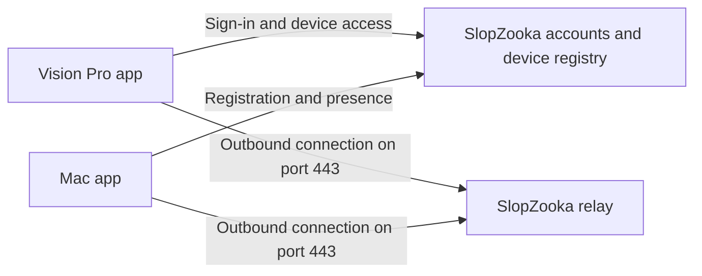

# Remote access through an owned SlopZooka gateway

## Status and product decision

Research and proposed implementation plan, November 1, 2026. Remote access is not
implemented or validated on physical devices yet.

The consumer experience is: install the Mac app and Vision Pro app, sign in to
SlopZooka on both, select your Mac, and work from another network. The Mac remains
powered, logged into macOS, online, and running the companion. The devices need
internet access, not the same Wi-Fi network or physical proximity.

The product will run its own relay/gateway service. Customers must not need
Tailscale, another VPN app, a tunnel-provider account, manual host addresses,
router configuration, or port forwarding. Managed tunnel products are not the
chosen architecture. Hosting and operating our service is our responsibility.

Start with relayed remote connections. Direct peer-to-peer connections can be a
later optimization; they must not be necessary for successful onboarding or
remote access. This scope covers SlopZooka terminals, workspace controls, and
frontend previews. Streaming and controlling the entire macOS desktop is separate.

## Consumer flow

1. Install the Mac app, sign in, and enable remote availability. Register this Mac
   to the account using a device identity and show its availability status.
2. Install the Vision Pro app and sign in to the same account. Show the registered
   Macs and their current availability. Any initial device approval belongs in
   our apps; it must not require network setup or repeated physical access.
3. Select an available Mac. Existing terminal and frontend actions work through
   the remote connection, and subsequent launches reconnect automatically.

Offer Start at Login and a clearly explained option to keep the Mac available
while connected to power. Preventing idle system sleep should not require keeping
the display lit. Do not promise access after shutdown, deliberate sleep, or lid
closure without validating those cases. Restart recovery before the macOS user
logs in is outside the initial scope.

## Architecture



Both apps initiate outbound connections. The relay joins authorized connections
for a registered Mac and headset. No public listener or inbound router rule is
required on either customer's network. Captive portals and networks that block
our connection protocol can still prevent access; port 443 alone does not prove
universal network compatibility.

Separate these responsibilities in the design, while allowing one initial
deployment:

- **Accounts and device registry:** authenticate users, record device ownership
  and public identities, authorize enrollment, and revoke access.
- **Connection broker:** track Mac presence using expiring leases and authorize
  connection attempts. Distinguish a registered Mac from one that is reachable.
- **Relay:** forward authorized streams, enforce resource limits, and release
  abandoned connections. It does not own terminal execution or window state.

An initial TypeScript service is a reasonable fit with the existing companion
and WebSocket dependencies, but the transport, encryption library, account
implementation, and deployment stack remain implementation decisions. Do not
turn a research candidate into a protocol commitment without the prototype.

## Transport and browser compatibility

The transport must carry all three existing traffic classes:

- Native control API requests, including workspace actions and window layouts.
- Terminal documents, assets, and bidirectional terminal WebSockets.
- Frontend preview HTTP/HTTPS, cookies, redirects, streaming responses, and
  WebSockets, including development hot reload.

The companion currently serves its control API over HTTP and creates separate
preview listeners on dynamically assigned ports. `WindowGateway.resolvePreview`
constructs preview URLs using the selected Mac host and returned port. Forwarding
only port 7777 or replacing the API base URL does not provide complete remote
support. Existing control-origin, cookie, certificate, and authentication rules
also need an explicit remote design.

Investigate an app-internal proxy adapter that routes native requests and WebView
connections through the private tunnel. Apple exposes proxy configuration for
`URLSessionConfiguration` and `WKWebsiteDataStore`, with HTTP CONNECT and SOCKSv5
support in Network framework. Apple's WebView property documentation lists
visionOS availability from version 1.0. This is a promising supported API path,
not evidence that our complete preview workflow already works.

The adapter should preserve separate browser origins for separate preview
surfaces. Validate Secure and HttpOnly cookies, HTTPS trust, redirects, origin
checks, WebSockets, and cross-service requests. Specify which destinations use
the tunnel and which external navigation goes directly to the internet. A failed
tunnel must not silently send private destinations to an unrelated local network.
Using a custom URL scheme is not a substitute for HTTP/HTTPS proxying: WebKit
does not permit a scheme handler to replace its built-in HTTPS handling.

The relay protocol should address authorized services on the selected Mac, not
offer an unrestricted proxy to arbitrary hosts or ports. Decide how streams are
opened, bounded, cancelled, and closed. Large preview responses must not exhaust
memory or starve terminal input. Reconnects need new connection identities so late
messages from an old connection cannot affect its replacement.

## Identity, authorization, and encryption

Account sign-in establishes ownership; it is not sufficient by itself to define
device trust or authorize every stream. Use individual device credentials,
short-lived connection grants, and revocation. Bind authorization to the account,
Mac, headset, and permitted operation. The existing client ID partitions layouts;
it must not become an authentication credential.

Target end-to-end encryption between the Mac and headset so the relay forwards
ciphertext rather than terminal content or preview cookies. TLS from each device
to a relay that decrypts both connections is transport encryption, not this
guarantee. Use an established protocol and maintained implementation rather than
designing cryptography. Resolve the encryption integration during the prototype.

Define authenticated device-key enrollment, verification, rotation, replacement,
and revocation. Explicitly document whether the identity service is trusted to
introduce new device keys; encryption alone does not prevent key substitution by
a compromised enrollment service. Store private credentials in platform-protected
storage and do not place reusable secrets in URLs or logs.

The Mac must enforce access at its service boundary as well as at the relay.
Do not publicly publish the current LAN HTTP port or its diagnostic health
response. Audit the information needed for remote discovery instead of exposing
local paths and diagnostics as account metadata.

## Preserve existing ownership

- `WindowGateway.swift` remains the sole gateway for terminal/preview opening,
  closing, resolution, reload, session launch/end, and recovery. A remote
  connection supplies transport and endpoint resolution; views do not acquire
  another window registry or construct tunnel URLs.
- `WindowScene.swift` retains native `openWindow` / `dismissWindow` calls and
  adapts scene observations and permanent discard events.
- `apps/mac-companion/src/window-layout.ts` remains the durable layout owner,
  partitioned by the existing client ID. `WindowPersistence.swift` retains its
  pending-intent outbox and conflict rebasing. The cloud does not become a second
  layout store.
- Persist stable host and content identifiers. Resolve connection addresses,
  tokens, proxy routes, and trust material when needed; never put them in window
  records. Keep TypeScript and Swift schemas compatible and preserve scene IDs.
- `SessionManager` in the Mac's separate session service continues to own PTYs.
  Disconnects, Wi-Fi changes, relay or HTTP companion restarts, and window
  restoration must not end sessions or create replacement processes. Sessions
  cannot survive a session-service or Mac restart.

Current Keychain credentials are indexed by URL origin. Plan how remote
credentials bind to a stable device identity rather than assuming a LAN address
and a relay address are interchangeable. Preserve the existing local connection
path without making Bonjour necessary for remote discovery or recovery.

## Prototype and implementation sequence

1. **Prove transport and previews.** Run a gateway we own, connect the Mac and a
   physical Vision Pro from separate networks, and exercise a terminal plus
   HTTP and HTTPS previews. Validate the app-internal proxy and established
   encryption implementation before choosing the final transport contract.
   Temporary prototype credentials must not be presented as production onboarding.
2. **Add accounts and device trust.** Implement registration, device approval,
   discovery, short-lived connection authorization, sign-out, and revocation.
   Persist stable identity and provide understandable connection states.
3. **Integrate recovery.** Route existing API, terminal, and preview resolution
   through the connection abstraction. Preserve gateway, session, and persistence
   ownership, including recovery when the launcher is closed.
4. **Prepare service operation.** Add deployment automation, certificate and
   secret rotation, connection draining, resource limits, metadata-only
   observability, and a rollback procedure. Measure connection success, latency,
   reconnect time, concurrent streams, and relayed bytes before choosing capacity
   targets or a pricing model. Test multiple relay instances and broker/relay
   routing before claiming high availability.

The prototype succeeds only when a user can operate existing terminals and
previews across networks, recover from interruption, and do so without manually
configuring either network.

## Verification

For implementation changes, run the checks required by `AGENTS.md` and README:

```sh
pnpm test:vision-state
pnpm typecheck
pnpm test
pnpm format:check
pnpm build:harness
xcodebuild -project apps/vision-client/SlopZooka/SlopZooka.xcodeproj \
  -scheme SlopZooka -sdk xrsimulator -configuration Debug \
  -derivedDataPath /tmp/slz-derived CODE_SIGNING_ALLOWED=NO build
```

Add meaningful integration and state coverage for:

- Wrong-account, wrong-device, expired-grant, and revoked-device access; stale
  presence; unauthorized service targets; and stream/connection resource limits.
- Late replies after reconnect or Mac selection changes; lost acknowledgements;
  retries without duplicate session creation; terminal replay and input ordering.
- Explicit close versus disconnect, pending-layout conflict recovery, restoration
  without the launcher, and unchanged session/window identities after reconnect.
- Concurrent terminals and previews, slow consumers, interrupted streams,
  cookies and origin isolation, HTTPS trust, WebSockets, and hot reload.
- Relay restart and deployment draining while Mac processes remain alive.

Physical-device validation must include different home/hotspot networks, a network
behind carrier-grade NAT, blocked UDP, available restrictive Wi-Fi environments,
headset sleep/wake, network transitions, Mac idle sleep, and device revocation.
Simulator compilation does not establish browser proxy compatibility, real-world
network reachability, physical window placement, or system-close/room-lock behavior.

For consumer distribution, clarify App Review classification early. Apple's
guideline 4.2.7 includes LAN restrictions for certain apps that mirror specific
software; whether it applies to SlopZooka's terminal/browser client needs review,
not an assumption that remote access is either approved or prohibited.

## References

Research consulted November 1, 2026:

- [WebView proxy configuration](https://developer.apple.com/documentation/webkit/wkwebsitedatastore/proxyconfigurations-6g21z)
- [URLSession proxy configuration](https://developer.apple.com/documentation/foundation/urlsessionconfiguration/proxyconfigurations)
- [Network framework proxy types](https://developer.apple.com/documentation/network/proxyconfiguration)
- [WebKit URL scheme handler limits](https://developer.apple.com/documentation/webkit/wkwebviewconfiguration/seturlschemehandler(_:forurlscheme:))
- [Preventing idle system sleep](https://developer.apple.com/documentation/foundation/processinfo/activityoptions)
- [TLS 1.3 specification](https://www.rfc-editor.org/rfc/rfc8446.html)
- [WebRTC data channels, a possible later direct transport](https://www.rfc-editor.org/rfc/rfc8831.html)
- [App Review guidelines](https://developer.apple.com/app-store/review/guidelines/#remote-desktop-clients)
