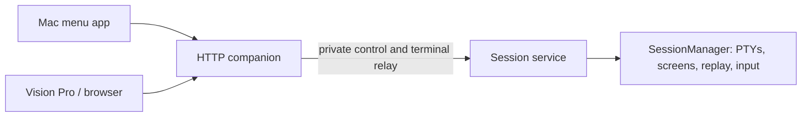

# Restart-safe development of SlopZooka inside SlopZooka

Status: implemented and ready for manual testing. All 39 tests and required local checks pass, including the signed packaged-app test and visionOS simulator build. Not installed over the live application.

## Goal and recommendation

Keep a shell or coding agent running while updating the Mac menu application or
restarting the HTTP companion. Continue supporting terminal-content reloads and
Vision Pro rebuilds through the existing window gateway.

The user's deciding constraint is a net improvement in ownership and maintainability,
with minimal new machinery. Session survival is useful, but does not by itself prove
that a new process boundary is a cleanup.

Second-pass recommendation: consider a narrow session-service extraction only if
surviving **HTTP companion restarts** is required. Move the existing terminal engine
as a unit, reuse its stream protocol, and keep the companion as a client. Do not
start a general daemon/RPC framework or split terminal state across processes.

This will add code. `SessionManager` is already a coherent domain boundary; moving
it to another process does not inherently simplify its implementation. The
potential cleanup is one clear lifetime owner and the removal of terminal
ownership from UI/server shutdown. Earlier conversational
assurances about a "small interface" understated startup, packaging, and upgrade
costs. Those are explicit gates below, not details to postpone until implementation.

## Evidence from the current implementation

- `apps/mac-companion/src/sessions.ts` is approximately 355 lines. It already owns
  PTYs, headless xterm, screen serialization, replay cursors, acknowledgements,
  writer arbitration, command deduplication, and descendant termination together.
  Its viewer identity is a `WebSocket`, not a transport-independent session handle.
- `server.ts` constructs `SessionManager`, calls it from session HTTP routes, and
  dispatches the existing terminal WebSocket protocol to it. Shutdown calls
  `sessionManager.stop()`. Session metadata and screen state are in memory.
- `CompanionModel.swift` launches the bundled HTTP companion as an owned child.
  The private pipe closes the child on UI exit/crash; bounded restart attempts
  replace the HTTP process, not its lost terminal sessions.
- The packaged app contains its own Node runtime, host bundle, and `node-pty`
  dependencies. `node-pty` retains a filesystem path to its spawn helper. Merely
  leaving an old Node process alive while replacing its app bundle is insufficient
  to guarantee it can continue creating terminals after an update.
- `dev:web` rebuilds browser assets without restarting PTYs; viewers reload
  explicitly. `dev:watch` restarts the backend and ends its sessions. The installed
  app serves bundled assets rather than the working checkout.
- `WindowGateway` and `WindowPersistence` already own scene recovery and desired
  layouts. Recovery must not create a replacement shell for a missing session.
- Preview gateway ports/tokens are ephemeral. An existing VP process can retain a
  stale preview payload until an explicit reload; this can be fixed independently.

## Alternatives and the decision they require

| Option | Benefit | Cost / limitation | Recommendation |
| --- | --- | --- | --- |
| Keep a stable installed host and run an isolated development instance | Almost no new runtime machinery; safe place to build/test changes | Restarting the host of the actual working terminal still ends that terminal | Baseline if code simplicity takes precedence over backend restart survival |
| Detach the entire existing companion from the menu UI | Menu UI updates can preserve sessions; no terminal stream relay | Backend updates still end sessions; native control, singleton startup, and runtime retention are still needed | Choose only if UI restart survival is enough; avoid implementing as a disposable intermediate design |
| Extract the existing terminal engine into one session service | UI and HTTP companion updates can preserve the same processes and screens | Local control protocol, bounded stream relay, startup coordination, runtime retention, and compatibility | Conditional recommendation for the full requirement |

An external terminal multiplexer is another product direction, but changes the
terminal model and introduces a dependency. Do not silently add one as an
implementation detail of this extraction.

## Proposed ownership, if the extraction is selected

- **Session service:** the single `SessionManager`, process tree cleanup, session
  identities, screen/checkpoint state, output flow control, writer ownership, and
  input-command deduplication. No workspace database, pairing store, or window list.
- **HTTP companion:** public authentication and origin checks, HTTP/WebSocket
  admission, workspace/GitHub operations, discovery, preview gateways, durable
  window layouts, and the private connection to the session service.
- **Mac menu app:** existing HTTP companion supervision and UI. Service lifecycle
  requests go through the companion. No second service client implemented in Swift.
- **Vision Pro:** existing `WindowGateway` / `WindowPersistence` / `WindowScene`
  boundaries. No direct session-service connection or new restoration owner.

The HTTP companion is the sole connect-or-start caller. Startup connects first,
then starts a service only when absence is established. Reopening the menu starts
the HTTP companion, which attaches to the existing service. Existing terminal
discovery always queries that service; no mirrored persistent session catalog.

## Keep the new boundary narrow

### Terminal streams

Prefer one private WebSocket per public viewer over a Unix-domain socket, reusing
the existing terminal message types and `SessionManager` attachment behavior.
The companion authenticates the viewer, then relays frames. The service remains
responsible for acknowledgements, checkpoints, writer arbitration, and ordering.

This avoids inventing viewer IDs, multiplexing every viewer through one connection,
or acknowledging output in the relay. An internal handshake may be consumed by the
companion while the public hello retains the pairing store's existing host identity.

The relay must have bounded queues in both directions. If it cannot forward, close
the viewer and let the existing cursor/checkpoint reconnect path recover. Do not
add another replay buffer, resend keyboard input, or promise exactly-once input.
Gateway failure must close its private streams so writer ownership can transfer.

If preserving these properties requires a second terminal state machine or a broad
transport abstraction inside `SessionManager`, reject this implementation approach
and revisit the design before expanding it.

### Control operations

Use a small typed set: inspect/list, create, end/remove, paste, and stop service.
Add bounded request correlation/timeouts where needed; do not introduce generic
RPC, arbitrary method invocation, event buses, or plugin transports.

- The companion resolves workspace/cwd and current launch configuration. The
  service performs the actual spawn. Avoid stale daemon-startup PATH/agent-command
  settings for newly created terminals, and avoid duplicating profile resolution.
- Creation uses the existing caller-supplied session ID. A lost reply is resolved
  by querying/retrying that ID against the same service, never generating another.
- Paste retains its existing command ID and bounded deduplication in the service.
- End requests must have a defined idempotent result after an interrupted reply.
- On connection loss, pending operations fail with an uncertain outcome where
  appropriate. Do not blindly retry every mutation.
- Empty session list and unavailable service are different states. An outage must
  not make window recovery conclude that all sessions have permanently disappeared.

## Unavoidable decisions before implementation

### D1. Which restart must preserve work?

The target from the discussion is survival across both menu and HTTP companion
restarts. The session-service option addresses that target, conditional on the
maintainability gates. If review narrows the target to menu-only survival, choose
detaching the whole host. Do not pay for a terminal relay solely for UI updates.

### D2. Startup, singleton ownership, and local access

Selected: one app-started detached service under macOS `/usr/bin/lockf -ks -t 0`.
The kernel holds the lifetime lock; there is no PID registry or second supervisor.
Only its command may remove an abandoned socket, after checking for a live listener.
Private socket directories use a short canonical-home hash and user ID.

One service per user and canonical `SLOPZOOKA_HOME`, independent of the
companion's public port. Production and development use separate homes.

Prefer an app-started detached process with private local sockets if it can be
made race-safe with one centralized startup mechanism. The socket is not a LAN
endpoint. Directory/socket ownership and permissions must restrict access to the
user; account for macOS Unix-socket path-length limits.

A failed connection alone is not permission to unlink a socket or kill its PID.
Simultaneous launchers, slow startup, abandoned socket files, and service exit
during connection must be handled together. No scattered lock/PID/port registries.
Do not kill an unrelated process to recover a name or endpoint.

If this becomes a custom service manager, compare using macOS service supervision
before proceeding. `launchd` can own process/singleton lifecycle, but adds install,
login-item, signing, and test implications. Do not combine both supervision schemes.
No new dependency or OS service registration is selected by this plan.

### D3. Executable/runtime lifetime across app replacement

Selected: a self-contained CJS service bundle plus Node and `node-pty`, fingerprinted
and atomically installed under `SLOPZOOKA_HOME/session-runtimes/<content-id>`.
The build helper is shared by source and packaged starts. Only a service holding
the lifetime lock prunes inactive runtime directories, never the companion updater.

The running service must retain usable Node, JavaScript,
native modules, and spawn-helper files after `/Applications/SlopZooka.app` changes.

Likely approach: atomically stage a versioned service runtime into a user-owned
Application Support directory before launch. Reuse an already installed matching
runtime; retain the active runtime until its service exits. The bundle remains the
distribution source. Preserve signing/permissions and verify spawning a *new*
terminal after replacing the app, not just continued output from an existing PTY.

This must stay a small packaging responsibility, with no general installer,
updater, or migration framework. If runtime retention requires that scope, stop
and reassess the benefit. Development must also have an explicit runtime identity;
an old service must not unknowingly load changed helper code from the checkout.

### D4. Compatibility and service identity

Selected: one local protocol version, with no compatibility adapters. Mismatch is
reported as unavailable, leaving both the old service and management UI available.
Explicit stop is a stable local management operation and requires UI confirmation.

A newer companion can encounter an older still-running service.
Handshake returns protocol version, service instance ID, and build/runtime identity.
Instance identity distinguishes a genuine reconnect from loss of the session owner.

For the first version, require explicit compatibility and refuse an unsupported
service with actionable guidance. Never automatically restart an incompatible
service with active terminals. Do not promise arbitrary rolling-version support
or implement multiple service protocols without a demonstrated need.

Service restart/crash still ends its sessions. Do not restore PIDs as if they were
reattachable PTYs, silently relaunch agents, or reuse stale screen cursors across
service instances. Mac reboot survival is outside scope.

### D5. Quit, restart, and updates

Selected: implement the behavior below. Quit only disconnects the menu and HTTP
companion; explicit session-service restart/stop always confirms termination.

Behavior:

| Action | HTTP companion | Session service / terminals |
| --- | --- | --- |
| Close menu / disconnect VP | Unchanged | Continue |
| Quit or restart Mac menu app | Stops/restarts its owned companion | Continue |
| HTTP companion crash/watch restart | Restarts or awaits explicit retry | Continue |
| End one terminal | Continues | Ends only that session and its descendants |
| Restart session service | Reconnects afterward | Explicitly ends sessions before restart |
| Shut down all SlopZooka processes | Stops | Ends sessions, then exits |

Retain confirmation before active sessions are ended. An idle service may remain
available until explicitly shut down; avoid introducing idle timeout policy in v1.
Document that background terminals continue after quitting the menu application.

An updater started inside a service-owned terminal cannot safely stop that same
service and then execute its own next step. Service restart must be completed by
the companion's control path; UI/HTTP restart survival does not remove this limit.
Do not expose a restart feature whose only coordinator is the process being killed.

## Independent improvements; do not bundle them into the service extraction

1. Add backend instance identity and refresh preview payloads through
   `WindowGateway` after a restart. Keep stable content IDs; resolve fresh gateway
   ports, tokens, and trust. A transient service outage must not erase window intent.
2. Improve the existing `dev:web` + Reload Content workflow. First make the active
   runtime/source location evident; automatic browser reload can be considered
   separately. A repository watcher cannot change the installed app's bundled code.
3. Keep VP native build recovery on the existing persistence path. Native Swift
   changes still require a build; WebView cookies/history and physical placement
   are separate limitations. No live Swift injection or additional scene registry.

## Maintainability gates and implementation sequence

1. **Choose D1–D5 in this document.** Resolve startup and packaging costs before
   writing a process boundary. A diagram alone is not an implementation approval.
2. **Prove the narrow boundary in isolation.** Reuse the actual `SessionManager`
   and message types with real PTYs. Demonstrate bounded relay, disconnect, lost
   create reply, and writer transfer. Review the complete code footprint, including
   startup/runtime retention/tests, before integrating it into the shipped app.
3. **Make the ownership change once.** Remove in-process `SessionManager`
   construction and terminal shutdown from the companion; do not retain an
   embedded fallback engine or two production paths. Keep the existing private
   menu/HTTP companion supervision, with one terminal-service connection owner.
4. **Add lifecycle UI and packaging.** Apply the chosen quit/update behavior,
   safe runtime retention, compatibility messages, and isolated development setup.
5. **Handle preview restart recovery separately.** Add one gateway invalidation
   rule and focused coverage, without changing the window schema unnecessarily.

Accept only if the final patch has:

- One PTY/screen owner; one input deduplication mechanism; one replay/flow-control
  implementation; one canonical list of sessions.
- One startup path and one runtime installation path. No Swift/TypeScript copies
  of service control logic, parallel persistence, or competing supervisors.
- An explicit inventory of added/deleted modules and dependencies. Review necessary
  runtime code separately from regression tests. No arbitrary LOC target, but a
  substantial framework is grounds to choose the simpler alternative.
- Existing session correctness tests still exercising the same terminal engine;
  process-boundary tests demonstrate the new guarantee rather than mocking it.

## Verification required for an eventual implementation

The defining test: create a shell/agent, record session ID and PTY PID, produce
output while disconnected, restart/replace the menu and HTTP companion, reconnect,
and verify the same session/PID, screen, and continued input without another spawn.

Also cover concurrent connect-or-start, slow/stalled startup, stale endpoint
recovery, lost create/paste/end replies, service unavailability versus empty state,
multi-viewer writer transfer, slow readers/output floods, incompatible versions,
explicit service shutdown and descendant cleanup, and fresh terminal creation
after replacing the app's runtime files. A service crash should report loss
honestly, preserve window intent, and never auto-create replacement agents.

Update `test:mac-app` to prove menu/HTTP crash survival and explicit service teardown
instead of its current assumption that a parent crash ends all work. Every test
uses a temporary home, isolated endpoints/runtime directory, and guaranteed cleanup.

Run all checks in AGENTS.md / README: `pnpm test:vision-state`, `pnpm typecheck`,
`pnpm test`, `pnpm format:check`, `pnpm build:harness`, visionOS simulator build,
plus the Mac bundle build and packaged-app tests. Validate reconnect and native
reinstallation on Vision Pro separately; simulator compilation does not establish
placement, room-lock, signing/privacy-permission, or real-device recovery behavior.

## Scope limits

No surviving a session-service crash or Mac reboot; no archival terminal history;
no job scheduler, generic RPC/event framework, service plugin system, automatic
agent relaunch, durable per-keystroke queue, or replacement window persistence.
Any dependency on one of these is a reason to revisit the design, not expand v1.

## Implementation inventory and testing boundary

Added three TypeScript modules (service entry point, client, and a small typed
contract) and one runtime build helper. No npm dependencies, launchd registration,
Swift service client, persistent session database, transport framework, or second
terminal engine. HTTP request/response provides control correlation; existing
terminal WebSockets provide viewer identity and stream ordering.

The existing `SessionManager` remains intact apart from taking the current launch
environment and checking cwd when a launch ID is reused. Its old HTTP dispatch
moved into the service. The HTTP companion now queries/relays rather than owning
PTYs; its last service snapshot is display-only, never a fallback catalog.

New process-boundary tests cover the same shell PID and screen after a gateway
replacement, concurrent singleton startup, fresh launch environment, writer
transfer, deduplicated create/paste, oversized checkpoints, incompatible/hung
endpoints, and crash/stale-socket recovery. Packaged tests use a separate app build,
temporary home and ports, verify new PTYs after removing the original app runtime,
and explicitly stop only their own service.

The installed app and user sessions must remain untouched until the user's other
tests are finished. Manual testing will require a deliberate first installation:
the old pre-service app still ends its own sessions when quit. After migration,
menu/HTTP restarts preserve service-owned sessions. Session-engine changes and
session-service crashes still end them.

## Manual test handoff

Build: `build/session-service-review/SlopZooka.app`. The simulator build is staged
under `/tmp/slz-session-service-derived`; neither build was installed on the user's
Mac application path or Vision Pro.

After the user's other tests finish:

1. Deliberately stop the old application and install the staged Mac build. This
   first migration ends terminals owned by the old in-process host. Install the
   updated VP app over its existing installation, keeping its data/client ID.
2. Open a shell and agent; record `echo $$` and produce output. Use **Restart
   Companion**, then **Quit** and reopen. Verify the same shell PID, screen, input,
   and agent continue, with no duplicate terminal or agent process.
3. Keep a preview open through a companion restart. Verify it resolves the new
   gateway without closing/recreating its native scene. Rebuild the VP app over
   the existing install and check scene recovery, placement, pairing, and expected
   loss of WebView-only navigation/cookies separately.
4. Use **Restart Session Service** and **End All Sessions and Stop Service** only
   when prepared to end the test sessions. Verify confirmation, descendant cleanup,
   honest unavailable states, and successful creation of a new session afterward.
5. Confirm protected-folder access and physical Vision Pro close/room-lock behavior
   on the actual devices; compilation and isolated temporary-home tests do not
   establish those guarantees.
