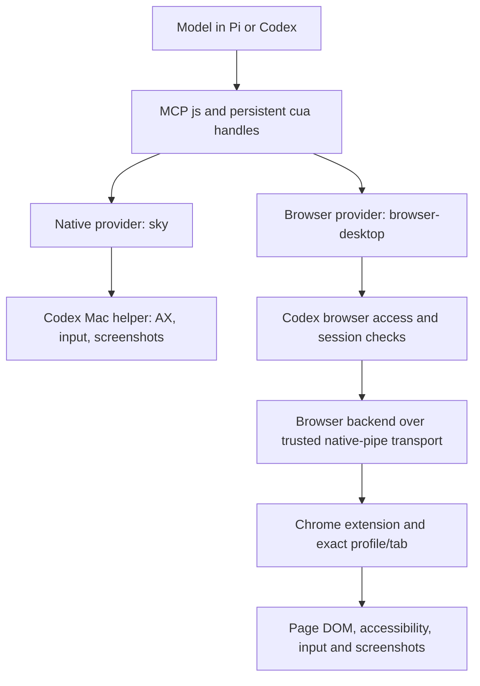

# Codex preference, browser internals and model guidance

November 8, 2026. Follow-up to the [working native-runtime experiment](2026-11-08-codex-runtime-reuse.md) and [open-source comparison](2026-11-08-macos-cua-options.md). [Source fingerprints and probe evidence](evidence/2026-11-08-codex-browser-guidance/research.json) distinguish installed documentation, source inspection and execution.

**November 9 follow-up and correction:** [deeper browser research](2026-11-09-browser-runtime-options.md) traced desktop access-host provisioning and exercised three OSS providers. A subsequent live test also controlled a webpage and iframe through `cua.getApp("com.google.Chrome")`, the native Mac route. Independent reuse of the specialized `browser-desktop` provider remains unresolved; that limitation does not prevent native Chrome control and should not block the first web demo.

## 1. Current preference and the decision to revisit

**Prefer reusing Codex's installed computer-use runtime.** This is the user's current direction: benefit from its existing interaction machinery and guidance, rather than owning an alternative implementation immediately. The successful independent native-app experiment makes this a concrete option. Keep the open-source research as comparison material and a fallback.

Before making it a shipping dependency, spend time with the user reviewing the actual interfaces and operational tradeoffs. That review should use a short working demonstration and the table below, rather than choosing on feature lists alone. This is a future implementation decision, not a request to pause research now.

| Option | What our model/companion calls | What we would own | Current evidence |
| --- | --- | --- | --- |
| **Installed Codex runtime — preferred** | MCP stdio; persistent `js` calls against `cua` app/tab handles; runtime-provided text/image observations and guidance; host approval callbacks | Small host adapter, target association, cancellation, installation/version compatibility, and integration with the runtime's authorization/lifecycle | Independent native fixture observation and input worked. Independent browser discovery failed its turn-access check. No supported embedding/distribution contract established. |
| **Peekaboo — comparison/fallback** | CLI/MCP for an experiment, or public Swift automation libraries for closer embedding; explicit window/snapshot references | Our permission host and library integration, driver updates, platform behavior and qualification | Pinned source review only; no local comparison run. MIT; some background input uses private macOS functions. |
| **Cua Driver — comparison/fallback** | MCP, typed SDKs or versioned C ABI with an embedded worker | Worker/permission-host integration, driver updates and qualification | Pinned source review only. Driver is MIT; broader Cua streaming components have different terms. |

The [existing comparison](2026-11-08-macos-cua-options.md) contains pinned sources and details. These are different integration contracts, not measured reliability rankings. A code-execution interface can batch operations and preserve handles, while typed operations are easier to validate individually. Neither interface alone guarantees correct window targeting or cancellation. Do not assume wrapping `js` behind a `surfaceId` automatically constrains what the submitted code can access.

The later review should resolve five concrete questions:

1. Can our companion start and recover the installed runtime when Codex is closed, after updates, and on a fresh machine?
2. Can it obtain legitimate browser authorization and lifecycle context, or must browser work remain hosted by an actual Codex session?
3. Does it retain the exact target across two Chrome windows, multiple simulators, modal dialogs and human takeover?
4. Can global and terminal agents share the provider without sharing mutable REPL handles or fighting over focus and clipboard state?
5. Are the installation, support and distribution terms acceptable for the intended release?

Keep one small provider integration first. This preference does not justify a new durable coordinator, a universal driver framework, or three production backends. Existing workspace/session services and `WindowGateway` remain the resource owners. Continuous media remains the tested ScreenCaptureKit → hardware video → Vision presentation path.

## 2. Chrome has a distinct browser backend

**Yes: Codex has browser-specific machinery behind its unified computer-use interface.** Selecting Chrome as a browser uses a different provider from selecting a native Mac app. The installed `@oai/browser-desktop` package is version `0.1.1`; its client and service exports are separate from `@oai/sky`, the native Mac provider.



This is a source-derived component map, not a completed external browser integration. The browser service exposes backend requests such as `executeCdp`, `attach`, `detach` and `turnEnded`, carried with session/turn identity. Its client dispatches through the trusted NodeREPL `browser` RPC service. The public extension guide independently documents installation into the selected browser/profile, debugger and native-messaging permissions, and per-site access controls. [OpenAI browser extension documentation](https://learn.chatgpt.com/docs/chrome-extension).

### The additional interface

The packaged API manifest and guidance describe these browser-specific capabilities. Availability depends on the connected backend, feature flags and permissions; the manifest is not proof every method is enabled in a particular session.

| Capability | Example interface / relevance |
| --- | --- |
| Exact browser/profile/tab discovery | `cua.listBrowsers()`, `cua.listTabs()`, `cua.getTab(...)`; browser records include family/profile and extension-instance identity. |
| Page accessibility | `tab.getAXState()` and browser `tab.ax` operations where enabled. The service obtains browser accessibility data through CDP, including `Accessibility.getFullAXTree`; this is not simply the macOS AX tree of Chrome's window. |
| Semantic web interaction | `tab.playwright.getByRole(...)`, `getByLabel(...)`, `getByTestId(...)`, locator `click`, `fill`, `press`, selection and checks; DOM snapshots and frame-scoped locators. This is a supported subset/facade, not an unrestricted Playwright installation. |
| Visual interaction | Tab screenshots, viewport-coordinate input and DOM-node actions. The browser implementation includes CDP input dispatch such as `Input.dispatchMouseEvent`. |
| Navigation and development | `goto`, `reload`, back/forward, dialogs, console logs; optional CDP events/commands scoped by the runtime's access rules. Page `evaluate` is documented as read-only. |
| Browser organization | Optional `management` capability: inspect/create/resize browser windows, move/group/pin tabs and inspect a model-change audit trail. This is separate from controlling web content. |
| Handoff and lifecycle | Exact tab claiming, `markDeliverable`, `markHandoff`, interruption notifications and turn cleanup. Details vary by browser backend. |

The unified entry points return their documentation and initial state. For a new Chrome task, the installed interface supports the shape:

```javascript
let tab = await cua.createBrowserTab("chrome", knownWorkspaceURL, {
  sessionName: "🛠 Poncho admin",
});
// Read the returned guidance and state before choosing actions.
// If the observed page has this button and the backend advertises Playwright:
await tab.playwright.getByRole("button", { name: "Settings", exact: true }).click();
await tab.getAXState();
```

This is an interface illustration, **not a browser action executed in our independent experiment**. Actual selectors must come from the current page. Browser-specific APIs are discovered from the returned documentation and capabilities, not guessed from standard Playwright or Chrome APIs.

For short interactions the installed guidance favors current accessibility indices. For repetitive tasks or a known app under development, it suggests locator-based batches when that reduces repeated observations. Native apps retain their own app-scoped AX and image interaction path. The model can select the right available representation without us writing an app-specific navigation recipe.

### Window organization is useful, but does not solve streaming identity

The optional browser management capability documents `windows.getAll`, `windows.create` and `windows.update`, plus tab/window association. It can create a blank normal window or move a known tab into one, then focus/resize it. Restrictions include no incognito window manipulation and no arbitrary navigation through the management interface. This maps well to “put admin and frontend in separate windows.”

A Chrome `windowId` is a browser identifier; it is **not established to be the same identifier as a ScreenCaptureKit/CGWindow target**. We still need to associate the exact controlled tab and its native host window with our streamed surface, then verify that association. Changing a tab, moving it between windows, resizing, or restoring after restart must not silently stream a different page.

Likewise, `markHandoff` is runtime tab lifecycle behavior, not our durable workspace layout. The intended workspace previews should survive an orchestrator turn through an explicit supported lifecycle policy, while `WindowGateway` retains Vision presentation ownership. No browser capability directly opens a SlopZooka Vision scene.

## 3. How opaque is it?

It is a mixture, not one opaque native binary:

- `@oai/browser-desktop/scripts/browser-client.mjs` and `browser-service.mjs` are readable bundled JavaScript, approximately 170 KB and 2.11 MB. We inspected their RPC boundary, browser access check, session transport, page AX/input routes and capability/doc manifests.
- `browser-accessibility.wasm.br` is a compiled browser accessibility component. Its wrapper exposes revision creation, text and element identity functions. Its internals were not reconstructed in this investigation.
- The signed NodeREPL/native bridge, desktop access host, browser extension and native Mac helper are additional components. Reading the JavaScript interface does not establish their full behavior or an embedding contract.
- Browser methods are not supplied merely by the public Codex CLI source. The installed desktop runtime/plugins and the user's browser extension/profile supply additional machinery.

The interesting reusable design is the combination of semantic page state, visual fallback, exact profile/tab handles, conditional guidance and host-managed lifecycle. It is richer than a screenshot/click loop. It also carries host dependencies that a generic MCP client does not automatically satisfy.

## 4. The standalone browser probe and its boundary

We repeated the already-successful MCP startup using the unchanged installed launcher, access preloader, explicit environment and trusted services. We narrowed enabled surfaces to `browser` and changed the first action to `await cua.listBrowsers();`. No inherited task variables or supplied turn metadata were added. No fixture-control mode was enabled.

Observed results:

- MCP initialization succeeded (`2025-06-18`); the normal four tools were advertised.
- The first browser discovery returned `isError: true`: **“Cannot verify browser access without the current turn.”** Bootstrap guidance was also emitted.
- No browser inventory or page observation was returned. No tab was opened, claimed or controlled. The owned MCP process exited normally.

[Redacted trace](evidence/2026-11-08-codex-browser-guidance/browser-discovery.jsonl). The frozen native probe's source hash and the three modifications used for this read-only experiment are recorded in the [evidence manifest](evidence/2026-11-08-codex-browser-guidance/research.json).

Source inspection explains the observed boundary: the installed access preloader enables the browser access check; that check requires current session/turn context and verifies a signed response from the browser access host. Backend requests separately require session and turn identifiers, and register turn-ended cleanup. Consequently, adding arbitrary strings for those identifiers is not evidence of a valid integration. We did not remove the check, change its mode, manufacture metadata or borrow another task's context.

**Conclusion:** native reuse is demonstrated; external browser reuse remains unresolved and has a concrete authorization/lifecycle dependency. This does not prove browser reuse is impossible. The next investigation is whether a legitimate host/session integration exists, or whether a real Codex-hosted browser session needs to execute browser work for the coordinator. That latter route would have different task delegation and latency semantics from calling a model-free local MCP provider.

Do not claim browser lock-state independence, background reliability, cross-profile correctness or streaming association from this failed discovery call. Those require actual execution once the integration boundary is satisfied.

## 5. Guidance pulled locally, and how Pi should consume it

Ran the new [guidance collector](../experiments/codex-runtime-probe/collect-guidance.py). It copied **52 packaged guidance/reference files, 198,515 bytes**, from the inspected installation into:

```text
experiments/codex-runtime-probe/build/guidance/26.1023.51421/
```

The directory is ignored. It contains the installed Mac instructions, CUA API/behavior docs, browser API manifest, browser document manifest, per-capability docs and native reference. We also saved the actual browser-only MCP tool catalog and emitted bootstrap locally. No separate `SKILL.md` was found in the inspected unified/browser plugin roots: this version primarily supplies guidance through tool descriptions and runtime documentation. The launcher README explicitly describes suppressing legacy provider skills when the unified provider handles them.

The collector checks the installed app version and that its destination is ignored. It copies documentation, not a distributable runtime. The committed evidence contains paths, byte counts and hashes rather than the vendor's full text. Re-run it after deliberately reviewing a new app version; do not silently mix old prompts with new binaries.

| Guidance layer | Local source relative to the installed `@oai` directory | Host/model behavior |
| --- | --- | --- |
| MCP startup and tool use | `cua-repl/README.md`, `cua-repl/instructions/`, live `tools/list` | Use the installed launch configuration and actual tool schemas/descriptions; preserve initialized persistent REPL semantics. |
| Native and unified CUA | `cua/docs/tinysky-alt-core-cua-repl-mac.md`, `tinysky-alt-confirmations.md` | Read initial returned guidance; attach explicitly, observe fresh state, use current indices, verify action effects and preserve approval callbacks. |
| Browser basics and optional APIs | `browser-desktop/environment-docs/codex-app/api.json`, `documents.json`, `cua/docs/tinysky-alt-other-browser-apis.md` | Let selected-backend documentation describe what is actually available. Fetch capability documentation before use. |
| Browser workflow details | Same browser docs: tab claiming, interruption, local development, screenshots, file uploads and capability pages | Load relevant documents when the task requires them; preserve exact profile/tab selection and interruption behavior. |
| Lower-level native reference | `sky/docs/sky-window-api.md` | Research reference. Prefer the demonstrated MCP/CUA boundary over reconstructing its native wire calls. |

The recommended Pi integration is deliberately small:

1. Start the configured installed MCP server and register its relevant discovered tools with Pi. Preserve descriptions and argument schemas. Keep module-management/debug hooks host-owned unless a concrete use needs them.
2. Pass tool results through as ordered text/image content. The first tool call and later app/browser selection can emit instructions alongside state; retaining only a final JSON value would lose essential guidance.
3. Use runtime first-use documentation and conditional capability lookup. `documents.json` distinguishes included, lookup and model-facing pages, and requirements by browser type/capability. Avoid flattening every platform's docs into a large permanent prompt.
4. Retain handles within the actor's runtime session; after reset, reinitialize and rediscover. Treat rendered application/page content as untrusted observations, distinct from runtime-supplied tool guidance.
5. Connect the real host's authorization, interruption and lifecycle to the provider. App elicitation worked in the native experiment; browser session access and turn cleanup are still open integration work.
6. Add only SlopZooka-specific context: selected workspace/surface, exact identity and observation freshness, control ownership, and existing presentation tools. Workspace names, live surfaces and `WindowGateway` remain ours; no extra permanent workflow engine is needed.

This research did not install a new agent skill, modify global Codex settings, alter browser permissions, or change production code. The next product experiment should prove one actual request through the selected provider and our presentation gateway, with the native/browser distinction explicit.

### November 9 audit: desktop runtime versus CLI itself

The research, native Chrome correction, background-extension mechanisms, reuse limits and proposed tests are linked from the [research index](2026-11-01-agent-surfaces-index.md) and included in draft PR #39. The guidance collection is also present, rather than merely proposed: all **52 cached files still match both their manifest and the installed source bytes**. The inspected `browser` and `unified-computer-use` plugin roots contain zero `SKILL.md` files. Their operational guidance arrives through MCP descriptions, first-use results and conditional runtime documents.

To distinguish this from the CLI itself, the audit additionally collected **nine public CLI source/reference files** at the release matching the installed `codex-cli 0.167.0`. GitHub's `rust-v0.167.0` tag resolves to commit `086ccc833bc9cf01024ad2dd6af7dbd421b6bf9a`. The [CLI collection manifest](evidence/2026-11-09-browser-runtimes/cli-guidance.json) records exact paths, source URLs, Git blob SHAs and local hashes. Files are cached under:

```text
experiments/codex-runtime-probe/build/cli-guidance/086ccc833bc9cf01024ad2dd6af7dbd421b6bf9a/
```

That collection includes the real skill-use prompt/catalog renderer, skill context injection, bundled-skill loading, generic base instructions, computer-use configuration/protocol types and the bundled cleanup-hook mapping. The full release tree contains five `SKILL.md` sample paths—image generation, OpenAI docs, review agent, skill creation and skill installation—and no dedicated browser/Mac CUA skill. This is a scoped repository finding, not a claim that no separately distributed OpenAI skill exists. [Release source](https://github.com/openai/codex/tree/086ccc833bc9cf01024ad2dd6af7dbd421b6bf9a), [skill-use instructions](https://github.com/openai/codex/blob/086ccc833bc9cf01024ad2dd6af7dbd421b6bf9a/codex-rs/ext/skills/src/catalog_prompt.rs), [cleanup hooks](https://github.com/openai/codex/blob/086ccc833bc9cf01024ad2dd6af7dbd421b6bf9a/codex-rs/plugin/src/bundled_hooks.rs).

The distinction matters when implementing Pi: **the 52 runtime documents and live tool outputs teach the model to operate the CUA provider; the CLI sources explain generic skill loading, policy and lifecycle plumbing.** Neither collection is a finished Pi integration or a newly installed SlopZooka skill. Preserve the provider's current descriptions, first-use guidance, image/text results and turn-end hooks through the small adapter described above. Add our workspace/surface instructions there; do not paste all collected source or every platform's docs into the permanent prompt. OpenAI's public skill guidance likewise describes loading relevant skill bodies on demand. [Official skill authoring guidance](https://learn.chatgpt.com/docs/build-skills).

## Verification

The collector ran successfully. Python syntax, all 52 source/cache file hashes, inspected runtime artifact hashes, the frozen probe-source hash, JSON/JSONL error and cleanup evidence, local Markdown links/fences and whitespace checks passed. The standalone browser probe is an expected recorded rejection, not a successful browser-control test. Production and headset tests were not rerun for this research-only update.
