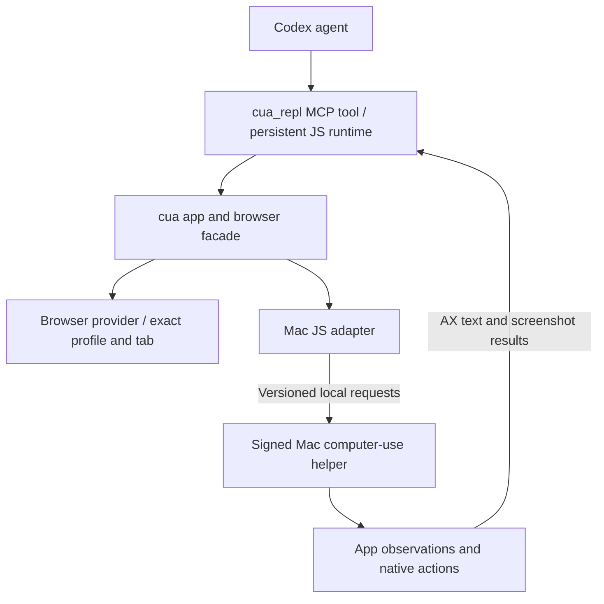

# Codex Mac computer-use harness: inspected interfaces and design lessons

Research date: November 8, 2026. Requested by the user after the foreground/background discussion. This records official documentation, pinned public source, and the original read-only inspection of the installed app separately. The original inspection performed no desktop-control trial or permission change. A later [runtime reuse experiment](2026-11-08-codex-runtime-reuse.md) successfully used the bundled MCP launcher from an independent application; its execution evidence and limits are separate.

**Conclusion:** Codex CLI and App Server are open source. The installed Mac computer-use path also ships readable API documentation and JavaScript adapters around a separate signed native helper. There is enough concrete interface material to improve SlopZooka's design without reproducing the whole Codex harness. The inspected material does **not** establish a supported, redistributable Mac CUA SDK for embedding in Pi.

Keep the existing proposal: ephemeral Pi in the Mac companion, shared application handlers, a signed native provider, terminal MCP, and Vision's existing window gateway. The strongest additions are explicit observation identity, disciplined input cleanup, provider-specific capabilities, and clear errors. Our multiple-workspace use case needs more explicit window/device identity than the inspected Mac app-level API exposes at its top level.

## 1. What was inspected

| Evidence | Version or reference | What it establishes |
| --- | --- | --- |
| Official Computer Use documentation | [OpenAI Computer Use](https://learn.chatgpt.com/docs/computer-use), fetched November 8 | Product permissions, Mac background-use support, and the separately enabled locked-use mechanism |
| Open-source inventory | [OpenAI Open Source](https://learn.chatgpt.com/docs/open-source) | CLI, SDK and App Server have public repositories; this is not a promise that every desktop component is open source |
| Public Codex source | [`b9796386e5f8fc10087bc4476e30896f97e16e5d`](https://github.com/openai/codex/tree/b9796386e5f8fc10087bc4476e30896f97e16e5d) | App policies, protocol types, lifecycle hook wiring and the Apache-2.0 repository license |
| Installed desktop app | `26.1023.51421`, build `22530`, bundle ID `com.openai.codex` | Actual package layout and the components available on this machine |
| CLI in the shell | `codex-cli 0.167.0` | CLI help/version; includes MCP and App Server entry points |
| CLI bundled in the desktop app | `0.165.0-alpha.1.2` | A different snapshot from the shell CLI and public source; don't conflate them |
| Installed JS packages | `@oai/cua` 0.2.6; `@oai/cua-repl` 0.1.2; `@oai/sky` 0.7.13 | Shipped API docs, provider wrappers and native request transport |
| Signed native helper | `Codex Computer Use.app`, `com.openai.sky.CUAService`, version `26.1022.1001641`, build `1001641`, minimum macOS 14.4, arm64 | A separate native permission/process boundary; inspected metadata and linkage, not execution |

The [artifact manifest](evidence/2026-11-08-codex-harness/manifest.json) records paths, versions, byte sizes and SHA-256 hashes for sixteen inspected local artifacts. Paths use `<app>` and `<CODEX_HOME>` placeholders. No proprietary source, binaries, complete string dumps, user credentials, chat history or privacy databases are included in the repository.

The public searches found the policy/protocol/hook integration, but not the complete Mac capture/input implementation. The installed `computer-use` plugin declares a proprietary license; the inspected JS package manifests don't supply a repository URL or license grant. `private: false` in a package manifest is not itself evidence of publication or permission to redistribute it. Use these installed interfaces as version-specific design evidence, not a shipping dependency.

## 2. The actual installed layers

The `unified-computer-use` plugin starts `@oai/cua-repl` using the app's bundled Node runtime. Its README describes selecting browser/computer providers at startup, a persistent REPL, and provider-specific documentation. The Mac adapter then communicates with the native helper over a local Unix socket through the runtime's native-pipe facility. This is a local execution path; the model does not directly connect to the Mac's GUI APIs.

The installed native request bridge uses an API version (`CodexComputerUseIPC-5`), request IDs, a deadline, and turn metadata. It separates app listing, app startup, policy checks, observations and input actions. The JS transport serializes requests on its connection, handles connection loss and can request native-service startup. That observed per-connection sequencing does not prove global serialization across every Codex session.

For SlopZooka, reuse the architectural boundary: a small correlated request/reply bridge to the signed process, with deadlines and trusted caller context. Our existing parent/child bridge remains a reasonable starting point. There is no need to adopt Codex's socket layout, service launcher, package loader or REPL just to execute Pi tools. Keep bulk media off the control channel.

**Sources:** installed `@oai/cua-repl/README.md`; `@oai/sky/.../targets/mac/client.js` and `native-pipe.js`; unified plugin declaration, all identified in the manifest.

## 3. Model-facing interface details worth borrowing

The shipped Mac API documentation exposes app discovery/attachment and a compact operation set:

| Area | Observed interface | SlopZooka lesson |
| --- | --- | --- |
| Discover and attach | `getState`, `listApps`, `getApp`; separate browser/profile/tab selection | Discover from current provider state. Attaching to an existing target and creating a new one must be different operations. |
| Observe | `getAXState`, `getScreenshot`, `getAXStateAndScreenshot` | Return semantic and visual evidence for the same target; let the model request the representation it needs. |
| Operate | Element-index or coordinate click, scroll, drag, key chords, typing, `setValue`, text selection, supported secondary actions | A small set of primitives supports model-driven navigation without app-specific workflow recipes. |
| Incremental context | AX diffs by default, with an option for a complete tree | Avoid sending an entire unchanged UI repeatedly, but make a full refresh easy after context loss or stale observations. |
| First use | App attachment and tab creation include an initial observation; relevant documentation appears when a provider is first used | Reduce redundant tool calls and avoid loading every provider's API into every prompt. |
| Timing | Documentation tells callers that observation methods include an internal wait before capture | Put bounded settling behavior in the provider instead of having the model invent sleeps. The actual settling algorithm was not established here. |
| Clipboard | Mac paste is documented to restore the previous pasteboard | Preserve human state during automation. For our implementation, avoid overwriting a newer clipboard value if the user changes it during the action. |

These are observed interface designs, not proof of every operation's reliability. A combined state call also does not prove the AX tree and pixels are an atomic OS snapshot. Our observation should record target/provider generation, geometry and freshness; subsequent input should reject stale element references or invalid coordinate mappings.

The docs prefer element actions when available, coordinate input when semantic actions fail, and browser locators for DOM-only surfaces. The model still chooses the action from observations. A command that produces no visible change requires another observation or a different approach, not an assertion that the task is complete.

**Sources:** installed `@oai/cua/docs/tinysky-alt-core-cua-repl-mac.md`, `@oai/sky/docs/sky-window-api.md`, native observation wrapper. These API documents were read from the installed package; they are not a public compatibility promise.

### A particularly important identity difference

The inspected Mac top-level requests take an **app identifier** plus an element index or coordinates. They are not the same interface as the package's Windows `Window2` API, which explicitly carries a window object and has different activation behavior. The presence of a window API elsewhere in the package is not evidence that it is available on Mac.

Our surface must remain tied to the exact workspace and window/device/browser page being streamed. Two worktrees can have identically named windows in the same app. Bundle ID alone cannot select between them. AX can still expose multiple windows, but our provider needs to retain and revalidate the selected one instead of assuming whichever window the app currently prefers is correct.

The installed browser guidance is stricter about identity: selecting an existing tab resolves the exact browser/profile and a current tab snapshot. Stale, changed or ambiguous references fail rather than silently opening a substitute. This is directly useful for reconnect/restoration: a numerical identifier can be reused after a restart, so combine stable resource identity with a provider generation and current observation.

**Sources:** installed Mac `client.js`; `sky-window-api.md`; Windows-only `sky-window2-api.md`; CUA REPL README; browser `docs/tab-claiming-chrome.md`.

## 4. Lifecycle, interruption and permissions

### Cleanup belongs in the harness

The public CLI source wires `Stop`, `Interrupt` and `SubagentStop` to a `turn_ended` hook for bundled computer-use integrations. The installed unified plugin includes corresponding hooks. This establishes an explicit lifecycle notification, not the complete native cleanup semantics. [Pinned hook implementation](https://github.com/openai/codex/blob/b9796386e5f8fc10087bc4476e30896f97e16e5d/codex-rs/plugin/src/bundled_hooks.rs).

For our adapters, a completed/cancelled task, disconnected caller or expired operation must release its input ownership and invalidate queued actions. Human takeover should stop the current control attempt and be reported plainly. Do not rely on the model remembering to call a cleanup tool. Releasing input ownership must not close the user's workspace, kill its PTY or remove an independently useful preview.

The native error definitions distinguish unavailable permissions, pending permissions, ambiguous app selection, absent active session, user stop/intervention, incompatible client version, locked screen and transport failure. Preserve these distinctions in our existing capability/result contract. They lead to different UI actions. A transport timeout after submission can have an uncertain effect; observe before retrying a click or typing text.

**Sources:** installed native `errors.js`, `native-pipe.js`; browser interruption guidance; public hooks above.

### OS permission and application scope are separate

Public Codex configuration and protocol types include app-access policy keyed by Mac bundle ID. Additional requirements independently govern persistent approvals and locked use. These are app policy, not substitutes for macOS privacy grants. [Config types](https://github.com/openai/codex/blob/b9796386e5f8fc10087bc4476e30896f97e16e5d/codex-rs/config/src/computer_use.rs), [wire types](https://github.com/openai/codex/blob/b9796386e5f8fc10087bc4476e30896f97e16e5d/codex-rs/app-server-protocol/src/protocol/v2/computer_use_config.rs), [requirements](https://github.com/openai/codex/blob/b9796386e5f8fc10087bc4476e30896f97e16e5d/codex-rs/config/src/browser_computer_use_requirements.rs).

Our signed companion should retain Screen Recording/Accessibility ownership, while terminal MCP callers receive access to the workspace surfaces they were granted. Carry actor/workspace context from the authenticated connection; a model-supplied app name or actor ID cannot confer access. This does not require adding routine confirmation dialogs to already-authorized work. The [guided permission setup](macos-window-streaming.md#product-requirement-clear-permission-setup-and-repair) remains the one UI for detecting and fixing OS grants.

Static native binary inspection found AX and ScreenCaptureKit linkage and capture-permission API imports. The settings identifiers `Privacy_ScreenCapture` and `Privacy_Accessibility` are present as strings. That corroborates the setup design, but does not prove our deep links land correctly on every OS version. Binary linkage and symbols cannot establish exactly how a particular action is executed.

## 5. What this tells us about background and locked operation

Official OpenAI documentation supports background tasks on Mac. The shipped CUA docs specifically describe starting an app in the background when attaching to it. Neither establishes that every click/key operation avoids foreground activation. The native binary contains foreground-context observer/subscription names, but these are only structural clues; no internal event-routing or virtual-desktop mechanism was established. Keep our existing focus-dependent input coordination and test it on actual providers. [OpenAI Computer Use](https://learn.chatgpt.com/docs/computer-use).

The [November 9 two-agent investigation](2026-11-09-background-browser-control.md#6-two-terminal-agents-controlling-two-chrome-windows) additionally located native synthetic-focus and focus-steal-prevention symbols. Their behavior remains opaque. The inspected Mac action envelope is app-scoped, without an independent window selector; two Chrome app handles do not establish isolated controllers. By contrast, the extension has distinct session/tab ownership and page-targeted input. Qualify these routes separately rather than treating either background native operation or same-app concurrency as automatic.

**Locked use is a separate feature.** OpenAI documents installing an Apple authorization plug-in, temporarily unlocking for a trusted active task, covering displays, and relocking on local input. This is materially different from simply continuing a capture stream behind the ordinary lock screen. It is not a capability we gain by granting Accessibility, importing the CLI, or finding a private helper executable. [Documented locked-use behavior](https://learn.chatgpt.com/docs/computer-use#locked-use).

For SlopZooka, keep native desktop operations unavailable under lock and retain the independently tested simulator provider. A comparable authorization/unlock feature would require a separate deliberate product and engineering decision; it is not part of the initial integration. The existing warm-simulator lock evidence remains valid without adopting that machinery.

The inspected CUA interface returns observations for reasoning. It is not documentation of a continuous Mac-to-Vision video transport. Keep our independently tested ScreenCaptureKit/VideoToolbox/native-viewer media path and its measurements separate from these control lessons.

### Could Locked Use improve SlopZooka availability?

November 9 follow-up, after the user noticed the remote-use-while-locked setting. **Potentially yes for an eligible Codex-hosted remote task; it is not yet a capability of our independent companion.** The current official documentation says the authorization plug-in participates in the macOS unlock flow, permits a temporary unlock only during a trusted active Computer Use turn, covers all displays, and relocks on local keyboard/pointer activity. After local activity, automatic unlock stays paused until the user manually unlocks. The feature explicitly does not grant other applications or local processes a general unlock API. Eligibility also depends on the app version, rollout, requirements and remote-control eligibility. [Locked Use mechanism](https://learn.chatgpt.com/docs/computer-use#locked-use), [enterprise eligibility](https://learn.chatgpt.com/docs/enterprise/chatgpt-work-local-security#locked-devices).

This could make arbitrary native apps, and potentially cold simulator preparation, usable while the user is away. Those are hypotheses to test with an eligible task, not results of our warm-simulator experiment. It also changes the state model: the display can appear locked while the desktop is temporarily unlocked behind a protective cover. Do not infer authorization from an ordinary session-unlocked observation or assume another process may use the temporary interval. Our native lock gate should only change if the selected provider exposes a legitimately granted capability with a tested lifecycle.

The updated desktop app (`26.1103.60933`) bundles `CUALockScreenGuardian.app` and an installer containing `CodexComputerUseAuthorizationPlugin.bundle`; their plist identities corroborate the documented components. Reading bundle metadata does not establish that Locked Use is enabled, installed into macOS, available to this task, or callable by our provider. We did not toggle the setting, invoke an unlock or lock the Mac. [Artifact/preflight record](evidence/2026-11-09-browser-runtimes/qualification-after-install.json).

Before improving the product's availability promise, qualify four independent claims:

| Claim | Required evidence |
| --- | --- |
| **Authorized control while away** | An actually eligible remote Codex task observes/acts while the Mac is user-locked. Separately determine whether our own Pi/CLI client can obtain that capability, or whether desktop-agent delegation is required. A standalone native click succeeding while unlocked does not prove either claim. |
| **Continuous Vision media** | Our exact-window capture yields fresh app frames during the protected interval and recovers after relock. Compare display capture separately because it can include the protective cover. Measure what happens between tool calls, at turn completion and during idle viewing; per-action screenshots do not establish a continuously available preview. |
| **Useful setup and recovery** | Test cold simulator boot/app launch if required, cancellation, provider failure, local-input takeover, manual unlock and subsequent recovery. Preserve the existing independent WDA route for cases where trusted desktop control is unavailable. |
| **Clear supported operating conditions** | Measure an awake Mac separately from display sleep, whole-system sleep, lid closure, logout and reboot. The Locked Use documentation does not establish wake/reboot/FileVault-unlock support or a service-level guarantee. |

This is an optional follow-up to runtime provisioning, with any real lock test scheduled with the user. It reopens a promising availability option without replacing the demonstrated simulator fallback or requiring us to build a new authorization plug-in. Enabling the setting alone is not sufficient evidence to raise SlopZooka's locked-state reliability claim.

## 6. Public CLI integration without typing through xterm

There is a documented open-source **App Server** for applications that need structured Codex conversations, approvals, tool progress and turn cancellation. Its documented default transport is stdio with JSON messages; the WebSocket option is marked experimental/unsupported in the fetched page. The existing terminal can remain the interaction surface while we start with workspace-scoped MCP. If we later need reliable dispatch and progress from the coordinator, evaluate App Server at the session-service boundary instead of parsing terminal screen output or injecting slash commands blindly. Do not launch a second independent agent merely to observe the first. [App Server](https://developers.openai.com/codex/app-server), [public implementation](https://github.com/openai/codex/tree/b9796386e5f8fc10087bc4476e30896f97e16e5d/codex-rs/app-server), [MCP integration](https://learn.chatgpt.com/docs/extend/mcp).

This is an optional integration improvement, not a reason to replace Pi or redesign the terminal service before the first preview works. CLI/App Server openness does not include an automatically reusable Mac native driver. The public repository's [Apache-2.0 license](https://github.com/openai/codex/blob/b9796386e5f8fc10087bc4476e30896f97e16e5d/LICENSE) should not be projected onto separately packaged proprietary components.

### Can we reuse the installed Mac runtime directly?

Follow-up investigation, November 8: **not established as a supported drop-in dependency**. Three questions must remain separate: whether a local call can be made, whether its use/distribution is permitted, and whether there is a stable supported interface. Readable files and `private: false` package metadata answer none of those by themselves.

There is a concrete host dependency in the inspected `native-pipe.js`: it rejects use without the trusted `globalThis.nodeRepl` runtime and requires that runtime's native connection facility. Requests carry Codex turn metadata; the policy wrapper resolves app access and can request approval through the host. Native errors include unauthenticated sender and absent active session. These observations establish integration coupling, but do not reveal the full authentication mechanism or prove that every external integration is impossible. No attempt was made to forge a caller/session, bypass a check, or invoke desktop actions.

| Reuse option | Current assessment |
| --- | --- |
| Bundle the helper and import its JS from Pi | No published embedding/redistribution grant found; also depends on host facilities and native authorization. Do not select as a shipping dependency on this evidence. |
| Depend on the user's installed Codex app and call its private runtime | **Locally demonstrated in the follow-up:** start the genuine bundled MCP launcher and handle its normal app elicitations. An independent Mac application read AX/screenshots and delivered input without supplied turn metadata. Support, cold-start independence and redistribution terms remain unestablished. |
| Delegate to a genuine Codex session using a supported interface | Potential investigation. Public App Server supports structured Codex operation, but the reviewed docs do not promise that an independently started server receives the desktop app's Mac CUA setup. Verify real tool availability, app approvals, identity and cancellation before relying on this route. |
| Obtain an explicitly supported/licensed Mac driver integration from OpenAI | The most direct way to retain Pi while reusing the native driver, if offered. Ask specifically about third-party callers, app distribution, native permission identity, supported targets, lifecycle and updates. No such offer was established by the reviewed docs. |

Recommendation: keep the native provider replaceable and separate the working local experiment from a supported shipping dependency. The later experiment establishes a direct MCP runtime path without an extra Codex agent/model loop. Delegating to an actual Codex agent remains a different option. Continuous Vision streaming and exact surface association remain SlopZooka responsibilities either way.

**Experimental follow-up:** a read-only `listApps()` call using this installed client from ordinary Node rejected immediately with `Sky Computer Use requires the trusted nodeRepl runtime`. No native connection or desktop action was reached. This establishes that a plain import is insufficient, not that every external integration is impossible. The [open-source follow-up](2026-11-08-macos-cua-options.md) records the probe and identifies Peekaboo and Cua Driver as candidates that expose reusable automation without relying on this private host. A stable vendor API is not required for a local experiment; actual authorization dependencies and redistribution terms remain separate questions.

**Further execution changed the result:** using the actual installed NodeREPL/MCP launcher supplied the missing runtime correctly. Our own LaunchServices app then controlled a disposable fixture with a clean environment and no supplied Codex turn metadata. [Working interface, evidence and remaining limits](2026-11-08-codex-runtime-reuse.md). The ordinary-import failure must not be used as evidence that local reuse is unavailable.

## 7. Narrow changes to our implementation plan

1. **One shared observation/action contract.** Bind exact surface identity and generation; return screenshot plus available semantic state, geometry and capabilities. Permit either form of observation and a full refresh when incremental state is insufficient.
2. **One input owner where foreground focus is required.** Pi and terminal MCP go through the same provider. Reject stale coordinates/element handles and re-observe after actions. Browser/device-specific operations remain independent when proven to be so.
3. **Explicit lifecycle and errors.** Propagate actor/operation context and deadlines. Release input on cancellation, stop or disconnect; distinguish missing permission, missing target, user takeover, lock and uncertain completion. Keep resource lifetime in existing services.
4. **Small interface conveniences.** Include initial state on attach, expose only relevant provider guidance, preserve clipboard state, and put bounded settling in the provider. Use app-specific hints only for concrete quirks, not scripted login/navigation recipes.
5. **Keep media and permission ownership unchanged.** Signed native companion, existing paired transport/window gateway, one video path. Do not import Codex's private runtime or add locked-unlock machinery to the first version.

The focused test should attach to two same-app windows belonging to different workspaces, act on one from each agent, interrupt one, and verify the other stream and both PTYs remain intact. Also verify a stale target fails after window replacement, a timeout does not duplicate typing, the clipboard survives, and the model sees a fresh result. These are planned integration checks, not new results from this read-only investigation.

## Verification and scope

Public source was read through the GitHub connector at the pinned revision. Official pages were fetched through OpenAI Docs. Local work used package/document reads, CLI help/version, archive metadata, native metadata/linkage/import inspection and a bounded string search. No downloaded code was executed, no binary was patched, and no installed settings changed. Source absence and binary symbols are treated as limited evidence, not proof of undisclosed implementation details.

The original inspection changes are documentation and an artifact hash manifest. Local-link, Markdown-fence, whitespace and evidence-hygiene checks passed; all sixteen recorded artifact sizes/hashes were verified against the installed files. The later ordinary-Node compatibility probe and its separate evidence record are linked above. Production tests and the physical probe were not rerun for these documentation updates; earlier results and unresolved failures remain in the benchmark/live reports.
