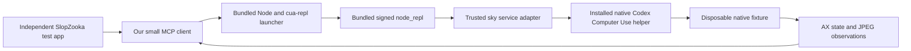

# Codex's unstable Mac runtime: a working local integration

November 8, 2026. Follow-up to the [static inspection](2026-11-08-codex-computer-use-harness.md) and [ordinary-Node probe](2026-11-08-macos-cua-options.md#5-for-science-installed-codex-runtime-probe).

**Result: yes, an independent application can use this installed runtime through its bundled MCP launcher on this machine.** We exercised discovery, native AX observations, screenshots, button clicks, text insertion and semantic value setting. This revises the earlier “plain import fails; further integration unproven” finding. The plain import still fails, but it is the wrong integration boundary.

The successful route required no new Codex agent, model API call, supplied Codex turn metadata, patched binary or manufactured trusted-runtime object. It did use the real bundled executables, the existing native helper and existing macOS permissions. Codex remained installed and running. This is evidence of technical reuse, not a supported embedding or redistribution contract.

## 1. What changed the answer

The JavaScript package's `nodeRepl` requirement is satisfied by **running the real NodeREPL launcher**. We do not need to recreate that object in ordinary Node. The launcher is already an MCP stdio server, so an ordinary client can initialize it, discover its tools and call its `js` tool.



This preserves the installed runtime's own service setup, native connection and application-policy flow. It is materially simpler than reimplementing the private native transport.

## 2. The concrete unstable interface

The inspected app version is `26.1023.51421`; `@oai/cua-repl` is `0.1.2`, `@oai/sky` is `0.7.13`. The private native wire version is `CodexComputerUseIPC-5`.

For this installation, the configured launcher is described by:

```text
~/.codex/plugins/cache/openai-bundled/unified-computer-use/26.1023.51421/.mcp.json
```

The entry launches the app-bundled Node executable, the installed access preloader, and:

```text
/Applications/ChatGPT.app/Contents/Resources/cua_node/lib/node_modules/@oai/cua-repl/bin/cua-repl.mjs
```

We read that manifest and preserved its command, arguments and explicit environment. The only provider change was narrowing `CUA_REPL_ENABLED_SURFACES` to `computer`. We passed a small ordinary process environment and did **not** inherit task IDs, tool-call IDs or the desktop host-services pipe. We did not pass `--disable-sandbox` or change the configured trusted services/code paths.

Relevant existing configuration includes the real `CUA_REPL_NODE_REPL_PATH`, module paths, trusted-service mappings, bundled CLI path and native helper path. These are installation-specific configuration, not values to guess or turn into a permanent public API. The launcher supplies its normal CUA initialization banner.

MCP discovery negotiated `2025-06-18` and exposed:

```text
js
js_add_node_module_dir
js_reset
turn_ended
```

The client first sends `initialize`, then `notifications/initialized`, then `tools/list`. A normal `tools/call` to `js` can run code such as:

```javascript
var fixture = await cua.getApp("/path/to/our/disposable/fixture.app");
// Use indices from the returned, current AX observation.
await fixture.click(buttonIndex);
await fixture.typeText("test text");
await fixture.setValue(fieldIndex, "replacement text");
await fixture.getAXStateAndScreenshot();
```

The `js` arguments include `code`, `timeout_ms` and `title`. Variables survive between calls. Results arrive as MCP text/image content blocks; the fixture screenshots were JPEG. The app facade emitted AX diffs after changes. The native method set is described in the [earlier interface notes](2026-11-08-codex-computer-use-harness.md#3-model-facing-interface-details-worth-borrowing).

**Application approvals are part of this API.** The client advertised MCP elicitation support and handled `elicitation/create`. For this user-authorized experiment it accepted only `connector_id: computer-use` targeting the disposable fixture's exact bundle ID; other app requests were canceled. We supplied normal accept responses, requested no persistent approval, and did not claim a preexisting approval or impersonate Codex turn metadata. A real host must connect this callback to its actual user authorization and policy. The example is not a general auto-approve client.

`turn_ended` was discovered but not invoked with invented thread/turn identifiers. The probes closed their own stdio processes after completing short actions. Full cancellation, interruption and lifecycle-hook integration remain untested.

## 3. What we actually tested

The [machine-readable results](evidence/2026-11-08-codex-runtime-reuse/results.json) and three fixture-only JSONL traces preserve the successful and unsuccessful outcomes. The [source scaffold](../experiments/codex-runtime-probe/README.md) contains our client, fixture and independent launcher; it contains no copied runtime implementation.

| Test | Observed result |
| --- | --- |
| Import `MacComputerUseClient` into ordinary Node; call `listApps()` | Rejected by the JS wrapper before native connection: trusted `nodeRepl` required. |
| Direct unsigned client to the native Unix socket; versioned `ping` | Socket accepted a connection but closed before a complete response. Cause not established; no native authorization workaround attempted. |
| Start the configured bundled launcher; MCP initialization and discovery | Succeeded. The server exposed its JavaScript/control tools. |
| Call `cua.getState()` through that launcher | Returned native application inventory. Inventory details were omitted from committed evidence. |
| Attach to our new AppKit fixture | Returned an indexed AX tree with the actual input and button. |
| Click the fixture's Increment button | Counter changed; confirmed by fresh AX state, screenshot and the fixture's independent state file. |
| Type into the fixture's field | Text insertion confirmed by AX, screenshot and fixture state. A repeated field click placed the caret within existing text; typing did not mean “append.” |
| Launch the client from a separate Mac app using LaunchServices | Worked. A clean run recorded parent PID `1`, no inherited Codex/NodeREPL/CUA environment names in the launcher, no task variables in the MCP process environment and no supplied turn metadata. |
| `pressKey("Super_L+a")` followed by typing | Method returned without an error, but the expected select-all effect was absent; typing inserted into the existing value. Cause unresolved. The minimal fixture had no Edit menu, so this is not a broad verdict on native shortcut support. |
| `setValue` to an exact replacement, followed by a button click | Worked from the clean independent launcher. Final independently logged fixture state was `counter: 5`, `text: independent-runtime-ok`. |
| Cleanup | Own clients exited normally. We verified the fixture PID's executable identity, terminated only that process, and left the shared native Codex helper untouched. |

We first used a shell-started client, then deliberately repeated through an ad-hoc-signed, task-owned Mac application launched by LaunchServices. Its parent was launchd, rather than the Codex task's shell. The first such launch still inherited environment names from `open`; a subsequent clean launch removed them. The client had already filtered those inherited task variables before starting MCP. This distinction is retained in the evidence instead of calling the first launch environment-independent.

The helper/REPL kept their original signatures. The bundled `node_repl` reports an OpenAI Developer ID signature. Our two small apps used their own `dev.slopzooka.*` identities. This demonstrates a normal client invoking the genuine runtime; it does not establish the full native sender-authentication algorithm.

## 4. Useful engineering details exposed by the experiment

- **The service boundary is already reusable technically.** An application can speak MCP while the installed runtime handles native transport, AX, images and input. Pi need not become a Codex agent or run an extra reasoning loop to call it.
- **Approval is an explicit callback.** Discovery succeeded before app-specific approval; fixture operations used the app-policy/elicitation path. A host adapter must preserve that distinction and actor scope.
- **Observations are first-class results.** Attachment returned useful state immediately, later calls emitted diffs, and combined observation returned AX plus an image. This is a concrete reference for our own provider interface.
- **Input semantics still require verification.** The select-all outcome and caret placement are real counterexamples to treating a successful tool response as task completion. Semantic `setValue` was a better fit for exact replacement in this fixture.
- **The images showed an agent pointer/highlight.** We have not established whether that is composited by this observation path or would appear in our independent ScreenCaptureKit stream. Do not assume the overlay automatically reaches Vision.
- **Mac targeting remains app-oriented at this facade.** Multiple same-app workspace windows, geometry changes, modal ownership and concurrent agents still need the exact-target design already proposed.

The lower native transport is also identifiable: UTF-8 JSON-RPC messages with a four-byte little-endian length prefix over a Unix socket, with version negotiation, typed request names, IDs and deadlines. The running helper closed our direct ordinary-client connection; the configured launcher path succeeded. For an experiment, use that functioning boundary instead of rebuilding or working around native authentication.

## 5. What this means for SlopZooka

An experimental **Codex-runtime provider** is now technically plausible: the companion starts the installed launcher, maps Pi tools to its `js` calls, forwards observations, and handles app approvals and cancellation. Terminal agents could reach that same companion-owned provider through our MCP. This would use Codex's native machinery while keeping our own coordinator and surface ownership.

**Subsequent user preference:** use this installed Codex runtime as the preferred direction, with a deliberate interface/tradeoff review before a shipping commitment. The [browser/guidance follow-up](2026-11-08-codex-browser-and-guidance.md) records that decision, collected model guidance and a separate browser discovery failure. Still unresolved:

1. Cold start when the ChatGPT/Codex app is closed; fresh installation, missing permissions, account requirements and a different host identity.
2. Helper restart, application updates, protocol changes and lifecycle cleanup without a Codex-managed turn.
3. Exact multi-window control, foreground behavior, human takeover, simultaneous agents and locked-screen behavior.
4. Browser-provider reuse and its separate profile/access requirements; only the native computer provider was enabled here. A later standalone browser-only call initialized successfully but rejected discovery with “Cannot verify browser access without the current turn.” Native success must not be generalized to that provider.
5. Embedding/distribution terms. The earlier proprietary-component finding is unchanged; local functionality does not create a license grant.
6. Continuous streaming. This experiment returned observations, not a video stream. Keep our tested media path and associate it with the exact controlled surface.

For science, we have answered the central question: **a callable unstable API exists, and we used it for real native control from our own application.** The next research question is operational independence and target/lifecycle correctness, not whether a plain JavaScript import can work.

## Verification scope

No new agent task or paid model API call was started. No app binaries were patched, no signing identity was forged, no native authentication was bypassed and no OS privacy grant was changed. Only the newly created disposable fixture received input. Existing Codex permissions and the already-running installation were prerequisites. Source/evidence checks accompany the commit; production application and Vision streaming tests were not rerun for this isolated experiment.
