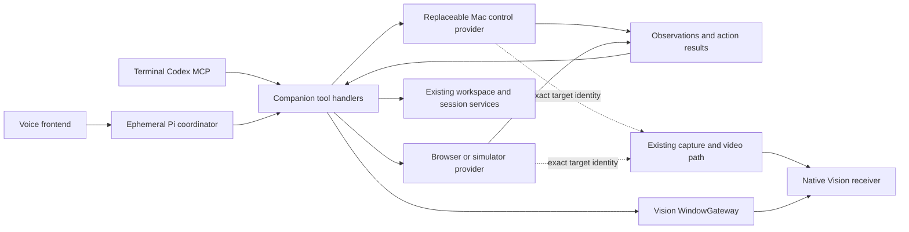

# Open-source Mac computer use: candidates, integration and experiments

Research date: November 8, 2026 (America/New_York). This extends the [Codex runtime inspection](2026-11-08-codex-computer-use-harness.md) and [execution/presentation plan](orchestrator-execution-path.md). This is source review plus one local compatibility probe, **not a live comparison of the open-source drivers**. Source revisions, inspected file hashes and the probe result are in [the evidence record](evidence/2026-11-08-macos-cua-options/research.json).

## Conclusion

Yes: we can build this with OpenAI models without depending on an OpenAI Mac-runtime SDK or a stable third-party driver API. The supported model interface can call our local tools; an open-source driver supplies the Mac mechanics. Pin its revision and keep its changing interface behind a small adapter. That leaves OS compatibility work, but gives us source we can inspect and fix.

**Evaluate Peekaboo and Cua Driver first.** Peekaboo is the strongest apparent fit for our Swift permission host; Cua Driver has the most explicit alternative embedding contract. Vercel's agent-desktop is a useful narrower candidate and an especially good reference for observation identity and honest action results. These are judgments from the reviewed sources, not measured rankings.

Direct reuse of the installed Codex runtime remains an experimental track. The ordinary-Node probe below failed before connecting to its native service. Lack of a stable API is not itself a technical blocker; the concrete extra problem here is the runtime's trusted-host dependency.

## 1. Candidates worth knowing

| Candidate | Evidence of useful engineering | Fit and limits for SlopZooka |
| --- | --- | --- |
| **[Peekaboo](https://github.com/openclaw/Peekaboo/tree/69764083b16397845dc68b5c0ddb4f674290ae70)** — MIT | Swift capture/AX/input services, CLI, MCP, menu-bar permission host; exact-window snapshots, authenticated host bridge, delivery evidence, and a source-controlled background-interaction test matrix. | First integration candidate. Its public Swift package separates automation from its agent/model runtime. Some background event routes use private macOS functions; capabilities must be qualified on our machines. |
| **[Cua Driver](https://github.com/trycua/cua/tree/fd059df668826e0568f9db1c63635d67726b38ed/libs/cua-driver)** — MIT driver | Rust native runtime, MCP, generated SDKs, versioned C ABI, explicit embedded-host mode, source-built GUI fixtures and an action-support ledger that distinguishes delivered actions from correct refusals. | Serious alternative, especially behind a companion-owned worker. Broader cross-platform machinery than we need. Do not mistake the whole Cua repository or its streaming stack for MIT. |
| **[Vercel agent-desktop](https://github.com/vercel-labs/agent-desktop/tree/b43ac4f6e892ef608f8851428613c4009f0e84c7)** — Apache-2.0 | Model-free CLI/C library/MCP; snapshot-qualified element refs, explicit ambiguity, bounded partial trees, structured delivery/retry results. | Attractive semantic provider. Its FAQ says apps without an AX tree are not visible to it and directs webpage automation to agent-browser. It is not, by itself, the broad visual fallback we need. |
| **[Browser Use macos-harness](https://github.com/browser-use/macos-harness/tree/43d9edf8286153482348b15f7d8c22d9e38f6c6b)** — MIT | Eleven generic operations; persistent helper, AX diffs, screenshot/settling, interruption handling and test modules for these behaviors. Python/PyObjC implementation is relatively approachable. | Good thin-harness reference or experiment. Declares itself experimental, enables anonymous telemetry by default, and uses undocumented event fields/functions despite posting through a public CGEvent API. Do not infer universal background delivery from that API alone. |
| **[Munim Computer Use](https://github.com/munimtechnologies/munim-computer-use/tree/883a4e181409f203b4b51f8219d88e0af43b1034)** — Apache-2.0 | MCP, native AX plus OCR, agent cursor, Chrome bridge, embedding profiles; documents dialog-first observations, menu-shortcut delivery and hidden-window parking. | Rich UX research reference. Background guarantees and comparison timings are publisher claims, not our measurements. Invisible-display parking adds state restoration and OS-compatibility obligations; do not adopt it by default. |
| **[mac-cua](https://github.com/hyprcat/mac-cua/tree/362393e312de500597146b13b6f5a428462f6ce2)** — Apache-2.0 | Python MCP with app-scoped AX/screenshots, per-app guidance and a candid small cross-app test report. | Useful implementation reference, less compelling than the finalists for exact multi-window integration. Its report itself records Electron, shortcut and Qt limitations. |
| **[computer-harness](https://github.com/huytieu/computer-harness/tree/cea3a9459d08e1eeafefe0fc4b6c2fa39dc31129)** — MIT | Small Python daemon exposing background semantic actions and explicit foreground controls; documents its local authority and screenshot storage. | Educational baseline, version 0.1.0 in the inspected README. The daemon accepts arbitrary Python from same-user callers, and uses older window-capture APIs. It is not a ready permission boundary for multiple SlopZooka agents. |

Also reviewed [mediar-ai's MacosUseSDK](https://github.com/mediar-ai/MacosUseSDK) and [MCP wrapper](https://github.com/mediar-ai/mcp-server-macos-use): useful Swift traversal, input and highlighting examples, but the reviewed wrapper is app/PID-oriented, opens or activates apps, and follows the SDK's moving `main` branch. It was not promoted over the finalists. Pin and audit the SDK itself before any reuse.

The comparison considers target identity, failure semantics, embedding, permission ownership and available test machinery. Repository popularity and polished demo videos do not establish reliable background control. We did not install these projects, run their test suites, or independently reproduce their published performance claims.

## 2. What we could actually reuse

### Peekaboo: native automation without a second agent

The root [Package.swift](https://github.com/openclaw/Peekaboo/blob/69764083b16397845dc68b5c0ddb4f674290ae70/Package.swift) exports `PeekabooFoundation`, `PeekabooProtocols`, `PeekabooAutomationKit` and `PeekabooBridge`. It does not pull in its agent runtime or Tachikoma model layer. This is unusually close to what we want: Pi remains the coordinator, while a signed native host supplies the UI mechanics. Its [platform table](https://github.com/openclaw/Peekaboo/blob/69764083b16397845dc68b5c0ddb4f674290ae70/docs/platform-support.md) distinguishes macOS 14 package metadata from the released CLI/app's macOS 15 floor; a package declaration is not proof of every feature's OS support.

For a disposable comparison, use its exact-window CLI/MCP. If it wins, evaluate linking the automation package into our host or a companion-owned helper. Avoid importing its daemon discovery, configuration hierarchy, agent sessions and complete tool catalog unless we actually need them. Its [architecture](https://github.com/openclaw/Peekaboo/blob/69764083b16397845dc68b5c0ddb4f674290ae70/docs/ARCHITECTURE.md) already separates these concerns.

### Cua Driver: an explicit embedded-host contract

The [embedding guide](https://github.com/trycua/cua/blob/fd059df668826e0568f9db1c63635d67726b38ed/libs/cua-driver/rust/Skills/cua-driver/EMBEDDING.md) covers same-process SDK use and a host-owned private worker with an MCP proxy. For the latter, the permission-owning Mac app directly spawns the worker; routing launch through another app changes responsibility attribution. It also distinguishes TCC responsibility from App Sandbox inheritance and identifies limitations of the cursor overlay in arbitrary direct runtimes. These are project integration claims to verify in our signed packaging, not guarantees for every spawn arrangement.

This could give Pi direct local calls and terminal agents MCP access to the same native runtime. We still need our own actor/workspace scoping and serialization. The [MCP document](https://github.com/trycua/cua/blob/fd059df668826e0568f9db1c63635d67726b38ed/libs/cua-driver/docs/mcp-protocol-and-skills.md) records specific Codex/Claude interoperability checks; these do not prove our packaging or authorization flow.

**License boundary:** the repository's [licensing map](https://github.com/trycua/cua/blob/fd059df668826e0568f9db1c63635d67726b38ed/legal/LICENSING.md) places Driver under MIT, but Spaces, its streaming client/codecs/viewers and Driver Bench under FSL-1.1-MIT. Optional perception includes separately licensed model artifacts. Evaluate the base driver independently; keep our already-tested streaming path.

## 3. The most useful findings for a great Mac UX

### Background input is a capability, not a global promise

Peekaboo's [BackgroundInputDriver](https://github.com/openclaw/Peekaboo/blob/69764083b16397845dc68b5c0ddb4f674290ae70/Core/PeekabooAutomationKit/Sources/PeekabooAutomationKit/Services/UI/BackgroundInputDriver.swift) dynamically loads a private SkyLight posting function with a public posting fallback. Cua's [Mac input implementation](https://github.com/trycua/cua/blob/fd059df668826e0568f9db1c63635d67726b38ed/libs/cua-driver/rust/crates/platform-macos/src/input/skylight.rs) also uses SkyLight and explains app-specific event delivery and key-window preparation. Browser Use's [event code](https://github.com/browser-use/macos-harness/blob/43d9edf8286153482348b15f7d8c22d9e38f6c6b/src/macos_harness/events.py) uses undocumented window-routing fields/functions as well. These are source observations, not Apple support commitments or proof of Codex's native implementation.

Therefore an open-source dependency removes the closed-driver dependency but not macOS compatibility risk. Prefer AX/DOM/device actions when they fit; attempt qualified background events next; expose an explicit foreground fallback when needed. Represent capabilities per target/action and report the mechanism used. Public-API-only operation is a possible restricted mode, but it must not advertise equivalent coverage without testing.

### An app's process is not an input destination precise enough for us

Two Chrome windows share an application; simulator windows and dialogs can share one too. Process-targeted keys can still reach the wrong in-app key window. Cua's source verifies which exact window is key before dispatch; Peekaboo binds coordinates and actions to a retained target and revalidates before acting. Start with process-level input serialization where focus is shared; add cross-process concurrency only when the provider supports it. Clipboard and foreground input remain shared resources. A per-window mutex alone is insufficient.

For SlopZooka, bind an observation to `surfaceId`, provider generation, the concrete native/browser/device target and its geometry. An element handle belongs to that observation. A screenshot's scale and crop origin must travel with it. Recheck after a resize, modal transition or window replacement. Discovery may search by title; execution must use the resolved identity.

### A delivered event is not a completed task

Cua's [press-key implementation](https://github.com/trycua/cua/blob/fd059df668826e0568f9db1c63635d67726b38ed/libs/cua-driver/rust/crates/platform-macos/src/tools/press_key.rs) distinguishes native readback from an unverified event post. Vercel's [JSON contract](https://github.com/vercel-labs/agent-desktop/blob/b43ac4f6e892ef608f8851428613c4009f0e84c7/docs/json-output.md) carries delivery and retry disposition even on failures. Peekaboo's [automation guide](https://github.com/openclaw/Peekaboo/blob/69764083b16397845dc68b5c0ddb4f674290ae70/docs/automation.md) stops fallback after a possibly delivered prefix.

Adopt that behavior with a small result shape: refused before dispatch, dispatched but unverified, or verified with stated evidence. A timeout after typing cannot safely trigger the same typing again. Re-observe first. UI readback verifies only what was read; it does not prove a save reached a backend. Native work that outlives the caller must retain its input ownership until it really ends.

### Make observations useful and cheap

Use a compact semantic tree plus an available screenshot, with explicit partial/truncated state. Offer focused subtree reads or a full refresh; keep dialogs/popovers visible in the observation. Use AX notifications and bounded settling instead of an unconditional sleep after every click. Semantic changes and pixels can arrive at different times, so record their observation times and reject changed target geometry rather than claiming an atomic snapshot we cannot provide.

Vercel's [README](https://github.com/vercel-labs/agent-desktop/blob/b43ac4f6e892ef608f8851428613c4009f0e84c7/README.md) supplies concrete skeleton/drill-down and snapshot-ref patterns. Munim's [README](https://github.com/munimtechnologies/munim-computer-use/blob/883a4e181409f203b4b51f8219d88e0af43b1034/README.md) supplies dialog scoping, OCR fallback and action-plus-state ideas. These suggest a hybrid observation contract; no need to bolt an OCR model onto every action or send a full-resolution desktop to the model continuously.

### Show agent intent in the window the user is watching

Our proposed UX: briefly show the target/workspace, current action, and a clear stop/take-over affordance. Render a separate agent pointer or target highlight rather than moving the user's pointer merely for feedback. A Mac overlay may be a separate window excluded from single-window ScreenCaptureKit capture; test this and, if necessary, send overlay coordinates as metadata for Vision to render.

Resolve “this window” from explicit headset focus/selection context captured with the utterance. Do not substitute the Mac frontmost app or invent a gaze signal. If the target changes during speech, preserve the original association or ask about the ambiguity. “Stop” must cancel queued Mac actions, not merely mute speech. On human takeover, invalidate pending actions and avoid restoring stale focus or clipboard contents over the user's newer changes.

Minimized-window parking is an interesting later experiment, not a requirement. It introduces window movement, hidden displays, cleanup and user-takeover restoration. No reviewed source establishes that parking makes our locked-Mac simulator workflow work. Retain the previously tested independent simulator provider and expose lock/unavailable state.

## 4. OpenAI models do not require Codex's Mac runtime

The current official guide explicitly supports [our own UI functions or MCP tools](https://developers.openai.com/api/docs/guides/tools-computer-use-integration#use-your-own-ui-tools). We can return semantic state and images from a tool. The [main guide](https://developers.openai.com/api/docs/guides/tools-computer-use#choose-an-integration-path) also supports generated-code execution and structured computer actions; its current recommendation for GPT-6 Astra favors code execution. That is an available model interface, not a requirement to replace Pi.

Three practical integrations:

| Interface | Application responsibility | Use here |
| --- | --- | --- |
| Pi custom tools / terminal MCP | Our handler calls the local provider and returns observations/results. | Smallest initial integration; shares the same provider across agents. |
| Persistent code tool | Our runtime executes bounded scripts that compose authorized controls and emit images/text. | Useful for short batches, loops and navigation; consider after the primitive contract works. A JS context alone is not a security sandbox. |
| Responses `computer` tool or SDK `ComputerToolset` | Our driver executes ordered actions and returns a screenshot. | Useful controlled visual baseline; it supplies neither a Mac daemon nor TCC permissions. |

Local MCP and OpenAI-hosted remote MCP are different connection paths. For Pi/local Codex, keep the endpoint on the Mac. A Responses function handler can bridge to it locally without exposing a desktop-control server to the internet.

For visual inputs, OpenAI recommends original image detail and correct coordinate remapping after scaling/cropping. Start with a target-window image; measure whether downscaling harms text/controls. Use short action batches followed by observation. The [driver reference](https://developers.openai.com/api/docs/guides/tools-computer-use-sdk-drivers) describes cancellation, coordinate spaces and execution results. API conversation state does not restore our OS process or window state.

For voice, Realtime can remain responsive while application-side tools execute; its [server-side controls](https://developers.openai.com/api/docs/guides/voice-server-controls?api=realtime) support a sideband connection. Keep one executor for each tool call even when both audio client and backend see the event. Preserve the existing [Pi/voice separation](orchestrator-tools.md); GPT-Live and Realtime have different lifecycles. Speech interruption and Mac-operation cancellation need an explicit connection.

## 5. “For science”: installed Codex runtime probe

We used the installed app's Node executable to import the installed `MacComputerUseClient`, then requested only `listApps()` with a two-second request timeout. No app names or desktop content were logged; no synthetic host identity or turn metadata was supplied.

Observed result:

```json
{
  "probe": "ordinary-node-read-only-listApps",
  "status": "rejected",
  "errorName": "SkyComputerUseTransportError",
  "message": "Sky Computer Use requires the trusted nodeRepl runtime",
  "elapsedMs": 1
}
```

This reproduces the wrapper dependency identified in static inspection: **importing the package from an ordinary Pi/Node process does not provide a working driver**. The check occurs before the native connection, so this did not test native sender authentication, app approval, screenshots or actions. It is not evidence that all external integrations are impossible.

An unsupported interface can be a perfectly reasonable local experiment when we own the adapter and can pin the version. For this particular runtime, a further legitimate experiment would have to establish a real Codex-managed session with the desktop tools and verify target handoff/cancellation. Public App Server documentation alone does not establish that setup. We did not manufacture trusted-runtime state, patch checks or bypass native authorization, and we have not established a redistribution license for the private components.

The open-source route avoids that unresolved integration dependency altogether. Keep the proprietary-runtime experiment separate from the first shippable path; do not let exploration imply a production dependency decision.

## 6. Keep our architecture small



The provider adapter needs discovery, observation, action and cancellation/capability reporting. It should preserve backend evidence rather than translate every result to “success.” This is a responsibility boundary, not a frozen new tool catalog. Do not normalize every vendor feature or introduce another workflow engine.

Our existing services still create worktrees and PTYs. Our surface association connects a concrete Mac window/tab/device to its workspace and stream. Vision's existing `WindowGateway` still handles presentation and restoration; visionOS owns physical placement. A driver's Mac window-move API cannot promise spatial placement in the headset. Provider observation caches are ephemeral; they are not another durable window registry.

Keep user video and model observations separate: continuous hardware video for the headset, selected screenshots/semantic state for the model. Neither Peekaboo's screenshots nor Cua's driver require replacing our ScreenCaptureKit → VideoToolbox → native Vision path.

## 7. Smallest comparison that can change the decision

Run the same cases against pinned Peekaboo and Cua Driver, using owned fixtures and a sentinel window. Start on the Mac; Vision is needed only for the final stream/overlay association check. This is a proposed comparison, not an approved full prompt suite or a completed result.

1. **Two windows, same app:** type distinct markers into two owned windows while a third stays active. Verify exact field contents, focus, pointer and no input leakage; repeat with two browser workspace windows.
2. **Real surface mix:** inspect/click/type/scroll in an AppKit fixture, a web/Electron fixture, and Simulator. Record semantic versus pixel delivery and every unsupported action; verify effects independently.
3. **Change after observation:** resize/move the target, replace a window, and show a modal. Stale actions must refresh or refuse; none may hit a sibling window.
4. **Two agents and a human:** Pi and terminal MCP share the provider; interrupt during typing, change focus manually, and edit the clipboard during a paste. No queued continuation or stale restoration may overwrite the intervention.
5. **Failure after dispatch:** lose the reply or time out after input starts. Reconnect and observe; do not replay uncertain effects. Verify cleanup releases input without closing user-owned windows or ending PTYs.
6. **Shipping identity:** launch through our signed companion, grant/deny/revoke permissions, restart the helper and update its build. Check permission attribution and recovery from the actual package, not just a developer shell.
7. **One end-to-end request:** “Open Poncho2 with the iOS app, show it here, and get to the login screen.” Verify the controlled simulator is the one streamed to Vision, and any agent highlight appears in the right coordinates. Reuse the prior lock fallback evidence; separately schedule any new lock or cold-boot test.

Record task outcome, wrong-target/focus incidents, observed effect, unsupported/refused cases, observation/action/model latency separately, screenshots/tokens, and cancellation time. Report sample counts and the exact OS/app/provider revisions. Compare driver mechanics first, then the same model/prompts over both; otherwise model luck can hide a targeting defect.

Decision rule: choose one provider that passes the required cases with the least integration code. Keep one adapter and the existing media path. A capability gap should trigger a browser/device/foreground alternative or a precise refusal, not a second always-running desktop framework.

## Verification and remaining uncertainty

This pass read primary repository sources and official OpenAI documentation, and ran the single installed-library probe. It did not install open-source drivers, alter macOS permissions, take over windows, access account data, call a paid model API, or repeat the physical streaming tests. Source-based quality assessments, background compatibility and TCC embedding still need the comparison above. Documentation/evidence checks accompany this change; prior production-test and physical-device limitations remain as recorded in the earlier reports.

Validation: local Markdown links and fences, evidence JSON/hash formats, and whitespace checks passed. Six additional fetches confirmed that key default-branch documents matched the recorded pinned revisions. No production code changed, so production and physical-device tests were not rerun for this research update.
