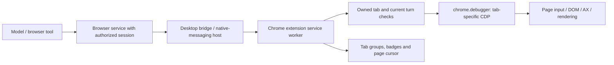

# Background browser control through the ChatGPT Chrome extension

November 9, 2026. Follow-up to the [native Chrome correction and provider comparison](2026-11-09-browser-runtime-options.md). The user wants the extension's background behavior understood deeply because foreground desktop input is a shared resource. [Versioned source and diagnostic evidence](evidence/2026-11-09-browser-runtimes/background-extension.json).

## Conclusion

**Background browser control is a distinct, valuable capability, and the extension has concrete machinery for it.** OpenAI documents parallel background tab work that does not take over the user's browsing. We inspected the published extension and installed desktop browser service to establish how they implement that separation. This strengthens the case for qualifying the Codex browser route early, while retaining the already-working native route for Chrome, Simulator and native dialogs. [OpenAI product documentation](https://learn.chatgpt.com/docs/whats-new#work-across-browser-tabs-with-the-chrome-extension), [official extension listing](https://chromewebstore.google.com/detail/chatgpt/hehggadaopoacecdllhhajmbjkdcmajg).

**This update is source research, not a live extension benchmark.** The shipped diagnostics report no enabled installation in the selected Chrome profile and a missing native-messaging host manifest. The earlier browser-access-host failure is an additional desktop prerequisite; installing the extension alone is not proven to resolve it. No extension or host was installed, no permissions changed, and no browser control was attempted in this update.

The official distribution supplied extension `1.26.1102.11740` (stable; build SHA `52add2ca490bc0f277acb48337ab808a143436b6`), matching the store listing. The installed desktop remains `26.1023.51421`. These are separately versioned artifacts, not an end-to-end validated pair. The downloaded CRX and readable implementation remain in ignored local research storage; the PR contains our findings and fingerprints only.

## 1. What actually makes it background

The desktop-connected route has this shape, derived from the inspected components:



The installed desktop access host described in the [earlier investigation](2026-11-09-browser-runtime-options.md#2-what-deeper-codex-inspection-established) is an authorization dependency. Chrome's native-messaging host is a separate transport component. Neither is the native Mac AX input provider, and the Chrome native-messaging host should not be confused with a raw debugging port.

Chrome explicitly supports extension debugger commands addressed to a tab ID, and native messaging between an extension and a registered local process. This lets an extension control an existing signed-in Chrome profile without launching that profile with a remote-debugging TCP listener. Our earlier direct-CDP OSS tests used a different connection route. [Chrome debugger API](https://developer.chrome.com/docs/extensions/reference/api/debugger), [native messaging](https://developer.chrome.com/docs/extensions/develop/concepts/native-messaging).

The inspected implementation supplies several complementary mechanisms:

| Mechanism | Actual source observation | Why it matters |
| --- | --- | --- |
| Inactive tab creation | The extension creates ordinary agent tabs with `active: false`; when it must create a new normal window, it requests `focused: false`. | Routine creation need not select a new tab or bring Chrome forward. This is source behavior, not a guarantee for every popup/login flow. |
| Logical active tab | A browser session maintains its own `activeTabId` and rewrites session tab records to indicate that logical selection. | An agent result saying `active: true` need not mean the user sees that tab. Never use that field alone to select the capture surface. |
| Tab-targeted input | Extension code calls `chrome.debugger.attach` and `sendCommand`; desktop code sends `Input.dispatchMouseEvent` and `Input.dispatchKeyEvent` to the selected page. | Page input is addressed through the browser rather than the desktop's current keyboard target. |
| Focus emulation | On attachment, the desktop service attempts `Emulation.setFocusEmulationEnabled` with `enabled: true`. | Helps keep controls behaving as though the page has focus without selecting its native window. The inspected call is best-effort; not every failure is propagated. |
| Page observations | Desktop service obtains browser AX/DOM state and uses page-rendering screenshot commands. | It can reason about the target page without observing the entire desktop or whatever tab the user is viewing. |
| Virtual pointer and clipboard | Extension publishes an in-page cursor overlay; desktop browser input supports a session virtual clipboard and blocks native clipboard shortcuts on that path. | The visible agent pointer is not evidence that the system mouse moved. Clipboard behavior is also distinct from native Mac paste. |

**A testing trap:** Chrome documents that focus emulation sets `document.visibilityState` to `visible` and suppresses `visibilitychange`. A page reporting visible is therefore insufficient proof that our automation foregrounded it, and insufficient proof that we reproduced normal blur/visibility behavior. Observe the real Chrome selected tab and native focused window independently. Test blur-driven autosave, attention timers and visibility bugs with this difference in mind. [Chrome focus-emulation documentation](https://developer.chrome.com/docs/devtools/rendering/apply-effects/#emulate-a-focused-page).

We did not reconstruct every native transport detail or execute these extension paths. The source evidence establishes the mechanism and intended coordination; it does not establish throughput or universal compatibility.

## 2. UX details worth understanding and borrowing

**Ownership is more than a tab ID.** Extension tab leases include session, turn, extension instance and origin (`agent` versus `user`). Claiming a tab actively owned by another session fails. Commands check session ownership; lifecycle changes are queued per session. This supports distinct agent workspaces, but it is not cookie/storage isolation: two tabs in the same browser profile can still affect the same login or backend account.

**Watching and controlling are separated.** The extension tracks the selected tab in each Chrome window for its cursor display. It can suppress animation for an unobserved tab, then show its page cursor when the tab is selected. Completion and handoff favicon badges distinguish results the user has not viewed. Separate code checks selected-tab-plus-focused-window state for clearing those badges. These are useful patterns for Vision: the selected stream should show which agent owns input, while an unviewed result can be discoverable without stealing focus.

**Background tabs are quiet.** The source mutes newly created inactive agent tabs and unmutes when they become selected if the extension itself applied the mute. This is an implementation finding, not a live sound test. It is a useful design detail for a coordinator that can launch several previews.

**Turn cleanup differs from workspace lifetime.** The installed guidance and extension implementation agree: unmarked agent-created tabs close at turn end; claimed user tabs are released and left open. Deliverable and handoff marks keep pages, with different ownership/resume behavior. Handoff marks need renewed attention on later turns. For our persistent workspace previews, deliberately retain or claim a companion-owned page; do not let ephemeral Pi completion close a useful preview. No second durable layout or tab registry is needed.

**Disconnect and takeover require real handling.** The extension has stop/abort state, debugger detach events, native-host reconnect logic and a client heartbeat that stops sessions and detaches when clients are no longer reachable. Chrome documents that opening DevTools on a tab can detach its extension debugger. We have not established that every manual click or keystroke automatically and safely pauses this exact extension version. Test the same-tab takeover explicitly; different-tab background work and same-tab co-editing are different promises. [Chrome debugger detach behavior](https://developer.chrome.com/docs/extensions/reference/api/debugger#event-onDetach).

The installed browser `visibility` capability is conditional on backend support. Its existence in generic guidance is not proof that every external Chrome connection can hide/show a window. Similarly, extension browser-management APIs are feature-gated. Use the actual returned capabilities rather than assuming all browser facades expose the same UI controls.

## 3. Background control and streaming are separate

One useful compatibility baseline is **a dedicated Chrome window for each actively streamed preview, with the relevant tab selected inside that window, while the Mac's keyboard focus remains elsewhere**. Then the browser agent can use tab-scoped input and ScreenCaptureKit can capture the selected page's native window. This combines the existing media pipeline with background browser control without adding another video transport. Exact tab/window/capture association, occlusion and frame freshness still need device validation. The later [many-surface requirement](2026-11-09-spatial-surfaces-without-desktop-windows.md) reopens the preferred browser host: dedicated desktop windows are not a requirement for every spatial preview.

An inactive tab behind another tab in the same window is different. Capturing that window shows its selected tab. The fact that the extension can control or screenshot a hidden tab does not make that tab appear in the window stream.

| Media option | What we know | Role in this plan |
| --- | --- | --- |
| Selected tab in a dedicated, unfocused native window → ScreenCaptureKit → VideoToolbox | Fits our existing H.264/Vision path. Native focus and window capture are separate concerns. | Compatibility baseline to qualify; compare browser-owned rendering for many surfaces. |
| Browser-generated screenshot | Installed service uses `Page.captureScreenshot`; its viewport path can briefly start a CDP screencast, accept a fresh frame, acknowledge and stop it, with fallback. | Model observations and diagnostics. Do not infer a stable continuous video API from an internal screenshot implementation. |
| Continuous CDP screencast | Browser service has per-tab arbitration between its internal screenshot screencast and raw screencast requests. | Possible experiment, but can contend with observation and needs quality/rate/cost measurements. Do not run an independent competing CDP controller against the same tab. |
| Extension `tabCapture` media stream | Chrome exposes a tab audio/video `MediaStream`; invocation and target access have their own requirements. The inspected ChatGPT manifest does **not** declare `tabCapture`. | Separate future browser-media investigation, not an existing ChatGPT stream we can simply consume. |

Chrome documents user invocation and target permissions for `tabCapture`; capture can persist across navigation, and closes with its tab or stream. That is distinct from debugger control permission. If dedicated windows prove awkward, this is a focused alternative to measure rather than a reason to redesign the media layer now. [Chrome tab capture](https://developer.chrome.com/docs/extensions/reference/api/tabCapture).

**Background is not one Boolean.** Qualify these separately: inactive tab; selected tab in an unfocused window; occluded window; minimized window; locked Mac; sleeping Mac; renderer suspended/discarded; and active human input. Chrome's lifecycle can suspend or discard pages. Neither a background-control claim nor emulated visibility guarantees fresh video, lock behavior or continued work during sleep. Keep native-control availability, browser-control availability and media availability distinct in the model's context. [Chrome page lifecycle](https://developer.chrome.com/docs/web-platform/page-lifecycle-api).

## 4. Reuse and implementation implications

The extension manifest grants debugger, native messaging, scripting, tab/window-related capabilities and broad host access; OpenAI's site permissions and task/session checks sit above those Chrome capabilities. The official setup path installs the extension and its desktop integration. Installing that integration, obtaining site approval, and provisioning an authorized browser runtime session are separate prerequisites. [OpenAI extension setup and permissions](https://learn.chatgpt.com/docs/chrome-extension).

There is a further source finding: the current extension contains an offscreen document for persistent JavaScript kernels and a feature-gated standalone browser-kernel path. That suggests more than one official hosting topology exists. It does **not** expose a documented arbitrary Pi-to-extension API or prove we can reuse that topology. We did not execute it, impersonate a session or enable hidden feature gates. Its registration/authentication boundary would need a separate investigation if it becomes relevant.

For SlopZooka, keep one coordinator and the existing companion-owned resources. Prefer a qualified tab-scoped browser capability for web work and the native capability for Simulator or native UI. They may come from the same installed Codex CUA runtime. A model chooses the applicable capability from observed state; there is no need for another supervisor or fixed app navigation recipes.

This changes where input arbitration belongs. Native keyboard/mouse work requires desktop coordination. Browser work can be coordinated per controlled tab when the provider proves that isolation. When an operation reaches a native file chooser, system dialog or other foreground-dependent interaction, explicitly transition to native ownership. Do not reserve the whole desktop unnecessarily for browser DOM work, and do not assume two actors can safely edit the same page concurrently.

Keep the native Chrome result as the working baseline. Treat background extension control as a high-priority qualification of the preferred Codex stack, not a requirement to replace it with OSS or build our own extension immediately. Public extension-based alternatives already researched remain available if legitimate Codex embedding stays unavailable.

## 5. Narrow live qualification

First enable the official integration through the user-facing setup and establish that a genuine Codex browser task can enumerate/claim an owned test tab. Do not treat a missing local installation as permission to install/repair the native host manually. There is no live extension result in this document.

Use two disposable pages with identical controls and independent event logs, plus a separate human typing page. Capture real Chrome selection and native focus, not just `document.hasFocus()` or `visibilityState`.

| Case | Concrete acceptance evidence |
| --- | --- |
| Background form action | Agent fills/clicks A while the user types in B or another app. Only A records agent input; user's field, selected tab, keyboard focus and clipboard remain correct. |
| Two agents / two tabs | Interleaved actions stay on their assigned pages. Conflicting ownership of one tab rejects or explicitly hands over. Record same-profile account sharing separately. |
| Observe and stream | A is selected inside its dedicated unfocused window; browser input changes A and the corresponding Vision stream shows that change without foreground activation. Compare page screenshot, capture ID and fixture event. |
| Human takeover / DevTools | User selects or interacts with A, then opens DevTools. Observe actual cancellation/detach behavior, stop pending input, and require a fresh observation before resuming. Do not retry a potentially delivered click blindly. |
| End turn / disconnect | Claimed user page survives; intended workspace preview survives; temporary agent tab closes. Reconnect cannot duplicate pages or revive a stale tab identity. |
| Visibility transitions | Repeat one action and frame-freshness check for inactive, occluded and minimized states. Record focus-emulation effects. A stale screenshot must not count as a functioning stream. |
| Lock and recovery | In a separately scheduled physical check, verify browser action, screenshot and Vision video independently while locked, then verify recovery. Preserve the existing native lock fallback until measured. |

These checks answer the UX question directly: can the orchestrator operate the correct preview while the user keeps working, and does the headset show that exact result? A new general-purpose browser platform is not required to answer it.

## Verification scope

Read official OpenAI/Chrome documentation, ran the two shipped read-only installation diagnostics, and inspected an official-store CRX without installing or executing it. Recorded package/source hashes, selected runtime call sites and the diagnostic results. Evidence and local documentation checks accompany this change; production, device and extension behavior tests were not rerun. Earlier native Chrome and OSS probe results remain separately labeled execution evidence.

## 6. Two terminal agents controlling two Chrome windows

Follow-up, November 9: the user wants two terminal Codex sessions operating separate browser windows concurrently. **The browser-extension architecture supports distinct tab owners; native app-scoped CUA does not establish that guarantee.** Two independent terminal clients still require a working, legitimately authorized adapter. Neither opening two Chrome windows nor granting Accessibility twice resolves that integration. [Additional source fingerprints and diagnostics](evidence/2026-11-09-browser-runtimes/parallel-control.json).

### What “focused” means

There are several different states: the frontmost macOS application; its key window/first responder; Chrome's selected tab within a window; and the focused element inside a page. An agent's logical active tab is another state. These must not be collapsed into one Boolean.

Ordinary keyboard events are dispatched through the key window to its first responder. Selecting a field and then typing relies on that destination remaining correct. Switching windows between those operations can redirect input. Direct AX actions address an accessibility element instead; they are not inherently equivalent to moving the global mouse. Accessibility permission identifies a trusted client process and does not create a separate input seat for every terminal. [Apple key-event routing](https://developer.apple.com/library/archive/documentation/Cocoa/Conceptual/EventOverview/HandlingKeyEvents/HandlingKeyEvents.html), [AX actions](https://developer.apple.com/documentation/applicationservices/1462091-axuielementperformaction), [process trust](https://developer.apple.com/documentation/applicationservices/1460720-axisprocesstrusted).

It would also be inaccurate to say that all Codex native Mac actions require the real foreground. OpenAI documents Mac background Computer Use. The installed native helper contains names including `SyntheticAppFocusEnforcer`, `SystemFocusStealPreventer`, `KeyWindowTracker` and `applicationBelievesItHasFocus`. These establish that focus management exists, not how every input is delivered or whether two windows in the same app can be controlled concurrently. The earlier successful native Chrome test did not vary focus or use two agents. [OpenAI Computer Use](https://learn.chatgpt.com/docs/computer-use).

The observed foreground behavior is therefore consistent with using the native route, selecting the relevant Chrome window/tab, or entering a native dialog. It is not proof that page-specific browser input needs desktop focus. Determining which happened in a particular task requires its actual tool trace.

### The actual interfaces we inspected

**Native route:** the persistent MCP JavaScript facade exposes `cua.getApp("com.google.Chrome")`, then methods such as `getAXState`, `click`, `setValue`, `typeText` and `pressKey`. Underneath, `@oai/sky` sends `ComputerUseIPCAppGetSkyshotRequest` and `ComputerUseIPCAppPerformActionRequest` through the signed helper's versioned local IPC (`CodexComputerUseIPC-5` in this installation). These requests carry an app identifier. This inspected Mac interface has no separate window-ID parameter; the `{windowId}` form in its shared documentation is for other platforms. Two handles obtained for `com.google.Chrome` are not evidence of two isolated window controllers.

**Browser route:** `cua.getBrowser` / `cua.getTab` expose the browser backend, with additional typed browser APIs supplied by its runtime guidance. The lower browser facade can list browser instances, enumerate user tabs and claim the exact returned tab object:

```javascript
// Interface illustration after legitimate runtime bootstrap, not a live test.
const browser = await agent.browsers.get(observedBrowserId);
const tabs = await browser.user.openTabs();
const page = await browser.user.claimTab(chosenTabFromThisList);
await page.playwright.getByRole("button", { name: "Save", exact: true }).click();
```

The selected browser includes its extension-instance/profile identity. Installed guidance checks the current tab ID, title and URL when claiming a user-mentioned tab, preventing a reused numeric ID from silently targeting a replacement. The service translates operations to tab-targeted CDP, carried through the desktop/native-messaging bridge to `chrome.debugger`. Browser AX/DOM observations are obtained from the page; this is distinct from macOS AX permission. The exact private runtime bootstrap remains the unresolved embedding dependency, rather than a public extension endpoint we can simply address.

The desktop service attempts page-focus emulation during attachment and sends mouse/key commands to the chosen CDP target. Thus, both pages can have independent target-local input and page focus without both being the real foreground window. That statement concerns the mechanism, not universal support for every page feature. Focus emulation changes visibility semantics, so blur/autosave behavior needs testing. [Chrome debugger targets](https://developer.chrome.com/docs/extensions/reference/api/debugger), [focus emulation](https://developer.chrome.com/docs/devtools/rendering/apply-effects/#emulate-a-focused-page).

### Where the runtime can conflict

The additional source inspection found:

- The extension stores **multiple sessions keyed by `session_id`**. Each session has its own `activeTabId`, `currentTurnId` and lifecycle promise queue. The inspected lifecycle queue is per session, not one global browser-work queue; that does not prove all lower-level execution is concurrent.
- `claimUserTab` rejects another session's already-owned tab; `requireOwnedTab` rejects commands outside the caller's tab set. Separate pages are the intended isolation boundary.
- A session has one active turn. Reusing one session identity for two independent terminals risks active-turn and cleanup interference even when their pages differ. Assign distinct authorized runtime sessions; do not fabricate identity metadata or duplicate one authorized task's credentials.
- The explicit `focusTab` operation calls both real tab selection and window focus. This is separate from logical tab ownership. Ordinary background page actions should not routinely invoke that presentation operation.
- The desktop screenshot/screencast queues are keyed by tab. Two different pages do not share that particular lock. Two independent screencast producers on the same page can still conflict.

| Arrangement | Consequence |
| --- | --- |
| Two Chrome windows, both agents using native `getApp("com.google.Chrome")` | Same app identity; exact per-window isolation and native focus arbitration are unproven. Serialize focus-dependent work and re-observe until qualified. |
| Two distinct tabs/windows, two authorized browser sessions | Intended background-control arrangement; tab leases prevent cross-session claims. Requires the actual two-client integration test. |
| Two agents sharing one tab | Ownership conflict or explicit handoff, rather than independent concurrent editing. |
| Two agents sharing one browser-session identity | Active-turn/lifecycle state can interfere; separate REPL variables alone do not fix it. |
| Separate Chrome profiles/instances | Can separate browser storage, but routing must include the correct extension instance. Does not itself create separate macOS foreground input. |

Two windows in one profile can share login cookies, storage and backend account state. Distinct tab ownership is not account isolation. Creating multiple Chrome processes also does not establish independent input seats, and the app-name/bundle-ID native interface may not distinguish the intended instance. For ordinary page operations, two complete Chrome installations are unnecessary; two correctly owned targets are the useful starting point.

### What remains unproven for terminal Codex

OpenAI documents parallel background tab work in the desktop product, but that does not promise a standalone browser-control SDK for two CLI processes. Its Browser documentation excludes the built-in browser from CLI/IDE. Our installed browser service additionally checks current-turn metadata and desktop-issued access authorization; the [earlier standalone probe](2026-11-09-browser-runtime-options.md#2-what-deeper-codex-inspection-established) failed those prerequisites. Native-runtime reuse succeeding does not establish browser-runtime reuse. [OpenAI parallel tabs](https://learn.chatgpt.com/docs/whats-new#work-across-browser-tabs-with-the-chrome-extension), [Browser availability](https://learn.chatgpt.com/docs/browser).

Both shipped installation diagnostics were repeated read-only: the selected profile still reports the extension not installed/enabled, and the native-messaging manifest is absent. No extension/host was installed, no permissions were changed, and no concurrent input was attempted. The Mac helper's packaged `sky/docs/skills/oai_sky_lib/macos/SKILL.md` was also inspected and cached separately from the earlier 52 guidance files; it confirms the app-scoped API and fresh-observation guidance, not a concurrency guarantee.

The focused acceptance test is **two actual terminal clients → two authorized browser sessions → two owned fixture tabs in separate streamed windows**, while the human types in a third app. Verify each page receives only its own actions, real foreground focus and clipboard remain unchanged, a same-tab claim rejects, and stopping/restarting A leaves B working. If cookies must be isolated, repeat with separate profiles. Add one native-dialog transition and verify it requests shared desktop input ownership instead of racing the other controller. Keep native streaming and browser input measurements separate.

This supports prioritizing the browser-specific provider for the parallel web UX. It does not require an owned Chromium embedder, and it does not settle whether Pi or a coding agent should own a given task. The unresolved issue is qualifying the real runtime/session connection and its behavior, not obtaining a second macOS Accessibility grant.

## 7. Runtime qualification runbook

November 9 follow-up: the user chose to work on the preferred runtime's actual integration. This phase needs the Mac, Chrome and the desktop app; it does not require Vision Pro. Reuse the dependency-free [two-page fixture server](../experiments/browser-runtime-probe/README.md#prepare-and-run). Keep each gate's result separate; a working desktop chat alone does not establish external Pi or CLI reuse.

### Current preflight

**Before installation:** rechecked the installed desktop version (`26.1023.51421`, build `22530`), the two shipped read-only diagnostics and this conversation's normal browser entry point. The selected profile reported extension `installed: false`, `enabled: false` (exit 2); the native-messaging manifest reported `exists: false`, `correct: false` (exit 1). `cua.getBrowser({ id: "chrome" })` returned **“The browser access host is unavailable.”** No tab was opened or permission changed by that probe. [Sanitized record](evidence/2026-11-09-browser-runtimes/qualification-preflight.json).

**After the user installed it:** the app is now `26.1103.60933`, build `25894`. Both current-version diagnostics pass (exit 0): the selected profile's extension is installed/enabled and its native host exists/is correct. This conversation's `cua.getBrowser({ id: "chrome" })` still fails with the same access-host error, including after the documented REPL reset. No browser action reached the fixture. This narrows the remaining failure to the chat/tool host path rather than the installation checks; it does not establish the root cause. [Post-installation evidence](evidence/2026-11-09-browser-runtimes/qualification-after-install.json).

The previous version's plugin-cache directory disappeared during the app update. An initial old-path diagnostic invocation failed before producing JSON; it was rerun against the explicitly identified current version. This is concrete version-path churn, not a native-runtime regression result. The earlier independent native experiment still describes its pinned old build; it has not been requalified on this new build.

Official setup is **ChatGPT desktop → Settings → Computer Use → Chrome → Install**, follow the extension-store permission prompts, return and confirm **Manage**, then start a browser-mentioned chat in the same profile. Installation and the fresh-chat Chrome baseline are now complete; see the result below. The official troubleshooting sequence includes a fresh chat for chat-specific connection state and, if necessary, desktop/browser restart. Restart is a separate user-coordinated action because it may interrupt other work. [Official browser setup and troubleshooting](https://learn.chatgpt.com/docs/chrome-extension).

The extension/native host and the desktop access host are different prerequisites. Read-only source inspection confirms that the latter is initialized by the desktop main process, signs access decisions, and resolves the requesting thread/executor through desktop-owned state. We have not found a public external registration contract. Filling in a pipe path or copying an existing turn's identifiers would not establish an independently authorized client. The documentation also does not offer the built-in browser as a CLI/IDE feature. [Browser availability](https://learn.chatgpt.com/docs/browser).

For the fresh-chat baseline, start the fixture server if necessary and substitute its current URL into this prompt: **“@Chrome use the browser-specific tools to open `<fixture-origin>/a`, save `codex-a` as the Workspace label, click Increment twice, open Settings, and verify with a screenshot. This is a disposable local fixture. Report whether the specialized browser route works; do not substitute native Mac app control.”** Inspect `/events` independently afterward. A successful fresh chat will not automatically repair this conversation or authorize an external client.

### Desktop baseline passed; independent provisioning remains open

The user completed the fixture in a fresh desktop chat. We independently read that task's tool trace, checked the fixture server's event log, and viewed its saved screenshot. The first run used the built-in browser; the corrected second run explicitly called `cua.createBrowserTab("chrome", ...)`, used Playwright controls, marked the tab as a deliverable and took a screenshot. The screenshot shows `codex-a`, Counter 2 and Settings. Events 5–8 contain exactly save, increment to 1, increment to 2 and settings for `/a`; events 1–4 belong to the earlier built-in-browser run. **Gate A passes for the desktop Chrome-extension route.** This is stronger evidence than the installation diagnostics or a non-error tool response alone. [Baseline and follow-up evidence](evidence/2026-11-09-browser-runtimes/desktop-baseline.json).

After this success, an independent, model-free MCP probe launched the genuine current-version runtime with only the browser surface enabled. It inherited no task identity and sent no turn metadata. Initialization and the tool catalog succeeded (`rmcp` 3.5.1); `cua.getBrowser({ id: "chrome" })` rejected **“Cannot verify browser access without the current turn.”** Its own process closed cleanly. This confirms that extension installation plus the launcher is insufficient for an outside caller. It does not prove that a properly provisioned CLI turn would fail. The ignored probe copy is derived from the original tracked client with the explicit new version and browser-only entry point; its recipe and hashes are recorded.

The new desktop bundle's thread-access registry observes actual thread start/resume responses and `thread/started` notifications, maps thread/session identity to an executor, and resolves authenticated-principal state for root threads. This is a concrete lifecycle boundary to investigate, not evidence that arbitrary IDs confer access. The normal browser service still requires current-turn identity and a signed access-host decision. Current-version source fingerprints and markers accompany the result; no checks were removed or identities borrowed.

There is also a working independent **App Server transport**: the installed CLI reports an existing daemon at version 0.167.0, and a client identifying itself as `slz_browser_qualification` connected through the documented WebSocket-over-Unix transport, initialized and read only the completed fixture task. It did not resume that task or create a thread/turn. An initial raw-JSONL attempt through `app-server proxy` timed out; the correct WebSocket handshake then passed. Neither result is a browser authorization verdict. The existing server and unrelated tasks were left running. [App Server transport and initialization](https://developers.openai.com/codex/app-server#protocol).

The next bounded experiment was an owned disposable task/turn on the existing App Server, using the installed runtime to try fixture `/b`. The user explicitly approved starting that separate task. Its result follows. Codex-hosted execution and a direct model-free Pi browser SDK remain distinct, and the two-client concurrency gate remains untouched.

### Owned Codex task result

The [independent client](../experiments/codex-runtime-probe/app-server-task.mjs) created a real ephemeral thread and turn on the existing App Server, with a read-only empty temporary working directory. It registered the current packaged MCP launcher under its own server name, retained the packaged environment/checks, and restricted its CUA surface to the browser. The configured default model was `gpt-6.1-sol`; no model override was supplied. We did not copy the successful desktop task's turn identifiers, access-host pipe or verifying identity. [Exact sanitized results and hashes](evidence/2026-11-09-browser-runtimes/owned-task.json).

| Boundary | Observed result |
| --- | --- |
| Independent client → existing App Server | Connected and initialized normally. |
| New task/turn | Server-issued thread/session and turn IDs returned; the model actually ran. |
| Genuine MCP launcher | Started successfully; its four-tool catalog was available. Catalog `authStatus: unsupported` describes MCP OAuth support, not a browser access decision. |
| Model → browser tool | Exactly one `slz_browser_probe.js` call: `await cua.getBrowser({ id: "chrome" });`. |
| Browser-host provisioning | Rejected **“The browser access host is unavailable.”** No site permission or other host request reached our client. |
| App effect | No new fixture events; `/b` remained untouched. No screenshot or browser tab was produced by this task. |
| Completion and cleanup | The model reported the exact error and stopped. Turn status was `completed`, meaning the diagnostic task finished, not that browser control passed. The client unsubscribed its thread, closed its connection and removed its empty temporary directory. The existing daemon remained running. |

This advances the diagnosis: a real Codex turn gets past the model-free probe's missing-current-turn check, but **App Server task creation plus the static MCP manifest does not supply the desktop browser host**. In the inspected service, this error occurs when the access-host connection or its verifying identity is absent, before a signed access decision is obtained. It is not a website denial or evidence that the extension is broken. This also does not establish that the host would authorize our executor if connected.

Configuration detail: the per-thread MCP map merged existing configured servers; some unrelated servers initialized, but the agent called only `slz_browser_probe`. No unrelated tools were invoked or personal configuration changed. Raw local traces can include those startup diagnostics and runtime guidance; the committed evidence retains only the relevant fixture/probe result. The experiment must not be described as a hardened tool-isolation test.

**Remaining integration work:** identify a legitimate desktop-owned bootstrap/registration interface that provides an outside caller with its own browser host connection and authorization lifecycle. Simply adding MCP to terminal Codex is insufficient in the tested arrangement. If that interface is unavailable, the demonstrated working path is a desktop-created Codex task; evaluate delegation to that path separately from direct Pi provider reuse. Do not fabricate access decisions, reuse another task's credentials, or change the runtime's checks. Parallel-owner, cold-start and Locked Use tests remain downstream of this provisioning gap.

### Gates and evidence

| Gate | Test | Pass evidence / next action |
| --- | --- | --- |
| **A. Working desktop baseline — passed** | A fresh desktop chat used the Chrome-extension route to operate fixture `/a`: save a dummy label, increment twice, open Settings, obtain a screenshot. | Actual Chrome tool trace, independently checked fixture events and screenshot agree. This conversation's earlier access-host failure remains a separate observation. |
| **B. Independent caller and lifecycle — still open** | The model-free MCP probe lacks current-turn context. A real, independently created App Server task supplies that context but still lacks the desktop browser host. | Obtain legitimate host provisioning for our own caller, then qualify access approval, observations, cancellation and cleanup. The tested static-manifest adapter does not pass this gate; a desktop-created task remains a separate working route. |
| **C. Actual consumers** | Connect a terminal Codex instance and a minimal Pi/tool adapter through the qualified path. Keep app-navigation reasoning outside the adapter. | Each can issue an operation and receive a fresh model-visible observation for its own target. Record whether the desktop must remain running and whether each consumer can recover without restarting the other. Do not build the production orchestrator to test this. |
| **D. Independent concurrent targets** | Run two distinct authorized consumers on `/a` and `/b`, with distinct dummy labels, while the human uses another app. | Verify events never cross targets, same-tab claims reject, foreground/clipboard remain undisturbed for page actions, Stop/restart A leaves B functional, and any native dialog requests shared input ownership. This qualifies browser control; streaming identity is a later integration test. |

If direct browser reuse cannot pass B, explicitly choose whether the additional desktop-agent delegation is acceptable or whether to use a separately selected browser provider while retaining Codex native CUA. Do not silently replace the requested runtime or build multiple backends. Review update independence and shipping terms before converting an unstable experimental dependency into a release commitment.

### Preparation verification

The new fixture server passed JavaScript syntax and an HTTP-only smoke check: both pages serve, a dummy event is persisted, invalid origin/target events reject, and its owned process exits cleanly. These HTTP requests are not browser actions or a passed runtime gate. Build/log output remains ignored. No model invocation, external-client browser authorization, parallel extension operation or Vision test was performed in this preparation step.

## 8. Desktop bootstrap traced after the owned-task failure

**The missing step is now located in the desktop's task-configuration path.** This follow-up inspected the installed `26.1103.60933` bundle and the public CLI source at `rust-v0.167.0`, matching our App Server. It did not start another task, invoke browser control, inspect another process's environment, or change settings. The [bootstrap evidence](evidence/2026-11-09-browser-runtimes/host-bootstrap.json) records source markers, artifact hashes and the inspected protocol inventory. These are source findings; the live result remains the host-unavailable failure above.

### What the desktop adds

The renderer calls `appServices.threadConfiguration.readMcpConfig({cwd, hostId, context})`. Its main-process implementation calls `buildMcpCodexConfig`, which selects the enabled runtime and generates per-task overrides. For the local host, it obtains the authenticated principal and injects three browser values: `BROWSER_USE_ACCESS_EXECUTOR_ID`, `BROWSER_USE_ACCESS_PIPE_PATH`, and `BROWSER_USE_ACCESS_VERIFYING_IDENTITY`. The last is an Ed25519 **public verification key**, not the signing private key. Its role is to verify the access host's response; a pipe address or public key alone does not grant access.

There is explicit handling for the shared local App Server daemon: the generated overrides can include the unified CUA MCP server as well as `node_repl`. This is significant because the daemon need not inherit the desktop process's current environment. The static plugin manifest we used contains the launcher and tool guidance, but not this generated desktop configuration.

```mermaid
sequenceDiagram
    participant UI as Desktop task creation
    participant Config as Desktop configuration service
    participant AS as App Server
    participant CUA as Packaged CUA runtime
    participant Host as Desktop browser access host
    UI->>Config: readMcpConfig(cwd, hostId, context)
    Config-->>UI: Runtime configuration + host connection + executor identity
    UI->>AS: thread/start with generated overrides
    AS->>CUA: Start MCP; invoke tool with actual turn context
    CUA->>Host: browser/access for executor, session, turn and nonce
    Host-->>CUA: Signed access decision
    CUA->>CUA: Verify decision before browser discovery
```

The desktop creates the access host during startup, holds its signing key, publishes its connection information internally, and removes it on disposal. On the packaged macOS path, the host transport calls a native socket-peer authorizer. Its decision also consults the desktop's session/executor registry and account/Work access state. We inspected the authorizer call site, not a full proof of its native implementation or allowed identities.

`readMcpConfig` is exposed as a desktop app service, not as a method in the installed App Server's 106-method `ClientRequest` schema. We found no external enrollment/bootstrap contract in that schema or the official pages consulted. That is a scoped negative finding, not proof that no other private interface exists. Ordinary client initialization identifies an integration; it does not document browser-host provisioning. [Official initialization contract](https://learn.chatgpt.com/docs/app-server#initialization).

### Two useful interfaces, with different limits

| Interface found | What it offers | What it does not establish |
| --- | --- | --- |
| App Server `mcpServer/tool/call` | Calls a loaded thread's configured MCP tool directly, returning MCP content and structured output. This is a documented, model-free transport operation. | It does not generate the desktop configuration. In the inspected CLI call chain it adds thread-ID metadata and forwards caller metadata, rather than creating a model turn and its browser session/turn context. It is not by itself a qualified Pi browser provider. |
| Packaged `codex-app-tools` MCP | Dynamically lists desktop tools and forwards calls/cancellation to the desktop. Its catalog includes `create_thread`, `send_message_to_thread`, `read_thread` and `wait_threads`. | It needs its own desktop host connection and caller context. Copying this second plugin manifest does not solve external provisioning either. It is a task-delegation interface, not low-level browser actions. |
| Desktop's remote-host MCP bridge | The inspected SSH transport creates a scoped, authenticated loopback Streamable HTTP MCP endpoint and forwards it to the remote host. It revokes the session on disposal and restricts the advertised tools for remote tasks. | This is evidence that desktop-tool delegation across a process/host boundary is implemented. It is not a generic local Pi registration API or proof that a remote task inherits local browser CUA. We did not create an SSH connection or use this bridge. |

The generic tool-call behavior is documented in the [App Server API overview](https://learn.chatgpt.com/docs/app-server#api-overview). Its pinned implementation is traceable through [the request handler](https://github.com/openai/codex/blob/086ccc833bc9cf01024ad2dd6af7dbd421b6bf9a/codex-rs/app-server/src/request_processors/mcp_processor.rs#L738), [the thread facade](https://github.com/openai/codex/blob/086ccc833bc9cf01024ad2dd6af7dbd421b6bf9a/codex-rs/core/src/codex_thread.rs#L1351), [MCP runtime dispatch](https://github.com/openai/codex/blob/086ccc833bc9cf01024ad2dd6af7dbd421b6bf9a/codex-rs/codex-mcp/src/runtime.rs#L771) and [connection dispatch](https://github.com/openai/codex/blob/086ccc833bc9cf01024ad2dd6af7dbd421b6bf9a/codex-rs/codex-mcp/src/connection_manager.rs#L1337). We reviewed these sources and their fixture test; we did not run the Rust test suite. Supplying arbitrary `_meta` is not a substitute for qualifying a real owner and turn lifecycle.

The local `codex app --help` and [official command description](https://learn.chatgpt.com/docs/developer-commands#codex-app) expose opening the desktop app at a workspace path. They do not provide a browser-host bootstrap or a headless desktop-task dispatch flag. Browser documentation still directs CLI/IDE users to the desktop product; it does not promise standalone reuse of the Chrome backend. [Browser availability](https://learn.chatgpt.com/docs/browser).

### Narrow next experiment and stopping rule

**Proposed experiment, now run in [section 9](#9-desktop-task-delegation-passed-terminal-delegation-differs): a desktop-delegated fixture task.** Use the actual desktop task-creation surface with its normal configuration generation, one owned disposable task and the same `/b` objective. Record task identity, actual Chrome-specific tool calls, independent fixture events and a screenshot. The existing fresh-chat baseline already passes; this next test must specifically establish programmatic dispatch, observation and completion through the desktop task interface. Test Stop separately once basic dispatch passes.

That result would qualify a useful candidate: **Pi requests a browser objective; a desktop Codex task performs navigation; the Mac companion captures the resulting window and presents it through the existing gateway.** It adds a second model task, desktop lifecycle dependence and progress/approval routing. It does not settle whether Pi should instead own each browser action, and it does not yet qualify an outside companion's access to the task interface.

For direct Pi actions, continue only when there is a concrete way for the desktop to issue configuration and lifecycle ownership to our caller. If no such route emerges, keep the direct-browser adapter unresolved and make the delegation-versus-separate-browser-provider decision explicit. Recreating the desktop's account mapping, signing host, plugin configuration, frontend service bridge and lifecycle machinery would be substantial maintenance work; the research does not justify adopting that architecture.

Keep SlopZooka's boundary small in either case: workspace/surface identity, requested operation, fresh observation, cancellation, and delivery to the existing window gateway. Native Mac CUA reuse and the ScreenCaptureKit/video path remain separate evidence. No production rearchitecture, new persistence owner, second media stack, parallel browser qualification or locked-use claim follows from this source inspection.

## 9. Desktop task delegation passed; terminal delegation differs

The user authorized the next experiment. **A desktop parent successfully created a child using `codex_app.create_thread`, and that child used Chrome through the extension to complete fixture `/b`.** We verified the parent/child tool traces, independent HTTP fixture events, completed turns and the saved screenshot. This establishes programmatic task creation and browser execution **inside the desktop-owned delegation path**. It does not establish an independent companion/Pi client's connection to that path. [Sanitized results and artifact hashes](evidence/2026-11-09-browser-runtimes/desktop-delegation.json).

Three attempts must remain distinct:

| Entry point | Result | Evidence |
| --- | --- | --- |
| This conversation's `codex_tui.create_thread` | Task creation worked; its Chrome initialization failed with “The browser access host is unavailable.” | One failed browser initialization call, one completion-summary call, completed diagnostic turn, no new fixture events. This was terminal-side delegation, not the desktop `codex_app` service. Our initial description of this attempt as desktop dispatch was incorrect. |
| User-created fresh desktop task | Chrome fixture passed with label `codex-b`. | Events 9–12: save at 0, increment to 1, increment to 2, Settings. Screenshot independently viewed; final turn completed. This repeats the desktop baseline, not programmatic creation. |
| Desktop parent → `codex_app.create_thread` → child | **Delegated Chrome fixture passed** with label `desktop-delegated-b`. | Parent called the real desktop tool with `target: {type: "projectless"}` and no model override. The distinct child called `cua.createBrowserTab("chrome", ...)`, used browser AX controls, marked its tab as a deliverable and captured a screenshot. Events 13–16 contain exactly its four expected actions. Parent and child completed. |

The parent performed no browser actions in its delegation turn. The child's screenshot shows Workspace `/b`, `desktop-delegated-b`, Counter 2 and Settings. `/a` remained unchanged. The two successful `/b` tasks used new tabs; no native Mac or built-in-browser fallback was used. Tabs and user-owned tasks remain available, and the existing loopback fixture server was left running for review.

Manual setup was necessary: this conversation's `cua.getApp("ChatGPT")` failed with **“Sky Computer Use native pipe startup failed.”** Its cause is not established. The user could not find the terminal-created task in the desktop UI, so created a fresh desktop task, ran the fixture, then sent the explicit child-task request there. We did not automate those two composer submissions. Consequently this is not yet an unattended external orchestrator demo, and the native runtime is still not requalified on the updated desktop build.

### Observation and lifecycle caveat

The terminal-side `read_thread` interface retrieved the desktop tasks' transcripts and final screenshot paths, which we inspected on the Mac. During execution, an early snapshot reported the desktop task as `notLoaded` with an `interrupted` turn and no completion time; a later read showed the final answer and `completed` status. The same transient pattern occurred while observing the child. We did not interrupt either desktop task. **Do not use that early cross-client snapshot alone to infer cancellation, completion or safe retry.** The underlying cause and whether these clients share a live task owner remain unqualified; visibility of a saved transcript is not proof of shared execution ownership.

### What to test next

The immediate question is now **how the Mac companion obtains an authorized connection to the working desktop task interface**. Test that registration and a fixture-scoped request, then Stop and reconnect, without duplicating the desktop's configuration/authentication services. The manual desktop setup must disappear before calling this a companion integration pass. Preserve the distinction between `codex_app` and `codex_tui` in any adapter and evidence.

This makes desktop Codex delegation a demonstrated candidate for navigation reasoning. Direct model-free Pi browser actions, two concurrent browser owners, precise tab-to-native-window capture association, restart recovery, Stop guarantees, Locked Use and Vision streaming remain separate qualification work. No production code or architecture changed in this test.

This update passed exact event/trace reconciliation, visual inspection of both new fixture screenshots, twelve artifact hashes, sixty local documentation links/anchors, Markdown fences and whitespace checks. Raw traces and screenshots remain ignored. Production, parallel-browser, Stop, lock and headset tests were not run; the earlier unrelated WebKit verification failure remains unresolved.
