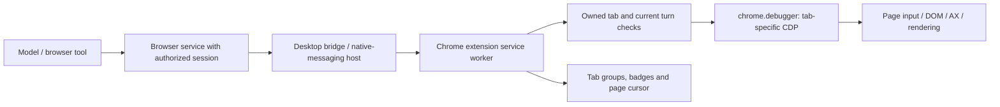

# Background browser control through the ChatGPT Chrome extension

November 9, 2026. Follow-up to the [native Chrome correction and provider comparison](2026-11-09-browser-runtime-options.md). The user wants the extension's background behavior understood deeply because foreground desktop input is a shared resource. [Versioned source and diagnostic evidence](evidence/2026-11-09-browser-runtimes/background-extension.json).

## Conclusion

**Background browser control is a distinct, valuable capability, and the extension has concrete machinery for it.** OpenAI documents parallel background tab work that does not take over the user's browsing. We inspected the published extension and installed desktop browser service to establish how they implement that separation. This strengthens the case for qualifying the Codex browser route early, while retaining the already-working native route for Chrome, Simulator and native dialogs. [OpenAI product documentation](https://learn.chatgpt.com/docs/whats-new#work-across-browser-tabs-with-the-chrome-extension), [official extension listing](https://chromewebstore.google.com/detail/chatgpt/hehggadaopoacecdllhhajmbjkdcmajg).

**This update is source research, not a live extension benchmark.** The shipped diagnostics report no enabled installation in the selected Chrome profile and a missing native-messaging host manifest. The earlier browser-access-host failure is an additional desktop prerequisite; installing the extension alone is not proven to resolve it. No extension or host was installed, no permissions changed, and no browser control was attempted in this update.

The official distribution supplied extension `1.26.1102.11740` (stable; build SHA `52add2ca490bc0f277acb48337ab808a143436b6`), matching the store listing. The installed desktop remains `26.1023.51421`. These are separately versioned artifacts, not an end-to-end validated pair. The downloaded CRX and readable implementation remain in ignored local research storage; the PR contains our findings and fingerprints only.

## 1. What actually makes it background

The desktop-connected route has this shape, derived from the inspected components:

The installed desktop access host described in the [earlier investigation](2026-11-09-browser-runtime-options.md#2-what-deeper-codex-inspection-established) is an authorization dependency. Chrome's native-messaging host is a separate transport component. Neither is the native Mac AX input provider, and the Chrome native-messaging host should not be confused with a raw debugging port.

Chrome explicitly supports extension debugger commands addressed to a tab ID, and native messaging between an extension and a registered local process. This lets an extension control an existing signed-in Chrome profile without launching that profile with a remote-debugging TCP listener. Our earlier direct-CDP OSS tests used a different connection route. [Chrome debugger API](https://developer.chrome.com/docs/extensions/reference/api/debugger), [native messaging](https://developer.chrome.com/docs/extensions/develop/concepts/native-messaging).

The inspected implementation supplies several complementary mechanisms:

| Mechanism | Actual source observation | Why it matters |
| --- | --- | --- |
| Inactive tab creation | The extension creates ordinary agent tabs with `active: false`; when it must create a new normal window, it requests `focused: false`. | Routine creation need not select a new tab or bring Chrome forward. This is source behavior, not a guarantee for every popup/login flow. |
| Logical active tab | A browser session maintains its own `activeTabId` and rewrites session tab records to indicate that logical selection. | An agent result saying `active: true` need not mean the user sees that tab. Never use that field alone to select the capture surface. |
| Tab-targeted input | Extension code calls `chrome.debugger.attach` and `sendCommand`; desktop code sends `Input.dispatchMouseEvent` and `Input.dispatchKeyEvent` to the selected page. | Page input is addressed through the browser rather than the desktop's current keyboard target. |
| Focus emulation | On attachment, the desktop service attempts `Emulation.setFocusEmulationEnabled` with `enabled: true`. | Helps keep controls behaving as though the page has focus without selecting its native window. The inspected call is best-effort; not every failure is propagated. |
| Page observations | Desktop service obtains browser AX/DOM state and uses page-rendering screenshot commands. | It can reason about the target page without observing the entire desktop or whatever tab the user is viewing. |
| Virtual pointer and clipboard | Extension publishes an in-page cursor overlay; desktop browser input supports a session virtual clipboard and blocks native clipboard shortcuts on that path. | The visible agent pointer is not evidence that the system mouse moved. Clipboard behavior is also distinct from native Mac paste. |

**A testing trap:** Chrome documents that focus emulation sets `document.visibilityState` to `visible` and suppresses `visibilitychange`. A page reporting visible is therefore insufficient proof that our automation foregrounded it, and insufficient proof that we reproduced normal blur/visibility behavior. Observe the real Chrome selected tab and native focused window independently. Test blur-driven autosave, attention timers and visibility bugs with this difference in mind. [Chrome focus-emulation documentation](https://developer.chrome.com/docs/devtools/rendering/apply-effects/#emulate-a-focused-page).

We did not reconstruct every native transport detail or execute these extension paths. The source evidence establishes the mechanism and intended coordination; it does not establish throughput or universal compatibility.

## 2. UX details worth understanding and borrowing

**Ownership is more than a tab ID.** Extension tab leases include session, turn, extension instance and origin (`agent` versus `user`). Claiming a tab actively owned by another session fails. Commands check session ownership; lifecycle changes are queued per session. This supports distinct agent workspaces, but it is not cookie/storage isolation: two tabs in the same browser profile can still affect the same login or backend account.

**Watching and controlling are separated.** The extension tracks the selected tab in each Chrome window for its cursor display. It can suppress animation for an unobserved tab, then show its page cursor when the tab is selected. Completion and handoff favicon badges distinguish results the user has not viewed. Separate code checks selected-tab-plus-focused-window state for clearing those badges. These are useful patterns for Vision: the selected stream should show which agent owns input, while an unviewed result can be discoverable without stealing focus.

**Background tabs are quiet.** The source mutes newly created inactive agent tabs and unmutes when they become selected if the extension itself applied the mute. This is an implementation finding, not a live sound test. It is a useful design detail for a coordinator that can launch several previews.

**Turn cleanup differs from workspace lifetime.** The installed guidance and extension implementation agree: unmarked agent-created tabs close at turn end; claimed user tabs are released and left open. Deliverable and handoff marks keep pages, with different ownership/resume behavior. Handoff marks need renewed attention on later turns. For our persistent workspace previews, deliberately retain or claim a companion-owned page; do not let ephemeral Pi completion close a useful preview. No second durable layout or tab registry is needed.

**Disconnect and takeover require real handling.** The extension has stop/abort state, debugger detach events, native-host reconnect logic and a client heartbeat that stops sessions and detaches when clients are no longer reachable. Chrome documents that opening DevTools on a tab can detach its extension debugger. We have not established that every manual click or keystroke automatically and safely pauses this exact extension version. Test the same-tab takeover explicitly; different-tab background work and same-tab co-editing are different promises. [Chrome debugger detach behavior](https://developer.chrome.com/docs/extensions/reference/api/debugger#event-onDetach).

The installed browser `visibility` capability is conditional on backend support. Its existence in generic guidance is not proof that every external Chrome connection can hide/show a window. Similarly, extension browser-management APIs are feature-gated. Use the actual returned capabilities rather than assuming all browser facades expose the same UI controls.

## 3. Background control and streaming are separate

One useful compatibility baseline is **a dedicated Chrome window for each actively streamed preview, with the relevant tab selected inside that window, while the Mac's keyboard focus remains elsewhere**. Then the browser agent can use tab-scoped input and ScreenCaptureKit can capture the selected page's native window. This combines the existing media pipeline with background browser control without adding another video transport. Exact tab/window/capture association, occlusion and frame freshness still need device validation. The later [many-surface requirement](2026-11-09-spatial-surfaces-without-desktop-windows.md) reopens the preferred browser host: dedicated desktop windows are not a requirement for every spatial preview.

An inactive tab behind another tab in the same window is different. Capturing that window shows its selected tab. The fact that the extension can control or screenshot a hidden tab does not make that tab appear in the window stream.

| Media option | What we know | Role in this plan |
| --- | --- | --- |
| Selected tab in a dedicated, unfocused native window → ScreenCaptureKit → VideoToolbox | Fits our existing H.264/Vision path. Native focus and window capture are separate concerns. | Compatibility baseline to qualify; compare browser-owned rendering for many surfaces. |
| Browser-generated screenshot | Installed service uses `Page.captureScreenshot`; its viewport path can briefly start a CDP screencast, accept a fresh frame, acknowledge and stop it, with fallback. | Model observations and diagnostics. Do not infer a stable continuous video API from an internal screenshot implementation. |
| Continuous CDP screencast | Browser service has per-tab arbitration between its internal screenshot screencast and raw screencast requests. | Possible experiment, but can contend with observation and needs quality/rate/cost measurements. Do not run an independent competing CDP controller against the same tab. |
| Extension `tabCapture` media stream | Chrome exposes a tab audio/video `MediaStream`; invocation and target access have their own requirements. The inspected ChatGPT manifest does **not** declare `tabCapture`. | Separate future browser-media investigation, not an existing ChatGPT stream we can simply consume. |

Chrome documents user invocation and target permissions for `tabCapture`; capture can persist across navigation, and closes with its tab or stream. That is distinct from debugger control permission. If dedicated windows prove awkward, this is a focused alternative to measure rather than a reason to redesign the media layer now. [Chrome tab capture](https://developer.chrome.com/docs/extensions/reference/api/tabCapture).

**Background is not one Boolean.** Qualify these separately: inactive tab; selected tab in an unfocused window; occluded window; minimized window; locked Mac; sleeping Mac; renderer suspended/discarded; and active human input. Chrome's lifecycle can suspend or discard pages. Neither a background-control claim nor emulated visibility guarantees fresh video, lock behavior or continued work during sleep. Keep native-control availability, browser-control availability and media availability distinct in the model's context. [Chrome page lifecycle](https://developer.chrome.com/docs/web-platform/page-lifecycle-api).

## 4. Reuse and implementation implications

The extension manifest grants debugger, native messaging, scripting, tab/window-related capabilities and broad host access; OpenAI's site permissions and task/session checks sit above those Chrome capabilities. The official setup path installs the extension and its desktop integration. Installing that integration, obtaining site approval, and provisioning an authorized browser runtime session are separate prerequisites. [OpenAI extension setup and permissions](https://learn.chatgpt.com/docs/chrome-extension).

There is a further source finding: the current extension contains an offscreen document for persistent JavaScript kernels and a feature-gated standalone browser-kernel path. That suggests more than one official hosting topology exists. It does **not** expose a documented arbitrary Pi-to-extension API or prove we can reuse that topology. We did not execute it, impersonate a session or enable hidden feature gates. Its registration/authentication boundary would need a separate investigation if it becomes relevant.

For SlopZooka, keep one coordinator and the existing companion-owned resources. Prefer a qualified tab-scoped browser capability for web work and the native capability for Simulator or native UI. They may come from the same installed Codex CUA runtime. A model chooses the applicable capability from observed state; there is no need for another supervisor or fixed app navigation recipes.

This changes where input arbitration belongs. Native keyboard/mouse work requires desktop coordination. Browser work can be coordinated per controlled tab when the provider proves that isolation. When an operation reaches a native file chooser, system dialog or other foreground-dependent interaction, explicitly transition to native ownership. Do not reserve the whole desktop unnecessarily for browser DOM work, and do not assume two actors can safely edit the same page concurrently.

Keep the native Chrome result as the working baseline. Treat background extension control as a high-priority qualification of the preferred Codex stack, not a requirement to replace it with OSS or build our own extension immediately. Public extension-based alternatives already researched remain available if legitimate Codex embedding stays unavailable.

## 5. Narrow live qualification

First enable the official integration through the user-facing setup and establish that a genuine Codex browser task can enumerate/claim an owned test tab. Do not treat a missing local installation as permission to install/repair the native host manually. There is no live extension result in this document.

Use two disposable pages with identical controls and independent event logs, plus a separate human typing page. Capture real Chrome selection and native focus, not just `document.hasFocus()` or `visibilityState`.

| Case | Concrete acceptance evidence |
| --- | --- |
| Background form action | Agent fills/clicks A while the user types in B or another app. Only A records agent input; user's field, selected tab, keyboard focus and clipboard remain correct. |
| Two agents / two tabs | Interleaved actions stay on their assigned pages. Conflicting ownership of one tab rejects or explicitly hands over. Record same-profile account sharing separately. |
| Observe and stream | A is selected inside its dedicated unfocused window; browser input changes A and the corresponding Vision stream shows that change without foreground activation. Compare page screenshot, capture ID and fixture event. |
| Human takeover / DevTools | User selects or interacts with A, then opens DevTools. Observe actual cancellation/detach behavior, stop pending input, and require a fresh observation before resuming. Do not retry a potentially delivered click blindly. |
| End turn / disconnect | Claimed user page survives; intended workspace preview survives; temporary agent tab closes. Reconnect cannot duplicate pages or revive a stale tab identity. |
| Visibility transitions | Repeat one action and frame-freshness check for inactive, occluded and minimized states. Record focus-emulation effects. A stale screenshot must not count as a functioning stream. |
| Lock and recovery | In a separately scheduled physical check, verify browser action, screenshot and Vision video independently while locked, then verify recovery. Preserve the existing native lock fallback until measured. |

These checks answer the UX question directly: can the orchestrator operate the correct preview while the user keeps working, and does the headset show that exact result? A new general-purpose browser platform is not required to answer it.

## Verification scope

Read official OpenAI/Chrome documentation, ran the two shipped read-only installation diagnostics, and inspected an official-store CRX without installing or executing it. Recorded package/source hashes, selected runtime call sites and the diagnostic results. Evidence and local documentation checks accompany this change; production, device and extension behavior tests were not rerun. Earlier native Chrome and OSS probe results remain separately labeled execution evidence.
