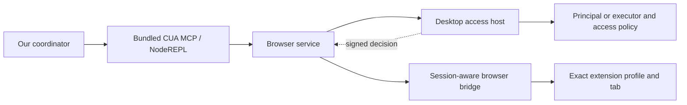

# Browser runtime reuse and open-source alternatives

November 9, 2026. Extends the [Codex browser/interface notes](2026-11-08-codex-browser-and-guidance.md). This update adds desktop-host inspection, two additional Codex boundary checks, a pinned OSS source comparison and real local tests of three providers. [Results](evidence/2026-11-09-browser-runtimes/results.json), [34 source fingerprints](evidence/2026-11-09-browser-runtimes/sources.json), [fixture trace](evidence/2026-11-09-browser-runtimes/fixture-trace.jsonl), and [reproduction scaffold](../experiments/browser-runtime-probe/README.md).

**Background-control follow-up:** [the published extension investigation](2026-11-09-background-browser-control.md) traces inactive tab creation, logical tab ownership, CDP focus emulation, native-messaging transport and screenshot/streaming distinctions. This is a valuable capability to qualify early; native Chrome remains the working baseline. Extension source inspection is not a live background-control result.

## 1. Current conclusion

Keep **Codex reuse as the preferred research direction**, as requested. Its native Mac provider already worked independently. Its specialized browser provider has an additional desktop-owned authorization and session layer that we have now traced to its implementation. Independent reuse of that specialized provider is unresolved. **This does not block controlling Chrome as a native Mac app:** the follow-up below successfully operated a real page through `cua.getApp("com.google.Chrome")` in this chat.

There are credible model-free OSS fallbacks. We ran Playwright MCP, Playwriter and agent-browser against an owned Chrome and local fixtures without starting another model or reasoning loop. For SlopZooka, **Playwright MCP's public context-injection API is the most useful newly verified integration point**: the companion can retain browser/context ownership and supply that context to the tool server. **Playwriter is the closest interaction-style comparison to Codex**, with persistent JavaScript and page handles. **agent-browser provides a useful terminal interface and demonstrated strict tab retention**.

These are recommendations for the later interface review, not three production dependencies or a change to the chosen streaming architecture. The important choice is the browser instance, profile and target the provider controls, plus who owns their lifetime. MCP, CLI and a JavaScript tool are alternative ways to expose those mechanics to Pi and terminal agents.

### Correction: Chrome also works through native Mac CUA

The user correctly pointed out that Codex already controls foreground Chrome without the Chrome plugin. Our earlier phrase “browser reuse remains unresolved” was too broad: it referred to the specialized `browser-desktop` provider, not every way of operating a browser. There are two distinct routes:

| Route | Observation/control | Evidence |
| --- | --- | --- |
| `cua.getApp("com.google.Chrome")` | Native Mac app observation, page semantics exposed through macOS accessibility, screenshots, element/coordinate actions and keyboard input | **Worked live in this session** on a disposable local webpage. Earlier independent native reuse was demonstrated against a separate Mac fixture. |
| `cua.getBrowser(...)` / `cua.getTab(...)` | Browser-specific profile/tab connection, DOM/Playwright/CDP capabilities and browser lifecycle | This session's entry point rejected a missing browser access host; the independent MCP probe rejected missing current-turn authorization. |

Chrome exposes web content through the operating system's accessibility API. Chromium documents its macOS `NSAccessibility`/`AXWebArea` implementation, semantic tree, actions and renderer-to-browser accessibility cache. This supplies more than a screenshot: a native client can observe named page fields/buttons and request actions without a browser extension providing the page representation. It is still an accessibility representation, not arbitrary DOM/JavaScript access. [Chromium accessibility architecture](https://chromium.googlesource.com/chromium/src/+/3376a4f83a973d9804e861d79cf43ae93e35feec/docs/accessibility/overview.md).

The installed Codex call chain confirms the distinction. `create_tinysky_alt.js` routes macOS `getApp` to `get_app_state`; `bind_mac_app.js` routes observation and input to the native computer adapter. The native client sends `ComputerUseIPCAppGetSkyshotRequest` and `ComputerUseIPCAppPerformActionRequest` through its Mac native-pipe transport. Its policy wrapper specifically emits `codex/computerUseChrome` metadata for `com.google.Chrome`. These calls follow the native app policy and helper path, not the browser-service access-host path above. [Installed source fingerprints and live evidence](evidence/2026-11-09-browser-runtimes/native-chrome.json).

**Live check:** attached to Chrome through the normal CUA native-app API; opened one disposable window at a loopback fixture using native keyboard input; observed page and iframe controls; typed `Native Mac route`; saved it; incremented the counter; opened Settings; and clicked the iframe button. Three independent HTTP fixture events confirmed save, increment and Settings. The AX result confirmed `Counter: 1`, `Settings page`, and `Frame clicked`. Closed the test window through its observed native close control and stopped the fixture server.

No browser-provider call, CDP connection, extension installation, alternate automation library or new model session was used for those actions. We did not inventory the user's installed extensions, so this is proof of the native execution path, not an audit of extension absence. We also did not run this Chrome-specific sequence from the independent launcher; that remains a smaller follow-up to the already successful native fixture experiment.

**Foreground behavior:** the user's observation is consistent with native window/tab selection and focus-sensitive input. This test did not systematically vary foreground, occlusion, minimization or simultaneous human input, so it does not establish that every native action requires foreground. OpenAI documents both Mac background Computer Use and separate extension-based browser control; do not replace one overly broad claim with a universal foreground requirement. [OpenAI Computer Use](https://learn.chatgpt.com/docs/computer-use), [browser extension setup](https://learn.chatgpt.com/docs/chrome-extension).

**Plan adjustment:** use the preferred native Codex provider for the first Chrome-plus-Simulator control/streaming slice. Specialized browser integration is optional capability work for exact tab ownership, DOM locators, debugging or more independent browser operation. Its unresolved access host should not block basic web navigation in the demo. Keep a single shared native control path initially; verify the selected Chrome window/tab matches the streamed surface and coordinate focus with human/agent input. The earlier headless OSS results remain useful alternatives, not a requirement to add another provider now.

## 2. What deeper Codex inspection established

The installed app remains `26.1023.51421`; browser-desktop is `0.1.1`. We inspected its browser client/service plus the desktop main bundle, `.vite/build/main-UOTY8NmV.js`, extracted locally from `app.asar`. The evidence hashes identify the exact artifacts; no implementation is copied into the PR.

The cached plugin manifest is only part of startup. The desktop main process also:

1. Derives browser executor identity from an authenticated principal or a registered executor.
2. Supplies the browser access pipe and its public verifying identity dynamically to the tool environment.
3. Hosts a `browser/access` request handler, with a fresh Ed25519 signing keypair, returning a signed access decision.
4. Consults the applicable account/executor and Work browser-access settings. Its local Work path can prepare a browser session route through the desktop's browser-session registry.
5. Uses native socket-peer authorization for the packaged macOS bridge. We identified its native-authorizer boundary, not the complete compiled authorization implementation.

The browser service separately requires live session/turn identity when issuing backend commands and participates in turn-ended cleanup. Page/site permissions and exact extension/profile/tab selection remain additional concerns. The public setup guide documents the extension/profile and website permission layer, but does not provide an external embedding contract for these private host services. [OpenAI browser extension setup](https://learn.chatgpt.com/docs/chrome-extension).



### Executed checks

| Boundary | Actual result |
| --- | --- |
| Ordinary Node import of exported `setupBrowserRuntime()` | Rejected: `Browser use requires a trusted Node REPL browser service`. |
| Genuine standalone CUA MCP launcher, browser-only discovery, November 8 | MCP initialized, then rejected: `Cannot verify browser access without the current turn`. |
| This chat's normal `mcp__cua_repl.js`, `cua.getBrowser({id:"chrome"})`, November 9 | Rejected: `The browser access host is unavailable`. No browser/tab handle or page content was returned. |

The last result matters: this is not merely failure to invent the correct fields in an outside client. The intended tool route in this session also lacks a host dependency. We have not established why this session's host provisioning is absent, nor that another properly provisioned desktop chat would fail. The errors identify different missing prerequisites; they are not evidence of a website denying access or Chrome being unsupported.

The client package exports `setupBrowserRuntime`, which dispatches through trusted browser RPC. Its internal facade classes are not exported as a ready standalone Playwright replacement. Extracting those classes or recreating the entire backend would be a different project with additional compatibility work.

We did not manufacture a signed response, substitute a trusted identity, strip the access preloader, change security modes, or borrow another task's metadata. A successful research integration should preserve actual user authorization, target ownership and cleanup. Removing those checks would not answer whether we can reuse the runtime reliably as a product dependency.

### Viable reuse paths still worth distinguishing

| Path | What it would mean | Status |
| --- | --- | --- |
| Direct model-free provider under our companion | Companion launches genuine CUA MCP and obtains legitimate host/session provisioning | Desired path; native part demonstrated, browser provisioning unresolved. We found no documented public browser host-registration API in this investigation. |
| Browser work in a real Codex-hosted session | Coordinator delegates a browser task through an actual supported Codex session | Plausible architecture, not exercised here. Adds a task/agent boundary and different latency, approval and cancellation semantics. App Server alone should not be assumed to provision desktop browser facilities. |
| Reuse interface ideas with an OSS browser driver | Pi calls public browser mechanics; retain observation/action style and conditional guidance | Working mechanics demonstrated below. No Codex browser authorization dependency. |
| Copy/adapt private facade or service code | Maintain a derived implementation and replace missing host facilities | No demonstrated advantage over the public alternatives; introduces code/version and distribution obligations. Not the proposed next step. |

The next Codex-specific test should run one disposable page from a **properly provisioned desktop browser session**, then establish an actual authorized external lifecycle connection. Until then, another guessed environment flag is not a product integration result. Installation/support/distribution questions remain separate from local technical feasibility.

OpenAI documents App Server as an integration for authentication, conversations, approvals and streamed agent events. The fetched reference does not establish a public registration interface for the desktop browser access host identified here. Treat those as separate integration claims. [Official App Server reference](https://developers.openai.com/codex/app-server).

## 3. OSS options and their actual interfaces

Source revisions are pinned in the links and evidence. Source review and local npm execution are separate: some released package contents differ from the reviewed repository head. No reliability ranking is inferred from stars or publisher benchmarks.

| Provider | Model-facing and embedding interface | Why it is relevant | Limits / ownership work |
| --- | --- | --- | --- |
| **[Playwright MCP](https://github.com/microsoft/playwright-mcp/tree/404be8eb89abecff77a55152b6d843d140c78372)** — Apache-2.0 | Typed MCP tools; public `createConnection(config, contextGetter)`; underlying Playwright APIs and optional browser extension | Public ownership boundary for a companion-created context; semantic snapshots, locators, screenshots, iframe interaction, navigation. Two supplied contexts worked in our test. | Distinguish provider-created and caller-supplied resources. Read actual schemas: this installed build uses `target`, and some observations are returned as file links. Do not infer that a browser-wide CDP client is restricted by these contexts. |
| **[Playwriter](https://github.com/remorses/playwriter/tree/2cae912a9c1e68ae2b74fcaef9efd79b6d7d432f)** — MIT | Stateful MCP `execute`/`reset`, CLI sessions, `connectViaExtension()`; extension relay or direct CDP | Closest to the Codex REPL style. Direct-CDP MCP worked with persistent `state.page`, locators, frame control and useful stale-handle errors. | Session JavaScript state is distinct from browser authority. Our direct connection enumerated all fixture tabs, including other contexts. Extension behavior and existing signed-in profiles were not tested. |
| **[agent-browser](https://github.com/vercel-labs/agent-browser/tree/4b0e9f01fa8d214d39bbfe5391257640634fb9a0)** — Apache-2.0 | Rust CLI/daemon, JSON output, MCP adapter; snapshots with element references, named sessions and CDP attachment | Fits terminal agents; strict `--pin-tab` worked across interleaved sessions and returned `tab_gone` after closure. | Its daemon/session lifetime must fit our existing owners. Separate sessions sharing a CDP browser still share profile state. Ordinary unpinned navigation can use a shared active tab; explicitly qualify the intended targeting mode. |
| **[Chrome DevTools MCP](https://github.com/ChromeDevTools/chrome-devtools-mcp/tree/7e10c08d30172f4a9d0dba64fa21890afebed09a)** — Apache-2.0 | Typed MCP and CLI; own Chrome launch, explicit CDP attachment or Chrome's user-approved auto-connect | Strong debugging companion: performance, network and console tools. Current docs expose page-ID routing for shared-server sessions. | Source review only. Auto-connect selects Chrome's default profile and exposes its windows; this is broader than an assigned workspace tab. Usage statistics and update checks are enabled by default and configurable. |
| **[Browser Use](https://github.com/browser-use/browser-use/tree/b49a68e4060acb226da8f784194fef301c53a6d7)** — MIT library | Python BrowserSession/Actor mechanisms plus optional agent/tool integrations | Worth examining for model-observation design, page refs, bounded output and model-free action dispatch; not necessary to adopt its entire Agent loop. | Source review only. More framework machinery than the first two integration points. A reviewed OpenAI adapter imports `openai.lib.browser`; we did not establish its current public SDK/documentation availability, so it is not a qualified supported API recommendation. |
| **[Stagehand](https://github.com/browserbase/stagehand/tree/d9cb8ccb8f9f4d07aaeb33cd634d76baabdc4295)** — MIT | Browser SDK/extension with deterministic page APIs and higher-level model actions; current repository includes Pi integrations | Interesting specifically because we use Pi. Its MCP-to-Pi adapter maps schemas, text/images, structured details, abort signals and sequential execution. | Source review only. Higher-level `act`/`observe`/agent behavior can add model calls and overlap Pi's reasoning; evaluate the deterministic subset before importing a second agent architecture. |

The concrete Playwright embedding signature is in its [public declaration](https://github.com/microsoft/playwright-mcp/blob/404be8eb89abecff77a55152b6d843d140c78372/index.d.ts); we also exercised the installed declaration's optional context getter. Playwriter's [public exports](https://github.com/remorses/playwriter/blob/2cae912a9c1e68ae2b74fcaef9efd79b6d7d432f/playwriter/src/index.ts) and [MCP implementation](https://github.com/remorses/playwriter/blob/2cae912a9c1e68ae2b74fcaef9efd79b6d7d432f/playwriter/src/mcp.ts) are inspectable. agent-browser's [session documentation](https://github.com/vercel-labs/agent-browser/blob/4b0e9f01fa8d214d39bbfe5391257640634fb9a0/skill-data/core/references/session-management.md) explicitly distinguishes owned-browser isolation from shared-CDP tab pinning.

### Existing user browser versus a browser we launch

For “launch Poncho2 with admin open,” the companion can launch a dedicated browser/profile and retain the exact page. That needs no extension in the user's personal Chrome. An existing production-admin tab is a different case: preserving its current authentication and state can favor an extension or Chrome's explicit connection approval.

The current Playwright extension documents per-client tab ownership, separate tab groups, profile selection and a background mode; its source includes multi-connection tests. Not every feature applies to our installed Chrome: for example, opening its connect page in the background with token authentication requires a newer Chrome version than this host's 156. The extension route was **not installed or exercised** here. [Extension guide](https://github.com/microsoft/playwright/blob/84e2bdcaa5a6e4a9e8afcbe8b1bca4ff8a8cb69a/packages/extension/README.md), [multi-client tests](https://github.com/microsoft/playwright/blob/84e2bdcaa5a6e4a9e8afcbe8b1bca4ff8a8cb69a/tests/extension/multi-connection.spec.ts).

Playwriter documents user-enabled tabs and persistent sessions; its direct-CDP mode is a broader connection. Its programmatic connection can dispose the session without closing tabs, with an explicit option to close tabs it opened. A profile, tab group, REPL session and access boundary are four different concepts. Its [security policy](https://github.com/remorses/playwriter/blob/2cae912a9c1e68ae2b74fcaef9efd79b6d7d432f/SECURITY.md) explicitly says remote control is not a sandbox. We did not enable remote sharing. The local test used telemetry opt-out.

Chrome DevTools MCP's [advanced connection guide](https://github.com/ChromeDevTools/chrome-devtools-mcp/blob/7e10c08d30172f4a9d0dba64fa21890afebed09a/docs/advanced-usage.md) covers auto-connect approval and explicit CDP. We should not restart or reconfigure a personal browser merely to satisfy workspace launch. Use a fresh owned profile for the first integration, then test existing-tab takeover as its own UX case.

## 4. What the local comparison actually proved

Environment: Chrome `156.0.8078.80`, Node `24.22.1`, headless mode, unique empty Chrome profile, loopback fixture, no model calls. Installed npm artifacts: Playwright MCP `0.0.84`, Playwriter `0.10.0`, agent-browser `0.41.2`, MCP SDK `1.30.0`. Playwright resolved to `1.65.0-alpha-2026-10-30`.

| Test | Observed result |
| --- | --- |
| Two Playwright MCP instances, two companion-supplied contexts | Both initialized through standard MCP. Interleaved operations saved `MCP A` in A and incremented only B. B's tab listing contained only B. |
| Playwright iframe and screenshot | Clicked the nested frame button using its observed reference. Saved screenshot visibly showed `MCP A`, counter zero and `Frame clicked`. |
| Disconnect Playwright client A | Its page remained open in the owned context; B still returned `Counter: 1`. Tool connection lifetime need not equal preview lifetime in this integration. |
| Playwriter direct CDP | Stateful `state.page` survived calls; fill/save/settings navigation and frame locator worked. The fixture server independently logged the correct label and settings action. |
| Playwriter inventory scope | Its `context.pages()` included all six fixture tabs, including the two other Playwright contexts. The persistent JS session was not a per-workspace authority boundary. |
| Close Playwriter's retained page, then use the old handle | Returned `isError: true`, a closed-page warning and a failed locator action. No fixture increment occurred elsewhere. |
| Two agent-browser sessions with `--pin-tab` | Distinct CDP target IDs; A saved `Pinned A`; B incremented only B. Snapshot refs and a B screenshot worked. |
| Close pinned A, query A, then query B | A returned exit 1 and structured `code: tab_gone` with its former target identity. B still returned `Counter: 1`. No automatic retargeting observed. |
| Cleanup | Both named agent-browser sessions closed, MCP connections/context owners were released, owned Chrome exited zero. Personal browser and shared Codex helper were untouched. |

Six independent fixture events verify the input effects. The raw trace retains expected errors. Tool timings are incidental single measurements with different return/settling behavior, **not a speed benchmark**. These were interleaved commands against live clients, not a concurrency stress test.

Two setup corrections are retained: initially we executed Playwriter's implementation module rather than its CLI entry point, so that MCP connection closed; switching to `bin.js` fixed startup. The first interactive scaffold waited for terminal EOF after resource cleanup; the final version releases stdin and passed a separate startup/exit check. Neither is presented as a browser interaction failure.

The source heads and published packages are not interchangeable evidence. Reviewed Playwright MCP source declares a newer Playwright alpha than the installed package resolved. Reviewed agent-browser source declared Node >=22, while its installed npm metadata requires >=24; the experiment used Node 24. Record resolved artifacts and read live schemas instead of assuming a repository README exactly describes a release.

## 5. Implications for Pi, coding agents and Vision

**Use one companion-owned browser provider initially.** Pi and terminal MCP should reach the same target association and control arbitration. A provider-specific MCP/CLI/JS adapter is enough; no new persistent workflow engine or generic browser framework is required.

The public Playwright MCP integration gives us a useful shape:

```text
Existing workspace owner creates/resolves development environment
  → companion owns browser/context/page
  → selected provider observes and controls that page
  → shared surface association resolves the native capture target
  → existing WindowGateway presents the stream on Vision
```

Keep browser profile/context lifetime separate from a tool client or an ephemeral Pi turn. Distinguish attaching to an existing user tab from creating an owned preview. Persist stable workspace/content intent through the existing owner; do not persist transient CDP IDs as durable identity or create a second window registry.

The tests support three practical interface requirements:

- **Exact target retention:** stale or closed targets report unavailable; they do not silently adopt whichever tab is active. The observed `tab_gone` behavior is a good reference. Shared cookies/storage still require a separate profile/context decision.
- **Stateful code needs an actual authority boundary:** keeping `state.page` in the REPL helps efficiency, but arbitrary JavaScript and a browser-wide CDP connection can reach additional tabs. A `surfaceId` argument alone does not constrain that access. Start with one actor controlling a target at a time; qualify stronger isolation where needed.
- **Preserve observations and failures:** typed schemas, image blocks, linked artifacts and provider error details must reach the model. Our Playwright MCP responses sometimes linked local snapshots/images instead of embedding them. Pi needs a bounded artifact-reading path or explicit inline configuration; the Vision client must not be handed a host-only filesystem path.

The inspected [Stagehand Pi adapter](https://github.com/browserbase/stagehand/blob/d9cb8ccb8f9f4d07aaeb33cd634d76baabdc4295/packages/integrations/pi-sdk/src/mcp.ts) is a useful small wiring reference, including schema discovery, sequential execution and abort forwarding. Review its failure mapping before borrowing it: the current code throws a generic harness error on `isError`, whereas our model should retain actionable provider failure context. We do not need all of Stagehand to implement this bridge.

The guidance strategy remains version-matched: use current MCP descriptions/conditional docs, or the installed CLI's skill retrieval. In this experiment Playwriter's `execute` description alone contained about 53 KB of guidance. One tool does not automatically mean a small prompt. Treat tool count, description size and actual observation content separately when comparing interfaces.

### Streaming stays a separate decision

The OSS tests used headless Chrome, so they establish neither a native window identity nor a Vision stream. The later native Chrome check above operated a real window, but did not associate it with ScreenCaptureKit or Vision. For the initial streaming path, we still need that verified association between the controlled page, its host window and the capture target. Browser tab IDs, CDP target IDs and native capture IDs are different identifiers.

Some providers expose browser screencasts, JPEG/WebSocket streams or recording features. Those can be useful development references, but this experiment does not establish their latency, text quality, lock behavior or power use. Retain the existing hardware-video strategy pending a specific measurement. A page screenshot supplied to a model is not the user's continuous preview stream.

## 6. Narrow next comparison before choosing

The highest-value next slice is one **headed, owned Poncho2 admin page**: create it from workspace context, navigate through the real provider, stream that exact window, interrupt it, then disconnect/reconnect the tool client while keeping the preview. Include a second page with the same controls to detect wrong-target input. No login service or second model is needed to establish that route.

Then test an explicitly selected existing browser tab through the preferred extension/connection route: correct profile, user approval, human takeover, tab movement/closure, and cleanup that preserves the user's page. Keep this separate from the owned-preview result. Real signed-in sites, human keyboard interference, macOS lock/sleep and physical Vision presentation remain untested in this update.

For Codex, first resolve legitimate desktop browser host provisioning. At the later review, compare a working Codex browser session against the same fixture if available; otherwise assess the concrete dependency and the now-working OSS alternatives. The user's Codex preference remains recorded, with the browser-specific feasibility gap visible.

## Verification scope

The completed OSS run has 32 trace rows, six independent fixture events, verified expected stale-target failures and owned Chrome exit zero. The final scaffold also passed a separate startup/exit smoke check. The subsequent native Chrome test has three additional fixture events and semantic UI verification, recorded separately. Evidence JSON/JSONL, source/artifact hashes, JavaScript syntax, local Markdown links/fences and whitespace checks accompany this update. No production dependency/source or global browser setting changed; production and headset suites were not rerun for this isolated research.
