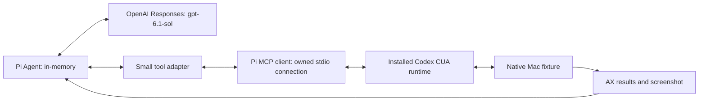

# A small Pi harness directly using Codex CUA

November 9, 2026. **The live native route works:** our own ephemeral Pi agent called the installed Codex Mac runtime, changed a disposable app and received its screenshot. There was no ChatGPT UI automation or delegated Codex task. **The independent Chrome route still fails at browser authorization.** These are separate findings.

Source: [`experiments/pi-cua-probe`](../experiments/pi-cua-probe/README.md). Sanitized results, fixture verdict and local artifact fingerprints: [evidence](evidence/2026-11-09-browser-runtimes/pi-harness.json). This extends the earlier [independent native-runtime experiment](2026-11-08-codex-runtime-reuse.md) with a real model/tool loop, using the newer installed runtime.

## What ran

Pi's model API is separate from the CUA execution service. The model chooses tool calls; the Mac process executes them through MCP, then sends observations back to the model. The screenshot is an image content block in the next model request, not only a path or console message. This is the concrete pattern we wanted to prove before integrating workspace launch or Vision presentation.

The experiment pins `@earendil-works/pi-agent-core`, `pi-ai` and `pi-mcp` to **1.4.0**, matching the generation inspected in Poncho2. It uses the ordinary in-memory `Agent`, not Pi Durable, SQLite, workers, a second supervisor or Poncho2's account gateway. Pi's existing MCP implementation owns initialization, request correlation, cancellation and subprocess cleanup. We do not implement another JSON-RPC stack. [Agent source](https://github.com/earendil-works/pi/blob/v1.4.0/packages/agent/src/agent.ts), [MCP package](https://github.com/earendil-works/pi/blob/v1.4.0/packages/mcp/README.md).

The installed runtime was ChatGPT **26.1103.60933**, MCP server `rmcp` **3.5.1**, negotiated protocol **2025-11-25**, Node **22.20.0**. We preserved its manifest's actual launcher and trusted services. No desktop executor ID, current-turn metadata, private host pipe or another task's identity was supplied. The model key remained in the Pi process and went to OpenAI; it was not inherited by the MCP child.

## Test log

All times below are one-run elapsed measurements, not latency targets or reliability statistics.

| Test | Observed result | Meaning |
| --- | --- | --- |
| Initial model request using the Poncho2 key | API rejected missing `api.responses.write`; no tool actions | Credential access failure, not a Pi/CUA failure. A different existing local key was subsequently found and used. No secret was printed or committed. |
| Live model + synthetic visual MCP fixture | **Pass**, 4.29 s; two tool calls; red card observed and exactly one correct answer accepted | Real Responses → Pi → MCP → image → model → action/result loop. This test alone is not computer-use evidence. |
| Native attach before fixture launch | `Invalid app: dev.slopzooka.codex-runtime-fixture` | Expected missing-target failure; start the fixture first. |
| Native attach with default permission policy | MCP permission request cancelled; runtime rejected app access | Connection availability and app authorization are separate. |
| Native attach with exact fixture grant | **Pass**, 0.54 s, no model call | Current-version runtime can attach through our independent MCP client. |
| Live model + actual native fixture | **Pass**, 11.49 s; four `js` results, one model-visible screenshot, zero tool errors | Pi entered `pi-direct`, clicked Increment twice, inspected state and captured the fixture. The app's independent state file reports `counter: 2`, `text: pi-direct`; visual inspection of the screenshot confirms both. |
| Independent browser initialization, no model | Rejected in 0.33 s: `Cannot verify browser access without the current turn` | MCP startup/catalog succeeded; browser access did not. |
| Live model + actual browser initialization | Same error; one tool call; model reported failure and stopped, 4.94 s total | Pi correctly receives and reports the runtime failure. It did not turn an unavailable browser into a successful action or keep retrying. |

The live native run handled six runtime permission requests through the narrowly scoped policy. That policy accepts only the existing disposable fixture's exact app identifier and the native computer-use connector. Other apps and browser approvals are rejected. This is test authorization, not a replacement for a product's consent/permission UX. It also shows why elicitation handling belongs in the Mac executor rather than being left to text in the model prompt.

Seven automated tests additionally cover: the real Pi loop receiving runtime guidance/tool schemas/image/structured data; MCP error flags reaching the next model request; a lost response preventing queued input and retries; Stop aborting an in-flight request and preventing the next queued action; actual stdio image exchange and child-process cleanup; child environment isolation; and strict fixture permission matching. The model in those regression tests is Pi's deterministic faux provider. The three live model cases above are separate evidence.

## Interface and maintainability implications

**Keep the coordinator small.** The useful boundary is an agent loop plus tool adapter, with the existing Mac services retaining resource ownership. No window-management rearchitecture was needed to prove model-driven native control. Adding workspace and presentation tools later should call the existing service and `WindowGateway` owners. The prototype does not decide whether the global agent or terminal Codex should own each task; see the [open responsibility decision](2026-11-09-agent-control-ownership.md).

**Reuse live guidance.** MCP initialization instructions, tool descriptions, schemas and first-use documentation are passed to the model. Text, images and structured results remain model-visible. Static copied instructions would drift with this opaque runtime; maintain our own scope and intent guidance, then obtain provider-specific guidance from the installed provider. [OpenAI tool calling](https://developers.openai.com/api/docs/guides/tools), [Pi tool contracts](https://github.com/earendil-works/pi/blob/v1.4.0/packages/agent/src/types.ts).

**The programmatic native path is now stronger evidence than desktop delegation for this use case.** Pi does not need to drive the ChatGPT interface to use these native tools in the tested environment. Keep the successful [desktop-delegated Chrome case](2026-11-09-background-browser-control.md#9-desktop-task-delegation-passed-terminal-delegation-differs) as a different route, not a requirement to reproduce desktop UI actions in our coordinator.

**Chrome still needs a legitimate embedding connection.** Neither a real external model turn nor a working native MCP client supplies the desktop browser access host's session/turn authority. This test did not forge that context. It adds no new reason to duplicate OpenAI's signing/session host. Resolve an authorized programmatic browser entry point, or consciously select another browser provider after comparing the tradeoffs already documented.

**Cancellation is not rollback.** A model can queue more than one call, so sequential execution alone is insufficient. The adapter checks connection availability before dispatch, stops the batch after transport uncertainty and closes its owned MCP connection on Stop. Tests prove those local semantics; they do not establish how fast a native helper halts an already executing gesture or script. If Pi and terminal Codex share a desktop, they still need common input arbitration.

## What this leaves open

- Independent Chrome access, browser turn cleanup and parallel tab ownership remain unqualified. `turn_ended` is not exposed as a model tool or implemented as a browser lifecycle adapter in this probe.
- Native-only startup with the desktop app closed, production app identity/permissions, runtime-update compatibility and shipping/reuse terms remain open. This is an installed unstable runtime, not a supported third-party SDK.
- Stop during actual native input, overlapping actors and recovery after helper failure need targeted qualification. Do not interpret the deterministic transport tests as live desktop contention tests.
- No voice, simulator navigation, media streaming, exact control/capture association, Vision window creation, workspace preparation, locked operation or device behavior was added or retested here.

The next architectural step can stay narrow: give the same agent one existing host/presentation operation, have it control a prepared target, and show that exact target through the existing window gateway. The browser-provisioning investigation can proceed separately. This result does not justify a durable coordinator or broader production tool framework.

Validation for this addition: seven isolated harness tests, explicit JavaScript syntax/formatting, three live model runs after credential repair, current-runtime direct connection checks, state/screenshot verification, local documentation links and sanitized evidence. Production and headset suites were not rerun for these isolated sources. The draft PR's earlier unresolved WebKit viewport timeout and native-probe limitations remain unchanged.
