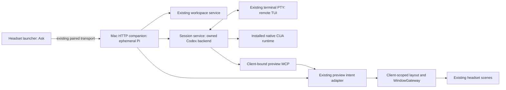

# Ephemeral coordinator: first implementation and device gate

Status: core headset gate passed on 2026-11-17; UX follow-ups remain. See [device results](2026-11-17-coordinator-headset-results.md).
Branch: `feat/ephemeral-coordinator`, based on main `71e7c5f` (#58).

## Narrow contract

One typed request in the existing launcher starts a real Codex worker in a
purpose-named workspace. That worker performs setup/computer use and requests
previews through the existing MCP. A follow-up goes to that same backend/thread.
User-facing usage and limits are in [the coordinator guide](../docs/coordinator.md).

The Mac HTTP companion hosts a replaceable Pi conversation. The retained session
service owns worker app-server processes and ordinary terminal PTYs. Native
computer use lives with Codex initially. Pi owns no display, application, browser,
PTY, or persistent job graph. Existing workspace APIs own checkout/worktree
creation and naming. The current authenticated transport carries coordinator
control over LAN or Direct. Preview capture/encoding/streaming is unchanged.

No headset window lifecycle path bypasses WindowGateway/WindowScene. The intent
adapter's terminal presentation uses the same CAS layout and fresh presenter
availability check as preview presentation. Window intent does not create another
PTY. visionOS still owns placement; this slice does not promise automatic physical
clustering or an infinite canvas.

## Concrete interfaces and owners

| Owner | Interface |
| --- | --- |
| Headset `CoordinatorState` / `CoordinatorView` | Capture destination and UUID, display status/approvals, Send and Stop; reject late host/operation replies |
| `coordinator-http.ts` | Existing paired HTTP routes: GET/POST `/api/coordinator`, POST `/stop`, POST `/answer` beneath it |
| `coordinator.ts` | Pi tools: context, workspace launch/name, worker start/queue/steer/status, preview list/open/close |
| `codex-workers.ts` / `worker-http.ts` | Private Unix service routes, one backend/thread binding per owned session; native queue and correlation reconciliation |
| `codex-rpc.ts` | Private WebSocket JSON-RPC to each owned Codex app-server; bounded waits, no blind mutation retries |
| `installed-cua.ts` | Explicit native-only installed runtime adapter; live vendor guidance, no browser task authority |
| Existing `preview-control.ts` | Same headset readiness and revision-checked layout writes for workers and terminal MCP |

The native input lane is deliberately restricted to one managed native worker
for its lifetime, including idle time, because its visible TUI can also submit
work. A submit-only mutex would falsely imply exclusion while missing TUI input.
Parallel browser-tab control is a later independent capability, not inferred from
native desktop control or screen streaming.

A request whose response is lost retains its ID. Known native queue/user-message
correlations are reconciled without repeating submissions. Missing correlation
remains uncertain. Stop blocks later tool dispatch and only interrupts/removes
submissions belonging to the request. Resources already accepted are retained.
Approvals are explicit, scoped to the bound worker, and never blanket-accepted.

## Mac evidence and limits

Development qualification on 2026-11-17:

- Real Pi called the actual HTTP/service path, started one Codex worker, and read
  a disposable workspace's ORCHID verification word. Repeating the same request
  retained one worker and one PTY. The offline headset was reported honestly.
  Evidence: `/tmp/slz-coordinator-smoke-YeRItk/results.json`.
- A real owned Codex worker used the native-only runtime to click Increment twice,
  enter `coordinator-native`, observe the result, and take a screenshot. Independent
  fixture state recorded counter 2 and the expected text. Evidence:
  `/tmp/slz-coordinator-native-live.log` and `/tmp/slz-coordinator/fixture-state.json`.
- Earlier attempts exposed meaningful integration gaps: inherited desktop browser
  authority was unavailable; a disabled MCP plugin entry still needed a valid
  transport declaration; computer-only runtime has no browser-tab API; native app
  lookup needed the exact fixture path. The adapter and instructions now reflect
  these observations. No background Chrome claim follows from this pass.
- Regression coverage exercises the real Pi loop with a deterministic external
  provider and the real worker owner against a protocol fixture: captured client,
  auth, duplicate requests, stale steer, lost reply, reconnect/reconcile, scoped
  Stop, launch cancellation, approvals, native-worker exclusion, shared terminal
  presentation, offline refusal, and late UI replies.
- Full companion suite: 81/81 passed. An earlier run timed out in the existing
  real-WebKit transport test while multiple UI experiments were running; the full
  rerun passed. This is recorded as timing sensitivity, not erased or claimed as
  a new transport fix.
- Typecheck, TypeScript/Swift lint, format check, native state suite and visionOS
  simulator build passed. Signed Mac and separate-device-identity headset builds
  passed. Packaged-app regressions and real WebKit keyboard/preview-history checks
  also passed. Log files use `/tmp/slz-coordinator-*.log`.
- Packaged full chain passed: real Pi → owned Codex → native fixture actions →
  independent counter/text verification → actual remote TUI showing ORCHID.
  Evidence: `/tmp/slz-coordinator-smoke-uT68Qf/results.json`, `terminal.txt` and
  `fixture-observation.json` in that directory.
- A second packaged run queued a follow-up on the same real worker/thread. Its
  provisioned preview MCP reported the headset not available right now, and the
  worker returned FOLLOWUP-ORCHID. One worker and one PTY remained after repeating
  the original request. Evidence: `/tmp/slz-coordinator-smoke-j2UMc4/results.json`.
- The isolated signed test companion's capture preflight returned `ready` and
  enumerated the actual controlled fixture; coordinator capability was available.
  No physical headset was involved. Evidence: private rig `preflight.json`.
- A final review found that tool failure could end a Pi turn without readable
  feedback. Failure and operation/time-limit messages now remain visible; the
  focused coordinator suite passed after that fix. Normal live-flow behavior is
  unchanged.

The initial worker-only observation was followed by the [physical device gate](2026-11-17-coordinator-headset-results.md): terminal and preview were visible, the same worker executed the follow-up, and Stop interrupted its active turn while keeping resources. The natural-language presentation-intent and stale-feedback gaps are recorded there. Streaming/transport discovery already completed earlier was not repeated.

## Reproducible preparation

`scripts/coordinator/mac-smoke.mts` uses an isolated home/port, real Pi and Codex.
It optionally uses the packaged companion (`SLZ_COORDINATOR_MAC`) and native
fixture (`SLZ_COORDINATOR_FIXTURE`, `SLZ_COORDINATOR_FIXTURE_STATE`). The native
option acts only on that fixture and verifies its independent state. It also
reads the actual terminal screen to establish that the remote TUI displays the
worker result, rather than assuming a PTY exists because its metadata does.

`scripts/coordinator/prepare.mjs` stages already-built signed Mac/headset apps,
builds a signed disposable fixture, and seeds a disposable workspace README.
It copies private configuration outside the repository. It launches nothing and
installs nothing. `rig.mts start|check|stop <directory>` controls only that rig.
The headset bundle ID is `com.slopzooka.probe.coordinator`; discovery advertises
**Slz Coordinator Test**. The installed SlopZooka app and its session service
are not replaced or restarted.

Prepared rig: `~/.slopzooka/test-rigs/coordinator-2026-11-17-ready`.
Use its actual pairing code at the start of the slot; codes rotate every five
minutes. Select the explicitly named test companion, not the existing Mac entry.
No credentials, model transcripts, screenshots, or fixture state enter repository
logs. Operator artifacts stay in private local test directories.

## Minimal headset slot (target 5–8 minutes, not a cutoff)

1. Operator starts the isolated rig, verifies health/capture and current pairing
   code, then installs/launches only **Slz Coordinator Test**. User pairs with that
   companion and opens **Ask**.
2. User sends: **“Use Coordinator fixture. Run its fixture test and show it here.”**
   Pass: one Codex terminal, one preview named Coordinator check, counter 2 and
   input `headset-ready`. Operator independently checks worker/thread IDs, fixture
   state, and one terminal/layout record. Pi acceptance alone is insufficient.
3. Select the coordinated workspace and send: **“Increment once more and change
   the text to followup-ok.”** Pass: counter 3 and new text in the same preview;
   same backend/thread/terminal. No new worktree or duplicate window.
4. Send a bounded waiting task, then **Stop this request** while it is active.
   Pass: native turn interrupted; source, preview and terminal remain. Operator
   checks precise correlation; if Stop arrives after completion, repeat only this
   step rather than claiming a cancellation pass.
5. Optional only if time permits: close/reopen the launcher and inspect the same
   worker. LAN/Direct parity is useful but not a reason to repeat the streaming
   discovery suite or keep the user in the headset for broad benchmarks.

On failure, retain IDs/logs, stop asking for blind retries, and return the headset.
Do not repair production or take over unrelated windows during this slot.

## What remains after this gate

Validate UX before generalizing: action feedback and ambiguity, whether global
CUA belongs in Pi as well as workers, explicit foreground contention ownership,
then voice/realtime and wrist access. Keep the transport and window gateway
unchanged. Browser-extension authority, many concurrent native workers, durable
orchestration, and adoption of arbitrary existing terminals are separate decisions.
