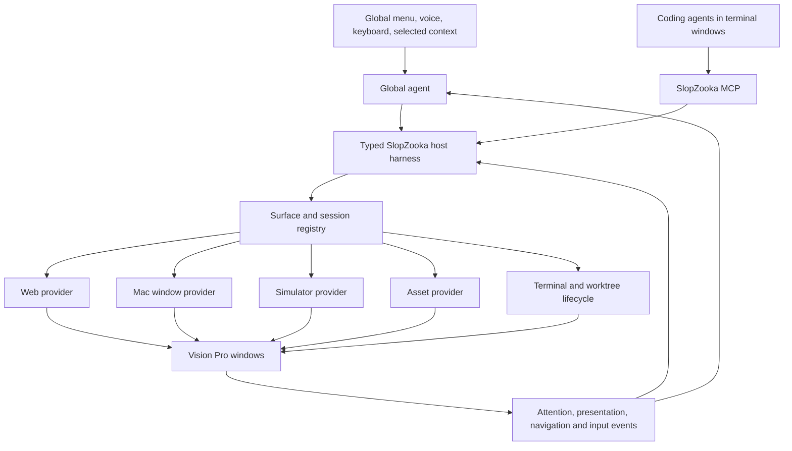
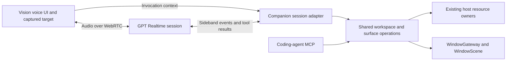

# Global agent, coding-agent MCP, and verification surfaces

Status: exploration and preferred direction; not an implementation specification.

**November 9 open decision:** [which agent owns computer use?](2026-11-09-agent-control-ownership.md) The global Pi agent could manage workspace/window intent and prompt routing while terminal Codex owns app navigation. Direct Pi control and shared access remain alternatives. Earlier global-CUA proposals below are historical candidates; resolve this responsibility split before agent implementation. Shared Mac providers and the existing Vision gateway do not determine which model runs the interaction loop.

**Current focus:** the [concrete orchestrator execution and presentation path](orchestrator-execution-path.md): how Pi/voice tool calls execute on the Mac, bind the actual simulator/browser, open a streamed preview through Vision's existing gateway, and return observed results. Latest source inspection uses main `a1e1541`. The [completed streaming discovery](shared-window-live-results.md) supplies provider evidence; the [shared-control UX cases](shared-control-ux-spike.md) are subsequent tests, not the immediate architectural focus.

Explored October 31–November 1, 2026. Last updated November 1, 2026. Repository inspected at `bcf17af`; locally installed Codex CLI reports `0.166.0`. Runtime interfaces and external documentation below are observations at this date, not permanent compatibility guarantees.

**Merged-code update:** the wrist-launcher follow-up inspected PR #17 (`8688963`) and local `main` at `8b68f3e`, which already contains a shared `WindowGateway`, native `WindowScene` adapter, and companion-owned window persistence from PRs #16/#20. This planning worktree remains on `bcf17af`. References below to extracting a new coordinator or to `AppModel` describe the earlier baseline and are superseded for implementation on `main`: extend the existing gateway. Section 11 records the updated integration plan and pinned source references.

## 1. Product direction

Opening a project, workstream, or worktree should still start with an agent in a terminal window. The problem is choosing and arranging the other things the user needs to see to verify the work: a local admin panel, production admin, another frontend, an iOS simulator, a native application, or an asset.

**Workspace-level intent is the primary launch interface.** The user's example is “launch Poncho2 in a new worktree, with admin and iOS open.” One request resolves the project, creates the requested workspace and coding session, starts the relevant app targets, and presents their usable surfaces. The harness needs structured access to the same project/menu catalog as the UI, explicit current context, and recent-workspace information. Individual window controls support this workflow. Section 13 defines the context and launch boundary without adding another workspace/window owner.

**Agent-generated workspace names are a required orchestrator responsibility.** The user should not need to name a workspace. Infer a short, recognizable display name from its purpose and task context, such as “Fix admin permissions” or “iOS settings redesign,” instead of making the generated worktree name the primary label. This must also cover workspaces opened through the regular launcher whose task first becomes clear inside a terminal agent. Keep names stable, refine an automatic name when the purpose becomes clearer, and respect an explicit user rename. Display names live with existing workspace metadata, survive the ephemeral coordinator, and appear consistently in the launcher, wrist recents, workspace/window labels and agent context. Worktree paths, branches and stable IDs retain their separate meanings. [Naming behavior and checks](orchestrator-tools.md#workspace-naming).

The user’s preferred direction is two complementary integrations:

1. **A menu-based global agent** with awareness of the user’s current context and access to window/session control through a tight harness. It can open and organize surfaces, navigate them, direct input at a specific window, and set up new terminal/agent sessions.
2. **An MCP server exposed to the coding agents inside terminal windows.** The coding agent knows what it is changing and can explicitly request the correct preview or verification surface.

**Latest refinement: let the model compose the workflow.** The harness supplies project/context discovery, host execution, existing workspace/session operations, and direct browser/native/device computer use. It should not require a recipe or registered destination before the agent can launch an app or find a screen. Operating web/mobile apps on the user's behalf is a primary global-agent capability.

Both should call the same underlying host APIs and operate on the same resource registry. The global agent is a first-class product interface, not merely an observer of terminal output. The coding agents provide task-specific intent through MCP rather than making the global agent reconstruct everything from screenshots.

For host-backed apps, the user, global agent, and terminal coding agent should observe and operate the **same live browser page or simulator**, including its login, navigation and unfinished inputs. A second browser at the same URL does not satisfy this. This has been researched, not implemented or verified end to end; section 17 and [the revised tool exploration](orchestrator-tools.md) describe the gap and first experiments.

The global agent also owns contextual command routing for voice and keyboard input. It should associate a request with the intended screen, understand the target application's command vocabulary, and execute slash commands, shortcuts, or prompt submissions appropriately. This is a core usability benefit even before native-window streaming is implemented.

**Voice/runtime candidates:** evaluate GPT Realtime and the voice/Pi separation used in Poncho2. The latest user preference is an ephemeral coordinator; the proposed next prototype is a small in-memory Pi coordinator with voice delegation, while direct Realtime tool execution remains a comparison. Workspace operations remain independent of the audio session. Section 14 records the initial Realtime research; section 16 and [the evolving capability layout](orchestrator-tools.md) record the newer direction and actual Poncho2 coupling.

**Proposed runtime placement:** the Mac companion's existing TypeScript service hosts orchestration, model-session control, and tool dispatch. The native Mac app supplies platform-specific capabilities, while the Vision app supplies current UI context, voice interaction, and its own scene/web-view controls. OpenAI hosts model inference. Section 15 defines this split and the cross-device boundary; a shared interface does not require every operation to execute in one process.

“Menu-based” is a product direction, not yet a settled placement decision: a global headset menu/launcher is the working interpretation, with the Mac menu-bar companion owning host capabilities. Exact invocation gesture, voice interaction, and menu placement remain open.

Example requests to the global agent:

- “Launch Poncho2 in a new worktree, with admin and iOS open.”
- “Show production beside this admin panel.”
- “Reload this window and go to the users page.”
- “Tell the agent in this project to fix the selected error.”
- “Create another worktree and start a Codex window for the mobile task.”
- “Show the iPhone version.”
- “Keep this window pinned while the other agent works.”
- “Grab Poncho2, make two workspaces, and open one on settings and the other on the app's prompt input.”
- “Spin up a Poncho2 workspace and get an iOS simulator rolling.”

## 2. Findings in the current repository

Historical baseline at `bcf17af`; see section 11 for the merged window/wrist architecture at `8b68f3e`.

| Component | Existing behavior | Implication |
| --- | --- | --- |
| [`sessions.ts`](../apps/mac-companion/src/sessions.ts) | Starts Codex, Claude, and OpenCode in owned PTYs; supports attachment, replay, input deduplication, and termination | Retain this useful terminal foundation; add semantic agent/session identity |
| [`frontend-discovery.ts`](../apps/mac-companion/src/frontend-discovery.ts) | Inventories user-owned listening processes and makes bounded HTTP probes | Discovery already supports arbitrary ports; it lacks task intent, not just more port rules |
| [`project-frontends.ts`](../apps/mac-companion/src/project-frontends.ts) | Maps canonical process directories to worktrees; reads optional `.slopzooka.json` frontend hints | Keep as fallback evidence; directory hints cannot identify every role/environment |
| [`frontends.ts`](../apps/mac-companion/src/frontends.ts) | Local/Portless/saved-URL catalog and authenticated HTTP/WebSocket gateways | Reuse as one provider within a broader surface system |
| [`TerminalWindowView.swift`](../apps/vision-client/SlopZooka/SlopZooka/TerminalWindowView.swift) | Dictation posts text plus a command ID and Return to a session | Capture semantic intent before converting speech to terminal bytes |
| [`BrowserWindowView.swift`](../apps/vision-client/SlopZooka/SlopZooka/BrowserWindowView.swift) | Headset-local `WKWebView` with a nonpersistent cookie store per view | A Mac browser opening the same URL is a different session |
| [`CompanionModel.swift`](../apps/mac-menu/Sources/CompanionModel.swift) | Signed native app supervises the Node companion | Natural place for native capture/accessibility services and permission ownership |
| [`packages/protocol`](../packages/protocol/src/index.ts) | Versioned terminal messages | Surface lifecycle, presentation acknowledgements, and attention need additional protocol contracts |

Important details from code and [`README.md`](../README.md):

- The terminal launch wrapper leaves a shell open after the agent exits. Sending bytes successfully does not establish that a coding agent received a prompt.
- An HTTP response establishes availability, not successful app readiness or the presence of the intended screen.
- The gateway forwards HTTP and WebSockets, but does not rewrite JavaScript, arbitrary cross-service URLs, OAuth callbacks, or Secure-cookie semantics.
- Existing frontend configuration provides hints; it does not launch commands or register runtime resources.
- Direct LAN control currently uses HTTP and assumes a trusted development network. Broader remote input/capture requires an encrypted, authenticated control/signaling design.

## 3. Separate responsibilities



The global agent interprets cross-window requests. Coding agents supply implementation-specific intent. A deterministic coordinator enforces identity, capabilities, leases, lifecycle, and presentation rules. Model reasoning is useful for ambiguity and navigation; it should not be required for every reload, resize, frame, or heartbeat.

The global agent can access all registered windows within its authorized scope. That means broad reach through explicit handles, not an unchecked ability to send keystrokes to whatever happens to be frontmost.

### Shared launcher and window-control interface: scope and maintainability

**Follow-up:** this extraction has already substantially landed on `main` as `WindowGateway`/`WindowScene`. The design constraints below remain useful, but do not create a second coordinator to carry them out. The specific view-level findings describe the older worktree snapshot.

The user proposes making the Vision Pro launching/window-management workflows currently available in the main pane accessible through one tight shared interface. The intended consumers are the existing UI, the global agent, coding-agent MCP where authorized, and an external development/test driver. This should shorten the observe–orient–decide–act loop by allowing an agent to invoke a workflow and inspect its actual outcome.

Code inspection supports a **small extraction**, rather than a new application framework:

- [`ContentView`](../apps/vision-client/SlopZooka/SlopZooka/ContentView.swift) registers a launch callback that updates `AppModel` and calls `openWindow`; reopening sessions also calls `openWindow` directly.
- [`FrontendListView`](../apps/vision-client/SlopZooka/SlopZooka/FrontendListView.swift) prepares the preview gateway URL, registers a payload, and opens the scene inside a view method.
- [`TerminalWindowView`](../apps/vision-client/SlopZooka/SlopZooka/TerminalWindowView.swift) creates new shell sessions, constructs terminal payloads, registers them, and opens scenes; it also ends sessions and closes their views.
- At the original `bcf17af` baseline, [`AppModel`](https://github.com/sragss/slopzooka/blob/bcf17af/apps/vision-client/SlopZooka/SlopZooka/AppModel.swift) owned presentation payloads and terminal presentation/focus/load state, while [`LauncherState`](https://github.com/sragss/slopzooka/blob/bcf17af/apps/vision-client/SlopZooka/SlopZooka/LauncherState.swift) handled launch/network workflows and stale completions. The merged-code update above supersedes that ownership split: extend the existing `WindowGateway` rather than maintaining a second copy.

Extract reusable launch/open/close workflows into an app-scoped, typed coordinator, either within an existing owner or a small separate type if it makes the dependencies clearer. UI controls call it directly. A thin scene adapter performs SwiftUI `openWindow`/`dismissWindow` operations from a valid scene context. Agent and test adapters translate requests into those same operations. No model or network round trip is needed for a local button press.

Start with existing behaviors: launch an agent in a workspace, create a shell in a workspace, open/reopen a session, open a frontend, close a view, and end a session. Keep “close the view” separate from “terminate the process.” Add selection/pinning/placement operations only as their real UX and platform capabilities are implemented. The larger tool catalog in this plan is a design space, not a requirement to build every operation up front.

One logical interface does not imply one giant object or identical wire protocols everywhere. The Mac remains authoritative for workspaces/processes; the Vision client remains authoritative for its scene lifecycle. A remote agent requests a client presentation effect through the shared control path; it cannot make a Vision window appear merely by changing host state. Local UI affordances such as opening a disclosure group, editing search text, or displaying a sheet can remain local unless a real caller needs them.

Maintainability constraints:

| Prefer | Avoid |
| --- | --- |
| Named typed operations with explicit arguments/results | A universal string command bus or UI automation DSL |
| Existing state owners with small derived snapshots | A second authoritative store mirroring `AppModel` or the host |
| One implementation of each launch/open/close workflow | Separate UI, agent, and test implementations |
| A thin boundary around actual SwiftUI effects and host requests | Protocols/factories for every view and speculative provider framework |
| Ordinary method calls inside the app | Serializing all UI actions through JSON, MCP, or the network |
| Correlated operation results and current lifecycle state | Event sourcing or durable command infrastructure without a demonstrated need |
| Incremental replacement of existing call sites | A big-bang rewrite of launcher, pairing, catalogs, and windows |

A remote/test transport can be added when there is a concrete consumer. Reuse the paired control connection where practical; a development driver should be explicitly enabled and scoped to the selected test client/environment. Transport adapters validate and route; they should not own launch policy. A remote request needs client identity, correlation, and retry handling, but those concerns need not become a generic framework for every in-process method.

### Testability and the observe–act loop

The useful test seam includes **state and outcomes**, not just a list of callable actions. Expose a bounded snapshot of sessions/windows, their client/host identity, known lifecycle/load state, pending operation, and errors. Reuse existing presentation state and add only missing facts. Preserve the distinction between a request being accepted, a scene reporting appearance, content loading, and focus. Do not label a window “visible to the user” solely because `openWindow` was invoked.

The external development agent should be able to read that state, invoke a named operation, await its result/lifecycle condition with a deadline, and obtain a screenshot when visual verification is necessary. Keep raw control access scoped; no need to expose a remote arbitrary-code evaluator to test launching a window.

Use the same workflow implementation in three verification contexts:

1. **Deterministic coordinator checks:** inject a fake host transport and a recording scene adapter to exercise failures, cancellation, duplicate requests, and late completions. These prove workflow behavior, not actual window rendering.
2. **Simulator integration:** run the real client and scene adapter against an isolated companion/test workspace; drive the public control path and inspect actual scene/content state. Verify that UI buttons call the same path with a small number of UI smoke checks.
3. **Physical headset checks:** verify spatial placement, focus/interaction, reconnect behavior, and visual quality that a headless test cannot establish.

The existing [`LauncherStateChecks`](../apps/vision-client/tests/LauncherStateChecks.swift) already exercise production launch state with a fixture transport, including stale completion and cancellation behavior. Preserve that coverage during extraction. Do not build a parallel sandbox application with different window logic; sandboxing should change dependencies/data, not the workflow under test.

Accept the extraction only if existing view code becomes simpler, workflow policy has one owner, and an agent/test invocation uses that same policy. First prove this on opening/reopening a terminal and opening a frontend. If the coordinator only adds pass-through wrappers without removing duplication or enabling a real second caller, keep the existing direct code until the seam is needed. This approach is justified by current mixed view/workflow responsibilities; it does not guarantee zero maintenance cost, and the broader abstractions remain conditional on demonstrated use.

### Attention and “what the user is looking at”

This is central to the desired UX, but passive gaze must not be assumed available. Apple documents that ordinary visionOS hover feedback is applied without giving the app the user’s gaze location. [Apple privacy guidance](https://developer.apple.com/documentation/visionOS/adopting-best-practices-for-privacy), [WWDC25 hover interactions](https://developer.apple.com/videos/play/wwdc2025/303/).

Start with explicit selection, the window from which the menu/microphone was invoked, the most recent interaction, and supported focus events. “This window” can use an explicit targeting gesture. Selection, keyboard focus, most recent interaction, and visual attention are different signals; retain their provenance and timestamps.

Capture the target when the utterance begins, then revalidate before acting. Do not silently retarget a delayed voice command because focus changed during transcription. If multiple targets remain plausible, show a small disambiguation choice. Raw gaze or broader system-wide attention access is a separate feasibility question, not an MVP dependency.

### Surface identity

A surface is a task-relevant view backed by a resource. A URL, PID, port, or window title alone is not its durable identity.

Examples:

```text
Worktree A / Admin / Local / Users route
Worktree A / Admin / Production baseline
Worktree A / Customer frontend / Local
Worktree A / iOS app / Simulator UDID X
Worktree A / Generated illustration / Revision Y
```

Store workspace/task association, application role, environment, rendering location, runtime handle, capabilities, ownership, lifecycle generation, presentation state, and verification provenance. Multiple views may reference the same runtime; closing a view need not stop its server.

The key invariant: **agent observation and actions must refer to the same live session that the user sees.** Two browsers visiting the same URL do not share cookies, navigation, scroll, forms, or state.

## 4. Proposed tight harness and coding-agent MCP

The names below illustrate capability families, not implemented tools or a fixed catalog. [The revised tool exploration](orchestrator-tools.md) describes agent-composed workflows, shared computer use, and Pi/voice/MCP adapters. The model should be able to discover setup and navigate an app without a predefined launch macro.

| Tool group | Example operations | Main caller |
| --- | --- | --- |
| Context | `context.read`, `surfaces.list`, `sessions.list` | Global agent; scoped subset for coding agents |
| Workspace/session lifecycle | `workspaces.create`, `sessions.create`, `sessions.attach` | Global agent |
| Host execution | Read project files/instructions, execute commands, inspect output and manage owned processes | Global agent; coding agents retain their own execution tools |
| Agent communication | `agents.submit`, `agents.steer`, `agents.interrupt` | Global agent |
| Command routing | `commands.list`, `commands.invoke`, `input.insertText`, `input.pressKeys` | Global agent and deterministic input controls |
| Resource lifecycle | `surfaces.ensure`, `surfaces.release` | Both |
| Presentation | `surfaces.present`, `surfaces.dismiss`, `surfaces.pin` | Both, subject to user presentation state |
| Observation | `surfaces.observe` with semantic/pixel modes | Both |
| Interaction | `surfaces.act` with supported typed actions | Both, with an interaction lease |

Separate `ensure` from `present`: a coding agent may need a browser for verification before showing anything. Separate `agents.submit` from raw `terminal.input`: a prompt, literal text, and a key combination are different operations.

Every action should resolve a stable target and check its current generation. Relevant fields include `requestId`, `surfaceId` or `sessionId`, `expectedGeneration`, `observationId`, and a typed action payload. Fields differ by operation; do not force one enormous universal action schema.

Coding-agent MCP credentials should bind the caller to its session/workspace. Caller-supplied workspace names are not authorization. A presentation request may specify role, environment, route, reason, and desired relationship to the owning terminal. The coordinator supplies actual handles and chooses an available backend.

Expose the same service through a small CLI for shell-only agents and debugging. A skill or server instructions can explain when to register resources and show verification results. Codex supports stdio and Streamable HTTP MCP servers and server-wide instructions. [Official OpenAI MCP documentation](https://developers.openai.com/codex/mcp/).

### Contextual keyboard, voice, and slash commands

The global agent should translate user intent into the correct operation on the correct window. A spoken command can mean a coding prompt, a literal string to insert, a terminal slash command, a key chord, or an action on a preview. These need distinct representations and delivery paths.

Examples of desired behavior, rather than claims about any provider's current command names:

| User request | Intended interpretation |
| --- | --- |
| “Open the slash-command menu in this agent” | Target that agent's input and open its command picker |
| “Run the review command in the backend agent” | Resolve the named session and its supported review command, including any arguments or choices |
| “Type slash review, but don't send it” | Insert literal `/review` into the selected input; preserve the draft |
| “Press Escape in the simulator” | Deliver a key action to the specified surface, subject to its capabilities |
| “Send this to the other project's agent” | Route the current composed message to an explicitly resolved destination |
| “Reload the admin panel” | Invoke the browser surface's reload operation |

Maintain a command catalog per provider/session, obtained from supported APIs, adapter metadata, or the observed command picker. It should describe command identity, arguments, availability, and whether invocation opens an interactive flow. Do not assume a slash-command spelling or meaning is shared by Codex, Claude, and OpenCode. Distinguish built-in commands from user-defined commands/skills, and refresh the catalog when the harness changes.

Prefer a structured command API when available. Otherwise, a provider adapter can operate the actual TUI: check that the agent and expected input mode are active, account for any existing draft, open/select the command, and verify the resulting state. Do not concatenate command text into an unknown draft or send a slash command to the shell left behind after an agent exits. Command-picker navigation may require incremental observation rather than one paste followed by Return.

The routing flow is: resolve target → classify input intent → resolve supported command/action → validate current target state → execute → observe acknowledgement/result. Bind commands to the selected session and generation, and show a compact destination/action indicator so the user can catch a routing mistake. Ask for clarification when the destination or command is materially ambiguous; routine explicit commands should remain quick.

Keep ordinary keyboard typing, exact dictation, and known shortcuts on deterministic paths without a model round trip per keystroke. Invoke the global agent for natural-language interpretation, cross-window routing, or ambiguous commands. Preserve an explicit literal-input mode and separate insertion from submission. A global-agent invocation should be distinguishable from text intended for the active application, so conversational phrases in a coding prompt are not accidentally executed as UI commands.

This can improve terminal UX without replacing xterm: the terminal remains the visible agent surface while the global harness supplies reliable targeting, command discovery, input composition, and submission semantics.

### Input ownership and concurrency

- Many observers can watch one surface; one actor should own an interaction lease at a time.
- Human interaction preempts automation. Cancellation must reach long-running operations.
- A global agent and coding agent must not race to navigate the same browser or simulator.
- Coordinate input needs current geometry, scale, crop, orientation, and observation identity.
- Retry requests by identity; do not blindly repeat clicks, prompts, or form submissions after a lost response. Unknown outcomes need reconciliation.
- Mac windows share desktop focus/input. Several video streams do not create independent desktops. Prefer tab/device-specific control; serialize unavoidable global input.
- Terminate only resources SlopZooka owns. Adopted servers/browser sessions retain their original owner.

## 5. Harness integration options

| Strategy | Useful information | Assessment |
| --- | --- | --- |
| Watch terminal screenshots | Visible UI only | Compatibility fallback; expensive and ambiguous |
| Parse PTY output | URLs, errors, rough activity | Discovery hints; not authoritative intent |
| Mirror prompts and consume hooks | User intent and lifecycle | Useful transition while retaining existing CLIs |
| Add MCP to coding agents | Explicit task-aware requests | Preferred early path |
| Connect to the backend behind the TUI | Structured prompts/events while preserving the terminal | Preferred feasibility experiment |
| Build a custom agent conversation UI | Full control over input, attachments, approvals | Optional later direction, not required for this plan |
| Global agent above coding sessions | Cross-window orchestration and navigation | Preferred product direction; use structured tools rather than screen watching by default |

Current Codex CLI help exposes `--remote`. Official app-server docs describe connecting the TUI to a backend with thread/turn/event APIs. This could retain xterm while SlopZooka observes and directs the same agent session. The docs mark the app-server command/WebSocket transport experimental; prove shared-thread identity, approvals, steering, reconnection, and no duplicate submissions with a pinned runtime. [Codex app-server](https://developers.openai.com/codex/app-server/).

OpenCode documents an HTTP server behind its TUI, SSE events, and TUI control endpoints. Starting a second server is not attaching to an existing one. Claude Code hooks expose prompt/tool/turn lifecycle events. ACP is another possible provider-adapter boundary; it serves agent/client communication, while MCP serves agent/tool communication. [OpenCode server](https://opencode.ai/docs/server/), [Claude hooks](https://code.claude.com/docs/en/hooks), [ACP](https://agentclientprotocol.com/get-started/introduction).

## 6. Rendering, streaming, and control options

Rendering and control are independent capabilities. A video stream does not grant DOM access, accessibility access, keyboard delivery, or lifecycle management.

| Approach | Good fit | Tradeoff |
| --- | --- | --- |
| Headset `WKWebView` through the current proxy | Ordinary local web previews | Crisp and already implemented; changed origins and distinct browser state |
| Direct LAN/private-network browser access | Apps with suitable DNS/TLS/origin configuration | Reachability alone does not solve authentication or origins |
| Host browser with tab-level streaming | Agent-led web navigation | User and agent share one tab; requires frame/input delivery |
| Individual Mac window stream | Simulator and arbitrary native apps | Broad coverage; independent control still needed |
| Simulator-specific provider | Repeatable iOS workflows | Better device semantics; additional dependencies and version testing |
| VNC/RDP gateway | Desktop compatibility fallback | Existing ecosystem; desktop-oriented rather than task-oriented |
| Dedicated desktop/VM per task | Independent GUI activity | Higher resource and platform complexity; a virtual display alone is not input isolation |
| Snapshots/recorded demonstrations | Checkpoints and before/after evidence | Not live interaction |
| Native asset viewer | Images, PDFs, video, 3D assets | Best clarity; format-specific implementation |
| DOM/state replication | Instrumented apps under our control | Difficult to generalize across frames, canvas, video, and app state |

### Web surfaces

Keep headset rendering and host rendering as explicit modes. Given the user's emphasis on agent-operated web/mobile apps, prioritize a shared host browser for the first computer-use workflow. Keep headset rendering for ordinary inspection and actual WebKit/visionOS testing where useful. Switching modes must not pretend to preserve a browser session automatically; the current headset web view is not a mirror of a Mac browser.

A managed persistent browser profile and stable tab handles are a good initial host-browser design. Chrome requires a non-default data directory for ordinary remote-debugging switches. CDP offers an experimental frame-based screencast API; Playwright supports CDP connections with documented fidelity limitations. [Chrome debugging changes](https://developer.chrome.com/blog/remote-debugging-port), [CDP Page API](https://chromedevtools.github.io/devtools-protocol/tot/Page/#method-startScreencast), [Playwright CDP connection](https://playwright.dev/docs/api/class-browsertype#browser-type-connect-over-cdp).

Alternatively, add a constrained control/observation bridge to SlopZooka’s own headset web view: reload, navigate, capture a screenshot, and inspect selected DOM content. This operates on the exact user-visible view, but requires a custom backend and does not automatically support the full Playwright API. [WKWebView](https://developer.apple.com/documentation/webkit/wkwebview).

### Mac windows and media transport

Candidate pipeline: ScreenCaptureKit window frames → one hardware encoding path → WebRTC → Vision Pro video view. Capture belongs in the native companion or a stable signed helper; Node can coordinate resources and signaling. Screen Recording and Accessibility are separate permissions/capabilities. [Apple window capture](https://developer.apple.com/documentation/screencapturekit/capturing-screen-content-in-macos), [accessibility trust](https://developer.apple.com/documentation/applicationservices/1459186-axisprocesstrustedwithoptions).

Start with an H.264 interoperability/latency spike and evaluate native versus web-based receivers on actual Vision Pro. VideoToolbox provides low-latency hardware encoding. Avoid double encoding if the selected WebRTC stack already owns the hardware encoder. WebRTC still needs signaling; remote operation may need TURN. [VideoToolbox](https://developer.apple.com/videos/play/wwdc2021/10158/), [WebRTC connections](https://webrtc.org/getting-started/peer-connections).

JPEG/WebSocket or MJPEG is a useful initial prototype and low-rate fallback. Custom video over TCP or QUIC is possible but makes SlopZooka responsible for buffering/recovery. HLS is a better match for watching a demonstration than driving an app. noVNC and Guacamole are practical compatibility/reference options. [noVNC](https://novnc.com/info.html), [Guacamole](https://guacamole.apache.org/doc/gug/introduction.html).

Measure small-text legibility, action-to-visible-response latency, and simultaneous-stream cost. Adapt resolution/frame rate to presentation state, bound queues, and drop stale frames. Minimized/obscured windows, Spaces, screen lock, sleep, closed-lid operation, and dialogs need explicit experiments; window capture alone does not establish all of these behaviors.

### Simulator

Use a specific simulator UDID, app bundle ID, and runtime generation. Initial display can capture Simulator’s window. Lifecycle/deep links can use `simctl`; richer interaction can use an XCUITest/WebDriverAgent adapter. Mac accessibility for the Simulator window is not the same as the iOS application’s accessibility tree.

Local `xcrun simctl help io` exposes screenshots and recording, but not a general interactive tap/swipe protocol. A recording command is not automatically a live transport. Appium documents WebDriverAgent MJPEG streaming for simulators/devices; idb is another automation candidate to evaluate against installed Xcode versions. [Appium stream](https://appium.github.io/appium-xcuitest-driver/10.43/guides/mjpeg/), [idb](https://github.com/meta/idb).

## 7. Presentation and verification behavior

Discovery evidence, in descending usefulness: explicit agent/launcher registration; owned process identity; saved recipes; structured harness events; current process-directory/port discovery; visual interpretation. Printed URLs are candidates, not instructions.

Maintain distinct readiness states: requested, starting, reachable, ready, needs login, failed. Keep client presentation acknowledgement separate: resource ready does not mean a headset window is open or visible.

The global agent should be able to open local admin and production side by side, reuse existing surfaces, and retain the user’s pins. Dismissal should suppress repeated automatic reopening. Closing a view need not terminate a shared resource. Preserve useful diagnostics during restarts and reconnects.

Production should be visibly identified. Restricted tool capabilities and appropriately scoped application credentials provide real boundaries; a “read-only” badge alone does not.

visionOS supports initial relative window placement. Use that for “beside this terminal,” respecting subsequent user placement; do not assume arbitrary ongoing control of every spatial window. [Apple window placement](https://developer.apple.com/documentation/visionos/positioning-and-sizing-windows).

Verification evidence should identify worktree/build, environment, route/device, surface generation, and capture time. Preserve useful screenshots or recordings as checkpoints, while keeping live viewing separate from durable evidence.

## 8. Implementation sequence and open experiments

Revised after the user's feedback: shared computer use is an initial requirement, rather than a later enhancement behind a catalog of launch macros.

1. Build one shared Mac browser target, with observation/input available to the global coordinator and a scoped coding-agent MCP connection, plus a live view on Vision Pro. Reuse the merged `WindowGateway`/scene boundary for presentation. Prove that navigation, login, an unfinished form, and human takeover all concern the same page.
2. Exercise the same architecture with one iOS simulator: specific UDID/app, actual frame capture, and working tap/type/scroll. Compare a generic window capture path with simulator-specific observation/control without assuming they are interchangeable. Measure on physical Vision Pro.
3. Give the ephemeral coordinator catalog/context, host execution, and existing worktree/session primitives. Use the user's Poncho2 launch prompts to test whether it can investigate setup and compose the flow without a mandatory recipe or named route. Keep partial progress visible.
4. Connect voice/keyboard interpretation and provider-aware terminal input to that same loop. Test corrections, human takeover and explicit target selection. A voice session ending does not close the apps it opened.
5. Broaden provider coverage and optimize repeated successful patterns only after these experiments. Saved recipes, richer terminal backend integration, and additional placement behavior are incremental improvements rather than gates for basic computer use.

First end-to-end milestone: the global agent operates a shared browser while the user watches in Vision Pro; the user takes over, then a terminal coding agent observes and acts on that exact state through MCP. Repeat for the simulator before treating the generic sharing architecture as established. These are proposed implementation milestones, not completed tests.

Experiments and acceptance evidence:

- **Shared control path:** UI, agent, and test callers execute the same launch/open/close workflows; observed scene/content state distinguishes actual completion from accepted requests; extraction removes view-level workflow code without introducing a second state owner.
- **Attention:** an utterance retains the intended target despite focus/transcription delays; ambiguous targets are explicit.
- **Input routing:** commands reach the named/selected session; slash-command pickers and existing drafts are handled correctly; literal text remains literal; an exited agent cannot receive an accidental shell command; retries do not submit twice.
- **Harness sharing:** exact thread association, coherent approvals, steering, disconnect recovery, and no duplicate prompts.
- **Multi-frontend:** local admin + frontend + production stay associated with the correct worktree and environment.
- **Shared browser:** agent actions and user input visibly affect the same browser session.
- **Native stream:** readable text and usable interaction on physical Vision Pro; permissions and window-state transitions tested.
- **Simulator:** stable UDID selection, rotation, app relaunch, navigation, and stream reconnection.
- **Lifecycle:** no accidental termination of adopted resources; no repeated window opening or replayed side effects.
- **Complete launch scenarios:** two independent worktrees each acquire their own terminal and browser, reach different requested app screens, and report presentation separately from navigation readiness; a mobile workspace boots and presents the intended app on a specific simulator. See section 10 for the detailed contracts.

Open decisions: global menu placement/invocation; available attention signals; global-agent runtime/model; per-provider semantic prompt integration; native/web video receiver; browser profile strategy; simulator automation dependency; ownership and persistence across host restart. No streaming performance results or end-to-end feasibility tests have been established yet.

## 9. Research appendix: the Codex control harness visible in this session

Added November 1, 2026 in response to the request to document the actual control interfaces and guidance.

### 9.1 Evidence and limits

There are three distinct kinds of evidence:

- **Observed session tool contracts:** the tools exposed to this Codex session and documentation returned by `mcp__cua_repl.js` on `cua.getState()`. These describe this environment, not a promised public SDK.
- **Public OpenAI documentation:** the Responses computer-use interface, browser/computer SDK drivers, custom execution-runtime recipes, Codex app-server, and MCP.
- **SlopZooka proposals:** API names and architecture sketches elsewhere in this document. They have not been implemented.

The inspection read tool documentation and the available-surface inventory. It did not operate application windows, run a browser automation task, or test video streaming. Native-app inventory succeeded. Browser inventory reported that its access host was unavailable, so provider-specific browser documentation and behavior could not be validated in this turn. No personal app/tab inventory is stored here.

The source for the exact `cua` signatures below is the runtime documentation emitted by `mcp__cua_repl.js` → `cua.getState()` on this date. There is no public permalink established for that session-specific contract. Public alternatives are linked separately; they should not be confused with this runtime.

### 9.2 Shell/process execution

The exposed shell primitives are `exec_command` and `write_stdin`, reachable here through the `functions.exec` tool orchestrator.

```typescript
// Abbreviated observed signatures; ancillary options omitted.
exec_command({
  cmd: string,
  workdir?: string,
  tty?: boolean,
  yield_time_ms?: number,
  max_output_tokens?: number
}): Promise<{
  output: string,
  exit_code?: number,
  session_id?: number
}>

write_stdin({
  session_id: number,
  chars?: string,
  yield_time_ms?: number,
  max_output_tokens?: number
}): Promise<{
  output: string,
  exit_code?: number,
  session_id?: number
}>
```

`exec_command` starts a command, optionally with a PTY. It returns output/completion or a session handle for ongoing work. `write_stdin` sends input or polls that existing process. This does not require opening Terminal.app or typing into a GUI terminal. Files can be patched directly; `view_image` can inspect an image already on disk.

`functions.exec` itself is a JavaScript orchestration environment for invoking tools and returning results; it is not the same as the persistent computer-use REPL. In this environment each orchestration call uses a fresh isolate, with explicit store/load helpers. Computer-use handles live in a separate persistent runtime.

SlopZooka lesson: expose process lifecycle and semantic agent communication directly. GUI terminal keystrokes should not be the only way to create sessions, run commands, or send coding prompts. Keep process IDs, terminal-session IDs, and agent-thread IDs distinct.

### 9.3 Native-app access: semantic state plus screenshots

The computer-use entry point is `mcp__cua_repl.js({ code, timeout_ms?, title? })`. Its JavaScript state persists between calls. The runtime provides `cua`; output helpers include `nodeRepl.write` and `nodeRepl.emitImage`.

Abbreviated observed interface:

```typescript
cua.getState()                         // app/browser inventory, partial errors
cua.listApps()
cua.getApp(nameOrPathOrBundleId)        // Mac app handle; may launch if needed

app.getAXState({ disableDiffing?: boolean })
app.getScreenshot()
app.getAXStateAndScreenshot()

app.click(elementIndexOrCoordinates, options?)
app.setValue(elementIndex, value)
app.selectText(elementIndex, text, options?)
app.performSecondaryAction(elementIndex, exposedAction)
app.drag(fromCoordinates, toCoordinates)
app.scroll(elementIndexOrCoordinates, direction, pages?)
app.paste(text, options?)
app.typeText(text)
app.pressKey(keyCombination, options?)
```

AX means accessibility. The model can read a compact representation of controls and then address an element by the index in that observation. Screenshots provide visual context and a coordinate fallback for controls absent from the semantic representation. Incremental AX diffs reduce repeated context.

A typical interaction is: bind app → inspect current state → choose an exposed element/action → perform a short batch → inspect updated state → verify the requested outcome. Indices come from current state; they are not durable element IDs. After a screenshot-only observation, this runtime instructs the agent to obtain a fresh full AX tree before relying on AX indices again.

Other practical guidance from the runtime:

- Prefer purpose-built APIs/connectors/CLI operations when they handle the task reliably.
- Prefer observed element targets over guessed coordinates when the semantic backend supports them.
- Use screenshots when visual context matters or semantic actions fail.
- Invoke only secondary actions actually exposed by the element.
- Batch deterministic actions with the resulting observation; observe again before making a new state-dependent decision.
- State observation already includes settling behavior; arbitrary sleeps before every read are unnecessary.
- A successful input call is not completion. Verify the resulting UI state.
- Clipboard behavior is adapter-specific: this runtime documents restoration for Mac app paste, but not browser paste.

There is no generic `moveWindow`, `resizeWindow`, or `streamWindow` method in this observed top-level interface. A workflow might manipulate exposed window controls or gestures, but full window management and spatial placement cannot be inferred from the existence of click/screenshot tools. SlopZooka should explicitly implement those lifecycle/presentation operations where the OS permits them.

### 9.4 Browser access is a separate, deeper backend

The observed generic interface includes:

```typescript
cua.listBrowsers()
cua.listTabs({ browser })
cua.getBrowser({ id })                 // returns provider documentation
cua.getTab(tabId, { browser })
cua.getTab({ url }, { browser })
cua.createBrowserTab(browserId, url, options?)

tab.getAXState()
tab.getScreenshot()
tab.getAXStateAndScreenshot()
// Optional; only use methods advertised by the selected provider:
tab.goto(url)
tab.back()
tab.forward()
tab.reload()
tab.close()
```

Browser metadata distinguishes in-app, extension, CDP, and MCP-app providers. Not every provider supports every operation. Generic native-style tab input has signatures such as `tab.typeText(elementIndexOrNull, text)` and `tab.pressKey(elementIndexOrNull, key)`; those wrappers deliberately throw on DOM-only tabs.

For DOM-only providers, the runtime directs the agent to use the provider’s documented Playwright locators. Its `getAXState()` then returns a DOM-derived snapshot without numeric AX indices. Therefore a uniform method name does not imply an identical observation schema or input model. Capability negotiation and provider-specific documentation matter.

This turn did not establish the exact session-specific locator wrapper because the browser access host was unavailable. Do not invent that wrapper. The public Playwright interface illustrates the underlying semantic pattern with roles, labels, locators, and actionability checks; these are public library APIs, not a claim that arbitrary Playwright code is accepted by this session’s provider. [Playwright locators](https://playwright.dev/docs/locators), [actionability](https://playwright.dev/docs/actionability).

Browser access is valuable because it can target a particular tab, inspect document structure, and operate controls without reconstructing everything from pixels. Browser engine, user profile, tab, and rendering instance must still match the surface shown to the user.

### 9.5 Public OpenAI interfaces we can build against

The official documentation currently describes three integration styles. All require an execution environment supplied or selected by the application; none automatically provides a stream of the user’s Mac desktop.

**A. Custom code-execution tool.** Expose an ordinary function such as `exec_js` or `exec_py` whose argument is code. The runtime can provide Playwright objects or desktop controls, persistent state, concise text output, and screenshots. The application executes the code and returns observations tied to the function call. The documented execution-service shape (`session_id`, `language`, `code`) is an application-defined example, not an OpenAI-hosted endpoint. [Official integration recipes](https://developers.openai.com/api/docs/guides/tools-computer-use-integration#expose-a-code-execution-tool).

This is conceptually closest to the observed persistent `cua_repl`, but that does not make the private runtime identical to the public example. A persistent JavaScript interpreter is not by itself a sandbox. For SlopZooka, a code tool should expose constrained host proxies and enforce capabilities outside the model/runtime.

**B. Structured computer actions.** The Responses API supports a `computer` tool. The model returns a `computer_call` with actions; the application executes them and supplies a `computer_call_output` containing a `computer_screenshot`, matching the call ID. The loop continues from that observation. [Official computer-use guide](https://developers.openai.com/api/docs/guides/tools-computer-use).

The documented computer driver methods are `click`, `double_click`, `drag`, `keypress`, `move`, `scroll`, `type`, `wait`, and `screenshot`. The SDK’s `ComputerToolset` dispatches actions to the application’s driver; it does not implement Mac window control for us. Driver errors must be surfaced, actions are ordered, and the helper does not retry them. [Computer driver contract](https://developers.openai.com/api/docs/guides/tools-computer-use-sdk-drivers#computer-driver-contract).

**C. Semantic browser drivers.** Public SDK documentation also provides `BrowserToolset` and `ResponsesToolRunner`, with browser drivers that report state and implement selected operations. This is a reusable public integration route distinct from the session-specific `cua` runtime. [Browser driver contract](https://developers.openai.com/api/docs/guides/tools-computer-use-sdk-drivers#browser-driver-contract).

The browser contract groups naturally into:

| Capability | Documented examples |
| --- | --- |
| State and reading | `state`, derived `list_tabs`, `read_page`, `get_page_text`, `find` |
| Tab lifecycle | `navigate`, `new_tab`, `switch_tab`, `close_tab` |
| Semantic interaction | `click`, `type`, `select_option`, `scroll_to`, `hover` |
| Keyboard/scroll | `key`, `scroll` |
| Observation/synchronization | `screenshot`, `zoom`, `wait_for` |
| Optional richer operations | scoped reads, coordinate clicks, drag paths, held keys, checkbox state |

Drivers can return structured reads containing text, element references, roles, and explicit omissions. The driver owns reference validity, privacy filtering, and current-target checks. Methods can be selected by capability; cancellation and confirmation callbacks remain application responsibilities. A confirmation callback is a policy hook, not necessarily a new user prompt for every harmless action. Pin and test an actual SDK release before implementation; these APIs were documented but not installed/exercised in this exploration. [SDK driver reference](https://developers.openai.com/api/docs/guides/tools-computer-use-sdk-drivers).

Codex app-server and MCP solve different adjacent problems: app-server connects a client to a coding agent’s conversation/lifecycle, while MCP makes SlopZooka’s controls callable by that agent. Neither automatically includes the desktop app’s computer-use backend. [App-server](https://developers.openai.com/codex/app-server/), [MCP](https://developers.openai.com/codex/mcp/).

### 9.6 What to borrow for SlopZooka

Adopt the layered observation/action design, stable target handles, fresh semantic observations, screenshot fallback, small action batches, cancellation, and explicit capability negotiation. Put a simple typed API underneath optional model-facing code execution so deterministic menu actions and MCP use the same implementation.

Add the pieces the observed agent interface does not supply:

- A media transport for continuous human viewing.
- Vision Pro window creation, placement hints, presentation acknowledgement, and dismissal state.
- Attention context and explicit target selection.
- Terminal/worktree creation and semantic routing into coding sessions.
- Per-surface interaction leases and human takeover.
- Resource lifecycle, reconnect generations, and evidence provenance.

Maintain three separate flows:

```text
Human viewing:     capture → encode → media transport → headset
Agent observation: semantic snapshot + selected screenshot → model
Control:           typed action → target/lease validation → adapter → observed result
```

Use the same surface/session identity across all three, while allowing different rates and representations. Attach frame/observation timestamps and geometry versions so an action cannot silently target a stale visual state. The global agent does not need to consume every video frame, and successful model observation does not establish that the user’s stream is live.

The near-term implementation can therefore use a menu-driven global agent with typed SlopZooka functions, the same functions exposed through coding-agent MCP, a native AX/capture adapter, and a browser adapter. The streaming path is an additional subsystem sharing those target identities, not something obtained merely by choosing a computer-use model.

## 10. End-to-end workspace launch prompts

Added November 1, 2026. These are proposed workflows and acceptance scenarios, not instructions executed during this exploration. Poncho2's actual frontend routes, setup commands, credentials, and iOS build configuration have not been verified here.

The global agent should prepare a usable working environment from a short prompt, including navigating the preview to the requested state and handing control back. Opening empty terminals or a simulator home screen is an intermediate result.

### 10.1 What “focus” and “cluster” mean

Keep four concepts separate in the harness:

| User intent | Operation | Observable outcome |
| --- | --- | --- |
| “Focus this workspace on settings” | Navigate its app to a screen or assign a coding task, depending on context | Requested app screen visible, or task delivered to the intended agent |
| “Focus the prompt input” | Locate the input in the specified app and prepare it for typing | Current element identity and field-focus state, where observable |
| “Make this my active workspace” | Select the workspace for subsequent routed commands | SlopZooka's selected target changes |
| “Cluster each pair together” | Associate terminal/preview and request supported initial relative placement | Logical membership plus separately reported placement request/outcome |

For the two-browser example, interpret “settings” and “prompt input” as destinations inside Poncho2, unless the user refers to the coding agent's own prompt. Do not assume `/settings` or a particular input selector exists. Discover the route/control from the app or its project recipe. Resolve material ambiguity with a concise target choice rather than navigating the wrong surface.

Both browsers can retain different page state, but there is one active destination for the user's routed input at a time. Preparing an input in the second browser does not establish headset keyboard focus or permission to steal it later. Report content readiness and input readiness independently.

### 10.2 Actual visionOS placement capabilities

The current app declares value-based `WindowGroup`s named `terminal` and `preview`, with default sizes but no relative placement policy. Apple documents `defaultWindowPlacement` for initial semantic placement relative to an existing app window. First-window placement remains system-controlled. [Apple placement guide](https://developer.apple.com/documentation/visionos/positioning-and-sizing-windows), [defaultWindowPlacement](https://developer.apple.com/documentation/swiftui/scene/defaultwindowplacement(_:)).

The installed XROS 26.2 SDK's public SwiftUI interface was inspected. It exposes `.leading`, `.trailing`, `.above`, `.below`, and `.utilityPanel` placement choices. Its absolute-coordinate `WindowPlacement` initializers are unavailable on visionOS. `WindowPlacementContext.windows` supplies `WindowProxy` values whose public fields in this SDK are `id` and `phase`; it does not expose the `WindowGroup`'s bound session value there. [WindowProxy](https://developer.apple.com/documentation/swiftui/windowproxy).

This creates a specific feasibility check: when several terminal instances share the `terminal` group, how do we select the correct instance as a preview's anchor using supported APIs? Do not use the first window whose group ID is `terminal`, assume enumeration order equals launch order, or claim the session ID is automatically available through `WindowProxy`. Prototype instance association and originating-scene behavior before promising four-window arrangement.

Size and world-space position are also different. UIKit's visionOS geometry preferences support requested size/minimum/maximum/resizing restrictions; that is not an arbitrary spatial move API. Existing-window repositioning and linked group movement are not established by the APIs inspected. [Vision geometry preferences](https://developer.apple.com/documentation/uikit/uiwindowscene/geometrypreferences/vision).

Expose operations such as “present beside this session” as capability-aware requests, with a result indicating whether the intended anchor was resolved and whether placement is requested, observed, unsupported, or unknown. Do not infer physical placement from `openWindow` returning, and do not close/reopen user-arranged windows as a hidden rearrangement technique.

Three presentation approaches remain available:

| Approach | Benefit | Limitation / decision |
| --- | --- | --- |
| Separate terminal and browser windows with initial relative placement | Matches the requested four-window workflow and independent resizing | Needs the exact-instance anchor spike; no guaranteed linked movement |
| One workspace window with terminal and preview panes, optionally detachable | Pair stays together through ordinary layout; two workspaces become two movable windows | Changes the UX from four independent windows; offer only as an explicit product choice |
| An app-managed immersive arrangement | Potentially greater control over content transforms | Large platform/UX change; outside the small shared-interface extraction |

The working preference is independent windows with logical workspace membership and best-effort supported initial placement. If precise pairing cannot be implemented reliably, report that limit and evaluate the combined workspace window. Logical grouping should use the existing workspace ID plus a role/relationship, not resurrect a separate cluster entity with competing lifecycle ownership.

### 10.3 Prompt: two Poncho2 workspaces, two destinations

> “Go grab Poncho2, make two workspaces, spin each of them up. Focus one of them on the settings page and the other on the prompt input.”

Proposed execution:

1. **Resolve the project.** Look up Poncho2 through the existing repository/workspace catalog and saved project aliases. Reuse its checkout or fetch it through the existing workspace service. Ask only if the repository identity is genuinely ambiguous or required access is missing.
2. **Resolve setup once.** Read the project's existing instructions/scripts and a previously verified launch recipe if available. Choose the configured agent profile and base revision. For a comparable pair, resolve the base commit once and create both worktrees from that exact revision.
3. **Create two distinct workspaces.** Assign operation-scoped identities for the two slots, descriptive labels such as Settings and Composer, separate branches/worktree paths, and separate agent sessions. Retrying the same request must recover these handles rather than create a third/fourth workspace. Preserve the host's existing serialization of Git mutations.
4. **Prepare and start each app.** Use each worktree's own directory and resolved environment. Run dependency/setup steps only where required, then start an owned development process. Independent preparation can run concurrently after shared resources are coordinated. Report progress per workspace; keep the coding terminals available throughout.
5. **Acquire distinct web routes.** Use the project's Portless setup and record the actual registered URL, process identity, and workspace association. Confirm both routes reach their respective processes. Do not take over an existing route with `--force` to make naming convenient.
6. **Acquire one browser target per workspace.** Prefer managed host-browser targets for this computer-use workflow, because they can resolve Mac-side `.localhost` names and be streamed as the same sessions the agent controls. Keep the two targets and their storage/profile policies explicit. Headset-local rendering requires the existing gateway or valid LAN routing plus a control bridge for that exact web view.
7. **Present each terminal/browser pair.** Create windows through the shared coordinator, associate them with their workspace, and request supported relative placement. Wait for the anchor scene before requesting its companion placement; if precise anchoring is unavailable, preserve logical association and report the placement limitation.
8. **Navigate and verify each destination.** Prefer known routes/deep links where appropriate, then semantic browser actions, then screenshot-based interaction. For Settings, verify the intended screen's controls. For Composer, verify the intended prompt field exists and is usable. Login, onboarding, and missing data produce an explicit intermediate state rather than a false “ready.”
9. **Hand off.** Release automation's interaction leases, retain processes/browser state, and select the requested working destination when supported. Present a concise per-workspace result: branch, frontend environment, destination, readiness, and any placement/login limitation. Do not send a message into the app's prompt field or start an implementation task unless requested.

Portless's current documentation and locally installed `0.14.0` help both describe worktree-prefixed names for `portless run`, including `--name` to choose the base name. Illustrative addresses might be `settings-<id>.poncho2.localhost` and `composer-<id>.poncho2.localhost`, but read the actual URL/port/TLS configuration rather than constructing it by convention. [Portless worktrees](https://github.com/vercel-labs/portless#git-worktrees).

Worktree separation provides separate source trees; distinct frontend URLs do not isolate databases, backend services, queues, callback URLs, or other shared state. The recipe must make shared versus per-workspace dependencies explicit. Discover hardcoded ports, shared build output, and broad cookie domains before declaring the pair independent. Reuse a supported environment strategy instead of inventing one silently.

### 10.4 Prompt: Poncho2 plus an iOS simulator

> “Let's spin up a Poncho2 workspace and get an iOS simulator rolling.”

The expected result is an agent terminal plus the project's running app on an identified simulator, presented for interaction.

1. Resolve the repo/base, create the worktree, and start its coding-agent session through the same workflow used for web projects.
2. Resolve the mobile target from the project: native Xcode project/scheme, React Native/Expo development flow, or another documented path. Do not hardcode a build scheme or assume every iOS project needs the same server.
3. Check installed runtime/tool prerequisites and choose a compatible simulator UDID. Reuse only when ownership and app state make that appropriate; separate concurrent mobile workspaces generally need separate device instances to avoid replacing each other's app/data.
4. Start required backend/bundler processes with workspace-specific configuration. Coordinate shared caches and isolate conflicting build outputs. Device networking and development-server addressing belong to the mobile recipe, not the web Portless rule.
5. Boot and await simulator readiness, build the selected target, install the resulting app on that exact device, and launch it. Track each resource and action outcome separately. The simulator being booted is not evidence the app was built or launched.
6. Attach the simulator provider, present its stream beside the terminal, and verify an actual app frame. Use deep links or device-specific automation for any requested destination. For the initial request, use the normal entry screen rather than inventing a task.
7. Release control for the user and report readiness. A missing runtime, build failure, login requirement, or capture permission remains a visible actionable state; retain the ready terminal and diagnostics rather than discarding the whole workspace.

This workflow should be composed from existing session/workspace operations plus a narrow simulator adapter. Apple simulator lifecycle, native capture, and iOS UI actions remain distinct capabilities even if one user-facing request triggers all three.

### 10.5 Tools and recipes needed to make these prompts routine

Use a small set of composable operations with typed results, not a new tool for each natural-language prompt. In addition to the previously proposed controls, these scenarios require project lookup/setup knowledge, owned runtime startup/readiness, explicit navigation targets, and simulator lifecycle.

| Capability | Suggested implementation boundary |
| --- | --- |
| Resolve repository and launch defaults | Existing repo catalog plus a small saved project recipe |
| Create/reuse requested workspaces and agent sessions | Existing host workspace/session services, with correlated retries |
| Prepare/start/inspect app runtimes | Owned process service; adapter for actual Portless registration/readiness |
| Acquire browser or simulator surface | Provider returns stable handle, capabilities, and state |
| Present beside a session | Shared client coordinator plus supported scene-placement adapter |
| Navigate to an app state | Browser/device tools bound to that surface, with observed success |
| Hand control to the user | Release lease and update selected target; report unsupported focus requests |

A project recipe should start as a few concrete facts: working directory, launch command, prerequisites/environment references, expected readiness, and optional named destinations; mobile projects add scheme/build mode/device requirements. Reuse repository scripts instead of duplicating their implementation. Do not store secrets or invent a configuration DSL for arbitrary workflows. A coding agent can discover missing project facts and register the resulting resource through MCP, while the global agent coordinates presentation.

The global agent may compose the initial sequence directly using those tools. If repeated setup warrants a deterministic helper, make it an ordinary workflow function with a small operation record. A general workflow engine, durable event log, or spatial-layout solver is not required to satisfy these examples.

Partial completion is normal: if one app fails, leave the other usable and retry only the failed step. Keep newly created workspaces available for diagnosis; stop only owned temporary processes when cancellation calls for it. A request result should distinguish requested, ready, blocked, and failed resources, and remember which handles were already created.

### 10.6 Further prompt variations and acceptance cases

| Prompt | Expected behavior |
| --- | --- |
| “Same setup, but one on main and one on my branch” | Resolve two bases explicitly, create the pair, label each, and preserve their environment mapping |
| “Open settings in this workspace and leave the other one alone” | Reuse one browser/session; no extra worktree or unrelated navigation |
| “Add an iPhone preview to this workspace” | Reuse the current worktree/agent and acquire only the additional mobile resources |
| “Retry the second app; the first is already ready” | Resume the failed runtime/navigation step using existing handles |
| “Close the previews but keep the agents running” | Dismiss views without terminating agent sessions |
| “Put the two pairs next to each other” | Use supported initial placement where applicable; explain existing-window repositioning limits or offer the explicit combined-pane option |

Acceptance should include two terminals with different worktree paths, two browser targets with verified distinct upstreams, independently verified screen destinations, correct association under concurrent launches, no duplicates after reconnect, and a clean handoff of input control. Test pairing with multiple same-kind windows already open, not just an empty scene. For iOS, verify that the displayed UDID/app/build belongs to the requested workspace and that relaunch/rotation/reconnect preserve that association. Spatial claims require real-client evidence; deterministic workflow tests alone cannot prove them.

## 11. How the merged optional wrist launcher fits

Added November 1, 2026 after inspecting the October 31 merge of [PR #17](https://github.com/sragss/slopzooka/pull/17) (`8688963`) and subsequent local `main` at `8b68f3e`. This was source inspection, including existing tests, not a physical-headset usability test or a new test run. No branch merge or application changes were performed.

### 11.1 What is implemented

The wrist menu is an optional mixed immersive workspace, enabled from Settings. The preference selects left or right wrist; immersion itself starts off on launch. It offers Open Launcher, up to three recent terminal entries from the existing gateway, and Exit Immersive Workspace. The simulator mounts the same menu at a stationary head-relative location. On a device, a RealityKit hand anchor tracks the selected wrist and carries a SwiftUI view attachment; switching hands updates the existing anchor/menu.

The menu uses ordinary buttons. It does not implement custom hand gestures, raw hand-data processing, voice input, gaze tracking, browser control, or arbitrary placement of ordinary windows. The merged plan calls out physical-device checks for tracking stability, comfort, targeting, system-overlay clearance, and loss/recovery of tracking. [Wrist implementation](https://github.com/sragss/slopzooka/blob/8b68f3e/apps/vision-client/SlopZooka/SlopZooka/WristWorkspaceView.swift), [merged wrist plan](https://github.com/sragss/slopzooka/blob/8b68f3e/.plans/2026-10-31-immersive-workspace.md).

Mixed immersion keeps the room and SlopZooka windows present while other apps are hidden. This makes wrist availability a mode tradeoff: the global agent should also be invokable through the ordinary launcher/window controls, without requiring immersion. Exit opens the launcher before dismissing the immersive space; mode changes preserve terminal processes and ordinary window intent. [Merged README](https://github.com/sragss/slopzooka/blob/8b68f3e/README.md), [scene adapter](https://github.com/sragss/slopzooka/blob/8b68f3e/apps/vision-client/SlopZooka/SlopZooka/WindowScene.swift).

### 11.2 The shared interface now exists

This is an important correction to the earlier planning baseline:

| Existing owner on merged `main` | Role to preserve |
| --- | --- |
| `WindowGateway` | Open/close intent, terminal launch/end, preview resolution, content reload, recovery, and the terminal list consumed by the wrist |
| `WindowScene` / `SceneActions` | Native window presentation and scene observations; presenter registration works from the immersive scene even when the launcher is closed |
| `WindowPersistence` plus companion `window-layout.ts` | Pending local intent and durable client-specific desired windows; stable identifiers rather than URLs/tokens |
| `ImmersiveWorkspaceState` | App-local immersive visibility and in-flight transition state, with scene events taking precedence over late native replies |
| `LauncherState` | Repository/workspace selection and existing setup flows, wired to gateway terminal launching |

The merged repository's [AGENTS.md](https://github.com/sragss/slopzooka/blob/8b68f3e/AGENTS.md) explicitly requires extending this boundary rather than adding a parallel registry, router, or persistence mechanism. [WindowGateway](https://github.com/sragss/slopzooka/blob/8b68f3e/apps/vision-client/SlopZooka/SlopZooka/WindowGateway.swift), [WindowPersistence](https://github.com/sragss/slopzooka/blob/8b68f3e/apps/vision-client/SlopZooka/SlopZooka/WindowPersistence.swift), [immersive state](https://github.com/sragss/slopzooka/blob/8b68f3e/apps/vision-client/SlopZooka/SlopZooka/ImmersiveWorkspaceState.swift).

The wrist is already a second UI consumer of the shared gateway. Adding the global agent and test driver should follow that example. New browser/device controllers can remain separate providers, while their window presentation and lifetime integrate through the gateway. Agent conversation/operation state has a different purpose from window state; it must reference existing IDs rather than create another authoritative window list.

### 11.3 Recommended wrist interaction

Use the wrist as a compact entry point and status/control surface for the global agent. A first version could add:

- **Ask SlopZooka:** explicitly start a voice command or open the command composer.
- **Target indicator:** Global, or a specific project/session/surface, with a quick way to change it.
- **Current operation:** a short truthful state such as “Starting two Poncho2 workspaces,” with Stop and a way to open details.

Retain Open Launcher, recent terminals, and Exit. Keep long transcripts, logs, command catalogs, and setup questions in an ordinary panel opened through the gateway when needed. The existing menu is 320 points wide at a 0.6 scale; expanding it into a full conversational interface should require a deliberate comfort/readability test.

Reopening a recent terminal and selecting it as the command target are different intents. Existing buttons can keep their current open behavior; add an explicit target choice or use a direct contextual invocation from the terminal. Later, a workspace-level shortcut can expose its terminal and previews together, using existing workspace membership rather than new persisted wrist-specific groups.

The global agent should be app/session scoped, so lowering the wrist or dismissing its view does not accidentally cancel an environment launch. Audio capture has a shorter lifetime: explicit start/stop, one microphone owner, and a clear policy for interruption, tracking loss, and immersion exit. A conservative first version stops recording on interruption without automatically submitting an unfinished transcript. Already-submitted work can continue with status available in the normal launcher.

### 11.4 Resolve the target before the wrist changes focus

Opening or interacting with the wrist may change scene activity. The existing `SceneActions` reports focus using `scenePhase == .active`; the gateway's recent-terminal ordering uses those observations. These are useful UI signals, but they do not establish gaze location or the exact editable control. The wrist anchor itself also supplies no evidence of which other window the user was looking at.

For contextual invocation, capture the explicit originating surface/selection before opening the wrist composer, and show that target in the command UI. If invocation starts on the wrist with no originating surface, use an explicitly selected target or Global. Recent activity can suggest a choice, but should not silently turn an ambiguous “reload this” into an action on the first terminal in the recent list. Hold that target through speech transcription and revalidate its generation before delivery.

This avoids making the wrist itself the target and protects the original session when the user looks around mid-command. Scope production/local environments explicitly. Do not infer approval of a coding-agent permission prompt merely from a global-agent instruction; the command still follows the target harness's permission behavior.

### 11.5 The concrete prompts from the wrist

**“Grab Poncho2 and make two workspaces.”** Invoke globally from the wrist; resolve the project and start the section 10 workflow. The wrist shows concise progress while terminals and previews open through `WindowGateway`. Navigation happens in the exact browser targets being presented. Once ready, expose a choice of the two workspaces for subsequent commands and release automation input leases.

**“Open settings in this one.”** Invoke from an explicitly selected workspace/surface. The global agent navigates that workspace's preview using its browser adapter. If “settings” could mean SlopZooka Settings or the project's settings page, the shown target and command context should settle it; otherwise present a small choice. The wrist does not need its own browser logic.

**“Add an iPhone preview here.”** Capture the selected workspace, acquire its mobile runtime/device through the simulator provider, and request presentation via the gateway. Wrist status distinguishes building, launching, streaming, and ready. The same command remains usable from the nonimmersive launcher.

**“Run the review slash command in the other terminal.”** Resolve the explicit terminal and provider command, then route through the section 4 input adapter. Avoid turning the wrist into an independent terminal or typing into a guessed frontmost window.

### 11.6 Limits and smallest next step

The immersive wrist does not remove the ordinary-window placement limits in section 10. The merged wrist plan explicitly treats an immersive terminal cockpit as a separate rendering project. Also, `WindowGateway` currently dispatches through an available presenter; presenter availability is not the same as a relationship to a particular terminal anchor. Relative placement still needs the targeted scene-association experiment. The new scene identity bridge helps restoration; it does not automatically solve `WindowProxy` anchor selection.

Do not persist immersive enablement, microphone state, hand transforms, or inferred attention in the desired window layout. Keep those ephemeral or in their existing preference owner. Desired window records also should not become a job queue for agent actions.

Smallest useful increment:

1. Use `main`'s existing gateway as the implementation baseline.
2. Add one global-agent invocation in both the wrist menu and normal launcher, sharing a composer/controller and an explicit target context.
3. Give it a narrow initial tool subset: list current sessions, open launcher/session, reload a specified window, and launch a selected project through existing workflows. If an existing workflow depends on UI-mutated selection such as `selectedTool`, add explicit parameters for the new caller rather than having the agent manipulate form state.
4. Verify target retention, duplicate submission handling, stop behavior, and launcher-closed invocation using the real gateway plus isolated test dependencies.
5. Extend to multi-workspace recipes and browser/simulator control after those dependencies exist. Show unsupported capabilities honestly instead of filling the gap with guessed keystrokes.

The current [immersive-state checks](https://github.com/sragss/slopzooka/blob/8b68f3e/apps/vision-client/tests/ImmersiveWorkspaceChecks.swift) cover repeated entry, cancellation, failure/retry, delayed appearance, and system dismissal during transitions. Preserve them. New checks should cover wrist/terminal microphone ownership, target capture before scene activity changes, operation continuity across wrist disappearance, and equivalent behavior from the normal launcher. On-device checks still need to establish ergonomics, tracking interruptions, and interaction while several windows are open.

## 12. Candidate prompts and workflow acceptance scenarios

Added November 1, 2026. **P01–P18 are proposed and awaiting user approval; P19 records the user's subsequent workspace-level example and preferred direction.** Detailed acceptance behavior remains proposed, and none of the prompts were executed. Approval selects intended behavior and priorities, not a commitment that every supporting platform capability exists. Keep the stable IDs when changing wording so the approved examples can be traced to implementation and tests.

The useful unit is a short conversation in a known environment, including interruption and recovery. A successful happy-path screenshot alone cannot establish correct routing or lifecycle behavior. These scenarios extend the initial two-workspace and iOS launch examples in section 10.

### 12.1 Prompt menu for approval

| ID | Proposed prompt | Workflow being designed |
| --- | --- | --- |
| P01 | “Open the local admin and customer app for this workspace. Put both on the same test order so I can change it in admin and see what the customer sees.” | Multiple roles, one intended backend/data record, separate browser identities |
| P02 | “Show main next to my current changes, both on settings. Keep a before screenshot while I work.” | Comparable environments, live previews, and a clearly frozen baseline |
| P03 | “Make two versions of this settings redesign in separate workspaces: one compact, one guided. Show me both when they're ready for review.” | Independent coding tasks, comparable verification, bounded completion |
| P04 | “That save just failed. Give this workspace's agent the reproduction and have it fix it. Keep this broken screen here until there's a fix to review.” | User observation → coding-agent task → verification surface |
| P05 | “Send the selected error and reproduction to the backend agent in the API workspace. Tell it the frontend here is waiting on that endpoint.” | Explicit cross-workspace context transfer and task handoff |
| P06 | “In the selected agent, type ‘change the button text to /review’, but don't send it.” Then: “Add ‘only on mobile’. Now send it.” | Literal dictation, retained target, editable draft, explicit submission |
| P07 | “Run the review slash command in the API agent, then leave its command menu open so I can see what else it can do.” | Provider-specific commands and interactive terminal state |
| P08 | “I'll take over this preview to log in.” Then: “I'm done; continue from here and open billing.” | Human takeover and resumption in the same browser session |
| P09 | “When the agent has a preview ready, make it available with this terminal. Don't switch me away from what I'm doing.” | Coding-agent MCP presentation, one-shot readiness, attention preservation |
| P10 | “Which workspaces need me? Show me the first one that's blocked on my input.” | Grounded status across agents and deliberate attention switching |
| P11 | “Stop setting up the second workspace; keep the first one running.” Later: “Retry the second from where it failed.” | Scoped cancellation, partial completion, and resumable setup |
| P12 | “The preview froze after reconnecting. Recover this workspace and keep its agent running.” | Stream/view recovery without duplicate sessions or repeated input |
| P13 | “Add an iPhone preview to this workspace on the same test account and screen as the web app. Keep the other workspace's simulator alone.” | Cross-platform task context with explicit device ownership |
| P14 | “Show production settings beside this local version so I can compare them. Keep production for viewing.” | Environment identity and a baseline with restricted actions |
| P15 | “Clear the other workspaces out of view and keep this terminal with its previews.” Then: “Bring the others back.” | Logical grouping and reversible presentation without stopping work |
| P16 | “Undo the last window change you made.” | Bounded, understandable reversal of an agent presentation action |
| P17 | “Save this setup as ‘Poncho billing review’. Next time, start it in a fresh worktree.” | A small reusable project recipe rather than a recording of UI clicks |
| P18 | “Show the two generated icon options beside this app at their actual UI size. Keep the current icon visible for comparison.” | Asset provenance, native viewing, and an explicit boundary before applying an edit |
| P19 | “Launch Poncho2 in a new worktree, with admin and iOS open.” | User-provided anchor: discover a project from shared context and launch a complete workspace with multiple app targets |

Use **P19 as the primary workspace-launch scenario**, with **P01, P04, P06, P07, P09, P11, P12** exercising its supporting contracts for surfaces, agent handoffs, input, MCP, and recovery. This is a suggested order for approving behavior; implementation can start with the available primitives within each scenario. P13 and P19's mobile portion remain dependent on the simulator provider; P15 has the placement limits already documented; P17 should wait until a useful setup has actually been repeated.

### 12.2 Expected behavior and observable tests

**P01 — One workflow across two app roles.** Resolve the selected workspace, the admin/customer frontends, a shared test backend, and one identified test order. Each browser uses the appropriate role and retains its own session. Open the record in both without performing the user's proposed edit. Pass when the user-visible pages identify the same order and environment, while the role sessions remain distinct; a subsequent user edit reaches the customer view according to the app's actual refresh behavior. Test with another workspace running identical frontend titles and another order with similar display text. A shared source tree or two healthy URLs is insufficient evidence. If suitable data or role access is missing, show that specific prerequisite rather than create records or claim readiness.

**P02 — Live comparison with a stable baseline.** Resolve `main` to a recorded commit and establish what “my current changes” includes, including uncommitted changes when present. Reuse the current workspace for the working version; obtain a separate baseline runtime without checking out over the user's files. Match the destination and explicitly identify shared versus separate test data. Capture a dated, labeled baseline image linked to its revision and surface. Pass when the live working preview changes while the baseline image remains unchanged, and neither instance is silently served by the other's process. If browser engines or data differ, expose those differences instead of calling the comparison equivalent. This requires capture/viewing support, not an image-diff framework.

**P03 — Compare two implementations.** Resolve the starting code/design context once, create two isolated workspaces, and deliver the compact/guided briefs to their respective agents exactly once. Both receive the same acceptance criteria. Each agent requests its own preview through MCP; present independently verified results as they become available. “Ready for review” means the specified screen can be inspected, with outstanding checks reported. Do not merge a winner or submit anything in the app. Pass when branches, task delivery, previews, and results stay associated through reversed completion order and one build failure. Use shared backend resources only when that does not invalidate the comparison. This composes the existing create/task/present operations; it does not need a separate multi-agent orchestration framework.

**P04 — Turn a visible failure into a repair task.** Capture the selected surface, workspace/build, route, visible error, and relevant observation. Include recent steps or request details only if the system actually observed them; otherwise say which reproduction step is missing. Submit this evidence to the workspace's existing coding agent. Preserve the original view and a labeled failure snapshot; the snapshot is needed because a live app may hot-reload. When the agent requests verification through MCP, offer the candidate preview without navigating away from the user's retained screen. Pass when the task reaches the correct agent once, evidence identifies its source/time, and the repair is verified on the corresponding new build. Test a failure that occurred before observation began: the system must not invent a click history. The request to fix the issue is the coding-task authorization; opening another preview does not authorize a repository merge.

**P05 — Transfer a bounded piece of context.** Resolve both the source selection and the named destination session. Send the selected error, known reproduction, source workspace/environment, and relevant endpoint reference as one task. Preserve the source and destination drafts; do not paste over the destination's composer or switch the user's selected workspace unless requested. Pass when the receiving agent's acknowledgement refers to the intended task and the unrelated transcript is not included. With two plausible API agents, show a destination choice. If delivery acknowledgement is lost, reconcile that request before resubmitting. This is a normal explicit agent submission, not a standing subscription between projects.

**P06 — Compose without losing the target.** The first utterance inserts literal text containing `/review`; it does not invoke a slash command. The next utterance edits that same draft, and “send it” submits exactly that draft. Keep the captured target and draft identity visible while the user interacts with the wrist or another window. Pass when no submission occurs before the final command, the draft text is exact, and another terminal receives no bytes. If the target already has a draft, preserve it and resolve append/replace intent rather than overwrite it. Test corrections before submission, after submission, and after the agent exits into a shell. After submission, editing the old draft is no longer possible; a correction becomes an explicit follow-up. For “No, I meant the other terminal” before submission, rebind the pending composition visibly while preserving any pre-existing text; never silently retract an already-delivered task.

**P07 — Command invocation is not dictation.** Resolve the provider's actual review operation and required arguments, accounting for any existing draft. Invoke it through the provider adapter, then open its command picker once the input state allows that. If review starts a long-running operation, report that state and defer the menu rather than interrupting the review to satisfy the second clause. Pass when review is invoked once and the menu is subsequently observed open, or a precise unsupported/blocked state is shown. Test a second provider with a different review command and one without it. Verify that a shell prompt, approval prompt, or interactive argument picker is not mistaken for the ordinary agent input. Do not promise one shared slash-command vocabulary.

**P08 — User control takes precedence.** Stop automation input for the explicitly selected browser and keep the same live session available to the user. On “continue,” take a fresh observation, establish the current authentication/navigation state, and navigate to billing using current controls. Pass when automation emits no input during takeover, login state is preserved, and continuation uses the state the user left behind rather than replaying the login sequence. Test user navigation away from the expected page, an expired control lease, and the browser being closed. Human interaction can trigger this takeover rule even without a spoken command. A second browser at the same URL is not an acceptable substitute.

**P09 — A preview offered at the right time.** Attach a one-shot readiness request to the specific task/session. Its coding agent can register or request the relevant surface through MCP; the host validates the association and the client reports actual presentation/readiness. Make it discoverable from the terminal/workspace and show a small ready indication, without navigating an existing preview, changing the routed input target, or interrupting a draft. Opening an additional window follows the user's presentation preference; relative placement is capability-dependent. Pass when duplicate readiness notifications produce one offered preview, a background task remains associated with its own terminal, and completion while the wrist is hidden remains accessible from the launcher. Cancelling the task cancels the pending readiness request. Start with an operation-scoped callback/subscription, not a general automation scheduler.

**P10 — An honest attention queue.** Summarize actual agent/operation states such as waiting for a user answer, build failed, ready for review, running, disconnected, or unknown. Prioritize an explicit pending user-input request, using age within that category. Show the reason/source and open the selected session through the gateway. Pass when the indicated reason is current and is revalidated before presentation; a resolved question disappears without changing unrelated tasks. Test sessions that expose only raw terminal output: apparent inactivity is not proof of being blocked. Opening an agent's approval request does not approve it. This is a derived view of existing states, not a second task database.

**P11 — Change direction during setup.** Resolve “first” and “second” through the originating operation's workspace slots, not current window order. Cancel only the second slot's outstanding work; retain completed worktrees and useful diagnostics, and stop its temporary processes only when owned and no longer needed. The first workspace remains usable. A subsequent retry inspects the second slot's current resources and resumes missing steps with the existing handles. Distinguish user cancellation from failure even if the user calls both “failed.” Pass when delayed completions cannot reopen cancelled windows, retries produce no additional worktree/session, and the first slot's process/view identity stays unchanged. Repeat while source checkout, build, and native presentation are each in flight. “Stop” must have a clear target and report what has actually stopped.

**P12 — Recover the failing layer.** Determine whether frames are stale, the stream disconnected, the client view disappeared, the browser crashed, or the app server stopped. Reattach/reopen the smallest recoverable part through its existing owner and gateway. Keep the coding session and worktree. If the original browser survives, preserve it; if it was destroyed, explicitly identify the replacement and any lost navigation/login/draft state. Pass when the user receives a fresh observed frame/content state and no duplicate agent or unnecessary server restart occurs. Inject connection loss immediately after a prompt or form action was accepted: recovery must reconcile the outcome, not replay that input blindly. Do not claim that desired-window restoration restores cookies or exact spatial arrangement.

**P13 — Match intent across web and iOS.** Resolve the selected workspace, test account, screen/record, app build, and owned simulator UDID. Use project instructions, runtime observation, computer use, and supported navigation/auth paths to reach the equivalent mobile state; an existing recipe may help but is not required. Web cookies are not assumed transferable to the app, and a user login step remains explicit when needed. Pass when the stream displays the requested build/screen/account, the other workspace's device and app state are unchanged, and a rotation/reconnect remains bound to the same UDID. If only one device is available and already occupied, report that constraint rather than replacing its app. This tests lifecycle, stream identity, and device navigation separately.

**P14 — A production reference with a defined action boundary.** Resolve the production URL/environment independently of local and label both surfaces persistently. The instruction allows opening/observing the settings screen, not editing or saving production settings. Use known navigation and observation without exploratory form actions; when a control's effect is unclear, stop at the supported view. Enforce the automation restriction in the tools/policy rather than relying on the model remembering it. Pass when observed environment identities are correct and no production write action is dispatched during comparison or recovery. If the provider cannot enforce the promised restriction, use a captured reference or explain the limitation. A viewing policy for agent tools is not a guarantee that the website itself performs no background requests or that human input is disabled.

**P15 — Tidy the view while work continues.** Identify the selected workspace's terminal and previews using existing membership. Record the other views actually dismissed by this operation, close those views through the gateway, and retain their underlying work. “Bring the others back” reopens that operation's dismissed set, excluding sessions ended in the meantime. Pass when no PTY/runtime is terminated, current-workspace views stay associated, and repeated restore requests create no duplicates. Keep this small operation record separate from desired-window state and do not reopen unrelated windows that the user had already closed. Promise restored membership; exact location, linked movement, and browser-state retention depend on the real provider/platform. If dismissal would destroy important unsaved view state, surface that concrete limitation before applying the tidy action.

**P16 — A narrow undo.** Identify the last agent-authored presentation action and display its intended inverse, such as reopening a dismissed preview or closing a newly presented one. Apply it only if the current target/generation and intervening user actions allow that inverse. Pass when the expected presentation changes and no code, process, form submission, or user window arrangement is reverted. Test a user closing the same window after the agent opened it: the stale inverse must not reopen it. If the last action has no supported inverse, say so and offer the specific available correction. Start with one small reversible operation receipt; do not introduce general application event sourcing or promise arbitrary undo.

**P17 — Repeat a proven setup.** Save only the reproducible project facts and choices needed for this setup: repo/base policy, launch recipe, frontend roles, named destinations, agent profile, and optional simulator requirements. Use existing configuration ownership; do not save secrets, current cookies, a live prompt draft, port numbers, process IDs, or a recording of arbitrary clicks. The next invocation allocates fresh workspace/runtime identities and verifies actual readiness. Pass when two runs produce distinct worktrees and correct routes while following the same intended setup, and a changed launch script produces an actionable prerequisite error rather than a stale “ready.” This is a later convenience feature; first prove the workflow with ordinary functions and project scripts. Do not add a recipe language to enable this example.

**P18 — Compare artifacts before applying them.** Resolve the two specific generated assets, the app's current asset/build, and the intended display size from the selected component or an explicit choice. Present labeled revisions in an asset viewer and, where a supported preview mechanism exists, at that component's logical UI size. Pass when the displayed images match those files/revisions and the baseline remains identifiable while new files are generated. Test identical filenames in different worktrees. “Show” does not change source assets; a later “use option two” is a separate editing instruction with a resolved target. Without a trustworthy in-app preview or sizing context, show a labeled standalone comparison and state that exact app rendering has not been verified.

**P19 — Launch the workspace, including its app targets.** Use the shared menu/catalog context to resolve Poncho2 without requiring an already-open project window. Create exactly one new worktree, start its selected/default coding-agent session, and acquire its local admin and iOS app targets. Present the terminal and both usable previews with the same workspace association. Pass when the terminal's working directory, admin's upstream, and simulator's installed build all refer to the new workspace, and the client reports their actual presentation/readiness. Another Poncho2 workspace may already be running; it must not satisfy the explicit request for a new one. Test invocation from an unrelated project, an ambiguous repository name, stale menu ordering, one target failing, and response loss after workspace creation. Section 13 expands discovery, defaults, and missing capability behavior. This records a desired workflow, not a claim that Poncho2's mobile setup or the required provider is already implemented.

### 12.3 Shared design consequences

These scenarios point to a few reusable affordances, not eighteen independent features:

- **A visible target and input mode.** Show Global or the explicit workspace/surface, plus whether the utterance is a command, a draft, or a submission. Capture the originating target before wrist interaction changes scene activity. Retain the target for an active composition; allow deliberate retargeting without interpreting every incidental focus change as a destination change.
- **A small operation summary with resource references.** Show what is starting/ready/blocked, which existing IDs it owns, and what Stop or Retry will affect. Stable slot IDs solve “the second one.” Observed state and existing owners remain authoritative; the summary is not another window registry.
- **A user/agent control handoff on each interactive surface.** Make takeover and resumption explicit, and stop automation promptly on human input. The global agent and coding-agent MCP share that rule. Stream, browser, terminal, and simulator handles stay bound to the same user-visible session.
- **Evidence attached to the task it came from.** Screenshots, errors, revisions, account/environment labels, and readiness observations carry provenance. A static failure/baseline image is visibly different from a live preview. Never infer full action history from one frame.
- **A restrained completion/attention surface.** Ready, blocked, and failed work remains accessible from wrist and normal launcher without stealing input. Delayed results must not override a cancelled operation or a later explicit user choice.

Extend the existing `WindowGateway`/host services and thin provider adapters only where an approved scenario needs a missing operation or observable result. The global agent composes these primitives; the MCP adapter supplies workspace-scoped intent; UI and test drivers use the same control boundary. Do not create a prompt-specific tool, separate wrist controller, parallel task/window database, or generic workflow engine for this catalog.

### 12.4 Turn approved examples into useful tests

For each approved ID, keep a small scenario fixture with: starting resources and selected target; utterance(s); allowed effects; states/resources to preserve; expected observed outcome or specific blocker; and one injected interruption. Use throwaway project data and known test applications for automated checks. Actual Poncho2-specific launch facts still need verification. Do not execute these sample prompts against production as part of approval or documentation work.

Test different layers without confusing their evidence:

| Layer | What it establishes | Representative checks |
| --- | --- | --- |
| Intent/routing evaluation | Natural language resolves to the correct target, mode, scope, or necessary clarification | P06 literal `/review` vs P07 command; ambiguous “other”; correction before/after submission |
| Deterministic harness integration | The real shared operations preserve ownership and recover correctly | P11 late completion after cancellation; P12 unknown submission outcome; duplicate readiness for P09 |
| Real client/provider integration | A real target reports the intended content/input state, rather than only an accepted request | P01 distinct role sessions; P04 correct new build; P07 actual command picker; P08 same authenticated browser |
| Simulator/headset interaction | User-visible behavior, microphone/control handoff, ergonomics, and supported presentation | P06 wrist activation during a draft; P09 no focus theft; P13 correct device frames; P15 logical grouping and honest placement limits |

Routing evaluations should score intended outcomes and allowed effects, not require one exact model wording or tool-call sequence. Test deterministic invariants with fixture transports/recording adapters, then exercise the same production workflow through real adapters; a mocked scene appearance does not prove a rendered window. Use semantically clear paraphrases and actual voice transcription separately: text routing tests do not establish audio accuracy.

Useful disturbances across the catalog:

1. Two same-named apps and three same-kind terminals, with the user switching focus during transcription.
2. A target with an existing draft, a target whose agent exited into a shell, and an unknown provider command.
3. A readiness event duplicated or delivered after cancellation, and workspace B finishing before A.
4. Connection loss after an action takes effect but before its acknowledgement, followed by reconnect.
5. Human takeover between observation and click, and target closure/replacement before delayed input.
6. Wrist hidden or immersion exited while setup continues; repeat the same invocation through the ordinary launcher.

Pass/fail evidence should include the resolved IDs/environment, action acknowledgements, current observed content, and changes to relevant resources. Fail the scenario for any wrong-target input, unexpected submission, duplicate workspace/task, unrelated process termination, or unsupported capability reported as success. Report latency and recovery duration separately so we can set practical responsiveness targets after a real prototype. A truthful blocker is the right result for an intentionally missing capability; it is not a pass for the corresponding fully provisioned happy path.

Approval record: **P01–P18 pending; P19 supplied by the user as a desired workspace-level workflow.** Detailed contracts and implementation priority remain open. After the user selects or revises the prompts, record the approved IDs/wording and priority here. Keep unapproved stretch examples marked as proposals and turn only the selected scenarios into implementation acceptance criteria.

## 13. Workspace launch intent and shared menu context

Added November 1, 2026 following the user's clarification: “launch Poncho2 in a new worktree, with admin and iOS open.” The global harness should know enough about the current UI, recent projects, and launchable menu items to resolve this without making the user supply a repository URL, start commands, ports, window identifiers, or simulator UDID on every invocation.

### 13.1 Project, workspace, and surface have different jobs

The project is the repository and its setup knowledge. A workspace is a particular worktree/branch and the associated coding sessions and running app targets. A surface presents one of those resources on a client. Keep the existing host workspace ID as the association; a workspace-level command does not require inventing a separate “super workspace” object or group database.

The global agent accepts the complete intent: project + new/resume/extend policy + requested app roles. Existing host and client services carry out the steps. “Admin” names a role within the project's development setup; “iOS” names its mobile app target. Neither is just a port/window search. In a new-worktree request, resolve both to that worktree's development configuration unless the user names another environment. Show the chosen environment; do not substitute a production bookmark or another worktree's already-running app because it has the right title.

This also handles a cold start: the launcher or wrist may be the only open surface. Project discovery must work without an active terminal or a screenshot of a running app. Conversely, “add admin here” should extend the selected workspace without creating another worktree or terminal.

### 13.2 Existing sources to reuse, and what they actually mean

Source inspection below is against local `main` at `8b68f3e`. These are existing data sources, not a claim that a structured agent context endpoint already exists.

| Source | Available context | Limitation / extension needed |
| --- | --- | --- |
| `LauncherState` and launcher views | Selected host connection, `recentRepos`, `recentWorkspaces`, discovered `frontends`, search text, and selected launch profile; UI filtering determines menu rows | Expose a derived snapshot to the agent; do not scrape the UI or change form state to launch |
| `GET /api/repos/recent` / `GitHubClient.listRecentRepos` | Repository names/owners, remote identity, default branch, push time | Sorted by GitHub `PUSHED_AT`, limited, and excludes forks; this is not personal usage history or an exhaustive catalog |
| `GET /api/workspaces` / `WorkspaceService.listWorkspaces` | Existing workspace IDs, repository, branch/path, profile, timestamps, archived/missing state where requested | Sorted by record `updatedAt`; that is not proof of last viewing or keyboard interaction |
| `WindowGateway` plus scene observations | Sessions, known presentations, workspace association through payloads, and recent activity observations | Scene activity does not establish gaze or exact input focus; explicit selection/source remains necessary |
| Frontend catalog and `project-frontends.ts` | Running frontend/worktree associations and optional declared role/directory hints | Current `.slopzooka.json` hints do not launch apps or describe mobile setup; a stopped app will not appear merely as an open port |
| Wrist menu | Up to three recent terminal shortcuts derived from the gateway | Not a complete project catalog; invoking from the wrist must not restrict discovery to those three entries |

References: [launcher state](https://github.com/sragss/slopzooka/blob/8b68f3e/apps/vision-client/SlopZooka/SlopZooka/LauncherState.swift), [launcher UI](https://github.com/sragss/slopzooka/blob/8b68f3e/apps/vision-client/SlopZooka/SlopZooka/ContentView.swift), [repository lookup](https://github.com/sragss/slopzooka/blob/8b68f3e/apps/mac-companion/src/github.ts), [workspace service](https://github.com/sragss/slopzooka/blob/8b68f3e/apps/mac-companion/src/workspace.ts), [host routes](https://github.com/sragss/slopzooka/blob/8b68f3e/apps/mac-companion/src/server.ts), [frontend hints](https://github.com/sragss/slopzooka/blob/8b68f3e/apps/mac-companion/src/project-frontends.ts).

Keep catalog recency, workspace modification/reopen history, and observed user interaction as separate facts. If “the project I used yesterday” cannot be resolved from recorded interactions or conversational context, do not reinterpret it as “the repository pushed yesterday.” Add a small last-interaction fact to an existing owner if that workflow needs it; do not build a parallel activity-history service preemptively.

### 13.3 Context delivered at invocation

Provide a compact, structured context snapshot when the user invokes the global agent, with more detail available on demand through the same underlying services. A proposed `context.read` result should contain:

- **Invocation:** client/host identity, originating window or menu, explicit selected project/workspace/surface if any, and selection provenance/time. Missing context is represented as missing, not inferred gaze.
- **Menu context:** current section/search/filter and the ordered offered entries with stable references, labels, actions, and disabled/loading reasons. If actual viewport visibility is not observed, say these are menu entries rather than claiming every row is on screen. “The second project in this menu” uses the captured order; “the highlighted one” requires an actual explicit selection.
- **Relevant catalog:** a bounded set of recent repositories/workspaces, open sessions/surfaces, their host and environment identities, and each recency signal's meaning. A search/detail tool can look beyond that set; not appearing in the current menu is not evidence a project does not exist.
- **Launch defaults and capabilities:** selected agent profile, configured project setup/role hints, known launch prerequisites, connected-client/provider availability, and defaults needed to interpret “admin” or “iOS.” Secrets and raw browser state do not belong in this summary.
- **Ongoing intent:** the currently selected launch operation and its workspace slots, if relevant, so “another like this,” “retry iOS,” and “cancel the second” refer to known resources.

Capture the invocation/selection and menu ordering once for the utterance. Each contributing catalog has its own observed time/status; do not imply an atomic snapshot across the host and headset. Revalidate the chosen stable identities, connection, availability, and capability before acting. A subsequent menu reorder or focus change must not retarget a queued command. Refresh changing data when needed, rather than streaming the whole UI or all terminal output into every prompt.

The snapshot is a projection of existing state. Its builder can be shared by the launcher, wrist invocation, global-agent adapter, and test driver. Native UI context originates on the client; repository/runtime facts originate on the host. No new authority owns copies of both. Coding-agent MCP receives its workspace-scoped subset; global discovery access is not automatically granted to every terminal agent.

### 13.4 Resolve a project and execute one workspace request

Resolution should follow the user's words and available evidence:

1. An explicit repository identity or uniquely resolved project name takes precedence over the currently active unrelated project. A deliberate menu selection supplies identity for “this project.”
2. Known aliases and relevant recent/contextual candidates can help resolve speech, but recency is a ranking signal, not permission to pick between equally plausible owners/hosts. Show a compact choice only when ambiguity affects which project will launch.
3. If no match is in the bounded menu/catalog, query the existing catalog/lookup service. Exact `owner/repo` lookup already exists; broader project search may need a small extension. Report stale/unavailable catalog data separately from “not found.” Do not invent a remote URL from a speech transcription.
4. Bind “new worktree” to creation even if another workspace for the same repo is open. Bind “resume” to an existing workspace, and “add admin here” to an additive request on that workspace. Repeating a network request is a retry; “make another” is a new launch intent.

The original proposal bundled app roles into a high-level `workspaces.launch` operation. The latest direction keeps the existing deterministic worktree/session creation operation but lets the model compose application setup, runtime selection, navigation, and presentation using general capabilities. Admin/iOS are user intent, not mandatory entries in a new role/recipe registry. Reuse existing project scripts and any verified setup knowledge, and allow the coordinator to investigate directly with file, process, and computer-use tools. A repeated sequence can later become an optional helper without replacing those primitives.

For P19, one plausible agent-composed flow is below. This is an example, not a required tool sequence:

1. Resolve Poncho2 from shared context and its real repository identity. Obtain the project's known setup facts, reading its instructions/scripts when needed. If mobile/admin setup is not known, investigate scripts and the running app or surface a genuinely missing choice; do not require the user to repeat already-known setup information.
2. Create one new worktree through the existing `WorkspaceService`, using the resolved/configured base policy. Start the requested/default agent profile in that worktree and present its terminal through `WindowGateway`. Pass the profile as an explicit argument; do not mutate `LauncherState.selectedTool` to drive another caller's workflow.
3. Start the admin and mobile dependencies from that workspace. Coordinate shared dependencies once and prepare independent targets concurrently where safe. Resolve the actual local admin route and allocate a compatible simulator/device for this workspace, building/installing/launching the project's app rather than just opening Simulator.
4. Present the admin browser and mobile stream through the shared client boundary. Verify both content targets and their association with the new workspace. Terminal ready, admin ready, mobile building, and mobile blocked are distinct states; preserve useful partial results.
5. Hand off the usable workspace and show a concise result such as “Poncho2 — new worktree; agent ready; admin ready; iOS building.” Only report the whole request ready when all requested targets meet their readiness checks. Launching the workspace does not assign an implementation task unless one was included in the request.

The current host launch endpoint creates a fresh UUID/worktree per successful call and does not accept a launch request ID. Before giving an agent automatic retries, add/reuse correlated operation handling at that existing boundary, or reconcile an uncertain outcome without reissuing creation. Do not claim retry safety from the current endpoint. Similarly, admin setup discovery and the simulator provider still need to be exercised; the existing launcher already provides repository/worktree/session launch, not the full P19 workflow.

Treat the requested surface set as this operation's requested additions, not an exhaustive desired layout. Asking for admin and iOS should not close other previews. Keep process/device lifetime, window intent, and the launch operation's progress with their existing owners. Window-layout persistence remains about windows, not background setup jobs.

### 13.5 More workspace-level phrasing to design around

These are additional proposed variations of P19, not approved new requirements:

| Prompt | Context and expected interpretation |
| --- | --- |
| “Launch the project selected in the menu in a fresh worktree, with its admin and iPhone app.” | Capture the selected repository reference before opening the composer; use its actual app-role definitions |
| “Pick up the Poncho2 workspace I used earlier and bring back its admin.” | Resolve an existing workspace from real usage/conversation evidence; reopen/add the requested surface without a new worktree |
| “Make another workspace like this one, but from main.” | Copy the setup choices and requested app roles, resolve the base revision, and allocate new resource identities; do not copy live cookies, unsaved code, or device state by implication |
| “Add admin to this workspace.” | Reuse the selected worktree/session, acquire only the missing role, and preserve already-running iOS/web resources |
| “Start Poncho2 with admin and iOS; if mobile fails, leave the rest ready.” | One launch with per-target outcomes; report and retry mobile independently instead of discarding or duplicating the workspace |

### 13.6 Acceptance checks for workspace context

Extend P19's fixture with repository/menu context as well as live windows:

- **Cold invocation:** no terminal open, launcher closed but wrist available; a catalog entry resolves Poncho2 and all requested resources belong to the new workspace.
- **Explicit name wins:** a different project is selected/active; naming Poncho2 still launches Poncho2 on the resolved host. Two owners with the same project name produce a meaningful choice.
- **Stable menu reference:** invoke “the second project,” reorder the menu before transcription finishes, and verify the original stable project is used. An unobserved highlight/viewport must not be invented.
- **Honest recency:** repo A was pushed most recently but workspace B was actually used most recently. Usage-based wording selects B only with usage evidence; missing evidence yields a choice, not substitution of push time.
- **Beyond the current menu:** the project exists outside the recent/filter limit; supported lookup finds it. A catalog fetch failure remains distinct from a negative lookup.
- **Create/resume/extend:** an existing Poncho2 workspace does not absorb a new-worktree request; a resume/add request does not allocate an unnecessary workspace/session. A retry preserves the original launch identity while a deliberate “another” creates a new one.
- **Multi-target ownership:** verify terminal worktree, admin upstream/role, iOS build/UDID, and shared backend configuration. Same titles or reachable ports do not prove the association.
- **Partial readiness and interruption:** iOS fails after admin opens, host disconnects after worktree creation, or the menu disappears during launch. Retain ready resources, report the actual gap, and resume without duplicate creation or false “all ready.”

Start with a derived context snapshot and existing workspace/session operations exposed to the global agent and test driver. Let the agent combine these with host execution and computer use for setup and presentation. A rich new project model, permanent activity stream, or mandatory configuration format is not required to make the harness understand the same choices already available to the user.

## 14. GPT Realtime as the global conversational orchestrator

Added November 1, 2026 at the user's suggestion. This is an architectural evaluation, not a model/transport decision or an implemented integration. Official OpenAI documentation was fetched for the capabilities below; no API session, audio benchmark, or headset integration test was run.

### 14.1 Initial direct-Realtime hypothesis

**Follow-up:** this was the initial direct-Realtime hypothesis. After the user's preference for an ephemeral Pi coordinator and inspection of Poncho2, section 16 proposes testing voice delegation to lightweight Pi as the next candidate. The Realtime capability and transport research below remains relevant; neither integration has been built.

**Prototype Realtime as the agent that talks to the user and selects the shared harness operations.** It can receive the section 13 context, resolve a project, initiate workspace setup, answer progress questions, and interpret corrections. Keep runtime/window ownership, input validation, retry identity, and long-running jobs in the existing application services. The coding agents remain responsible for coding work and keep their workspace-scoped MCP interface.

This allows a single conversation:

> “Launch Poncho2 in a new worktree, with admin and iOS open.”
>
> “Actually, skip iOS for now.”
>
> “Open settings in admin, and leave its agent ready for me.”

The second utterance revises the mobile part of the same operation. It does not create a second workspace or cancel the admin launch merely because the user interrupted the assistant's speech. The third refers to the workspace established in that conversation, with its resolved identity shown in the UI.

OpenAI's current Realtime guide uses `gpt-realtime-2.1`. Its model page lists audio/text/image input, audio/text output, function calling, and configurable reasoning effort. Higher reasoning effort can add latency and output usage; choose a setting using our task tests rather than assuming the maximum is best for every voice command. This is a candidate identifier as of the research date, not a claim of account-specific availability or measured superiority. [Realtime guide](https://developers.openai.com/api/docs/guides/realtime), [GPT-Realtime-2.1](https://developers.openai.com/api/docs/models/gpt-realtime-2.1).

### 14.2 Architecture choices and maintenance cost

| Option | Where intent/tool decisions happen | Fit and cost for SlopZooka |
| --- | --- | --- |
| Realtime directly calls the shared harness | Realtime understands speech and selects typed operations | Initial candidate, now a comparison to voice + ephemeral Pi; the application executes/validates tools and owns work |
| Realtime plus a delegated planning tool | Realtime handles interaction and simple operations; a text/planning agent handles selected complex tasks | Add only if tests show a quality gap for setup discovery or complex computer use; requires clear task/cancellation ownership and adds latency/cost |
| Transcription → existing text orchestrator → optional speech | A text agent reasons over a transcript; speech stages are separate | Useful baseline and literal-dictation path; more control over intermediate text, with extra stages to coordinate |
| GPT-Live plus an independent backend | A separate voice frontend delegates reasoning/tool work to a chosen backend | Relevant comparison if concurrent conversation during backend work becomes the deciding requirement; not a silent replacement for the requested Realtime evaluation |

The official voice guide distinguishes the Realtime single-model approach, chained speech/text pipelines, and GPT-Live's delegated approach. GPT-Live supports client delegation to an existing harness as well as Responses delegation; its API/lifecycle differs from Realtime. Evaluate that alternative through the same scenarios before choosing it, rather than implementing both integrations up front. [Voice architectures](https://developers.openai.com/api/docs/guides/voice-agents), [GPT-Live overview](https://developers.openai.com/api/docs/guides/live).

For either model arrangement, the orchestrator is a client of SlopZooka's tools. Do not move `WindowGateway` or host workspace/session logic into SDK callbacks, introduce a second resource registry, or make ordinary UI buttons depend on an inference request. A delegated planner would use the same explicit operation identity and control leases; it must not become a second agent independently acting on the same browser.

### 14.3 Transport and where tool execution belongs

The preferred topology to investigate is:



OpenAI recommends WebRTC for browser/mobile clients and documents a server WebSocket connection attached to the same Realtime call. That sideband can observe events, update configuration, and return tool results. Session setup can use the server's unified WebRTC exchange or a short-lived client secret; the long-lived API credential stays in the trusted host/backend. Here the Mac companion can play that role. [Realtime WebRTC](https://developers.openai.com/api/docs/guides/voice-webrtc?api=realtime), [Realtime server controls](https://developers.openai.com/api/docs/guides/voice-server-controls?api=realtime).

This is a native Swift/visionOS client, so the browser-oriented Agents SDK example is not evidence of a drop-in headset integration. Prototype native audio capture/playback, the chosen WebRTC implementation, audio routing/echo behavior, interruption, and foreground/background transitions before committing. A host WebSocket connection with relayed headset audio is a valid alternative to evaluate if it simplifies the initial native spike; it adds an audio hop and makes playback/buffering responsibility explicit. Measure the actual tradeoff rather than assuming either route wins on this device. Keep voice audio transport separate from browser/simulator video streaming even if both eventually use WebRTC.

For tool access, prefer **application-executed function tools** routed by the companion into the shared harness. Realtime also supports remote MCP tools, executed through the API. That is an option, but does not require exposing local host control as a new remote service: the global voice agent can use function tools while terminal agents use MCP, with both adapters calling the same operations. Reuse schemas where their contracts match. [Realtime tools and MCP](https://developers.openai.com/api/docs/guides/realtime-mcp).

Exactly one application component executes a given function call, even if both the headset and sideband observe its events. Correlate the result with the API's `call_id`, and separately retain SlopZooka's operation/request identity so reconnects or a newly generated call cannot repeat a launch. A Realtime response finishing is not evidence that the requested app finished building or that a window is visible.

### 14.4 Minimal control loop

1. **Explicit invocation and context.** Open the wrist/launcher conversation, capture the selected context/menu ordering, and establish the session. Gate mutating execution until the host has associated the conversation turn with a valid context snapshot. Revalidate the target at dispatch; do not rely on the model inventing or remembering host/client IDs correctly. Starting a voice session does not automatically send every visible window or microphone stream forever.
2. **Interpret with composable capabilities.** Expose context/catalog lookup, existing workspace/session lifecycle, host execution, presentation, and direct browser/native/device observation and action. The model selects the sequence; app-specific launch recipes are optional. Expose only supported provider capabilities. Publish screenshots as explicit observations when useful; image input does not itself provide gaze, browser semantics, screen capture, or a streaming implementation.
3. **Return an operation handle promptly.** A workspace-launch tool returns accepted/progress state once the shared workflow has actually accepted the request. Runtime/build work continues under the host's existing ownership. Realtime can say it is starting; it cannot say “ready” based on acceptance alone. Missing setup facts may require a bounded discovery task or clarification before execution.
4. **Report grounded transitions.** Feed concise status changes back into the conversation or answer status calls using current host/client state. Keep build logs on demand and preserve a visible status card while audio is quiet. Coalesce updates so a burst of events does not generate a burst of spoken responses. Let the session adapter serialize conversational responses; task progress need not block the user from making another request.
5. **Handle corrections against the same operation.** Revisions carry operation and target identity. Cancel only the requested work, reject stale queued input, and report effects already completed. “Do another one” creates a new operation; a duplicate delivery does not.
6. **Rehydrate after disconnect.** A replacement voice session reads current context and outstanding operations from the application. It does not replay the old transcript as executable instructions. Terminals/builds outlive audio loss unless an explicit stop or resource policy says otherwise.

The documented function-call flow uses session/response tool definitions, complete function arguments, a `function_call_output` tied to the call ID, and a follow-up response request. Consume completed arguments and validate them before execution; streamed argument fragments are not an action. Keep this protocol mapping in the adapter. [Realtime function calling](https://developers.openai.com/api/docs/guides/realtime-conversations#function-calling).

### 14.5 Turn taking, interruption, and literal input

Realtime supports silence-based and semantic turn detection, as well as explicit turn control with automatic detection disabled. Semantic turn detection is a candidate for requests with pauses such as “launch Poncho2 … with admin … and iOS”; test it against push-to-talk/manual completion. A detected turn boundary is not a user request to submit a terminal draft. Keep mode and target visible, particularly for P06's “type this, don't send.” [Realtime turn detection](https://developers.openai.com/api/docs/guides/realtime-vad).

Separate three events in the application:

| Event | Effect |
| --- | --- |
| User interrupts the assistant's speech | Stop or replace the spoken response; do not implicitly terminate workspace work |
| User says “stop the iOS launch” | Invoke scoped cancellation for that operation's mobile target and observe what actually stopped |
| User takes over a browser or terminal | Revoke automation input for that surface; retain unrelated work and conversation |

OpenAI documents automatic handling of unplayed response audio for WebRTC interruptions. With WebSocket audio, the client must stop its player, discard queued audio, and truncate the conversation item to the amount actually played. These are conversation/playback mechanics; application-owned tool work needs its own cancellation path. Track audible playback separately from model generation. [Realtime interruption behavior](https://developers.openai.com/api/docs/guides/realtime-conversations#interruption-and-truncation).

Maintain one microphone owner across terminal dictation and global conversation. The current app uses `AVAudioEngine`/`SFSpeechRecognizer`, and its terminal path sends the finished transcript with `sendReturn: true`. Do not attach Realtime's end-of-turn event to that submit callback. Preserve a separate literal composition path where the visible draft is the text submitted, and keep ordinary typing/shortcuts deterministic. Spoken confirmations should describe the actual resolved action, rather than treating an assistant transcript as an execution receipt. [Current speech controller](https://github.com/sragss/slopzooka/blob/8b68f3e/apps/vision-client/SlopZooka/SlopZooka/SpeechCaptureController.swift), [terminal submission](https://github.com/sragss/slopzooka/blob/8b68f3e/apps/vision-client/SlopZooka/SlopZooka/TerminalWindowView.swift).

Start with explicit listening from wrist or launcher, showing listening/speaking/working separately. Keep recording/immersion-exit behavior consistent with section 11: an unfinished recording does not auto-submit when its UI disappears. Already-accepted work can continue. Routine unambiguous launch/reload commands need no extra spoken confirmation step; clarification is for actual ambiguity or existing operation requirements.

### 14.6 Session lifetime, context, and cost

The current Realtime conversation guide specifies a 60-minute maximum session. Plan rotation/reconnection independently of workspace lifetime. Store the selected target, draft state, and operation handles with the application; restore a concise factual summary and fresh context when connecting a new session. Conversation history is useful context, not the authoritative resource state. [Realtime session lifecycle](https://developers.openai.com/api/docs/guides/realtime-conversations#session-lifecycle-events).

Realtime conversation costs depend on modality token usage and retained conversation context; optional input transcription has separate accounting. Measure actual session usage, including retries and unsuccessful tasks, rather than estimating value from first-audio latency alone. Keep instructions/tool definitions stable where practical, supply bounded context, and summarize stale history. Do not send every video frame, terminal log line, or heartbeat into the model. If evaluating GPT-Live, its duration-based voice accounting and separate backend usage are a different comparison. [Realtime cost guidance](https://developers.openai.com/api/docs/guides/voice-latency-cost?api=realtime), [GPT-Live accounting](https://developers.openai.com/api/docs/guides/live).

If the voice service is unavailable or rate-limited, the normal launcher, operation status, and typed control paths should still work. Existing platform dictation can remain an independent input option where available. This does not imply that either speech recognition path is always available offline.

### 14.7 Evaluation before committing

Use the same shared harness and scenario fixtures for Realtime and a text/transcription baseline. This isolates voice understanding and timing from differences in workspace implementation. Do not build a second fake product to make the voice demo look complete. Start with the available operations; represent unimplemented simulator control explicitly, then repeat the full P19 case once the provider exists.

| Scenario | What to verify |
| --- | --- |
| P19, with pauses and “actually, skip iOS” | Correct project/new-worktree intent; one operation; only the mobile part revised/cancelled; admin remains usable |
| P06, spoken `/review`, “don't send,” and a correction | Exact visible draft, retained target, no command invocation or Return until requested |
| P07, provider-specific review command | Actual command availability and input state; no guessed command delivered to a shell |
| P09, preview ready while the user speaks | Grounded status, no input theft, no competing assistant responses, accessible result with wrist hidden |
| P08, human takeover during navigation | No further automation input after takeover; fresh observation before resumption |
| P11/P12, interruption or disconnect during work | Speech interruption, operation cancellation, and transport recovery have distinct effects; no duplicate creation/submission |
| “Launch the second project” while the menu reorders | Uses the captured project reference; the model does not replace it with later screen context |
| Session replacement while a build runs | Existing job retained, actual progress restored, old function calls not executed again |
| Native audio conditions | Real microphone, room noise, assistant-audio echo, varied speech pace/project-name pronunciation, and audio-route changes |

Track correct task completion, wrong-target effects, premature submissions, duplicate work, interruption success, and recovery. Measure end-of-utterance to useful first audio, tool acceptance, and actual ready state separately, plus warm/cold startup and cost per successful workflow. Compare median and tail latency; a fast “working on it” must not hide slow or incorrect execution. Keep typed fixtures, recorded human audio, and interactive interruption tests distinct. OpenAI's evaluation guidance likewise separates conversation quality from completed task outcomes. [Voice evaluation guidance](https://developers.openai.com/api/docs/guides/voice-agents#evaluate-your-voice-agent).

The decision gate is practical: choose Realtime if it reliably handles our targets/corrections and improves the interaction enough to justify native audio/session maintenance. Add a planner only for demonstrated failure classes. Evaluate GPT-Live if its separate voice/backend model better fits ongoing conversation, not merely because it is another available API. Keep the shared harness stable across that choice.

## 15. Where the harness lives

Added November 1, 2026 in response to the user's placement question. **Recommendation: a Mac-hosted orchestration core, with a small Vision client adapter and native Mac capability providers.** Reuse the app's current processes and ownership boundaries. This is a proposed implementation split, not an additional service that has been built.

### 15.1 Concrete ownership

| Location | Responsibility | Existing foundation / proposed addition |
| --- | --- | --- |
| Mac companion TypeScript service (`apps/mac-companion`) | Global conversation/session adapter, structured context assembly, project lookup, workspace launch composition, operation progress/cancellation, tool validation/dispatch, coding-agent MCP | Existing repository/workspace/session/frontend services; add orchestration as ordinary modules beside them |
| Signed native Mac app (`apps/mac-menu`) | Supervise the host service; provide native screen/window capture, accessibility/input, and platform permission integration where required | Already launches/supervises bundled Node; native control/capture providers and their narrow IPC are additions |
| Vision app (`apps/vision-client`) | Wrist/launcher/composer, microphone and playback, explicit target/menu observations, native scene actions, headset web-view interaction and content observations | Existing `WindowGateway`, `WindowScene`, `LauncherState`, and speech UI; add a bounded agent-control/context adapter |
| OpenAI service | Realtime model inference and the model-side conversation | Connect through section 14's transport; application state and operations remain with SlopZooka |

The Mac recommendation is specific: put the reusable orchestration code in the existing TypeScript host, rather than building it into the Swift menu view or starting another daemon. `CompanionModel` already launches bundled `runtime/node` with `host/src/server.mjs`. That service constructs `WorkspaceService`, `SessionManager`, `FrontendService`, and the desired-window layout store. [Native supervisor](https://github.com/sragss/slopzooka/blob/8b68f3e/apps/mac-menu/Sources/CompanionModel.swift), [host composition](https://github.com/sragss/slopzooka/blob/8b68f3e/apps/mac-companion/src/server.ts).

The Vision client is an active participant: it is the source of its current selection, menu, draft, scene presence, and exact headset-rendered browser state. Those facts cannot be reconstructed reliably from Mac processes. It executes supported UI operations locally and reports results. The model may run in OpenAI's infrastructure while the harness that configures its tools, validates calls, and tracks execution runs on the Mac; “where the agent lives” has those two distinct meanings.

### 15.2 End-to-end example

For “launch Poncho2 in a new worktree, with admin and iOS open”:

1. The Vision app captures the invocation target, selected host, menu context, and requested voice mode. Its voice audio can connect directly to Realtime over WebRTC, while it sends the captured UI context to the companion.
2. The companion assembles that context with its repository/workspace catalog. Its Realtime session adapter handles the resulting tool call, validates it against the bound client/host/context, and starts the shared workspace-launch operation.
3. Host services create the worktree/session and start the admin/mobile resources. A native Mac provider supplies capture/control when needed. Progress belongs to the host operation, so ending the voice conversation does not discard it.
4. The companion requests presentation on the originating Vision client using stable resource references. A thin client adapter calls `WindowGateway`; `WindowScene` performs the native scene effect. The client reports requested/presented/content-ready states separately.
5. The companion combines host readiness with client observations to return an accurate result. If the headset is unavailable, resources can be ready on the host while presentation is still pending; the system must not claim that the user can see them yet.

Once a server-side workflow has created a terminal session, presentation must open that existing session. It must not invoke the client launch path a second time and allocate another PTY. Extend the gateway's existing catalog/resolve/open boundary to consume the result. For a headset-local `WKWebView`, navigation and observation also route to that exact client view; for a streamed host browser, those actions execute on its host browser target. Rendering location determines the executor, while the surface ID preserves the association.

### 15.3 One implementation of each operation

The current launcher composes repository/worktree launch and session startup from Swift, while the host owns the actual resources. When introducing the high-level host launch operation, make the launcher and global agent delegate to that same composition. Retain the client gateway as the entry point for UI intent and presentation. Do not keep a second independently evolving Swift workflow for the same multi-target setup. This is a narrow migration of launch composition, not a rewrite of all client code. [Launcher workflow](https://github.com/sragss/slopzooka/blob/8b68f3e/apps/vision-client/SlopZooka/SlopZooka/LauncherState.swift), [window gateway](https://github.com/sragss/slopzooka/blob/8b68f3e/apps/vision-client/SlopZooka/SlopZooka/WindowGateway.swift), [native scene boundary](https://github.com/sragss/slopzooka/blob/8b68f3e/apps/vision-client/SlopZooka/SlopZooka/WindowScene.swift).

Ordinary client UI interactions continue calling their existing local/shared operations directly. Selecting a row, editing a draft, stopping audio playback, and opening an already-resolved local UI do not require model reasoning. Input that actually targets a Mac resource travels through its deterministic input path. Realtime interprets natural language into those operations; it is not a per-keystroke intermediary.

For new native Mac features, expose a small capability-specific boundary between the TypeScript host and the signed app/helper. Browser automation and simulator command-line lifecycle can remain in host adapters where appropriate; native capture/accessibility belongs in the platform provider that implements it. Do not move all host logic into Swift just because one provider needs a native API. The exact IPC and permission ownership should be proven with the first real native capability before generalizing.

The external test driver calls the same host operations and client adapter. Host-only tests can prove launch/retry behavior; real client tests must observe actual scenes and content. A detached headset should produce a meaningful client-unavailable/presentation-pending result, not a fake successful window creation.

### 15.4 Small cross-device contract

Build the agent control path on the paired host/client relationship, extending the existing protocol where needed. The present code does not already provide the full host-to-client control bridge proposed here. Start with three capabilities:

| Message family | Contents | Authority |
| --- | --- | --- |
| Context/capability snapshot | Client/host identity, explicit selection and menu references, context revision/time, supported client operations | Vision supplies its UI facts; host supplies catalog/runtime facts |
| Targeted client action | Request ID, client ID, action and stable target, expected target/context generation where relevant | Host requests an effect; the client validates and executes through its gateway/provider |
| Result/observation | Accepted, unavailable, rejected, failed, or observed state with target/generation and reason | The executor reports what actually happened; acceptance alone is not readiness |

Route each conversation to its bound client and selected execution host. Keep activity on another connected client from becoming the target of a pending command. Start with one selected host per conversation; multi-host orchestration can be a later explicit extension rather than an implicit global singleton across every paired Mac/headset.

Use current context and target generations to reject stale input. Correlate retries by action/operation identity. Reconnection can restore desired presentation through the existing window-layout mechanism, but must not replay uncertain clicks, terminal submissions, or task launches. Application cancellation is an explicit operation and is independent of closing a network socket.

### 15.5 State and failure behavior

Preserve the existing owners:

- **Host:** repositories/workspaces, PTYs and managed runtimes, owned simulator/browser resources, and active launch-operation records/outcomes. Begin with bounded in-memory operation bookkeeping for cancellation/reconciliation; it references existing resource IDs. This is separate from the existing durable workspace/window records and does not require a durable coordinator database.
- **Desired window layout:** continue using companion `window-layout.ts` with the existing client-specific revision model, and `WindowPersistence` as the client outbox. Agent requests flow through the gateway; they do not write a parallel layout store or turn window records into task queues.
- **Vision client:** current scene/content observations, active composition, microphone/playback, wrist/immersive state, and explicit selection. The host can retain a dated observation, but cannot declare it current after losing the connection.
- **Conversation:** a replaceable context for the model. Required operation/target identity must be recoverable from the application even when a Realtime session ends or history is truncated.

Expected behavior when part of the system disappears:

| Failure | Expected behavior |
| --- | --- |
| Voice connection ends | Accepted host jobs continue; the launcher/status UI remains usable; a new conversation reads current state |
| Vision app suspends/disconnects | Host work can continue while the Mac/service remain running; presentation waits for a capable connected client |
| Mac or companion becomes unavailable | Host-dependent actions report unavailable/unknown; audio may still be connected, but it cannot truthfully report successful local execution |
| Companion restarts | Reconcile actual resources and operation outcomes; do not assume in-memory sessions/jobs survived or replay creation blindly |
| One provider fails | Report that target's failure and preserve independent ready resources |

This placement supports continuity across headset/voice loss, not guaranteed survival across Mac sleep, host termination, or OS restart. Stronger process/job durability is a separate requirement and should not be implied by locating orchestration on the Mac.

### 15.6 Why this is the preferred split

Host placement puts orchestration next to the repository, build tools, coding agents, and simulator/browser resources it coordinates. It also gives terminal-agent MCP and the global agent a common local execution boundary and makes headless workflow testing straightforward. The Vision app retains the UI and platform responsibilities it can actually observe/control. Realtime audio can still use a direct client-to-OpenAI path, so host-owned orchestration does not require relaying every audio packet through the Mac.

Putting all orchestration in Vision would tie ongoing work to headset lifecycle and require it to coordinate most effects remotely anyway. Putting it all in a new cloud service would still require local executors and client observations, while introducing another deployment/state boundary. Neither is justified for the current Mac-backed workflow. Revisit cloud coordination only for a concrete requirement such as cross-machine/off-host operation; changing inference providers alone does not require it.

The implementation should therefore begin as ordinary modules in the current host plus one client adapter. Validate host launch and client presentation together, including no duplicated session creation, disconnected-client behavior, stale target rejection, and UI/agent/test parity. Add native providers incrementally. The maintainability win comes from preserving a single owner for each fact and effect, not from making every platform operation look identical.

## 16. Ephemeral Pi coordinator and the evolving tool layout

Added November 1, 2026 following the user's preference: Pi has worked well in Poncho2, but a durable coordinator may be excessive for SlopZooka. The more persistent/proactive alternative remains an optional later direction, not an initial requirement.

The earlier sections established tool families and runtime ownership. The initial ten-tool launch proposal was too prescriptive and has been replaced in [Ephemeral coordinator, composable tools, and shared computer use](orchestrator-tools.md). The system needs model-driven setup and computer use alongside existing app operations; which capabilities go to Pi versus coding agents is an [open decision](2026-11-09-agent-control-ownership.md). The precise callable API remains open; these tools are not implemented or approved.

### What Poncho2 contributes

The local Poncho2 checkout at `8d52306340092ee3972185de6029a8b939d81fd6` uses **GPT-Live (`gpt-live-1`) with client delegation**, and **Pi Durable 1.4.0** for its backend. The voice controller deduplicates delegation requests, submits bounded transcript/context to the backend, forwards verified publications, and separates call teardown from accepted work. This is a helpful architectural precedent, but it is not a literal Realtime/Pi provider integration. [Poncho2 call provider](https://github.com/Merit-Systems/poncho2/blob/8d52306340092ee3972185de6029a8b939d81fd6/apps/chat-api/src/modules/calls/provider.ts), [voice configuration](https://github.com/Merit-Systems/poncho2/blob/8d52306340092ee3972185de6029a8b939d81fd6/apps/chat-api/src/modules/calls/prompt.ts), [call controller](https://github.com/Merit-Systems/poncho2/blob/8d52306340092ee3972185de6029a8b939d81fd6/apps/chat-api/src/modules/calls/controller.ts), [Pi engine](https://github.com/Merit-Systems/poncho2/blob/8d52306340092ee3972185de6029a8b939d81fd6/apps/chat-api/src/services/agent-runtime/engine.ts).

Adopt that separation with a smaller proposed backend: an in-memory `pi-agent-core` coordinator using SlopZooka's explicit operations. Rebuild context from project/workspace/menu state as needed. Keep submitted host jobs independent of the model turn, but do not promise crash-resumable reasoning or exactly-once effects after losing in-memory receipts. A new conversation can inventory current resources; it must not replay uncertain actions from old speech. [Pi agent core](https://github.com/earendil-works/pi/blob/v1.4.0/packages/agent/README.md), [OpenAI client delegation](https://developers.openai.com/api/docs/guides/live-delegation#configure-client-delegation).

The broader-coordinator candidate gives Pi host execution and direct browser/native/simulator computer use alongside workspace/session operations. The narrower candidate leaves CUA with coding agents and uses Pi for contextual routing and window/workspace intent. Shared access is a third option. Any authorized actor operates the exact Mac target shown in Vision; Pi, Realtime, and MCP adapters must not duplicate the provider implementation or resource ownership.

For the coupled voice/Pi design, the voice frontend delegates and communicates results. Pi either performs its granted actions or routes the task to the relevant coding agent. Literal Realtime could instead call domain tools directly, or call one bounded Pi delegation tool. Avoid duplicate dispatch of one voice request. Authorized controllers use the same target-level input arbitration. The existence of an SDK conversation/tool loop does not supply SlopZooka's window controls, resource identity, or execution semantics.

No application code was changed, no dependencies were installed, and no live Poncho2 call or SlopZooka agent integration was exercised during this research. The cited Poncho2 tracked files were inspected read-only and match the pinned commit.


## 17. Agent-led workflows and shared Mac computer use

Added November 1, 2026 after the user rejected an overly prescriptive launch API and emphasized how difficult direct web/mobile interaction can be in Vision Pro.

### Product correction

The user should be able to request app navigation as ordinary work: find a screen, scroll, fill a form, inspect a result, or get the simulator ready. They should not need to invent a code-edit task or wait for a project-specific recipe. A menu/wrist invocation starts that interaction. Whether Pi performs it directly or routes it to a coding session, and which agent verifies code changes, remain open responsibility questions.

Keep the harness strict about what target an action affects and truthful about the outcome. Leave planning, setup discovery, screen navigation, and adaptation to the model. The smaller capability-based interface in [the revised companion document](orchestrator-tools.md#4-capabilities-the-model-can-compose) replaces the fixed ten-tool proposal. Existing workspace/session invariants stay in their current owners; no new workflow language is implied.

### What we have and have not established

At inspected `main` (`8b68f3e`), `BrowserWindowView` creates a headset-local `WKWebView` with an isolated nonpersistent data store. Controlling a Mac browser at that URL would affect another session. No matching Mac capture/streaming or simulator automation implementation was found in the inspected app/package sources. The earlier sections researched relevant APIs; no live shared-session or streaming performance test has been run. [Pinned browser implementation](https://github.com/sragss/slopzooka/blob/8b68f3e/apps/vision-client/SlopZooka/SlopZooka/BrowserWindowView.swift).

The proposed path is one Mac target with authorized clients: Vision receives its frames, and the assigned agent observes and operates it through host providers. A shared-access policy can grant both Pi and terminal MCP access; direct headset input is a separate capability. A browser target includes its actual page/context, not just its URL. A mobile target includes its actual simulator UDID/app, not just a window title. Closing the ephemeral coordinator should not destroy either target.

The available building blocks support investigating this design. Playwright can attach to a Chromium context with documented CDP fidelity limits; ScreenCaptureKit provides per-window frames; Appium documents simulator/device frames and gestures. They do not together constitute a tested SlopZooka implementation. Capture, transport, model observations, and input execution must be connected to the same resource. The [evidence and provider comparison](orchestrator-tools.md#6-how-mac-sharing-could-work-and-what-is-actually-known) records sources and limitations.

MCP can make the host backend callable from terminal Codex. It does not automatically transfer this desktop Codex session's private computer-use backend into xterm, and a CLI being able to run a shell command is not proof that its model received a screenshot. Test the actual configured agent/model image and action round trip. [Codex MCP](https://developers.openai.com/codex/mcp/).

### The experiment that resolves the uncertainty

Use one managed browser and one simulator. Compare the [candidate responsibility splits](2026-11-09-agent-control-ownership.md) on the same approved prompts before production agent integration. For shared access, include agent/human handoff and continuity of unfinished input. Assert target identity and observed results, not just successful tool return values. The simulator test must correlate capture and control with the same device and survive rotation/keyboard changes. Measure latency/readability and human takeover on the physical headset; test foreground contention before claiming concurrent native control.

The candidate prompts in [the experiment list](orchestrator-tools.md#9-first-experiments-and-candidate-prompts) are pending user review. They test flexible behavior and observed results, rather than requiring a particular call sequence. No application code or dependencies were changed for this refinement.


## 18. Mac capture permissions, efficient streaming, resizing, and lock state

The focused [Mac window-sharing investigation](macos-window-streaming.md) records the permission matrix, native media path, source-window versus headset resizing, and a separate lock/sleep/lid test matrix. It supersedes treating all native-window lifecycle behavior as one unspecified experiment.

Documented: user-selected picker sharing and broad programmatic capture have different consent flows; native cross-app window control needs Accessibility; independent-window capture continues through occlusion/off-screen placement but pauses when minimized. Proposed: native capture → hardware compression → direct local transport → native Vision decoding/rendering, with Node handling coordination. Unproven: actual multi-stream cost and continued interactive native-window use while the Mac is locked. No permission prompts, capture tests or lock transitions were performed. References and deployment-version limits are in the focused document.


## 19. Isolated prototype before orchestrator integration

The user wants this platform risk proved independently and will provide a time-bounded test slot after preparation. [The prototype plan](shared-window-prototype.md) specifies standalone artifacts, model-visible capability state plus server-side enforcement, real lock detection tests, warm/cold simulator fallbacks, and a bounded runbook. The [isolated demo](../experiments/shared-window-probe/README.md) is now implemented, compiled, and checked without desktop takeover. Live platform claims remain unverified.

The key new distinction is that desktop sharing/input becomes unavailable under lock, while simulator screenshots, prebuilt XCTest, WDA interaction and device frames are separately probed capabilities. None is considered a working locked-Mac fallback until it passes an actual locked trial. The plan also records the undocumented lock-signal risk and Appium's broad headless-UI shutdown behavior.

The latest instruction is to let Codex orchestrate the experiment: discover arbitrary windows/types, choose sharing and control tools as the conversation evolves, and check the actual headset result with the user. The prototype therefore exposes a small dynamic CLI/API rather than app-specific scenarios. This is also a practical way to learn what a future ephemeral Pi/Realtime coordinator and coding-agent MCP should receive. No new model runtime, durable scheduler, workspace database or production window gateway was introduced.


Live provider evidence is now recorded in [the November 1 shared-window results](shared-window-live-results.md). Native multi-window viewing, independent simulator streaming/input, actual lock gating, display-sleep behavior and recovery bugs were exercised. These findings refine provider capabilities; they do not commit the production app to the experimental transport or add another durable coordinator.
