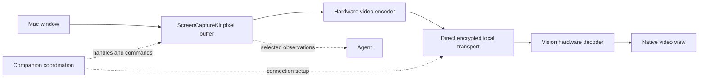

# Mac window sharing: permissions, transport, resizing, and locked sessions

Research date: November 1, 2026. Supplements [the main exploration](agent-managed-surfaces.md) and [the coordinator/tool design](orchestrator-tools.md). This records documented behavior, source inspection, and proposed experiments separately. The original research was read-only. Subsequent [live experiments](shared-window-live-results.md) now establish narrower, machine-specific results; consult that evidence separately.

**November 9 scope clarification:** these native-window findings do not require every Vision surface to have a visible Mac window. The [spatial-workspace investigation](2026-11-09-spatial-surfaces-without-desktop-windows.md) compares offscreen Chromium and headset-local rendering with desktop capture. Covered/offscreen capture removes a simple screen-area limit; it does not prove arbitrary geometry, independent input or many-window capacity. Keep frame sources separate from encoding/presentation.

**Streaming strategy clarification, November 6, 2026:** we already implemented and tested ScreenCaptureKit → hardware VideoToolbox H.264 → direct TLS/TCP → `AVSampleBufferDisplayLayer` on physical Vision Pro. HEVC is the next codec comparison, not an already-selected or measured default. JPEG was the independent simulator fallback. The [strategy review below](#8-streaming-strategy-review-november-6-2026) records the Apple references, the distinction between direct local transport and peer-to-peer Wi-Fi, and the narrow measurements needed to choose the production codec/transport.

## 1. Current answer and implementation boundary

Ordinary per-window sharing and control have public macOS building blocks. A practical design is a native capture/encode path on the Mac, a direct compressed-video connection to Vision Pro, and a native receiver. The existing TypeScript companion can coordinate sessions and commands without carrying raw video frames.

The unresolved part is **continued interactive use while the Mac is locked**. The reviewed Apple documentation does not establish that ordinary ScreenCaptureKit capture plus Accessibility input keeps an application usable behind the lock screen. Do not advertise that behavior before testing it. This is not evidence that every browser/device automation path must stop when the desktop locks: providers that render and accept input independently need their own tests.

The first supported operating condition to prove is an awake Mac with an active, unlocked user session. Background/occluded windows are compatible with the documented single-window capture model; minimized windows pause capture. Lock, display sleep, system sleep, logout, and lid closure are separate conditions.

Local source baseline: planning worktree `bcf17af`, with the merged client/gateway architecture previously inspected at `main` `8b68f3e`. The research machine reports macOS **26.5.2 (25F84)**. The companion currently targets macOS **13.0**, and this worktree's Vision project targets **visionOS 26.2**. Availability matters: the system capture picker requires macOS 14+, and a new visionOS 27 video-rendering sample is not a drop-in baseline dependency.

## 2. Permissions and who should own them

**Default product flow:** after the companion has the required grants, the agent discovers and selects windows/displays programmatically. The user does **not** pick each window in Apple's sharing picker. The picker is an optional manual-sharing route, not a prerequisite for agent-driven capture.

| Capability | Permission or prerequisite | SlopZooka implication |
| --- | --- | --- |
| Capture a user-selected window/display with the system picker | `SCContentSharingPicker` provides selection-scoped authorization for the capture session on supported macOS versions | Good manual “share this app” flow; the user still selects content in trusted system UI |
| Programmatically capture windows through ScreenCaptureKit | Screen Recording / Screen & System Audio Recording access, managed by macOS privacy settings | Fits agent-selected windows after onboarding; must handle denied/revoked access and any OS reauthorization |
| Read another app's AX tree, move/resize its window, invoke supported AX actions | Accessibility trust for the process performing the work | Separate from permission to capture pixels |
| Synthesize mouse/keyboard events | Event-posting access; check the CoreGraphics posting APIs and actual Accessibility state | Verify independently from capture and AX observation; successful permission checks do not prove a particular action reached its target |
| Observe global keyboard/mouse events | Event-listening/Input Monitoring authorization when using protected global listeners | Not automatically needed just to send input or receive input inside SlopZooka's own UI |
| Send Apple Events/AppleScript to control another app | Automation consent and required Apple Events configuration | Only needed if we choose that control path; direct AX is a separate path |
| Connect/discover over the LAN | Local Network access on applicable OS versions; Bonjour service declarations | Already declared by both apps; native streaming still needs the actual authorized network path |
| Microphone/camera | Their own grants when those devices are used | A silent window-video stream does not need to turn on either device; voice permissions are independent |

Apple explicitly explains that the system picker authorizes selected content for the session without separate broad capture permission. That makes it useful for deliberate sharing, but it cannot silently choose arbitrary future windows for the agent. For programmatic capture, Apple's sample requests Screen Recording and describes restarting after the initial grant. Test grant/regrant behavior in the shipped app. [Picker authorization](https://developer.apple.com/videos/play/wwdc2023/10053/), [programmatic capture sample](https://developer.apple.com/documentation/screencapturekit/capturing-screen-content-in-macos).

Use `AXIsProcessTrustedWithOptions` to inspect Accessibility trust; requesting a prompt does not mean access has been granted. The installed CoreGraphics header separately defines `CGPreflightPostEventAccess` / `CGRequestPostEventAccess` for event synthesis and `CGPreflightListenEventAccess` / `CGRequestListenEventAccess` for listening. [AX trust](https://developer.apple.com/documentation/applicationservices/1459186-axisprocesstrustedwithoptions), [event posting](https://developer.apple.com/documentation/coregraphics/cgpreflightposteventaccess()), [event listening](https://developer.apple.com/documentation/coregraphics/cgpreflightlisteneventaccess()).

If Apple Events are used, `NSAppleEventsUsageDescription` is required; hardened-runtime/sandbox configuration must also match the chosen mechanism. It is unnecessary to introduce AppleScript simply to resize a window that AX already supports. Local Network privacy has its own responsible-process attribution and deployment rules. [Apple Events purpose string](https://developer.apple.com/documentation/bundleresources/information-property-list/nsappleeventsusagedescription), [Local Network privacy](https://developer.apple.com/documentation/technotes/tn3179-understanding-local-network-privacy).

### Permission ownership and distribution

Put capture and native AX/input in the stable signed companion app or an intentionally packaged native helper. The Pi and MCP layers call it; each terminal agent should not run its own capture executable and acquire an unrelated set of grants. Test permission attribution for the actual app/helper packaging; do not assume every child process inherits all privacy access.

The existing [`Info.plist`](../apps/mac-menu/Info.plist) declares `com.slopzooka.companion`, Local Network usage and `_slopzooka._tcp`. The current [`build script`](../scripts/build-mac-app.mjs) prefers certificate signing and explicitly warns that ad-hoc rebuilds may reset grants. It does not establish a finished notarized/hardened distribution configuration. Add purpose strings required by the capture APIs and supported OS versions; the current ScreenCaptureKit overview calls out `NSScreenCaptureUsageDescription`, while deployment should be verified against the target SDK/OS rather than inferred from an Info.plist entry alone. [ScreenCaptureKit overview](https://developer.apple.com/documentation/screencapturekit).

Apple lists assistive Accessibility APIs among activities restricted by App Sandbox. That favors the existing separately distributed Mac companion for broad cross-app control; do not assume a sandboxed Mac App Store build can do it just by adding a permission prompt. The Vision app can retain its normal distribution model. [App Sandbox limitations](https://developer.apple.com/documentation/security/protecting-user-data-with-app-sandbox).

Our own capture/input service does not require enabling macOS's built-in Screen Sharing/VNC server. Ordinary capture/control also does not imply Full Disk Access or a root daemon. Apple offers a managed `com.apple.developer.persistent-content-capture` entitlement for VNC applications, requiring Apple's permission. It is a separate possible unattended-access investigation, not an entitlement we can assume or a documented promise of control behind the lock screen. [Persistent capture entitlement](https://developer.apple.com/documentation/bundleresources/entitlements/com.apple.developer.persistent-content-capture).

### Product requirement: clear permission setup and repair

Added November 8 at the user's request. Provide a compact **Screen sharing and control** setup view in the Mac companion, reachable both during onboarding and later from its menu/settings. Show detected status beside each capability and a direct action to open its System Settings page. This is a planned production feature; the probe's existing grants do not implement this onboarding flow.

| Row | Explanation | Action when access is missing |
| --- | --- | --- |
| **Screen sharing** | Let SlopZooka show Mac windows in Vision Pro. | **Enable screen sharing**, then **Open Screen Recording Settings** when a settings change is needed |
| **Control apps** | Let your agents click, type and navigate Mac apps. | **Enable app control**, then **Open Accessibility Settings** when a settings change is needed |

Use clear states such as **Checking**, **Needs access**, and **Allowed**, with a checkmark as well as text. Show **Restart required** only when the granted permission has not become usable and relaunch is actually indicated. The public boolean checks do not distinguish every denial/not-yet-requested condition, so do not invent a more precise authorization history. Permission being allowed is separate from a particular window/stream being ready.

The first enable action requests the relevant OS authorization from the stable signed process that will capture/control apps. Passive status checks must not prompt. For capture, use `CGPreflightScreenCaptureAccess`; for Accessibility use the nonprompting trust check; verify event-posting access separately before exposing generic mouse/keyboard input. Clicking a button or opening Settings never sets the row to Allowed by itself. Apple's AX prompt is asynchronous and does not change the check's return value. [Capture preflight](https://developer.apple.com/documentation/coregraphics/cgpreflightscreencaptureaccess()), [capture request](https://developer.apple.com/documentation/coregraphics/cgrequestscreencaptureaccess()), [AX trust and prompting](https://developer.apple.com/documentation/applicationservices/1459186-axisprocesstrustedwithoptions).

On returning from System Settings, refresh automatically. While the setup view is visible, a modest, nonprompting status refresh can update the checkmarks without requiring a relaunch; also offer **Check again**. Stop that refresh when the view is closed. After a grant, verify the relevant capability on an authorized target before calling an operation ready; do not run unsolicited input against another app just to test a permission. If relaunch is necessary, explain it and offer **Restart companion** through existing supervision, preserving the session service and its PTYs. Do not automatically restart the app because a permission flag changed.

Keep System Settings navigation in one native helper, keyed by permission kind. Candidate pane URLs are `x-apple.systempreferences:com.apple.preference.security?Privacy_ScreenCapture` and `x-apple.systempreferences:com.apple.preference.security?Privacy_Accessibility`. These pane identifiers are compatibility details to verify on supported macOS releases, not a guaranteed public navigation contract. If a deep link fails or reaches the wrong page, retain plain instructions for **System Settings → Privacy & Security → Screen & System Audio Recording / Accessibility**, and a way to open System Settings itself. Use the permission label shown on the actual OS. URL-open success only establishes that the request was accepted, not that the correct pane appeared.

The native provider owns permission observations. Expose the same current facts through the existing companion bridge to onboarding, Vision's launcher/wrist UI, and agent/MCP handlers. Do not add independent permission caches or an agent-specific setup wizard. From Vision, the action should say **Open settings on Mac** and identify the paired Mac; it opens that Mac's settings, never a misleading headset settings page. Keep a status result available in Vision while the user completes setup on the Mac.

Missing access should block only the affected capture/control operation and return the actionable setup state to the agent. Existing terminals and unrelated work remain usable. Lock state, missing native provider, disconnected Mac and unavailable target are separate conditions; none should be mislabeled as permission denial. Revocation updates the same state and stops/rejects affected operations. Microphone, Input Monitoring and Automation requests belong only to features that actually need them, rather than this basic two-row setup.

Acceptance checks for the actual signed package:

- Fresh install and partial grant: correct rows/actions; a prompt or settings launch alone never produces a green state.
- Return from Settings: automatic recheck; grant becoming usable immediately versus requiring a relaunch; existing terminal sessions survive any offered companion restart.
- Revocation and app update: current status reflects the process that performs the work; stable signing and actual permission attribution are checked. Apple's DTS confirms ad-hoc signing can make rebuilds appear as new apps to privacy controls. [Signing finding](https://developer.apple.com/forums/thread/819406).
- Settings navigation: both deep links and fallback instructions work on supported OS versions; no prompts recur from passive checks, and no automatic input is used to grant permissions.
- Vision/agent invocation: the selected Mac receives the setup action; status agrees with the Mac view; locked/disconnected/provider-unavailable states produce the right recovery action.

## 3. Moving and resizing: three different operations

**Resize the real Mac window.** Resolve the target application's AX window, check whether `kAXPositionAttribute` and `kAXSizeAttribute` are settable, then set supported values with `AXUIElementSetAttributeValue`. Read back actual bounds. Apps may enforce minimum sizes, aspect ratios, fullscreen behavior, or unsupported attributes; return the actual result. Accessibility is the relevant grant for another app's window. Our own native windows use their own AppKit APIs. [Settable attributes](https://developer.apple.com/documentation/applicationservices/1459972-axuielementisattributesettable), [attribute mutation](https://developer.apple.com/documentation/applicationservices/1460434-axuielementsetattributevalue), [size attribute](https://developer.apple.com/documentation/applicationservices/kaxsizeattribute).

**Resize the video output.** ScreenCaptureKit's output dimensions/scaling and encoder settings can change without changing the source app's layout. This spends fewer or more pixels on the same window; it is not an app viewport resize. Preserve the mapping from captured content to input coordinates and send new geometry with a generation/format change. The capture sample documents updating a running stream's configuration. [Capture configuration](https://developer.apple.com/documentation/screencapturekit/capturing-screen-content-in-macos).

**Resize or position the Vision presentation.** This is the headset app's own scene/view operation through the existing gateway and visionOS APIs. It is not covered by Mac Accessibility, and it does not grant arbitrary positioning of other visionOS apps. A user making the streamed panel visually larger should normally increase presentation size/quality; changing the underlying browser viewport should be an intentional action. The existing placement limits remain in [main-plan section 10](agent-managed-surfaces.md#10-end-to-end-workspace-launch-prompts).

For Simulator, distinguish changing the Mac Simulator window's zoom/size from changing the simulated device's orientation or screen configuration. Treat resize, capture crop, and device coordinate space as separate facts. Coalesce resize drags and revalidate geometry before input; don't restart the entire app for each frame-size adjustment.

### Foreground requirements: capture and input differ

Clarified November 8 after the user observed Codex bringing controlled apps forward. With a desktop-independent single-window filter, ScreenCaptureKit includes the full window even when it is covered or off-screen; minimizing pauses that stream. This is documented capture behavior, not proof that every app keeps rendering at the desired cadence in the background. [Apple's single-window demonstration](https://developer.apple.com/videos/play/wwdc2022/10155/).

| Operation | Foreground dependency |
| --- | --- |
| Per-window video capture | Does not generally need the window frontmost; distinguish covered from minimized |
| AX observation / supported element actions | Targets a process/element, but background action success is app/action dependent; observe the result |
| Generic desktop pointer / keyboard input | Treat as potentially requiring activation and the correct window/control focus; serialize shared desktop input |
| Managed browser protocol or simulator device automation | Can address an explicit page/device without generic desktop input; verify each provider's behavior and capture/control identity |

The current official OpenAI documentation explicitly lists background tasks on **macOS**, while describing **Windows** computer use as foreground takeover. Thus the user's observed Codex foregrounding does not establish that all Mac control requires it. The docs do not expose the native driver's implementation or guarantee background operation for every action; they are not a reusable driver contract for SlopZooka. [OpenAI Computer Use](https://learn.chatgpt.com/docs/computer-use).

The subsequent [installed-harness inspection](2026-11-08-codex-computer-use-harness.md#5-what-this-tells-us-about-background-and-locked-operation) found background app launch in the shipped API guidance, but did not establish the native input-routing mechanism. It also records that Codex's documented locked-use feature installs an authorization plug-in and temporarily unlocks under additional safeguards. That is separate from our ScreenCaptureKit/AX permission model and is not part of the initial SlopZooka plan.

Multiple streams can remain visible while one app is activated for a focus-dependent action. All global-agent and terminal-agent requests must use the same Mac input owner for those actions: resolve the target, activate if required, refresh observation/geometry, verify focus, act, then verify the result. Coordinate the whole focus-dependent interaction, not just individual key events. Human takeover cancels queued/stale actions; don't blindly restore an old focus after the user has deliberately changed it. Direct page/device operations need not occupy that desktop input owner when their independence is established. Background browser automation must still operate on the page the user is actually seeing; targeting a hidden tab does not make a native browser-window stream display it.

Add one explicit integration check: keep three streams open, cover an inactive target with another app, perform a supported semantic action, then test the native pointer/keyboard fallback. Record whether capture stays fresh, which actions require activation, whether another agent or human can steal focus, and whether any input reaches the wrong target. Minimized and locked cases are separate. This is planned coverage; the existing multi-window demo does not establish concurrent independent native GUI control.

## 4. A video path with bounded overhead

Proposed native path:

ScreenCaptureKit supplies `CMSampleBuffer` frames backed by `CVPixelBuffer`/`IOSurface`. Keep that native path into the encoder, choosing a compatible pixel format and avoiding repeated CPU image conversion. Apple documents hardware scaling and capture metadata. “Zero copy” end to end is not established: encoding, decoding and any color conversion still do work. [Capture buffers](https://developer.apple.com/documentation/screencapturekit/capturing-screen-content-in-macos).

Start with **H.264 in a hardware low-latency mode** and a conservative stream size/frame rate. VideoToolbox documents a mode that removes frame reordering and uses hardware encoding. Verify supported settings and the actual selected encoder; evaluate HEVC later for bandwidth/readability on the target devices. Use exactly one encode path: if WebRTC owns the encoder, do not pre-encode then make it encode again. [Low-latency VideoToolbox](https://developer.apple.com/videos/play/wwdc2021/10158/).

On Vision, `AVSampleBufferDisplayLayer` can display compressed or uncompressed frames and is available from visionOS 1. An explicit `VTDecompressionSession` plus native rendering is another route. Prototype one, verify hardware use and queue latency, and avoid unnecessary decode/re-encode stages. Apple's newer shared-texture RealityKit sample offers another rendering pattern, but requires visionOS 27/Xcode 27 and a real device; the current project targets 26.2. [Display layer](https://developer.apple.com/documentation/avfoundation/avsamplebufferdisplaylayer), [decompression session](https://developer.apple.com/documentation/videotoolbox/vtdecompressionsession), [newer rendering sample](https://developer.apple.com/documentation/realitykit/displaying-low-latency-connected-video).

### Transport choice: performance versus code ownership

| Option | Benefit | Cost / evaluation boundary |
| --- | --- | --- |
| Native WebRTC media connection | Existing media timing, congestion/loss handling and connectivity machinery; direct local connection when available | Native library size/build/updates; prove visionOS support and hardware codec integration before adopting |
| Native Network.framework connection carrying framed compressed video | Small local proof of concept using Apple frameworks; fits an already-paired Mac/headset | TLS/TCP queues and retransmission can increase latency; QUIC/datagrams require framing, loss/recovery and rate control work. Not a free replacement for a media transport |
| WebRTC receiver in a headset web view | Can reduce initial native media integration | Test actual WKWebView playback/input behavior, codec path and latency; another rendering layer is not automatically cheap or expensive |
| MJPEG/JPEG frames | Simple diagnostic prototype, particularly with a WDA source | Repeated full-image compression and bandwidth; useful baseline, not the intended multi-window production path |
| HLS-style segmented playback | Familiar streaming infrastructure | Additional buffering/control is a poor default for interactive window operation |

Prefer WebRTC if a maintained visionOS-compatible native implementation passes a small integration test. If that integration is disproportionately expensive, use a bounded direct-native H.264 prototype to establish capture/decode quality and latency first. Do not simultaneously build a new custom media protocol and integrate WebRTC. The exact transport remains a measured choice; merely selecting ScreenCaptureKit does not choose one. WebRTC needs application signaling, and relay service may be needed off-LAN. [WebRTC connection model](https://webrtc.org/getting-started/peer-connections).

Keep video local when the devices are local. The Node host can authenticate/pair, resolve target handles, exchange connection setup, and publish status. It should not convert video into base64/JSON, route every frame through agent tools, or bounce it through a cloud model. Model observations are occasional images/state from the same target. Audio can be omitted in the first video prototype.

### What actually controls overhead

- Capture individual windows at the resolution needed for readable UI. Start the experiment at about 1920×1080 and 30 fps for a landscape browser, with aspect-correct simulator dimensions; compare 60 fps for scrolling. These are experiment settings, not proven quality targets.
- Keep existing terminals on the current xterm/PTY path and assets in suitable native viewers. Two terminal/browser pairs need two video streams, not four. Evaluate small colored text carefully with the selected codec/chroma format before reducing resolution or bitrate.
- Bound capture/encode/network/decode queues. Drop outdated work before encoding; after encoding, respect inter-frame dependencies and use keyframe recovery rather than discarding arbitrary reference frames.
- Lower the rate/resolution or pause streams based on explicit client presentation state. Do not invent gaze information. A static app need not be continuously re-sent as full screenshots.
- Reuse one capture/encode stream for multiple observers at the same quality where practical. Each independently changing app window still costs capture, encoding, decoding, and compositing resources.
- Keep capture buffers out of SwiftUI image-state updates on every frame. Use a video surface/native renderer; profile retained buffers and WindowServer memory as well as our process.

For scale, **uncompressed** 1920×1080 BGRA at 30 fps is roughly 249 MB/s, or 1.99 Gbit/s, per stream before any transport overhead. That is arithmetic, not a measurement. It explains why native buffers and hardware compression matter. A starting compressed-bandwidth sweep might be 4/8/12 Mbit/s per stream; whether small text is acceptable at those rates must be measured. Two streams at a selected 8 Mbit/s video target imply roughly 16 Mbit/s of video payload, plus transport overhead. No CPU, power, or latency claim follows from those settings.

Apple exposes a visionOS 26+ low-latency networking entitlement intended for streamed-game applications, activated when system resources permit. It is worth checking eligibility if network timing is a problem; ordinary window streaming should not assume eligibility or guaranteed priority. Likewise, immersive foveated-streaming APIs are not automatically the right abstraction for independent flat app windows. [Low-latency entitlement](https://developer.apple.com/documentation/bundleresources/entitlements/com.apple.developer.low-latency-streaming).

## 5. Window state, lock, sleep, and lid closure

| Host/source state | Evidence and current conclusion | Product behavior to test |
| --- | --- | --- |
| Window partially/fully covered | Apple documents full single-window content capture despite occlusion | Continue stream; semantic input may work independently, while pointer fallback can need foreground focus |
| Window moved off-screen or to another display | Apple documents continued independent-window capture | Preserve target mapping across display changes; verify geometry |
| Window minimized | Apple documents capture pausing until restored | Mark paused and restore only when appropriate; do not present the last frame as a fresh observation |
| Pop-up/child window appears | Apple's single-window example excludes additional child/pop-up windows | Observe and explicitly include/present a related dialog when needed; otherwise stream and controller can diverge |
| Mac locked, user still logged in | No reviewed Apple contract guarantees continued target capture plus ordinary GUI control | Unproven. Test an already-running stream and attempts to start/attach while locked separately |
| Display asleep, machine awake | Distinct from lock/system sleep; capture can report blank/suspended/stopped conditions | Detect actual provider state, rebuild if necessary after wake; do not infer healthy capture from an open network socket |
| System asleep | Cannot promise normal application processing or live frames while asleep | Show disconnected/suspended, preserve handles, reconcile on wake |
| Logged out / user switched | The original interactive session is not the active desktop; session lifecycle applies | Invalidate affected observations/control and reconcile actual resources; ordinary menu-app behavior is not login-window remote access |
| Lid closed | Depends on power/display configuration and whether the machine stays awake | Explicit clamshell test; no assumption that keeping a process alive preserves capture |

The occlusion, off-screen, minimized and child-window behavior above comes from Apple's single-window demonstration. Recheck on the deployment OS, especially for app-specific dialogs. [Window capture behavior](https://developer.apple.com/videos/play/wwdc2022/10155/).

ScreenCaptureKit exposes idle, blank, suspended and stopped frame states. Idle can simply mean unchanged content; it is not evidence of a locked Mac. Handle stream errors and public workspace/display notifications, and report what is observed rather than guessing the reason for a frozen picture. Apple's session-active notifications describe session switching; they are not documented as a complete lock/unlock detector. [Frame status](https://developer.apple.com/documentation/screencapturekit/scframestatus), [stream delegate](https://developer.apple.com/documentation/screencapturekit/scstreamdelegate), [session switching](https://developer.apple.com/documentation/appkit/nsworkspace/sessiondidresignactivenotification).

A current third-party capture implementation reports stream invalidation around lock/unlock and display changes. This is useful evidence for recovery tests, not Apple's platform contract or a result from our app. A separate Sunshine report concerns an AVFoundation display-sleep recovery failure, so it must not be generalized into a ScreenCaptureKit limitation. [Implementation report](https://github.com/seakrebel/macos-animation-fix), [Sunshine sleep-recovery report](https://github.com/LizardByte/Sunshine/issues/5509).

Apple's own Mac Virtual Display setup instructions say the Mac laptop should be open with its display active. Its internal-display mirroring behavior is not evidence that arbitrary third-party capture works while locked or with the lid shut. Supported closed-display Mac configurations have their own power/display/input requirements. [Mac Virtual Display](https://support.apple.com/en-gb/118521), [closed-display conditions](https://support.apple.com/en-us/102501).

### If using the app while the desktop is locked is essential

Investigate a browser-owned rendering/input path and simulator-owned frames/control separately from WindowServer capture and global input. A headless/managed browser can be the actual session the user sees through its own stream; a device automation provider might also avoid some desktop-focus dependencies. Neither path has been validated under Mac lock here, and a simulator is not automatically independent of the Mac graphical session.

If arbitrary native windows must remain interactively available behind a locked desktop, that is a stronger remote-desktop requirement. Evaluate a supported remote session/VM or an eligible persistent-capture design rather than assuming an ordinary menu app has those semantics. A virtual display alone is not an independent user/input session. Keeping the machine awake also does not unlock it or prove GUI access.

For the first release candidate, treat locked-session native interaction as unsupported until the experiment demonstrates a specific supported configuration. This is a provisional support boundary, not a claim that it is technically impossible. Do not change the user's lock settings as an implementation shortcut.

## 6. Small experiments that settle the real questions

| Experiment | Evidence required |
| --- | --- |
| Signed-app permissions | Fresh grant, denial, revocation/regrant, update/relaunch, and actual helper attribution; capture and AX/input checked independently |
| Capture/control continuity | Browser and Simulator observed/control-bound to the same window/device; covered, off-screen, minimized, dialogs, resize and rotation exercised |
| Lock versus sleep | Start before lock, attach while locked, unlock; repeat with display sleep, system sleep, user switch and lid closure as separate tests |
| Performance | One, two and four streams; idle text, scrolling and animation; 30/60 fps and a resolution/bitrate sweep |
| Recovery | Wi-Fi interruption, decoder/encoder restart, format change and reconnect return to the same target; stale input is rejected |

For lock tests, record frame status/timestamps, actual content freshness, control acknowledgements and observed effects separately. Test AX actions, foreground CoreGraphics input, browser protocol operations and simulator automation individually; one working channel does not establish all four. A sleeping/locked Mac should not be forced through those transitions on the user's active machine without arranging the test.

Measure capture-to-display latency and action-to-visible-response latency, p50/p95, plus CPU, GPU/encoder/decoder use, process and WindowServer memory, network rate, dropped frames, thermal behavior and text readability. Timestamp every stage; one-way cross-device timestamps need clock alignment, so use round trips or an external high-frame-rate recording when necessary. A proposed initial target is p95 under 150 ms for the active interactive surface on a good LAN, subject to user evaluation; this is an acceptance hypothesis, not a benchmark result.

The first spike should answer these platform questions with one browser and one simulator before expanding the agent tool catalog. It can reuse the existing host identity/window gateway and add one native media provider. No production transport decision or locked-session support claim is justified by this research alone.

## 7. Prototype preparation and completed live test

The [isolated prototype plan](shared-window-prototype.md) turned these risks into concrete deliverables, locked-simulator fallback trials, capability enforcement and a runbook. The [standalone prototype](../experiments/shared-window-probe/README.md) was built and tested on the Mac and physical Vision Pro on November 1. Three user-controlled lock/unlock cycles completed; the [live report](shared-window-live-results.md) records observations, fixes, failures and cleanup. The November 6 follow-up is a source/documentation review, with no additional device test.

Preparation finding: with hardware-required, low-latency H.264 on this Mac, session creation and four-frame encoding/decoding succeed, but querying `UsingHardwareAcceleratedVideoEncoder` returns `kVTPropertyNotSupportedErr` (-12900). The prototype records that distinction. Apple's hardware-required creation flag fails if hardware encoding is unavailable; it does not make the separate readback property universally supported. [Hardware requirement](https://developer.apple.com/documentation/videotoolbox/kvtvideoencoderspecification_requirehardwareacceleratedvideoencoder), [readback property](https://developer.apple.com/documentation/videotoolbox/kvtcompressionpropertykey_usinghardwareacceleratedvideoencoder).

The initial transport is a framed H.264/TLS LAN probe with bounded queues and reconnect, not a production transport selection. Simulator PNG polling proved too slow for interactive use; independent WDA continuous JPEG and device actions worked during the tested locked intervals. Early lock detection and the 30-second diagnostic confirmation caused expiry/black-screen failures; the live report records the subsequent fixes and limits. Native desktop operations remain gated separately from device automation. Standalone XCTest failures and cold simulator boot while locked remain unresolved.

## 8. Streaming strategy review, November 6, 2026

**November 8 measurement update:** [26 offline Mac codec cases](2026-11-08-mac-codec-benchmarks.md) passed, including hardware low-latency HEVC on this M4 Max. Keep the existing H.264 path for initial integration. Ordinary real-time HEVC, rather than low-latency HEVC, is the stronger text-bandwidth candidate for a physical comparison; it had higher local delay. Synthetic JPEG→H.264 reduced payload from 14.65 to 3.89 Mbps, but live WDA transcoding to Vision remains untested. These measurements refine the candidates below without settling headset quality, transport or total system cost.

The user's proposed Apple-native pipeline matches the direction and much of the implementation. The production codec and network choice remain measurements to make. This is our composition of Apple's building blocks, not an Apple-prescribed end-to-end screen-sharing architecture.

| Component | Evidence so far | Decision |
| --- | --- | --- |
| Per-window ScreenCaptureKit capture | Implemented in `Host/Capture.swift`; three selected native windows streamed to physical Vision Pro. Apple positions the API for high-performance screen sharing. | Keep it as the desktop-window source. [Apple overview](https://developer.apple.com/videos/play/wwdc2022/10156/) |
| Hardware VideoToolbox encoding | `Shared/Video.swift` requires hardware H.264 and enables low-latency rate control, real-time operation and no frame reordering. The live native streams and November 8 offline codec comparison passed. | Keep H.264 for the first integration. Compare ordinary real-time HEVC on the headset next. |
| Native Vision video presentation | `Viewer/ViewerApp.swift` embeds `AVSampleBufferDisplayLayer` in a `UIViewRepresentable` and feeds its renderer. The physical viewer used this path. | Reuse the native receiver inside the production preview gateway. Apple's [connected-device sample](https://developer.apple.com/documentation/visionos/displaying-video-from-connected-devices) demonstrates this rendering arrangement; its UVC/Developer Strap input is different from our network input. It is renderer evidence, not a ready-made networking implementation or a requirement for our viewer to use a strap. |
| Direct local media connection | The probe used Network.framework TLS/TCP on the Mac and a pinned URLSession receiver, with independent streams and bounded queues. | Preserve this working comparison path. Production transport, congestion handling and physical peer-to-peer Wi-Fi remain unselected/unmeasured. |
| Independent simulator fallback | WDA/Appium input and JPEG frames worked while the desktop was locked. Measured source rate was about 14 fps, with roughly 15–20 Mbps at the final scaling/quality settings. The offline JPEG→video benchmark now exists. | Keep independent device access. Evaluate JPEG→H.264 on the existing live receiver; only synthetic transcoding has been implemented so far. |

### HEVC candidate and H.264 baseline

Apple's [WWDC21 low-latency encoding session](https://developer.apple.com/videos/play/wwdc2021/10158/) specifically describes H.264 for that mode. The [current rate-control property documentation](https://developer.apple.com/documentation/videotoolbox/kvtvideoencoderspecification_enablelowlatencyratecontrol) describes no reordering or lookahead, among other constraints. Neither reference establishes that switching the probe's codec constant to HEVC preserves its measured behavior on the user's devices. This does not establish that HEVC cannot be low latency.

Treat hardware HEVC as the candidate preferred codec, selected only if it improves measured bandwidth at acceptable text quality, delay and power. Require hardware encoder creation, check supported property results and confirm receiver compatibility. The probe's packet/sample code currently assumes H.264 parameter sets; HEVC needs its own format-description handling and an explicit negotiated codec, followed by decoder reset/keyframe recovery when formats change. A future WebRTC implementation also needs actual support for the selected codec; codec negotiation cannot be assumed from VideoToolbox availability.

The native test configured a capture rate up to 30 fps, dimensions up to 1920×1440 and an **8 Mbps average encoder target**. That target is not a hard bandwidth ceiling or a measured network rate. Actual headset presentation rate, end-to-end delay and power were not measured. The capture pixel format is currently 4:2:0, so small colored text must be inspected; a codec-name change alone does not establish better text rendering.

### JPEG's role and the simulator fallback

A 500 kB JPEG sent 60 times per second is `500,000 × 60 × 8 = 240,000,000 bits/s`, or **240 Mbps** before transport overhead. This is the user's illustrative arithmetic, not our measured JPEG frame size/rate. Continuous independent images repeat unchanged content; inter-frame video coding can reuse information between frames. The actual JPEG fallback's roughly 15–20 Mbps at about 14 fps already makes it a useful optimization target.

For unlocked desktop windows, stay on the native capture-buffer → encoder path. For the separately operating simulator, test WDA JPEG → decode once to a pixel buffer on the Mac → hardware H.264/HEVC → the common video receiver. That can reduce traffic crossing to Vision; it still incurs the WDA JPEG work, local decode and video encode. It cannot recover detail lost in the JPEG or create real 60 fps motion from a roughly 14 fps source. Measure the tradeoff and preserve the proven JPEG route as a diagnostic/fallback during evaluation. Direct simulator-frame acquisition is another provider possibility, but no suitable supported replacement has been established here.

### Direct connectivity and peer-to-peer Wi-Fi are separate choices

Keep local media on a direct Mac-to-headset connection, with neither the cloud model nor Pi carrying every frame. That connection can traverse the local Wi-Fi access point. Apple peer-to-peer Wi-Fi is a separate link option enabled through Network.framework's [`includePeerToPeer`](https://developer.apple.com/documentation/network/nwparameters/includepeertopeer); successful direct LAN streaming did not test it. Apple's [DTS guidance](https://developer.apple.com/forums/thread/751839) says infrastructure Wi-Fi can be preferable and that enabling peer-to-peer can affect its performance. It is not a guaranteed latency improvement or a free connection-migration mechanism.

Retain LAN operation as the first supported network condition. **November 10 user update:** perform the narrow [peer-link comparison](../experiments/peer-link-probe/README.md) before product implementation, including no-shared-LAN operation and a negative control; [rollout step 0](2026-11-10-preview-first-rollout.md#0-quick-direct-link-check-before-product-implementation) owns the gate. Physical results remain pending. This moves link discovery/connectivity measurement earlier without replacing the later rendered-media transport qualification. Treat remote Internet access/relaying separately. If a maintained native WebRTC integration fits the platforms and chosen codec, it can supply media transport machinery; its [signaling and connectivity model](https://webrtc.org/getting-started/peer-connections) still needs application integration. Do not change codec, network topology and media protocol simultaneously in the first comparison.

### Foveated Streaming

Apple's [Foveated Streaming overview](https://developer.apple.com/documentation/foveatedstreaming) describes immersive local/cloud endpoints, CloudXR integration and presentation in an `ImmersiveSpace`; its documented availability begins at visionOS 26.4. Our November 1 physical experiment used visionOS 26.2. The framework was not tested in the probe. Its immersive rendering model is not the natural starting point for independently controlled flat browser/simulator windows, so it remains outside this implementation path. Revisit it for an actual immersive workload rather than assuming gaze-based streaming applies to every normal window.

### Narrow next media comparison

1. On the existing transport, compare hardware H.264 and HEVC using one window, then three, with static fine/colored text, scrolling and animation. Compare both equal bitrate and matched perceived quality; record actual throughput, frame age, dropped frames and total host/headset cost. Try 30/60 fps where the capture source supports it. Verify hardware selection and property support per codec.
2. Independently compare the simulator's current JPEG relay with Mac-side video transcoding, including the already-supported locked-device route during an arranged live test. Keep target identity and app state constant.
3. With the selected codec, exercise network contention/reconnect and then the optional peer-to-peer link. Decide whether bounded direct transport is sufficient or a maintained media transport earns its dependency cost.

Measure user-visible action-to-response delay and capture-to-presentation delay with clock alignment or an external recording; do not subtract unrelated device clocks or equate source frame counts with displayed fps. Keep queues bounded, drop obsolete input before encoding, and recover inter-frame streams at valid dependency/keyframe boundaries. The choice is accepted when measured text clarity, interaction delay and resource use satisfy the intended multiple-window workflow. Agent tools and `WindowGateway` remain independent of this codec/transport choice.

## 9. Implementation readiness and transport gate, November 10

The [preview-first rollout](2026-11-10-preview-first-rollout.md) can begin. We have demonstrated the capture/encoding/rendering path and the provider/presentation architecture. We have **not** demonstrated a globally optimal codec or qualified the probe's transport for sustained poor-network use. The first production slice should settle that narrower transport question before its media contract becomes difficult to change. This review adds no live measurement.

### Initial strategy and confidence

| Layer | Initial implementation choice | Evidence and limit |
| --- | --- | --- |
| Mac source | Programmatic, exact-window ScreenCaptureKit capture; authoritative geometry from the source | Physical native/Chrome/Simulator window streams worked. General app dialog, resize and permission-recovery behavior still needs qualification. |
| Compression | Hardware H.264 with real-time, no-reordering settings; source-dependent resolution/cadence | Physical H.264 plus local codec benchmarks support this default. HEVC has a measured text/bandwidth tradeoff, not an established overall win. No need to block manual preview work on another codec bake-off. |
| Delivery | Reuse the direct authenticated TLS/TCP LAN path as the **first integration candidate** | It ran on the user's LAN. Production acceptance requires fresh-video recovery under constrained bandwidth, receiver stalls and reconnect. Direct LAN is not the same as measured peer-to-peer Wi-Fi or Internet/relay support. |
| Vision rendering | Native video sample-buffer renderer within the existing Preview/gateway | The physical H.264 renderer lives in the standalone ProbeViewer. The optional receiver currently inside SlopZooka is JPEG-only. Integrating the native video receiver is real work; changing a payload discriminator alone does not supply H.264 support. |
| Control | Existing authenticated companion operations and native Codex CUA; small preview MCP | Keep media bytes out of terminal/control polling, Node JSON/base64 and agent calls. Model observations remain occasional images/state. |

Keep this one transport implementation small and replaceable at the encoded-media boundary. Do not prebuild TCP/QUIC/WebRTC providers or several codec-negotiation modes. If the LAN candidate meets the measured UX requirements, retain it. If reliable delivery causes persistent stale-frame catch-up or frequent disruptive resets, compare one native QUIC approach or a maintained WebRTC integration before expanding the rollout.

Apple documents reliable streams versus best-effort datagrams, recommends QUIC when choosing a new reliable protocol without an existing preference, and notes that datagrams still need size limits and fragmentation/reassembly. This makes QUIC a legitimate alternative, not an automatic complete media solution. A single ordered QUIC stream still preserves ordering within that stream; changing its transport name alone does not implement video expiration. WebRTC also requires application signaling/connectivity integration. [Apple networking guidance](https://developer.apple.com/documentation/technotes/tn3213-moving-from-multipeer-connectivity-to-network-framework), [WebRTC connection setup](https://webrtc.org/getting-started/peer-connections).

### Why the transport gate remains real

Source inspection of the existing probe found useful safeguards: one application send in flight per peer, dependent-frame dropping followed by a keyframe wait, disconnect on prolonged send stalls, a bounded receiver inbox, and renderer reset after backpressure/failure. Those are worth retaining. They are not a measured upper bound on frame age: lower-level network buffering and ordered delivery can still delay newer video. A send callback, received byte count or renderer enqueue counter does not establish that the user saw a fresh frame.

The probe also synthesizes sample presentation timestamps from `sequence / 30` and timestamps its packet at encoder output. Do not use those as measured source capture times when carrying variable-cadence production video. Preserve actual media timing, label measurement stages honestly, and align clocks or use an independent visible marker for cross-device delay. A static source can legitimately have no new image; health/idle status and connection liveness must distinguish that from a frozen source.

### Small decisive media test during the first implementation

Use the native H.264 path with one source, then three independent sources. Test readable small/colored text, scrolling and animation. Automate bounded bandwidth/receiver stalls on owned test connections, a midstream disconnect and a resize/format change. Keep a second viewer healthy while one is stalled. These injected conditions do not reproduce every real Wi-Fi loss pattern, so include a short actual-headset pass after the automated checks.

Record queue memory, actual payload/transport rate, source/receive/decode-or-enqueue milestones, independently observed frame age or action-to-visible delay, reset count and time to a fresh correctly identified frame after recovery. Preserve the earlier proposed healthy-LAN p95 below 150 ms as an evaluation target, not an achieved result. Source FPS and local decoder latency do not pass that target. Confirm the user's judgment of text and motion quality.

The release gate is bounded memory and bounded stale-video handling, no decoder corruption/wrong target, fresh-keyframe recovery without replaying a long obsolete sequence, and independent progress for other viewers/control requests. Drop superseded work before encoding; after encoding, respect dependencies. Explicitly discard/reset an overdue stream and reacquire a keyframe when its backlog cannot be removed safely. Do not hide a persistent transport failure behind an endless reconnect loop. Agree the numeric recovery/freshness budget against measured behavior before calling the experience reliable.

No new codec, voice/global agent, browser embedder or peer-to-peer-radio implementation is needed for this test. HEVC quality comparison and device-JPEG transcoding remain later optimizations; their absence does not block the initial native-window product.

### Interface to freeze with the first slice

The division of responsibility is understood; exact wire names should be finalized with matching TypeScript/Swift fixtures, not inferred from the disposable packet structs:

- **Catalog/target binding:** stable frontend ID, source kind/title/workspace, current availability, opaque exact target generation and authoritative geometry. Keep capture availability separate from native-control availability.
- **Preview commands:** list/open/close/rename through existing owners, launch-bound caller/client scope, bounded idempotency and honest acceptance/presentation status. Closing one view does not end its source or another viewer.
- **Resolved viewer subscription:** short-lived, exact-target media access and trust material; codecs/capabilities and current geometry; release independent of model/MCP connection lifetime. Persist stable window references only.
- **Media framing:** versioned bounded headers/payloads, codec configuration, stream generation, sequence, real media timing, keyframe/dependency indication and geometry association. Decoder reset/keyframe recovery and explicit state/error events belong here. Encoded resolution is distinct from preferred spatial size.
- **Receiver feedback:** enough telemetry/recovery signaling to identify stale delivery, request a valid restart/keyframe and preserve independent viewer behavior. Keep it within the stream provider rather than another global control service.

The MCP need not expose bitrate, transport, window dimensions or these packet details to the model. Keep the public preview semantics stable if media delivery changes later.

### One everyday UX case to include: dialogs and child windows

Verify a normal login/modal/popover while native Codex controls the selected source. A successful parent-window stream does not prove every UI the agent can interact with is visible. The installed macOS 26.2 header documents `includeChildWindows` for display-bound window/application sharing, while the probe uses desktop-independent single-window capture. Do not assume that setting the flag fixes that mode or broaden capture to all app windows implicitly. Qualify the selected capture mode; if a related dialog cannot be included, identify/present its exact target explicitly or report that limitation. [Single-window filter](https://developer.apple.com/documentation/screencapturekit/sccontentfilter/init(desktopindependentwindow:)), [child-window configuration](https://developer.apple.com/documentation/screencapturekit/scstreamconfiguration/includechildwindows).

Together with the real interactive terminal-CUA/MCP test and signed-app permission/recovery checks in the rollout plan, these are focused production acceptance gates. They do not require another broad pre-implementation discovery project.
