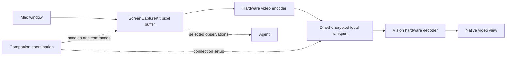

# Mac window sharing: permissions, transport, resizing, and locked sessions

Research date: November 1, 2026. Supplements [the main exploration](agent-managed-surfaces.md) and [the coordinator/tool design](orchestrator-tools.md). This records documented behavior, source inspection, and proposed experiments separately. The original research was read-only. Subsequent [live experiments](shared-window-live-results.md) now establish narrower, machine-specific results; consult that evidence separately.

## 1. Current answer and implementation boundary

Ordinary per-window sharing and control have public macOS building blocks. A practical design is a native capture/encode path on the Mac, a direct compressed-video connection to Vision Pro, and a native receiver. The existing TypeScript companion can coordinate sessions and commands without carrying raw video frames.

The unresolved part is **continued interactive use while the Mac is locked**. The reviewed Apple documentation does not establish that ordinary ScreenCaptureKit capture plus Accessibility input keeps an application usable behind the lock screen. Do not advertise that behavior before testing it. This is not evidence that every browser/device automation path must stop when the desktop locks: providers that render and accept input independently need their own tests.

The first supported operating condition to prove is an awake Mac with an active, unlocked user session. Background/occluded windows are compatible with the documented single-window capture model; minimized windows pause capture. Lock, display sleep, system sleep, logout, and lid closure are separate conditions.

Local source baseline: planning worktree `bcf17af`, with the merged client/gateway architecture previously inspected at `main` `8b68f3e`. The research machine reports macOS **26.5.2 (25F84)**. The companion currently targets macOS **13.0**, and this worktree's Vision project targets **visionOS 26.2**. Availability matters: the system capture picker requires macOS 14+, and a new visionOS 27 video-rendering sample is not a drop-in baseline dependency.

## 2. Permissions and who should own them

| Capability | Permission or prerequisite | SlopZooka implication |
| --- | --- | --- |
| Capture a user-selected window/display with the system picker | `SCContentSharingPicker` provides selection-scoped authorization for the capture session on supported macOS versions | Good manual “share this app” flow; the user still selects content in trusted system UI |
| Programmatically capture windows through ScreenCaptureKit | Screen Recording / Screen & System Audio Recording access, managed by macOS privacy settings | Fits agent-selected windows after onboarding; must handle denied/revoked access and any OS reauthorization |
| Read another app's AX tree, move/resize its window, invoke supported AX actions | Accessibility trust for the process performing the work | Separate from permission to capture pixels |
| Synthesize mouse/keyboard events | Event-posting access; check the CoreGraphics posting APIs and actual Accessibility state | Verify independently from capture and AX observation; successful permission checks do not prove a particular action reached its target |
| Observe global keyboard/mouse events | Event-listening/Input Monitoring authorization when using protected global listeners | Not automatically needed just to send input or receive input inside SlopZooka's own UI |
| Send Apple Events/AppleScript to control another app | Automation consent and required Apple Events configuration | Only needed if we choose that control path; direct AX is a separate path |
| Connect/discover over the LAN | Local Network access on applicable OS versions; Bonjour service declarations | Already declared by both apps; native streaming still needs the actual authorized network path |
| Microphone/camera | Their own grants when those devices are used | A silent window-video stream does not need to turn on either device; voice permissions are independent |

Apple explicitly explains that the system picker authorizes selected content for the session without separate broad capture permission. That makes it useful for deliberate sharing, but it cannot silently choose arbitrary future windows for the agent. For programmatic capture, Apple's sample requests Screen Recording and describes restarting after the initial grant. Test grant/regrant behavior in the shipped app. [Picker authorization](https://developer.apple.com/videos/play/wwdc2023/10053/), [programmatic capture sample](https://developer.apple.com/documentation/screencapturekit/capturing-screen-content-in-macos).

Use `AXIsProcessTrustedWithOptions` to inspect Accessibility trust; requesting a prompt does not mean access has been granted. The installed CoreGraphics header separately defines `CGPreflightPostEventAccess` / `CGRequestPostEventAccess` for event synthesis and `CGPreflightListenEventAccess` / `CGRequestListenEventAccess` for listening. [AX trust](https://developer.apple.com/documentation/applicationservices/1459186-axisprocesstrustedwithoptions), [event posting](https://developer.apple.com/documentation/coregraphics/cgpreflightposteventaccess()), [event listening](https://developer.apple.com/documentation/coregraphics/cgpreflightlisteneventaccess()).

If Apple Events are used, `NSAppleEventsUsageDescription` is required; hardened-runtime/sandbox configuration must also match the chosen mechanism. It is unnecessary to introduce AppleScript simply to resize a window that AX already supports. Local Network privacy has its own responsible-process attribution and deployment rules. [Apple Events purpose string](https://developer.apple.com/documentation/bundleresources/information-property-list/nsappleeventsusagedescription), [Local Network privacy](https://developer.apple.com/documentation/technotes/tn3179-understanding-local-network-privacy).

### Permission ownership and distribution

Put capture and native AX/input in the stable signed companion app or an intentionally packaged native helper. The Pi and MCP layers call it; each terminal agent should not run its own capture executable and acquire an unrelated set of grants. Test permission attribution for the actual app/helper packaging; do not assume every child process inherits all privacy access.

The existing [`Info.plist`](../apps/mac-menu/Info.plist) declares `com.slopzooka.companion`, Local Network usage and `_slopzooka._tcp`. The current [`build script`](../scripts/build-mac-app.mjs) prefers certificate signing and explicitly warns that ad-hoc rebuilds may reset grants. It does not establish a finished notarized/hardened distribution configuration. Add purpose strings required by the capture APIs and supported OS versions; the current ScreenCaptureKit overview calls out `NSScreenCaptureUsageDescription`, while deployment should be verified against the target SDK/OS rather than inferred from an Info.plist entry alone. [ScreenCaptureKit overview](https://developer.apple.com/documentation/screencapturekit).

Apple lists assistive Accessibility APIs among activities restricted by App Sandbox. That favors the existing separately distributed Mac companion for broad cross-app control; do not assume a sandboxed Mac App Store build can do it just by adding a permission prompt. The Vision app can retain its normal distribution model. [App Sandbox limitations](https://developer.apple.com/documentation/security/protecting-user-data-with-app-sandbox).

Our own capture/input service does not require enabling macOS's built-in Screen Sharing/VNC server. Ordinary capture/control also does not imply Full Disk Access or a root daemon. Apple offers a managed `com.apple.developer.persistent-content-capture` entitlement for VNC applications, requiring Apple's permission. It is a separate possible unattended-access investigation, not an entitlement we can assume or a documented promise of control behind the lock screen. [Persistent capture entitlement](https://developer.apple.com/documentation/bundleresources/entitlements/com.apple.developer.persistent-content-capture).

## 3. Moving and resizing: three different operations

**Resize the real Mac window.** Resolve the target application's AX window, check whether `kAXPositionAttribute` and `kAXSizeAttribute` are settable, then set supported values with `AXUIElementSetAttributeValue`. Read back actual bounds. Apps may enforce minimum sizes, aspect ratios, fullscreen behavior, or unsupported attributes; return the actual result. Accessibility is the relevant grant for another app's window. Our own native windows use their own AppKit APIs. [Settable attributes](https://developer.apple.com/documentation/applicationservices/1459972-axuielementisattributesettable), [attribute mutation](https://developer.apple.com/documentation/applicationservices/1460434-axuielementsetattributevalue), [size attribute](https://developer.apple.com/documentation/applicationservices/kaxsizeattribute).

**Resize the video output.** ScreenCaptureKit's output dimensions/scaling and encoder settings can change without changing the source app's layout. This spends fewer or more pixels on the same window; it is not an app viewport resize. Preserve the mapping from captured content to input coordinates and send new geometry with a generation/format change. The capture sample documents updating a running stream's configuration. [Capture configuration](https://developer.apple.com/documentation/screencapturekit/capturing-screen-content-in-macos).

**Resize or position the Vision presentation.** This is the headset app's own scene/view operation through the existing gateway and visionOS APIs. It is not covered by Mac Accessibility, and it does not grant arbitrary positioning of other visionOS apps. A user making the streamed panel visually larger should normally increase presentation size/quality; changing the underlying browser viewport should be an intentional action. The existing placement limits remain in [main-plan section 10](agent-managed-surfaces.md#10-end-to-end-workspace-launch-prompts).

For Simulator, distinguish changing the Mac Simulator window's zoom/size from changing the simulated device's orientation or screen configuration. Treat resize, capture crop, and device coordinate space as separate facts. Coalesce resize drags and revalidate geometry before input; don't restart the entire app for each frame-size adjustment.

## 4. A video path with bounded overhead

Proposed native path:

ScreenCaptureKit supplies `CMSampleBuffer` frames backed by `CVPixelBuffer`/`IOSurface`. Keep that native path into the encoder, choosing a compatible pixel format and avoiding repeated CPU image conversion. Apple documents hardware scaling and capture metadata. “Zero copy” end to end is not established: encoding, decoding and any color conversion still do work. [Capture buffers](https://developer.apple.com/documentation/screencapturekit/capturing-screen-content-in-macos).

Start with **H.264 in a hardware low-latency mode** and a conservative stream size/frame rate. VideoToolbox documents a mode that removes frame reordering and uses hardware encoding. Verify supported settings and the actual selected encoder; evaluate HEVC later for bandwidth/readability on the target devices. Use exactly one encode path: if WebRTC owns the encoder, do not pre-encode then make it encode again. [Low-latency VideoToolbox](https://developer.apple.com/videos/play/wwdc2021/10158/).

On Vision, `AVSampleBufferDisplayLayer` can display compressed or uncompressed frames and is available from visionOS 1. An explicit `VTDecompressionSession` plus native rendering is another route. Prototype one, verify hardware use and queue latency, and avoid unnecessary decode/re-encode stages. Apple's newer shared-texture RealityKit sample offers another rendering pattern, but requires visionOS 27/Xcode 27 and a real device; the current project targets 26.2. [Display layer](https://developer.apple.com/documentation/avfoundation/avsamplebufferdisplaylayer), [decompression session](https://developer.apple.com/documentation/videotoolbox/vtdecompressionsession), [newer rendering sample](https://developer.apple.com/documentation/realitykit/displaying-low-latency-connected-video).

### Transport choice: performance versus code ownership

| Option | Benefit | Cost / evaluation boundary |
| --- | --- | --- |
| Native WebRTC media connection | Existing media timing, congestion/loss handling and connectivity machinery; direct local connection when available | Native library size/build/updates; prove visionOS support and hardware codec integration before adopting |
| Native Network.framework connection carrying framed compressed video | Small local proof of concept using Apple frameworks; fits an already-paired Mac/headset | TLS/TCP queues and retransmission can increase latency; QUIC/datagrams require framing, loss/recovery and rate control work. Not a free replacement for a media transport |
| WebRTC receiver in a headset web view | Can reduce initial native media integration | Test actual WKWebView playback/input behavior, codec path and latency; another rendering layer is not automatically cheap or expensive |
| MJPEG/JPEG frames | Simple diagnostic prototype, particularly with a WDA source | Repeated full-image compression and bandwidth; useful baseline, not the intended multi-window production path |
| HLS-style segmented playback | Familiar streaming infrastructure | Additional buffering/control is a poor default for interactive window operation |

Prefer WebRTC if a maintained visionOS-compatible native implementation passes a small integration test. If that integration is disproportionately expensive, use a bounded direct-native H.264 prototype to establish capture/decode quality and latency first. Do not simultaneously build a new custom media protocol and integrate WebRTC. The exact transport remains a measured choice; merely selecting ScreenCaptureKit does not choose one. WebRTC needs application signaling, and relay service may be needed off-LAN. [WebRTC connection model](https://webrtc.org/getting-started/peer-connections).

Keep video local when the devices are local. The Node host can authenticate/pair, resolve target handles, exchange connection setup, and publish status. It should not convert video into base64/JSON, route every frame through agent tools, or bounce it through a cloud model. Model observations are occasional images/state from the same target. Audio can be omitted in the first video prototype.

### What actually controls overhead

- Capture individual windows at the resolution needed for readable UI. Start the experiment at about 1920×1080 and 30 fps for a landscape browser, with aspect-correct simulator dimensions; compare 60 fps for scrolling. These are experiment settings, not proven quality targets.
- Keep existing terminals on the current xterm/PTY path and assets in suitable native viewers. Two terminal/browser pairs need two video streams, not four. Evaluate small colored text carefully with the selected codec/chroma format before reducing resolution or bitrate.
- Bound capture/encode/network/decode queues. Drop outdated work before encoding; after encoding, respect inter-frame dependencies and use keyframe recovery rather than discarding arbitrary reference frames.
- Lower the rate/resolution or pause streams based on explicit client presentation state. Do not invent gaze information. A static app need not be continuously re-sent as full screenshots.
- Reuse one capture/encode stream for multiple observers at the same quality where practical. Each independently changing app window still costs capture, encoding, decoding, and compositing resources.
- Keep capture buffers out of SwiftUI image-state updates on every frame. Use a video surface/native renderer; profile retained buffers and WindowServer memory as well as our process.

For scale, **uncompressed** 1920×1080 BGRA at 30 fps is roughly 249 MB/s, or 1.99 Gbit/s, per stream before any transport overhead. That is arithmetic, not a measurement. It explains why native buffers and hardware compression matter. A starting compressed-bandwidth sweep might be 4/8/12 Mbit/s per stream; whether small text is acceptable at those rates must be measured. Two streams at a selected 8 Mbit/s video target imply roughly 16 Mbit/s of video payload, plus transport overhead. No CPU, power, or latency claim follows from those settings.

Apple exposes a visionOS 26+ low-latency networking entitlement intended for streamed-game applications, activated when system resources permit. It is worth checking eligibility if network timing is a problem; ordinary window streaming should not assume eligibility or guaranteed priority. Likewise, immersive foveated-streaming APIs are not automatically the right abstraction for independent flat app windows. [Low-latency entitlement](https://developer.apple.com/documentation/bundleresources/entitlements/com.apple.developer.low-latency-streaming).

## 5. Window state, lock, sleep, and lid closure

| Host/source state | Evidence and current conclusion | Product behavior to test |
| --- | --- | --- |
| Window partially/fully covered | Apple documents full single-window content capture despite occlusion | Continue stream; semantic input may work independently, while pointer fallback can need foreground focus |
| Window moved off-screen or to another display | Apple documents continued independent-window capture | Preserve target mapping across display changes; verify geometry |
| Window minimized | Apple documents capture pausing until restored | Mark paused and restore only when appropriate; do not present the last frame as a fresh observation |
| Pop-up/child window appears | Apple's single-window example excludes additional child/pop-up windows | Observe and explicitly include/present a related dialog when needed; otherwise stream and controller can diverge |
| Mac locked, user still logged in | No reviewed Apple contract guarantees continued target capture plus ordinary GUI control | Unproven. Test an already-running stream and attempts to start/attach while locked separately |
| Display asleep, machine awake | Distinct from lock/system sleep; capture can report blank/suspended/stopped conditions | Detect actual provider state, rebuild if necessary after wake; do not infer healthy capture from an open network socket |
| System asleep | Cannot promise normal application processing or live frames while asleep | Show disconnected/suspended, preserve handles, reconcile on wake |
| Logged out / user switched | The original interactive session is not the active desktop; session lifecycle applies | Invalidate affected observations/control and reconcile actual resources; ordinary menu-app behavior is not login-window remote access |
| Lid closed | Depends on power/display configuration and whether the machine stays awake | Explicit clamshell test; no assumption that keeping a process alive preserves capture |

The occlusion, off-screen, minimized and child-window behavior above comes from Apple's single-window demonstration. Recheck on the deployment OS, especially for app-specific dialogs. [Window capture behavior](https://developer.apple.com/videos/play/wwdc2022/10155/).

ScreenCaptureKit exposes idle, blank, suspended and stopped frame states. Idle can simply mean unchanged content; it is not evidence of a locked Mac. Handle stream errors and public workspace/display notifications, and report what is observed rather than guessing the reason for a frozen picture. Apple's session-active notifications describe session switching; they are not documented as a complete lock/unlock detector. [Frame status](https://developer.apple.com/documentation/screencapturekit/scframestatus), [stream delegate](https://developer.apple.com/documentation/screencapturekit/scstreamdelegate), [session switching](https://developer.apple.com/documentation/appkit/nsworkspace/sessiondidresignactivenotification).

A current third-party capture implementation reports stream invalidation around lock/unlock and display changes. This is useful evidence for recovery tests, not Apple's platform contract or a result from our app. A separate Sunshine report concerns an AVFoundation display-sleep recovery failure, so it must not be generalized into a ScreenCaptureKit limitation. [Implementation report](https://github.com/seakrebel/macos-animation-fix), [Sunshine sleep-recovery report](https://github.com/LizardByte/Sunshine/issues/5509).

Apple's own Mac Virtual Display setup instructions say the Mac laptop should be open with its display active. Its internal-display mirroring behavior is not evidence that arbitrary third-party capture works while locked or with the lid shut. Supported closed-display Mac configurations have their own power/display/input requirements. [Mac Virtual Display](https://support.apple.com/en-gb/118521), [closed-display conditions](https://support.apple.com/en-us/102501).

### If using the app while the desktop is locked is essential

Investigate a browser-owned rendering/input path and simulator-owned frames/control separately from WindowServer capture and global input. A headless/managed browser can be the actual session the user sees through its own stream; a device automation provider might also avoid some desktop-focus dependencies. Neither path has been validated under Mac lock here, and a simulator is not automatically independent of the Mac graphical session.

If arbitrary native windows must remain interactively available behind a locked desktop, that is a stronger remote-desktop requirement. Evaluate a supported remote session/VM or an eligible persistent-capture design rather than assuming an ordinary menu app has those semantics. A virtual display alone is not an independent user/input session. Keeping the machine awake also does not unlock it or prove GUI access.

For the first release candidate, treat locked-session native interaction as unsupported until the experiment demonstrates a specific supported configuration. This is a provisional support boundary, not a claim that it is technically impossible. Do not change the user's lock settings as an implementation shortcut.

## 6. Small experiments that settle the real questions

| Experiment | Evidence required |
| --- | --- |
| Signed-app permissions | Fresh grant, denial, revocation/regrant, update/relaunch, and actual helper attribution; capture and AX/input checked independently |
| Capture/control continuity | Browser and Simulator observed/control-bound to the same window/device; covered, off-screen, minimized, dialogs, resize and rotation exercised |
| Lock versus sleep | Start before lock, attach while locked, unlock; repeat with display sleep, system sleep, user switch and lid closure as separate tests |
| Performance | One, two and four streams; idle text, scrolling and animation; 30/60 fps and a resolution/bitrate sweep |
| Recovery | Wi-Fi interruption, decoder/encoder restart, format change and reconnect return to the same target; stale input is rejected |

For lock tests, record frame status/timestamps, actual content freshness, control acknowledgements and observed effects separately. Test AX actions, foreground CoreGraphics input, browser protocol operations and simulator automation individually; one working channel does not establish all four. A sleeping/locked Mac should not be forced through those transitions on the user's active machine without arranging the test.

Measure capture-to-display latency and action-to-visible-response latency, p50/p95, plus CPU, GPU/encoder/decoder use, process and WindowServer memory, network rate, dropped frames, thermal behavior and text readability. Timestamp every stage; one-way cross-device timestamps need clock alignment, so use round trips or an external high-frame-rate recording when necessary. A proposed initial target is p95 under 150 ms for the active interactive surface on a good LAN, subject to user evaluation; this is an acceptance hypothesis, not a benchmark result.

The first spike should answer these platform questions with one browser and one simulator before expanding the agent tool catalog. It can reuse the existing host identity/window gateway and add one native media provider. No production transport decision or locked-session support claim is justified by this research alone.

## 7. Prototype and scheduled test execution

The follow-up [isolated prototype plan](shared-window-prototype.md) turns these risks into concrete deliverables, locked-simulator fallback trials, capability enforcement and a bounded runbook. The [standalone prototype](../experiments/shared-window-probe/README.md) now builds; synthetic codec, parsing, gating and CLI cleanup checks pass. The user will provide the takeover slot. No live capture, permission change, simulator run, lock transition or headset deployment has happened.

Preparation finding: with hardware-required, low-latency H.264 on this Mac, session creation and four-frame encoding/decoding succeed, but querying `UsingHardwareAcceleratedVideoEncoder` returns `kVTPropertyNotSupportedErr` (-12900). The prototype records that distinction. Apple's hardware-required creation flag fails if hardware encoding is unavailable; it does not make the separate readback property universally supported. [Hardware requirement](https://developer.apple.com/documentation/videotoolbox/kvtvideoencoderspecification_requirehardwareacceleratedvideoencoder), [readback property](https://developer.apple.com/documentation/videotoolbox/kvtcompressionpropertykey_usinghardwareacceleratedvideoencoder).

The initial transport is explicitly a framed H.264/TLS LAN probe with bounded queues and reconnect, not a production transport selection. Separate simulator PNG streaming is diagnostic. WDA and the fixture test bundle are prebuilt; locked operation is still a hypothesis. Missing OS lock state blocks native operations, with a visible local 30-second diagnostic confirmation available; this limitation must be evaluated before promising unattended shared-desktop operation.
