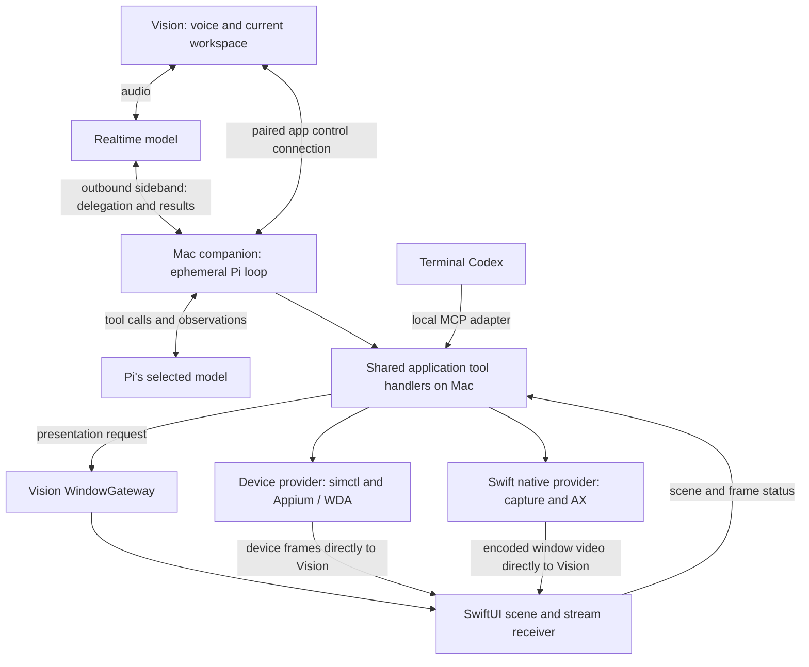

# From an agent request to a live, controllable Vision window

**November 10 sequencing update:** start with [manual stream previews and a small terminal preview MCP](2026-11-10-preview-first-rollout.md), using native Codex CUA separately. Qualify that slice, then add background Chrome and finally Pi. The global-agent architecture below remains the later destination; external worker submission is not a prerequisite for direct terminal MCP use. Shared preview/domain handlers stay outside the model harness, even if the MCP is retired later.

Status: integration plan, updated November 9, 2026 after merging `main` through `6d7d26d`. **The current order and architecture-changing tests are in the [post-cleanup execution plan](2026-11-09-post-cleanup-execution-plan.md).** Both core [physical experiments](2026-11-09-surface-live-results.md) have run. Extend the existing client, frontend catalog and gateway. [Existing-worker delivery is now qualified for an owned Codex runtime](2026-11-10-worker-delivery-results.md); integrate its bounded correlation and lifecycle semantics before relying on Pi delegation. Earlier direct-Pi examples below illustrate the provider path, not a requirement for Pi to perform every click.

**November 9 decision update:** [computer-use responsibility is open](2026-11-09-agent-control-ownership.md). The global agent might only manage workspace/window intent and prompt routing, with terminal Codex owning navigation; Pi-owned and shared-access control are alternatives. The direct-Pi sequence and diagram below describe one candidate. They specify how commands can reach the Mac and Vision, not which model must choose those commands. Decide the initial split before production agent integration.

**Browser rendering is also open:** the user wants [many spatial surfaces without matching Mac desktop windows](2026-11-09-spatial-surfaces-without-desktop-windows.md). A browser target may provide offscreen frames or render in the headset; it need not bind to a native Mac window. Existing window capture remains a source adapter. Keep target identity, media production and Vision presentation separate, and qualify the selected browser-control adapter against the chosen renderer.

Current implementation baseline: merged `main` through `6d7d26d` (merge `cdd38a5`). `CompanionClient` now owns discovery, trusted host routes, typed requests and shared catalogs; `WindowGateway` has one ephemeral record per window; workspace display names have a Mac-owned API. Earlier pinned links remain historical references. Use the [current source/ownership map](../docs/architecture.md) and the post-cleanup plan for implementation.

## Recommended placement

Run the proposed ephemeral Pi coordinator **inside the existing Mac TypeScript companion**. That placement does not require Pi to own CUA. Model inference runs at the selected model provider; the controlling agent's tool loop and Mac executors connect through local handlers or the coding session's MCP adapter. Vision supplies voice, current workspace/window context and native presentation. The signed Swift Mac companion supplies platform capture/accessibility. Simulator automation uses the device provider running on the same Mac.

For a literal GPT Realtime + Pi pairing, Vision connects its audio to Realtime, and the Mac attaches an outbound sideband WebSocket to that same call. Realtime delegates a task to Pi. Under direct-Pi control, Pi owns the observe/act loop; under coding-agent control, Pi routes a bounded task to the selected session, which calls the shared provider directly. The Mac is the sole executor of the voice delegation calls. Vision can receive conversation events without also executing them. OpenAI documents the client-plus-server arrangement and server handling of function calls; the agent responsibility split is our design choice. [Realtime server controls](https://developers.openai.com/api/docs/guides/voice-server-controls?api=realtime).

This requires implementing the native voice connection, call setup and sideband attachment; those are not existing SlopZooka features. The companion brokers setup and retains server credentials. Attach the tool handler before enabling action-taking conversation. If the voice API choice remains Poncho2's GPT-Live, use its client-delegation adapter instead; retain the same Pi task entry point. Poncho2's inspected checkout uses GPT-Live, not literal Realtime. [Existing Poncho2 findings](orchestrator-tools.md#2-what-poncho2-actually-does).

These are components and connections, not separate new services. In particular, no additional orchestration daemon, persistent task database or cloud Mac-control server is required. All OpenAI connections can be outbound; OpenAI does not need network access to a localhost MCP endpoint. Realtime function tools execute in application code; remote MCP tools are a different arrangement in which the API connects to a reachable MCP server. Use function delegation here. [Realtime tool execution](https://developers.openai.com/api/docs/guides/realtime-mcp).

## One complete request

Example: **“Launch Poncho2 in a new worktree, with iOS open. Get through login and leave me on Settings.”** These are illustrative calls and messages, not a frozen public tool catalog or an app-specific scripted recipe.

This walkthrough assumes direct-Pi CUA. With coding-agent-owned CUA, the selected Codex session performs setup/navigation through its tools and MCP; Pi retains routing and presentation context. Do not relay every Codex observation or click through a second reasoning loop. The provider and Vision connections remain the same.

1. **Capture the request and context.** Vision sends the selected host/client, originating workspace/window, current visible surfaces and a context revision over its app connection. Capture the origin before opening the wrist menu changes focus. The Mac already has the project/workspace catalog. Realtime's delegation identifies the request; the companion binds it to authenticated client context, rather than trusting a model-invented target or assuming the newest focused window is the intended one. If the referenced context has not arrived, resolve that before acting.

2. **Let Pi choose the setup.** Pi invokes existing workspace/session operations to create the worktree and actual terminal Codex session, assigns a useful display name, reads project instructions and starts the relevant build/dev processes. Shell execution remains an ordinary tool for project-specific work. Simulator lifecycle operations return the exact UDID and app identity; no ambiguous “first booted simulator.” Existing services own workspaces and sessions. A longer build can return an operation handle and progress while voice stays responsive.

3. **Bind a controllable surface.** After starting or attaching the simulator, the host provider returns a `surfaceId` tied to that device, workspace and provider generation. It reports available capture and control capabilities separately. Starting a simulator does not itself establish an automation session or stream. The device provider starts/attaches its Appium/WDA session and obtains a real observation. For native Simulator-window video, the capture binding must additionally identify the matching window/PID; a matching title alone is insufficient.

4. **Ask Vision to present it.** Pi calls the presentation operation for that `surfaceId` and initiating client. The Mac sends a correlated `presentation.open` request over the app control connection. Vision passes it to `WindowGateway`, which records normal open intent, resolves the preview payload and asks its scene adapter to open the preview window. The stream receiver connects directly to the Mac media source. Opening this preview is app behavior; it does not require the model to click the Vision launcher.

5. **Navigate through actual tools on the Mac.** Pi calls `observe(surfaceId)` and receives a fresh screenshot plus available device elements. Its model selects a field or a point and emits a tool call. Pi's local handler resolves the surface, checks that its observation/provider generation is current, and invokes the corresponding WDA/Appium operation on that exact UDID. WDA uses the simulator's automation runtime to perform the input. For a native Mac app, the analogous handler calls the signed Swift process over private IPC, which performs AX/native input. For a managed browser, the browser provider acts on its explicit page/session. The command never needs to travel through the streamed video or xterm.

6. **Observe and report the result.** Input changes the running app. Its next frames independently reach Vision. The tool returns an execution result, and Pi observes again to determine whether login succeeded and Settings is actually visible. Vision separately reports scene/receiver state. Only then can the coordinator accurately say the requested screen is open in the headset. An accepted input or functioning encoder does not establish either claim.

Pi's custom tool contract is a local `execute(toolCallId, params, signal, onUpdate)` handler. Its tool result can carry text and images back to the model. This is the concrete bridge from a cloud model's proposed action to Mac code: register the handler in Pi, call the provider inside it, return the observation. Preserve screenshots as image content; a local pathname alone is not an observation a remote model can see. [Pi tools, pinned v1.4.0](https://github.com/earendil-works/pi/blob/v1.4.0/packages/agent/README.md#tools), [result and execution types](https://github.com/earendil-works/pi/blob/v1.4.0/packages/agent/src/types.ts).

The model figures out login/navigation from observations. The application handles target identity, lifecycle and transport. There should be no `loginToPonchoAndOpenSettings` product API.

## The three connections to build

### 1. Pi / MCP → Mac providers

One set of application handlers resolves resources, enforces scope and dispatches operations. Register thin Pi tools and/or a local MCP adapter according to the selected responsibility split; sharing handlers does not require identical grants. Pi does not need to make an MCP round trip to functions already in its process.

The provider boundary is specific to capability, not a universal mouse abstraction:

| Target | Control execution | Observation / media |
| --- | --- | --- |
| iOS simulator | Host lifecycle commands plus local Appium/WDA bound to UDID | Device screenshots/tree; tested device JPEG stream, or separately verified native Simulator-window capture |
| Mac application/window | Signed Swift companion's AX/native operations | AX/screenshot observations; ScreenCaptureKit and VideoToolbox stream |
| Managed Mac browser | Browser automation attached to the same profile/page | DOM/screenshot observations; selected capture provider for that same page/window |
| Terminal Codex session | Existing session service's task/input API | Existing terminal transport and session state |

The current Swift menu app already launches the bundled Node companion and has private parent/child pipes. Extend that narrow bridge with correlated native-operation requests/replies. For example, Node sends a typed native request on its existing parent-facing pipe; Swift replies on the child's input pipe. Existing status messages are not already a CUA RPC protocol. Keep controls bounded and separate from bulk images/video; obtain observations through the provider's bounded image endpoint. Keep native permission ownership stable in the signed app. A Node-only development host should report native capabilities unavailable if that app bridge is absent. [Mac supervision and pipes](https://github.com/sragss/slopzooka/blob/a1e1541/apps/mac-menu/Sources/CompanionModel.swift), [current desktop protocol](https://github.com/sragss/slopzooka/blob/a1e1541/apps/mac-companion/src/server.ts).

The same native provider supplies detected permission status to the [guided permission setup](macos-window-streaming.md#product-requirement-clear-permission-setup-and-repair): Screen sharing and Control apps rows, direct System Settings actions, automatic rechecks and explicit restart recovery when needed. Vision and agent tools consume those facts instead of maintaining separate permission state. After grants are available, agents select capture targets programmatically; no per-window picker step is required.

Reuse the tested capture/device pieces; do not transplant the whole experimental host, pairing scheme and diagnostic UI. General Mac pointer/key injection and production browser attachment are still provider work; the probe only implemented a subset of native AX operations. The device login path can use its tested device automation without depending on a generic desktop driver.

“Codex uses CUA” does not mean the packaged tool in this conversation is an SDK Pi can import. Official documentation establishes external MCP support for terminal Codex; the reviewed Computer Use documentation does not establish an embeddable copy of this conversation's CUA runtime. Configure the real terminal CLI to connect to our scoped provider adapter. If a supported existing CUA integration is available, connect it behind the same boundary rather than requiring it for the architecture. [Codex MCP](https://learn.chatgpt.com/docs/extend/mcp), [packaged Computer Use](https://learn.chatgpt.com/docs/computer-use).

The [November 8 harness inspection](2026-11-08-codex-computer-use-harness.md) now identifies the installed JS facade, signed native helper, versioned local request bridge, observation APIs and public cleanup hooks. Borrow their small interface patterns while retaining exact window/device identity; the inspected Mac API is app-scoped at its top level. Public Codex App Server is a later option for structured terminal-agent dispatch/progress, not a prerequisite for this first MCP integration.

For Codex, the path is therefore **model → Codex CLI's MCP client → local adapter → the same provider → actual app**. Its workspace/session identity comes from adapter configuration or connection credentials. It can discover a surface the coordinator already opened and continue operating it without creating another simulator/browser. It can also request presentation through the same client gateway. Multiple possible headset clients require explicit routing context rather than broadcasting a window to everyone.

### 2. Mac presentation request → Vision scene

The optional live probe now demonstrates Mac presentation requests reaching the real gateway. Its poll/receipt path is not yet the general production contract. Terminal `/ws` remains a session relay and layout GET/PUT remains desired-state synchronization; neither should become an independent agent window manager. Production presentation needs an explicit client destination, bounded correlation and accurate observed status.

Extend the existing `CompanionClient` request/snapshot path first. The merged probe uses typed, authenticated poll/resolve calls through that client and inherits route-revision rejection. Do not require a new `/ws/control` socket or another connection owner. If measured interaction latency needs push or long polling, add it inside the same client lifetime. Optional command delivery must not stall normal refresh. Immediate input Stop uses a direct authenticated request and must not wait for the periodic poll. Client identity selects presentation; it is not authentication.

For the first integration, route an agent's open/close request **through the existing Vision `WindowGateway`**, exactly as a UI action does. That gateway writes the existing intent outbox and synchronizes the companion's existing per-client layout store. The Mac presentation handler should not simultaneously make a second independent layout mutation. This preserves one presentation-intent path and the existing conflict/reconnect behavior. If Vision is disconnected, report that presentation is pending/unavailable; don't create another durable command queue. Once the gateway has accepted/persisted intent, ordinary restoration can recover it.

Extend preview content with a host-stream variant. Retain the existing `WindowGroup("Preview", id: "preview", for: String.self)` and stable window ID where practical; a preview container chooses web content or stream content. Add a gateway entry for an attached surface and a resolver for its stream payload. `WindowScene` remains the only place that executes SwiftUI's `openWindow`. Mac tools cannot directly call that native Vision API. The immersive wrist scene already supplies a presenter when the launcher is closed. [Gateway](https://github.com/sragss/slopzooka/blob/a1e1541/apps/vision-client/SlopZooka/SlopZooka/WindowGateway.swift), [scene adapter](https://github.com/sragss/slopzooka/blob/a1e1541/apps/vision-client/SlopZooka/SlopZooka/WindowScene.swift), [scene declarations](https://github.com/sragss/slopzooka/blob/a1e1541/apps/vision-client/SlopZooka/SlopZooka/SlopZookaApp.swift), [existing persistence](https://github.com/sragss/slopzooka/blob/a1e1541/apps/vision-client/SlopZooka/SlopZooka/WindowPersistence.swift).

Keep these observations distinct: request accepted, desired layout saved, scene observed, receiver obtained/decoded a fresh frame, content verified by the agent. Report the strongest measured state, including errors or absence of an active presenter. Receiver telemetry does not prove the user is looking at the window. Placement may be a supported relative-placement hint; arbitrary Vision window movement is not implied by this architecture.

### 3. Mac media → Vision receiver

Media goes directly from the Mac capture/device provider to the Vision stream view using the proven bounded transport for the first integration. It bypasses Pi, Realtime and the control-message queue. The agent requests selected fresh observations as needed; it does not consume every video frame. Thus model latency does not set the preview frame rate, and changing the model/harness does not require changing the media transport.

Native H.264 and device JPEG reception were demonstrated earlier; the November 9 simulator trial additionally exercised the actual companion and `WindowGateway` with a stream preview. Two independently controlled browser sources were shown in the separate ProbeViewer. Production work now generalizes frontend catalog/resolution and separates viewing from agent input lifetime. The physical results do not establish the final general schema, video quality defaults or full fault matrix. [Current evidence and limits](2026-11-09-surface-live-results.md).

## The shared identity that keeps the paths together

Use an application-owned `surfaceId` that binds workspace, exact target, capture provider and control provider. A model sees a stable handle and capabilities; it does not supply arbitrary private provider endpoints. A Vision window ID identifies presentation, while a simulator UDID or browser-page handle identifies the app. Those are related identities, not interchangeable strings.

The minimal transient binding can carry `surfaceId`, `workspaceId`, target identity, provider generation and capabilities. Stream payloads are resolved separately so credentials/URLs do not enter persisted window layouts. Reuse workspace metadata and existing window persistence; keep running driver sessions, native handles, current observations and controller state in the owning providers. This runtime binding is needed to share the exact app; it is not another workspace database.

Provider replacement invalidates old observations/actions. A switch from native capture to device capture can preserve the logical surface while updating its capture generation and capabilities. Verify that both refer to the same simulator; the probe's manual target selection did not establish automatic association. Mac lock state disables the desktop route and informs the model, while the already-tested device route can remain available independently. Neither route claims to work through whole-system sleep or logout.

For a first simulator integration, using device observations, device input and device frames together avoids the extra native-window association step. Native capture can then improve the viewing path once that association is verified. This is a provider choice, not a hardcoded login workflow or a permanent JPEG transport decision.

Stop and competing input are enforced at the shared handler/provider boundary. Pi's abort alone cannot revoke a queued MCP call from another agent. Native focus-dependent operations may need a Mac-wide input lock; independent device/page operations can use their own target lock. Keep this bounded and in memory. It does not need a durable coordinator, and it cannot claim control over unrelated automation that bypasses the boundary.

## Smallest useful architectural integration

The [simulator/gateway trial](2026-11-09-simulator-gateway-live-plan.md) and [background-browser trial](2026-11-09-background-browser-streaming-live-plan.md) both ran on the headset; the [case ledger](2026-11-09-surface-live-results.md) distinguishes demonstrated paths from deferred cases. Do not schedule another broad feasibility slot before starting production integration.

Build one traceable product path: **typed request → lightweight coordinator → identified real terminal agent → exact Mac provider → existing frontend/preview gateway → fresh visible result**. The November 10 experiment qualified native submission/status/queue/steer against a real TUI on an owned runtime. It also established that duplicate client message IDs do not deduplicate the queue, interruption leaves queued work, and closing the TUI differs from ending its backend. Integrate those semantics through the existing Mac owner. The earlier independent Pi/Codex probe tasks alone did not prove this attachment path. In parallel with that design work, integrate a manually presentable prepared source through the shared catalog; manual Show must work without a model. Use the tested simulator provider first and separate capture subscriptions from caller/input lifetime before promising persistent browser viewing.

The key evidence is one correlated trace showing the model-selected operation, actual provider/target, Vision scene/receiver acknowledgement and verified app result. No new broad screen-sharing feasibility matrix is needed to answer this architectural question. Cold builds/launches, spatial grouping and broader handoff UI can follow on the same boundaries. The prior [shared-control cases](shared-control-ux-spike.md) remain useful subsequent tests, not the immediate design focus.

Maintainability check: application services continue owning workspaces/sessions; providers own running apps and capture/control; `WindowGateway` owns presentation intent; SwiftUI owns native scene mechanics; Pi owns only reasoning. The additions are narrow adapters and a necessary cross-device control protocol. Avoid a second window registry, a universal UI action language, model-specific media paths, or a custom recipe engine. The provider packaging and lifecycle are real engineering work, so this is not merely “add MCP”; the existing boundaries keep that work from spreading into every caller.

## Implementation, testing and rollout sequence

**The prerequisite abstractions are already present.** `CompanionClient` supplies shared connection/catalog/control transport; `WindowGateway.WindowState` supplies one ephemeral state record; existing persistence owns desired layout; Mac workspace/session services own resources and names. The [revised sequence](2026-11-09-post-cleanup-execution-plan.md#revised-execution-sequence) now starts with the qualified worker adapter and one manual stream frontend, then capture lifetime, Pi delegation, real workspace setup and voice. The [worker result](2026-11-10-worker-delivery-results.md) supplies the initial Codex attachment path; arbitrary existing TUIs and direct Pi navigation remain separate scope questions. No broad window/network rewrite is needed.

Only extract shared workspace-launch/retry behavior when Pi becomes the second caller and demonstrates duplicate invariants. `LauncherState` already consolidates UI operation/catalog state; keep that there. Reuse `WorkspaceService.renameWorkspace` and session rename for labels, while adding automatic-name policy that respects user overrides. Do not add another catalog, naming database or durable workflow queue.

The milestones below are proposed implementation order, not permission to run another live machine session. Keep each change reviewable and exercise its actual path before expanding capability.

| Stage | Deliverable | Evidence needed to advance |
| --- | --- | --- |
| **0. Decide the initial CUA responsibility split.** | Review the [ownership alternatives and candidate prompts](2026-11-09-agent-control-ownership.md). Use a disposable comparison where needed; avoid implementing several production orchestrators. | Record which prompts require direct Pi control, which benefit from Codex task context, and how busy-session routing works. Choose an initial tool grant/delegation policy; provider feasibility alone does not decide it. |
| **1. Generalize the demonstrated presentation path.** | Extend `CompanionClient` with production context/receipt operations and the existing frontend catalog with prepared stream sources. UI and agent intents reach the same gateway; no new connection manager. | Retain the physical and deterministic evidence. Test wire compatibility, current route trust, no-client behavior, duplicate/late requests and reconnect preserving explicit close. New delivery must not create another process or stall normal refresh. |
| **2. Make one stream frontend usable without Pi.** | The prepared simulator appears in the shared catalog and resolves through the existing Preview. Keep source, viewer subscription and input lifetimes separate; carry phone aspect ratio. Bring the tested browser source into this flow next. | Manual Show, launcherless recovery, source replacement/stale actions, and one viewer closing while another remains. Agent completion and input Stop preserve an interested viewer. A brief integrated device check verifies matching identity/fresh frames; it does not repeat the original discovery slot. |
| **3. Connect the chosen agent responsibility split.** | Typed task entry and scoped tools for the selected actor(s): Codex MCP, direct Pi tools, or both. If Pi delegates, exercise the real submission/result path. Add provider-side input admission and Stop before enabling autonomous input. | The assigned agent opens the selected simulator preview and navigates using fresh observations. For shared access, verify a second actor continues on the same target. Try a different initial screen, a competing request and Stop. No wrong-target action or newly admitted action after Stop acknowledgement. Record already-dispatched input separately; do not promise to undo it. No app-specific login/navigation script. |
| **4. Expand to the user's workspace-level request.** | Resolve projects from the existing catalog; create/reuse worktrees and sessions; name workspaces; start builds/dev servers; attach a managed Mac browser and simulator. Share launch/retry logic where it actually becomes duplicated. | Exercise the user's “launch Poncho2 in a new worktree, with admin and iOS open.” Then repeat with two workspaces and distinct destinations. Confirm correct worktrees, endpoints, device/page identities and labels. A failed build or absent device reports partial progress and can resume without duplicating the completed workspace/session. The browser controlled by the agent is the one being streamed. Test the integrated lock/fallback/recovery path before offering it as a supported workflow. |
| **5. Connect voice and wrist context.** | The selected voice adapter delegates to the same coordinator entry point as typed requests. Both launcher and wrist invoke it with captured origin context. Corrections and contextual keyboard/command input use the same resource handlers. | Re-run the same workspace request by voice; test “the other one,” a correction while launch is pending, menu-induced focus changes and interruption. Check intended target, command-to-visible-action time and Stop-to-last-input time with the headset user. Speech success requires the actual voice path; typed tests do not establish it. |
| **6. Broaden opt-in use from observed evidence.** | Keep orchestration optional during ordinary-use testing. Expand supported targets and defaults only after their real paths work. Preserve the manual launcher and existing terminals/previews when the coordinator is disabled or restarted. | In ordinary sessions, traces and user feedback show no duplicate resource creation or wrong-target input, accurate partial-failure reporting, useful workspace naming and acceptable response/interruption time. Confirm recovery after a companion/coordinator restart and a client reconnect. Admit each additional native app/provider separately rather than claiming that one simulator establishes all desktop control. |

Stages 1–2 now turn demonstrated probe paths into ordinary opt-in frontend/presentation behavior; they are not untested architectural theories. Keep changes narrow and usable with Pi disabled. The first useful coordinated slice still needs an actual task delivered to the correct existing worker, that worker acting on the same target that is displayed, and truthful completion/Stop status. The [post-cleanup plan](2026-11-09-post-cleanup-execution-plan.md) separates that architecture experiment from later qualification.

For Stage 4, a worktree, a session and a displayed window remain separate outcomes. If session creation fails after worktree creation, return the existing worktree identity; do not automatically delete it or replay the whole launch. Use existing stable resource IDs and bounded operation correlation/deduplication within the running companion. A companion restart with an uncertain outcome requires resource reconciliation, not a claim of durable exactly-once execution. Names are workspace metadata, not identities or branch/path renames.

Testing follows the dependency being added: deterministic handler and gateway checks for the command path; one physical receiver/control trial for a new provider; actual-model tasks for tool usability; actual speech for voice routing. Link the request, resource/surface, provider generation, scene acknowledgement and fresh receiver/observation timestamps in one trace. A successful RPC, model assertion or source-frame counter is insufficient evidence of the end-user result. Keep metrics scoped to the stage and ask the user to judge the measured experience instead of inventing acceptable latency thresholds.

Defer a generic workflow engine, durable agent history, a new window registry, automatic proactive observation, codec replacement and precise spatial clustering until a specific supported workflow needs them. Relative placement can be an optional later presentation hint. Direct human pointer/keyboard input into streamed apps is a separate feature and is not required to learn the agent-operated interaction pattern.

At each stage, the maintainability test is concrete: manual and agent presentation reach the same gateway; Pi and MCP call the same providers; a model replacement leaves application/media contracts intact; disabling the agent leaves application-owned resources manageable. If satisfying a stage requires a parallel owner for the same state, revisit that boundary before adding more features.
