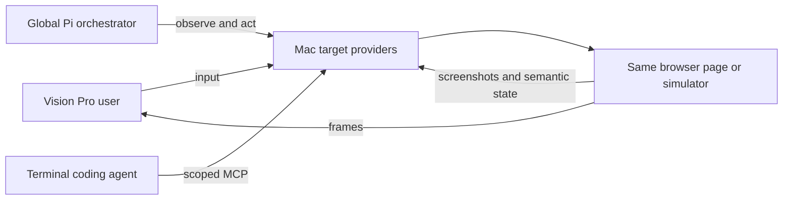

# Ephemeral coordinator, composable tools, and shared computer use

**Prototype update, November 1, 2026:** the [live sharing experiment](shared-window-live-results.md) completed three lock/unlock cycles and verified native multi-window viewing plus independent simulator streaming/input. Production Pi/voice and terminal MCP integration remain unimplemented. The current focus is the [execution/presentation architecture](orchestrator-execution-path.md): model delegation → local Mac provider → Vision gateway/stream receiver → observed result. The shared-control UX cases follow that integration. The temporary CLI is evidence-gathering scaffolding, not a frozen product tool catalog.

Status: revised exploration, not an implemented or approved API specification. November 1, 2026. Supplements [the exploration](agent-managed-surfaces.md). Latest direction: an ephemeral, intelligent coordinator with direct computer use, plus coding-agent MCP access to the same live surfaces. This replaces the earlier ten-tool launch proposal: workflows and project setup should be figured out by the agent, without requiring a predefined launch recipe.

## 1. What we know and what remains a choice

The application supplies reliable capabilities and current context; the model decides how to accomplish the request. A tight harness means clear targets, observable effects, and reusable providers. It should not require us to encode every workflow, app role, screen name, or recovery path. Method names below illustrate capability boundaries, not a frozen tool catalog. The existing services supply some lifecycle operations; shared browser/device control and streaming remain additions.

There are three layers:

| Layer | Purpose | Proposed implementation |
| --- | --- | --- |
| Voice interaction | Listen, speak, maintain conversational timing, pass tasks/corrections to the coordinator | Evaluate the Poncho2-style GPT-Live frontend; retain literal GPT Realtime as a separate candidate |
| Coordinator agent loop | Interpret the request using current context and select tool calls | An in-memory Pi agent on the Mac, with a bounded conversation and explicit tools |
| Application operations | Create workspaces, manage resources, present/control surfaces, report observed outcomes | Existing companion services plus `WindowGateway` and narrow provider adapters |

**Integration candidate after the completed platform spike:** use a small Pi coordinator with the voice frontend delegating to it. The [execution-path design](orchestrator-execution-path.md) specifies the local tool handlers, native bridge and missing Mac-to-Vision presentation protocol. Give the coordinator direct access to host execution, browser/native computer use, and existing workspace/window operations. Typed commands enter the same coordinator. UI buttons and exact keyboard actions continue to use application operations directly. Within this voice/Pi pairing, the voice frontend delegates actions and communicates verified results. This does not exclude coding agents or the user from controlling shared surfaces; input arbitration belongs at the resource provider.

Literal Realtime also supports an alternative single-agent layout: Realtime selects the tools directly and the companion executes them. If combining literal Realtime with Pi, expose a bounded delegation function to Realtime and put domain tools on Pi. That is an explicit two-model bridge, not “set Pi's model to Realtime.” OpenAI's Realtime API/Agents SDK supplies the voice session and tool-call protocol, while application functions still need an executor. [Realtime guide](https://developers.openai.com/api/docs/guides/realtime), [Realtime function tools](https://developers.openai.com/api/docs/guides/realtime-mcp).

Do not implement both voice architectures before testing one. The application contracts below should work with either adapter; choosing an agent loop should not force a rewrite of window/workspace behavior.

## 2. What Poncho2 actually does

Read-only inspection of `/Users/samragsdale/Documents/Code/merit-systems/poncho2` at `8d52306340092ee3972185de6029a8b939d81fd6`; the cited tracked files match that commit. This is code evidence, not a claim about the deployed version or a live-call test. No Poncho2 files were edited.

- The current voice model is **`gpt-live-1`**, rather than a `gpt-realtime-*` model. The provider creates `/v1/live/sessions` with `delegation: { type: 'client' }`, then attaches a server WebSocket. [Voice configuration](https://github.com/Merit-Systems/poncho2/blob/8d52306340092ee3972185de6029a8b939d81fd6/apps/chat-api/src/modules/calls/prompt.ts), [provider](https://github.com/Merit-Systems/poncho2/blob/8d52306340092ee3972185de6029a8b939d81fd6/apps/chat-api/src/modules/calls/provider.ts).
- `CallController` uses a delegation event to trigger submission, deduplicates delegation IDs, gathers the relevant transcript interval and context, and submits to the existing conversation with a stable voice-request ID. It forwards new backend publications to speech and typed user updates as quiet context. Call teardown does not cancel accepted backend work. [Controller](https://github.com/Merit-Systems/poncho2/blob/8d52306340092ee3972185de6029a8b939d81fd6/apps/chat-api/src/modules/calls/controller.ts).
- The current backend uses `@earendil-works/pi-durable` / `pi-ai` **1.4.0**, with `Harness.open`, SQLite storage, named extensions, and separate coordinator/shared/worker tool sets. The ordinary root coordinator does not receive `CodingTools`; workers do. [Dependencies](https://github.com/Merit-Systems/poncho2/blob/8d52306340092ee3972185de6029a8b939d81fd6/apps/chat-api/package.json), [engine](https://github.com/Merit-Systems/poncho2/blob/8d52306340092ee3972185de6029a8b939d81fd6/apps/chat-api/src/services/agent-runtime/engine.ts), [worker tools](https://github.com/Merit-Systems/poncho2/blob/8d52306340092ee3972185de6029a8b939d81fd6/apps/chat-api/src/services/agent-runtime/subagents.ts).
- Conversation submission, state publication, and recovery have additional Poncho2-specific machinery. Those are not necessary just to reuse its voice/backend separation. [Conversation integration](https://github.com/Merit-Systems/poncho2/blob/8d52306340092ee3972185de6029a8b939d81fd6/apps/chat-api/src/modules/conversation/runtime.ts).

Reuse the separation, explicit delegation, request correlation, and verified-result feedback. Leave Poncho2's persistent chat journal, memory, proactive wake scheduling, worker fleet, and storage/backup architecture out of the initial SlopZooka coordinator. Its controller's fixed wait for late transcript fragments is a behavior to test, not a guarantee that a request is complete; bind the captured target and reject/clarify missing speech rather than dispatching incomplete text. An ephemeral replacement must also stop relying on Pi Durable's admission/replay guarantees.

OpenAI's client-delegation documentation supports connecting an application-owned backend and supplying results. GPT-Live and Realtime remain different APIs with different lifecycles. [Client delegation](https://developers.openai.com/api/docs/guides/live-delegation#configure-client-delegation).

## 3. Ephemeral means replaceable reasoning state

Evaluate `@earendil-works/pi-agent-core` with custom tools and an explicitly selected provider/model. Its versioned source exposes an `Agent`, in-memory message/tool state, events, steering, and abort controls. This is a smaller entry point than adopting Poncho2's durable harness or embedding the whole terminal coding agent. Pin and test an actual version before implementation. [Pi agent core v1.4.0](https://github.com/earendil-works/pi/blob/v1.4.0/packages/agent/README.md), [Agent implementation](https://github.com/earendil-works/pi/blob/v1.4.0/packages/agent/src/agent.ts).

Proposed lifetimes:

- One coordinator context per active client interaction on the selected host, retained for follow-ups such as “that workspace” and “skip iOS.” Use bounded in-memory history and fresh application context; discard it on reset or host restart.
- Host-owned launches/builds and existing terminal sessions have their own lifetime. A tool that starts longer work returns a handle after acceptance. Ending the agent turn or voice call does not cancel that accepted work.
- Keep a bounded in-memory command/operation map for deduplication, current outcomes, and cancellation while the companion runs. Existing resource owners and window persistence remain authoritative. A coordinator reset in the same host process can query them.
- After a host restart, inventory actual resources. Without a durable operation receipt, an uncertain launch/submission remains uncertain: do not reconstruct an intent from old speech and execute it again. Explicitly report limits instead of claiming exactly-once behavior across crashes.

No automatic proactive tasks, permanent coordinator memory, or durable reasoning replay in the first version. Revisit persistence only when a specific approved workflow requires recovery beyond the host lifetime. Even then, first consider a small receipt at the existing mutation owner rather than a second durable workflow system.

Pi steering takes effect at loop boundaries and is not a substitute for promptly revoking input or cancelling a host job. The application must reject stale queued calls after a correction and provide a deterministic Stop action. Pi's tool abort signal can stop work still inside the call; an already-accepted host operation uses its separate cancellation handle. [Pi tool/loop contracts](https://github.com/earendil-works/pi/blob/v1.4.0/packages/agent/src/types.ts).

## 4. Capabilities the model can compose

Computer use belongs in the first prototype. The global agent must be able to do “open settings, scroll to the subscription controls, and leave it there” without starting a coding task. Its reasoning loop needs a model that can consume the returned screenshots as well as text. A voice frontend can remain responsive while Pi performs that interaction; choosing a voice API does not supply the computer-use backend.

| Capability family | What the agent needs | Existing owner / proposed provider |
| --- | --- | --- |
| Context and discovery | Read current selection, menu/recent projects, workspaces, sessions, visible surfaces, and available capabilities; resolve a project or target | Existing catalog/services plus client context; selection provenance and freshness |
| Host execution | Read project instructions/files, run setup commands, inspect output, start and stop owned processes, poll longer jobs | Companion process executor scoped to the selected host/worktree; process handles and output |
| Workspace and session lifecycle | Create/reuse worktrees, assign/update a useful workspace display name, open terminal sessions, inspect session state, send a task or exact input | Existing workspace/session services and metadata; provider-aware terminal adapters |
| Browser and native computer use | Enumerate/attach targets, observe screenshot and DOM/AX/device state, navigate, click/tap, scroll/swipe, type, press keys | Browser, Mac accessibility/input, and simulator providers |
| Presentation | Associate an actual app target with a workspace, stream/present/dismiss it, select input target, request supported relative placement | Host resource associations, native capture, and existing `WindowGateway`/scene adapter |

These are families, not five giant tools with arbitrary action strings. Start with a small typed interface and expose only implemented capabilities. Reuse existing higher-level operations where their semantics already exist, such as creating a worktree and its terminal. Do not force the model to reconstruct those invariants with shell commands. Conversely, app-specific setup and navigation should not require a new tool or product-code change.

Host execution is a real coordinator capability. The earlier recommendation to withhold shell/filesystem access and delegate all discovery to terminal agents was too restrictive. The coordinator can inspect the repository, start the relevant development server, read errors, and adapt. It can ask a coding agent for help when useful; that is a reasoning choice, not a prerequisite for operating an app. Normal host permissions and workspace ownership still apply.

Two viable model-facing shapes:

- **Typed tools:** a few discovery/lifecycle tools plus explicit browser/device operations. Easiest first integration with Pi and MCP.
- **A code-execution interface over typed handles:** the agent writes short programs against a supplied browser/native/session API, retaining handles between calls. This resembles the control style observed in this Codex session. It can batch related operations, but adds runtime lifecycle and cancellation work; use an existing suitable runtime if available. It is not necessary to build a new execution framework before proving shared control.

Both should call the same providers. Do not build both interfaces up front. Tool granularity is an experiment; the required behavior is flexible reasoning with observable results.

**November 8 preference:** start by exploring Codex's installed MCP/CUA runtime as the control provider. Its persistent JavaScript interface and dynamically supplied guidance are the preferred candidate, following the successful independent native-app experiment. Browser control uses a separate backend with turn-scoped access dependencies; our independent browser discovery failed that check. See [interfaces, collected guidance and the later tradeoff review](2026-11-08-codex-browser-and-guidance.md). Preserve workspace/session and `WindowGateway` ownership; this choice does not require another durable orchestration layer or parallel production drivers.

**November 9 browser evidence:** [local provider trials](2026-11-09-browser-runtime-options.md) demonstrated public Playwright MCP context injection, Playwriter's persistent code interface and agent-browser's strict closed-tab failure. Keep browser lifetime under the companion even when tool clients disconnect. The tests also showed that a browser-wide CDP connection can expose other workspace tabs, and that model observations may be host-local file links. Those ownership and artifact-delivery details belong in the shared adapter; they do not require another coordinator.

**Native Chrome correction:** the same follow-up successfully drove a real webpage through `cua.getApp("com.google.Chrome")`, including semantic page/iframe observations and native input. The specialized browser backend's access-host failure does not block this route. Start the Chrome-plus-Simulator demo with the preferred native provider; add a specialized browser provider only for capabilities the chosen workflow needs. Exact window/tab-to-stream association and shared focus arbitration remain required.

**Background Chrome qualification:** [extension source research](2026-11-09-background-browser-control.md) establishes why tab-scoped browser input can avoid taking desktop focus. Qualify this route early for concurrent human/browser work. The extension's logical active tab is not necessarily the physically selected tab; keep control target, presentation and native focus distinct. A selected page in its own unfocused Chrome window is the first candidate for the existing native video path. Retain workspace previews explicitly across turn cleanup. This does not require another coordinator, persistent layout owner or new media transport.

### Workspace naming

Explicit user requirement: the orchestrator names workspaces automatically so the user can recognize the work without remembering generated worktree names. Manual naming should be optional, not a setup step or a dependency for useful labels.

Use the initial request, task intent and subsequent coding-agent context to choose a concise purpose-based name. “Fix admin permissions” and “iOS settings redesign” distinguish two Poncho2 workspaces better than random worktree names. Include project context where the UI needs it. Launching admin and iOS alone establishes a setup, not a coding goal: use an honest provisional label until the task is known. A transient navigation command such as “open settings” should not automatically redefine the workspace's purpose.

Cover both orchestrator-created workspaces and ordinary launcher-created workspaces. When the meaningful prompt goes straight into a terminal agent, use the shared prompt context or a scoped coding-agent MCP task-summary/name suggestion to inform naming. The exact context delivery mechanism remains open; naming must not depend on the user having launched through the orchestrator. Update automatic names when the purpose becomes clear or materially changes, without constant title churn. Explicit user names take precedence and remain until the user requests another change.

Keep this small: expose a display-name update through the existing workspace service and store the name, plus enough provenance to respect user overrides, in its existing metadata. UI, coordinator and scoped MCP adapters use that same operation. This does not require durable coordinator memory, a separate naming service, or a new workspace registry. Renaming a display label does not rename the worktree directory, Git branch, route or resource identity. Resolve actions to stable workspace IDs; similar names still require disambiguation. Propagate the label to launcher/wrist recents, workspace/window labels and model context, retaining surface roles and technical identifiers where useful.

Acceptance cases: a workspace receives a useful name without a naming prompt; two tasks in the same repo get distinguishable labels; a launcher-created workspace gains a task-based name after its first coding prompt; incidental navigation leaves it stable; a user rename survives later agent activity and coordinator restart; every UI/context view reflects the same name while resource IDs and input routing remain unchanged. These are design requirements for orchestrator integration, not features added to the streaming probe.

### Example: “Launch Poncho2 in a new worktree, with admin and iOS open”

The coordinator resolves Poncho2 from the catalog, uses the existing worktree/session operation, reads project instructions, and chooses how to launch its apps. It can run commands, inspect failures, choose a simulator, open a browser, inspect the UI, and present the resulting live targets. This is an illustrative possible sequence, not a fixed workflow embedded in a `launch_workspace(targets=[...])` implementation. Missing setup knowledge triggers investigation; it does not automatically block on creating a recipe.

For “two workspaces, one on settings and one on prompt input,” the model discovers those screens from the running apps, available deep links, or source as appropriate. We should not need to register a `settings` destination or hard-code its route. It verifies the final visible screens and requests supported placement of each pair. visionOS placement limits still apply.

A proven sequence can later become an optional helper, project instruction, or saved setup. That is an optimization after observing repetition, not the initial architecture. Existing scripts are useful evidence, not a mandatory new configuration format.

## 5. One live app, several authorized controllers

The core shared object is a **live target**: a particular browser page/context, native window/process, or simulator device/app instance. A URL, app name, or screenshot is insufficient identity. A presentation is a view of that target in Vision Pro; it is not another running copy of the app.

The user can watch the orchestrator operate an app, take over, and later ask a coding agent to inspect or modify that same UI state. Navigation, cookies, scroll position, selected records, and unfinished forms remain in the actual target. Sharing a URL with a second browser does not accomplish this.

Capture and control should be separate provider capabilities attached to that target. For example, ScreenCaptureKit can supply Simulator video while an iOS automation driver supplies taps and device observations. They need a verified mapping to the same device and app; they need not use the same transport. The model generally consumes selected fresh observations, not every frame delivered to the headset.

Keep the shared bookkeeping small: existing workspace/session associations, a runtime target handle and generation, capture/control bindings, and the current input holder. This is not a second persistent window database. Browser profile/window/tab identity and simulator UDID belong in their providers; the common layer need not flatten every provider into a universal desktop abstraction.

### Input ownership

All controllers may observe a granted target. Serialize actions on that target, with a visible controlling actor and immediate human takeover/Stop. A takeover invalidates queued actions; a subsequent agent action must reacquire control and refresh its observation. This can start as a simple in-memory owner and generation, rather than a distributed lock service.

Semantic browser/device operations can often address a specific target. Native mouse/keyboard fallbacks can depend on Mac foreground focus, so two different window handles do not prove independent input channels. Serialize focus-dependent actions across the host and recheck the destination. Acknowledging this physical limitation is more useful than promising concurrent independent GUI agents.

Per-window streaming itself does not generally require foreground focus. Keep multiple streams running while serializing only the actions that actually share desktop input; see the [capture/control distinction and focused test](macos-window-streaming.md#foreground-requirements-capture-and-input-differ). Codex bringing an app forward is not evidence that ScreenCaptureKit requires it.

Associate coordinate observations with capture geometry and target generation, handling scale, cropping, rotation, and stream delay. Reject input against replaced targets or obsolete geometry; ordinary app animation does not require invalidating every semantic action. Inspect after meaningful actions and report partial/unknown outcomes truthfully.

## 6. How Mac sharing could work, and what is actually known

**Current implementation:** local `main` at `8b68f3e` renders web previews inside Vision Pro's own `WKWebView`, with a nonpersistent data store per preview. A browser opened on the Mac is a different session. Inspection found no Mac capture/streaming or simulator automation implementation in the inspected `apps`/`packages` sources. The isolated live experiment now verifies selected Mac → Vision streams and simulator actions; the production shared-controller/MCP integration remains untested. [Current browser view](https://github.com/sragss/slopzooka/blob/8b68f3e/apps/vision-client/SlopZooka/SlopZooka/BrowserWindowView.swift).

| Target | Candidate display path | Candidate agent control | Main thing to prove |
| --- | --- | --- | --- |
| Managed Mac browser | Capture its dedicated window, or capture the exact tab | Playwright/browser protocol for DOM, screenshots, navigation and input; native fallback for browser chrome/dialogs | Display and controller resolve to the same page, login and form state |
| iOS simulator | Capture the Simulator window; alternatively device frames from WDA MJPEG | `simctl` for lifecycle/deep links; XCUITest/WebDriverAgent for app interaction; test Mac input fallback separately | Capture/control agree on UDID, app, orientation and geometry |
| Other Mac app | ScreenCaptureKit per-window capture | AX observations/actions plus screenshot-based pointer/keyboard input where needed | Permission coverage, foreground dependencies, dialogs and window replacement |
| Headset-local web app | Existing `WKWebView` | A new bridge executed in that exact web view | Its own snapshot/DOM/input support; a host browser cannot control it by sharing a URL |

For workflows where the agent operates the app, the preferred experiment is a host-managed browser and simulator streamed to Vision. Keep headset rendering for native WebKit/visionOS inspection or other cases that benefit from it; label which execution mode is active. The choice need not be a permanent global setting.

**Browser evidence.** Playwright can connect to a running Chromium browser through CDP and access its existing context, with documented fidelity limits. Prefer owning the browser/profile lifecycle for the prototype. Do not create a new page/context for every agent. With window capture, switching tabs can make the stream show a different page than the automation handle; start with a dedicated window/page or capture the page directly. [Playwright browser connections](https://playwright.dev/docs/api/class-browsertype#browser-type-connect-over-cdp).

**Native capture evidence.** Apple's ScreenCaptureKit sample enumerates shareable windows, filters one window, and delivers video frames. Those frames still need encoding, transport, and a headset receiver; capture does not itself provide input or accessibility. Existing section 6 of [the exploration](agent-managed-surfaces.md#6-rendering-streaming-and-control-options) compares WebRTC, simpler frame transports, and desktop alternatives. Screen Recording and Accessibility remain separate capabilities. [Apple capture sample](https://developer.apple.com/documentation/screencapturekit/capturing-screen-content-in-macos).

**Simulator evidence.** Local `xcrun simctl help io` exposes screenshots and video recording, not general tap/swipe control. Appium's XCUITest driver documents WDA device/simulator MJPEG frames and separate tap/swipe commands. This supports a plausible display/control combination, not a measured product-quality stream. Mac AX access to the Simulator shell is not proof of access to the iOS app's element tree. Xcode compatibility, driver setup, rotation, multiple devices, and live latency need actual tests. [WDA stream](https://github.com/appium/appium-xcuitest-driver/blob/master/docs/guides/mjpeg.md), [XCUITest gestures](https://github.com/appium/appium-xcuitest-driver/blob/master/docs/reference/execute-methods.md#mobile-tap).

The provider interface can expose both semantic and screenshot-based operation. Prefer the representation that works for the target: DOM/AX/device elements when available, visual actions when necessary. A visually intelligent model still needs a working input executor.

For the platform-specific permission, resize, performance, and lock-state details, see [Mac window sharing](macos-window-streaming.md). In particular, covered windows and locked desktops are different cases; locked-session native interaction remains unproven.

## 7. Terminal agents get the same control providers through MCP

Yes: a terminal Codex session could operate the same Mac browser or simulator being shown in Vision Pro **if SlopZooka supplies that host control backend and grants the session access to the target**. Running Codex in xterm does not automatically give it the desktop app's computer-use tools. MCP supplies callable tools; it does not supply capture, automation drivers, or model image support by itself. Codex documents local-process and Streamable HTTP MCP connections. [Codex MCP](https://developers.openai.com/codex/mcp/).

Expose discovery of associated live targets, observation, supported input/navigation, and presentation through a workspace-scoped MCP adapter over the same providers used by Pi. Return screenshots as actual image content supported by the chosen agent/model, alongside concise semantic state and handles. Validate that image round trip in the first integration test; do not count a screenshot URL in text as equivalent.

An agent that launched an app through its shell can register/attach the real resource and ask for it to be presented. Validate the association using host-observed process/browser/device identity. The MCP server should return the existing granted target rather than opening another browser profile or simulator session. Its attachment does not confer a second input channel: it participates in the same ownership rules as Pi and the human.

Scope defaults to its workspace and explicitly shared targets. A broader user task can grant additional targets. Application authorization comes from the authenticated connection, not a model-provided workspace ID. These checks protect target correctness; they should not impose canned navigation plans.

## 8. Keep the implementation smaller than the workflow space

Reuse existing workspace/session services and `WindowGateway`; add browser, native capture/input, and simulator adapters only as each is exercised. Run the ephemeral reasoning loop and dispatch in the companion's TypeScript service, with native Mac helpers for OS functions and the Vision client for presentation/context. No new durable workflow engine, project-role DSL, or parallel window manager.

Share handler semantics across UI, Pi and MCP, with small transport adapters. Not every UI button needs to become a separate model tool. Pi tool registration differs from Pi Durable, and model-visible `content` must contain important outcomes/handles; extra structured details are not automatically model context. [Pi tool types](https://github.com/earendil-works/pi/blob/v1.4.0/packages/agent/src/types.ts).

Start with explicit lifecycle calls and provider methods. If repetitive agent work becomes slow or unreliable, add a helper for the demonstrated pattern while keeping the underlying primitives available. If a new app screen requires a change to SlopZooka, the abstraction is probably too prescriptive. If routine creation opens duplicate sessions or two actors type into each other's window, the shared execution boundary is too weak.

## 9. First experiments and candidate prompts

These are proposed tests, not implemented functionality or newly approved product requirements. P01–P18 in the main exploration remain pending approval; P19 is the user's workspace-launch example. Test visible outcomes and resource identity, not one prescribed tool sequence.

1. **One shared browser.** The global agent navigates an unfamiliar app to a requested screen without a registered route. Stream that exact page to Vision, retain an unfinished form, let the user change it, and let a terminal agent observe the change through MCP. Neither agent opens a substitute session.
2. **One shared simulator.** Stream a specific device/app, let the global agent navigate and type, then let the coding agent inspect and act on the same state. Test rotation, software keyboard, app relaunch, and human takeover. Prove capture and automation target the same UDID.
3. **Agent-led setup.** Run the user's Poncho2/admin/iOS request using repository inspection and existing lifecycle primitives. A missing recipe is allowed; missing access or a genuinely unsupported app target is reported. Measure useful partial completion and recovery from a real launch error.
4. **Two pairs and interruption.** Launch two worktrees with distinct browser/device targets, navigate them differently, then interrupt one interaction. Verify no cross-target input and no stale actions after takeover. Include foreground-dependent native input, rather than testing DOM actions only.
5. **Ephemeral recovery.** Reset the coordinator while the displayed apps remain running, reconstruct context from their owners, and continue on those targets. Separately test host restart without promising replay of uncertain operations.

Candidate phrasing for user review:

- “Open settings in this iPhone app, turn on dark mode, and leave that screen open.”
- “Find the user I was just looking at in the admin panel and show their billing page.”
- “Take over this form and fill in the details I dictate; leave it ready for me to submit.”
- “Tell the coding agent to inspect the error on this exact screen, then let me drive again.”
- “Go to the equivalent screen in web and iOS, and put them next to each other.”
- “Stop clicking. I'll get it to the right screen; then you can continue.”

Measure action-to-visible-response latency, text readability, observation freshness, takeover response, and simultaneous-stream cost on physical Vision Pro. Test obscured/minimized windows, tab changes, dialogs, reconnects and focus contention. The open question is whether these providers make shared interaction reliable and pleasant; the sources alone do not establish that.

Live provider evidence is now recorded in [the November 1 shared-window results](shared-window-live-results.md). Native multi-window viewing, independent simulator streaming/input, actual lock gating, display-sleep behavior and recovery bugs were exercised. These findings refine provider capabilities; they do not commit the production app to the experimental transport or add another durable coordinator.

The earlier UX refinement narrowed the actors to terminal Codex plus a companion-hosted CUA global agent. The latest clarification focuses first on the [execution and presentation architecture](orchestrator-execution-path.md); the [handoff walkthrough](shared-control-ux-spike.md) remains a subsequent exercise.

Implementation review also recorded [shared-control tests](shared-control-ux-spike.md#risk-first-test-sequence): actual CUA attachment, exact stream/control identity, competing input and Stop, fresh observations under layout changes, and full agent-loop latency. These do not replace designing the execution path. The probe currently has no general Vision-to-app pointer/keyboard bridge; direct human headset editing must be tested as an additional capability rather than assumed from successful streaming.
